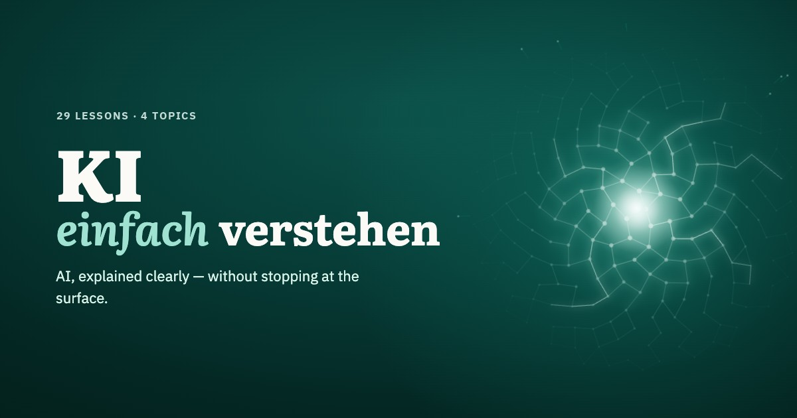

**English** · [Deutsch](README.de.md)

<!-- TODO(demo-gif): swap this banner for a short GIF of a live demo (e.g. the tokenizer) once one is recorded. -->
<p align="center">
  <a href="https://ki-einfach-verstehen.de/en/">
    
  </a>
</p>

# KI einfach verstehen: learn how AI really works

A free course that explains what happens inside modern AI models, from the
first spam filter to the language model behind a chatbot. Short lessons
build on each other, with diagrams, animations and interactive demos you can
play with. No technical background needed, but nothing is glossed over either.

- **Step by step:** lessons in a fixed order, each one using only what came before.
- **Bilingual:** every lesson in German and English.
- **Check yourself:** a few recall questions at the end of each lesson, no
  sign-up, progress stays in your browser.
- **Open:** content under CC BY 4.0, code under MIT. Use the graphics in your
  slides, lessons and articles.

**Start reading:** [ki-einfach-verstehen.de/en](https://ki-einfach-verstehen.de/en/)
or browse the Markdown lessons right here in the repo.

> ⭐ **Star this repo as a bookmark.** New lessons land here, so you'll find
> your way back when the next one is out.

## Contents

<!-- The list below is generated by `pnpm gen:lessons` (scripts/export-lessons.mjs). Edit the content collections, not this list. -->
<!-- lessons-toc:start -->
### 1. [Foundations](https://ki-einfach-verstehen.de/en/topic/foundations/)

The concepts everything else builds on: what separates a program from a model, and what's behind probabilities, vectors, hardware and neural networks.

1. **Program, Algorithm, Model Compared**  
   How do program, algorithm and model differ? Classic software follows rules a person writes down. An AI model consists of a fixed calculation and numbers set during training.  
   [Website](https://ki-einfach-verstehen.de/en/lessons/program-algorithm-model/) · [Markdown](lessons/en/program-algorithm-model.md)
2. **Input and Output: What a Model Does with an Input**  
   What goes into an AI model, and what comes out? From spam filters to chatbots, the output is often a list of scores.  
   [Website](https://ki-einfach-verstehen.de/en/lessons/input-and-output/) · [Markdown](lessons/en/input-and-output.md)
3. **Tokenizers: How Text Breaks into Tokens**  
   Shows how a tokenizer splits text into pieces that it learned earlier by counting, and why the number of tokens is not the number of words.  
   [Website](https://ki-einfach-verstehen.de/en/lessons/tokenizer-ids-vocabulary/) · [Markdown](lessons/en/tokenizer-ids-vocabulary.md)
4. **Token IDs: What a Number Means**  
   Shows what a token ID is: a number that only has meaning within its tokenizer’s vocabulary. It also explains why each model must use the tokenizer it was trained with, and why the number itself reveals nothing about the piece.  
   [Website](https://ki-einfach-verstehen.de/en/lessons/token-ids-and-vocabulary/) · [Markdown](lessons/en/token-ids-and-vocabulary.md)
5. **Scalar, Vector, Matrix, Tensor: the Building Blocks of Numbers**  
   From the weather app to the chatbot: how number, list, table and stack of tables relate, and why your chat is exactly such a block of numbers for a model.  
   [Website](https://ki-einfach-verstehen.de/en/lessons/scalar-vector-matrix-tensor/) · [Markdown](lessons/en/scalar-vector-matrix-tensor.md)
6. **Probability and Softmax: How a Model Decides**  
   How a language model turns its scores into shares, why it sometimes picks the obvious choice and sometimes something else, and how temperature changes that.  
   [Website](https://ki-einfach-verstehen.de/en/lessons/probability-and-softmax/) · [Markdown](lessons/en/probability-and-softmax.md)
7. **Parameters, Training and Use: How a Model Learns**  
   What is inside a model file, what people decide before training, how training uses the error to find each fader’s direction and why learning costs more than using.  
   [Website](https://ki-einfach-verstehen.de/en/lessons/parameters-training-inference-hardware/) · [Markdown](lessons/en/parameters-training-inference-hardware.md)
8. **Model Size and Hardware: Where a Model Fits**  
   How much memory an AI model needs, why space, not speed, is the first limit, how quantization shrinks models and why training needs far more memory still.  
   [Website](https://ki-einfach-verstehen.de/en/lessons/model-size-and-hardware/) · [Markdown](lessons/en/model-size-and-hardware.md)
9. **The Artificial Neuron: How a Sum Becomes an Output**  
   What an artificial neuron calculates: weights, bias and a lower limit. Follow the spam-filter example from the first lesson and work through every step by hand.  
   [Website](https://ki-einfach-verstehen.de/en/lessons/artificial-neuron/) · [Markdown](lessons/en/artificial-neuron.md)

### 2. [Inside the Model](https://ki-einfach-verstehen.de/en/topic/inside-the-model/)

A prompt goes in, a token comes out — you follow everything that happens in between, step by step.

1. **What an AI Model Actually Is**  
   What is an AI model? Not a database of facts, but billions of numbers in which knowledge is spread out. That is where answers and made-up facts come from.  
   [Website](https://ki-einfach-verstehen.de/en/lessons/what-an-ai-model-actually-is/) · [Markdown](lessons/en/what-an-ai-model-actually-is.md)
2. **Layers: How Many Neurons Become a Network**  
   Many neurons calculate using the same numbers, and their outputs become the inputs of the next layer. Why the lower limit makes a peak possible that two layers without it cannot form, and what a figure like “96 layers” means.  
   [Website](https://ki-einfach-verstehen.de/en/lessons/layers/) · [Markdown](lessons/en/layers.md)
3. **Tokenization Inside the Model: How Your Chat Becomes a Token Sequence**  
   How a chat with roles becomes a single token sequence, what special tokens are for, and everything that has to fit into the context window.  
   [Website](https://ki-einfach-verstehen.de/en/lessons/tokenization-inside-the-model/) · [Markdown](lessons/en/tokenization-inside-the-model.md)
4. **Embeddings: How a Number Becomes a Learned Vector**  
   Why a token ID tells the model nothing about similarity, how training turns random numbers into similar profiles for tokens used in similar ways, and what a large vocabulary costs.  
   [Website](https://ki-einfach-verstehen.de/en/lessons/embeddings/) · [Markdown](lessons/en/embeddings.md)
5. **Transformer Blocks and Attention: How Context Gets Mixed In**  
   How a language model mixes the information of earlier words into each token, why it may not look ahead while doing so, and how many such blocks work in a row.  
   [Website](https://ki-einfach-verstehen.de/en/lessons/transformer-blocks-and-attention/) · [Markdown](lessons/en/transformer-blocks-and-attention.md)
6. **Output Head: From the Last State to a Prediction**  
   How a language model computes a score for every token from its last state and why only the last position counts.  
   [Website](https://ki-einfach-verstehen.de/en/lessons/output-head/) · [Markdown](lessons/en/output-head.md)

### 3. [How Learning Works](https://ki-einfach-verstehen.de/en/topic/how-learning-works/)

How does an AI learn? It measures its error, traces improvements backwards through its computation and changes its weights step by step.

1. **Text Becomes Many Practice Problems**  
   Why nobody writes down answers to train a language model, how many texts become sequences of a fixed length, and which text gets in at all.  
   [Website](https://ki-einfach-verstehen.de/en/lessons/text-becomes-many-practice-problems/) · [Markdown](lessons/en/text-becomes-many-practice-problems.md)
2. **Forward Pass and Loss: How the Model Measures Its Own Error**  
   How a language model’s percentages for the token that actually follows turn into penalty points, how a whole stack of text becomes one single number, and what that number does not measure.  
   [Website](https://ki-einfach-verstehen.de/en/lessons/forward-pass-and-loss/) · [Markdown](lessons/en/forward-pass-and-loss.md)
3. **Backpropagation and Gradients: How the Model Knows What to Change**  
   How training turns a single error number into a direction and a strength for every fader, why one pass backwards through the model is enough, and why no fader moves along the way.  
   [Website](https://ki-einfach-verstehen.de/en/lessons/backpropagation-and-gradients/) · [Markdown](lessons/en/backpropagation-and-gradients.md)
4. **Optimization: What Actually Changes the Weights**  
   How the optimizer turns the notes from backpropagation into real steps: with momentum, with a step size of its own for every fader, with a gentle pull toward zero and on a schedule for the learning rate.  
   [Website](https://ki-einfach-verstehen.de/en/lessons/optimization-of-the-weights/) · [Markdown](lessons/en/optimization-of-the-weights.md)
5. **Batch, Epoch, Step, Token Budget: How Training Progress Is Measured**  
   How a training run is counted in steps and tokens, why a language model like GPT-3 sees some sources not even halfway and others several times, how a held-out text tells real learning apart, and how much text goes with how many faders.  
   [Website](https://ki-einfach-verstehen.de/en/lessons/batch-epoch-step-token-budget/) · [Markdown](lessons/en/batch-epoch-step-token-budget.md)

### 4. [From Model to Assistant](https://ki-einfach-verstehen.de/en/topic/from-model-to-assistant/)

What turns a language model into a chat assistant — why it can be convincingly wrong, what it really knows in a conversation, and how you check its answers.

1. **Why Prediction Is More Than Parroting**  
   How a model that only predicts the next token can write an email that never existed before: why good prediction requires rules rather than copies, where verbatim memorization still happens and where new tasks fail.  
   [Website](https://ki-einfach-verstehen.de/en/lessons/why-prediction-is-more-than-parroting/) · [Markdown](lessons/en/why-prediction-is-more-than-parroting.md)
2. **From Text Predictor to Assistant: What Post-Training Makes of a Model**  
   Why a base model continues questions instead of answering them, what post-training changes, and where a chatbot gets its date and its instructions.  
   [Website](https://ki-einfach-verstehen.de/en/lessons/from-text-predictor-to-assistant/) · [Markdown](lessons/en/from-text-predictor-to-assistant.md)
3. **How a Model "Thinks": Intermediate Steps It Writes Itself**  
   Why a model writes intermediate steps as text before its answer, why that makes some tasks solvable, and who decides whether and how long it thinks.  
   [Website](https://ki-einfach-verstehen.de/en/lessons/how-a-model-thinks/) · [Markdown](lessons/en/how-a-model-thinks.md)
4. **Why AI Is Convincingly Wrong: When Guessing Pays Off and a Confident Tone Proves Nothing**  
   Why a chatbot would rather give a wrong answer than "I don't know", why follow-up questions often talk it out of a right answer, and why invented sources look real.  
   [Website](https://ki-einfach-verstehen.de/en/lessons/why-ai-is-convincingly-wrong/) · [Markdown](lessons/en/why-ai-is-convincingly-wrong.md)
5. **What a Chatbot Knows in a Conversation: Four Sources, One Context Window**  
   Where an answer in a chat can come from: from the weights set by training, from the text in the context window, from tools and from saved memories, and what that means for how far you can rely on it.  
   [Website](https://ki-einfach-verstehen.de/en/lessons/what-a-chatbot-knows-in-a-conversation/) · [Markdown](lessons/en/what-a-chatbot-knows-in-a-conversation.md)
6. **From Chatbot to Agent: How AI Works through a Task**  
   A model only writes text and runs nothing itself. How it becomes an agent that uses tools in a loop, who does what in that loop, and why the end of a run says nothing about the result.  
   [Website](https://ki-einfach-verstehen.de/en/lessons/from-chatbot-to-agent/) · [Markdown](lessons/en/from-chatbot-to-agent.md)
7. **Does AI Understand What It Says?**  
   Experts disagree on whether language models understand. What the findings show, what they do not show, and why a fluent answer proves neither side.  
   [Website](https://ki-einfach-verstehen.de/en/lessons/does-ai-understand-what-it-says/) · [Markdown](lessons/en/does-ai-understand-what-it-says.md)
8. **Training Data: Copyright and Privacy**  
   Which texts may be used for training, how a rights reservation works, why copying raises the first legal question, and what may remain in the model. As of 12 Oct 2026; not legal advice.  
   [Website](https://ki-einfach-verstehen.de/en/lessons/training-data-copyright-and-privacy/) · [Markdown](lessons/en/training-data-copyright-and-privacy.md)
9. **Checking Answers: Using AI Safely in Everyday Life**  
   When a chatbot answer has to be checked, why asking the same bot again is not enough, and which checking step fits which kind of error.  
   [Website](https://ki-einfach-verstehen.de/en/lessons/checking-answers/) · [Markdown](lessons/en/checking-answers.md)

Every technical term in a sentence or two: **[Glossary](https://ki-einfach-verstehen.de/en/glossary/)**
<!-- lessons-toc:end -->

Each lesson exists twice: the **website** version with the interactive demos,
animations and recall questions, and a **Markdown** version in
[`lessons/`](lessons/) that reads well on GitHub, offline or in your own notes.

## Contributing

Found a mistake, an unclear passage or a missing source? That's the most
valuable help there is. Please read [CONTRIBUTING.md](CONTRIBUTING.md):
it starts with an issue, not a pull request, because this repository is a
generated mirror. Questions about the content are best asked in the
[community forum](https://community.ki-einfach-verstehen.de).

## License

- **Content** (lesson texts, glossary, graphics, illustrations, animations,
  `lessons/`): [CC BY 4.0](LICENSE-CONTENT.md). Credit it as
  `KI einfach verstehen, <title>, CC BY 4.0, <URL>`.
- **Code** (components, scripts, styles): [MIT](LICENSE).

Fonts, the logo and the merch designs are excluded, see
[LICENSE-CONTENT.md](LICENSE-CONTENT.md). Vendored third-party code keeps
its own licence: `src/vendor/qrcodegen.js` is the
[QR Code generator](https://www.nayuki.io/page/qr-code-generator-library)
by Project Nayuki (MIT, notice in the file).

## About this repository

This is the source of the website, built with [Astro](https://astro.build).
It is mirrored from a private project repository that also holds the
e-book and video scripts; only the website is open source.

```sh
pnpm install
pnpm dev          # http://localhost:4321
pnpm build        # static site in dist/
pnpm lint         # content checks and tests
pnpm gen:lessons  # regenerate lessons/ and the contents above
```

Requires Node.js 22.12 or newer and pnpm.
