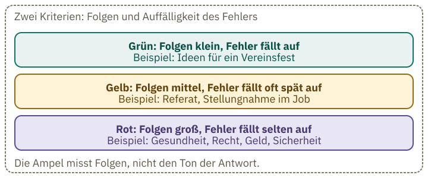
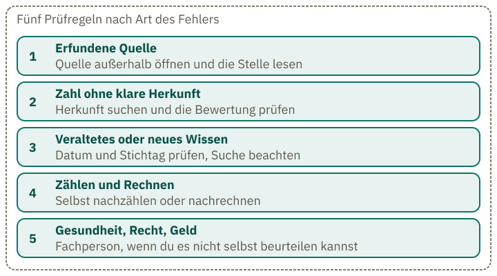
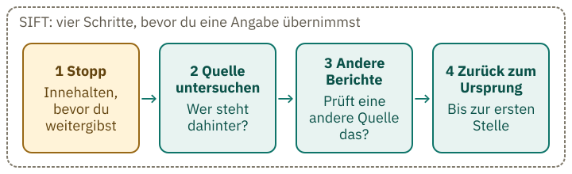

<!-- Generated from src/content/bausteine/de/antworten-pruefen.mdx by scripts/export-lessons.mjs -- do not edit by hand. -->

# Antworten prüfen: KI im Alltag sicher nutzen

> Lesefassung für GitHub. Die vollständige Fassung mit interaktiven Demos, Animationen und Abrufmoment findest du auf der Website: **[Antworten prüfen: KI im Alltag sicher nutzen](https://ki-einfach-verstehen.de/de/bausteine/antworten-pruefen/)**
>
> Lizenz: [CC BY 4.0](https://creativecommons.org/licenses/by/4.0/deed.de) · Nenne die Quelle so: KI einfach verstehen, „Antworten prüfen: KI im Alltag sicher nutzen“, CC BY 4.0, https://ki-einfach-verstehen.de/de/bausteine/antworten-pruefen/

Wann eine Chatbot-Antwort geprüft werden muss, warum eine Nachfrage beim selben Bot dafür nicht reicht und welcher Prüfschritt zu welchem Fehler passt.

Ein Chatbot antwortet dir flüssig, mit Namen, Jahreszahlen und Quellenangaben. Bevor du die Antwort übernimmst, stell dir diese Situation vor: Du fragst den Bot, ob seine Quelle stimmt, und er sagt: „Ja, die Quelle ist echt.“ Hast du die Quelle damit geprüft? Denk kurz nach, bevor du weiterliest.

Den Fall aus New York kennst du aus dem Baustein über [das KI-Modell](./was-ein-ki-modell-eigentlich-ist.md): Ein Schriftsatz zitierte sechs erfundene Gerichtsentscheidungen. Dort ging es darum, wie so etwas entsteht. Hier geht es darum, was du dagegen tust.

## Beim selben Bot nachzufragen ist keine unabhängige Prüfung

Deine Frage „Stimmt das?“ und der bisherige Text mit der Quelle gehen in das Modell hinein. Das Modell setzt den Text fort, und heraus kommt ein „Ja“, das zu dem passt, was schon dasteht. Ohne Websuche prüft der Bot dabei nicht, ob die Quelle existiert und die Aussage stützt. Das „Ja“ ist dann keine zweite, unabhängige Information.

Eine überzeugende Form macht eine Angabe noch nicht wahr. Auch eine erfundene Quellenangabe kann einen Titel oder ein Aktenzeichen nennen und glaubwürdig klingen. Dasselbe gilt für die Bestätigung. Dazu kommt [Gefälligkeit](https://ki-einfach-verstehen.de/de/glossar/gefaelligkeit/): Ein Bot kann einem Zweifel nachgeben, auch wenn seine erste Antwort richtig war. Das wird wahrscheinlicher, sobald der Zweifel von dir kommt.

Das BSI beschreibt, warum erfundene Angaben so überzeugend wirken: [Halluzinationen](https://ki-einfach-verstehen.de/de/glossar/halluzination/) erscheinen zumeist glaubhaft, insbesondere wenn auf wissenschaftliche Publikationen oder andere Referenzen verwiesen wird, die selbst frei erfunden sein können.

*Auf dem Tisch liegt ein Zettel mit einer Notiz. Im Regal steht eine geschlossene Akte mit einem Fragezeichen auf dem Rücken. Der Zettel auf dem Tisch nennt die Akte im Regal, ohne sie zu zeigen.*

Stell dir einen Zettel auf dem Tisch vor. Der Bot hat ihn geschrieben und darauf eine Akte genannt. Ob es diese Akte gibt, verrät der Zettel nicht. Dafür musst du im Regal nachsehen, in dem sie liegen müsste. Das gilt auch für Titel und Zahlen: Eine Angabe mit Jahr, Zeitschrift und Band sieht nach einer Fundstelle aus, bevor jemand sie gesucht hat. Die Akte zu finden ist deshalb der eigentliche Prüfschritt. Eine Nachfrage beim Bot ist dagegen nur ein weiterer Zettel vom Tisch.

## Wann prüfen? Die Risiko-Ampel

Zwei Kriterien entscheiden über die Prüfung: Was kostet ein Fehler, wenn er durchrutscht, und fällt er dir selbst auf?

**Grün:** Die Folgen sind klein, und der Fehler fällt sofort auf. Ein Beispiel sind Ideen für ein Vereinsfest. Bei Grün reicht es, die Antwort selbst gegenzulesen. **Gelb:** Die Folgen sind mittel. Die Antwort fließt in eine Arbeit oder Entscheidung, etwa ein Referat oder eine Stellungnahme im Job, und ein Fehler fällt oft erst später auf. **Rot:** Die Folgen sind groß, und der Fehler fällt selten auf. Typische Fälle sind Gesundheit, Recht, Geld und Sicherheit.

Für die Ampel zählt nicht, wie sicher der Bot klingt. Eine Antwort zur Dosierung kann genauso überzeugend klingen wie eine mit Ideen für ein Vereinsfest.

Das BSI empfiehlt etwas Ähnliches: Wenn Antworten generativer KI-Modelle kritische Folgen haben könnten, sollten sie überprüft und bei Bedarf mit Informationen aus weiteren Quellen abgeglichen werden (Maßnahme M20, Stand 17. Januar 2025). Die Dreistufung ist ein Vorschlag dieses Bausteins und keine Vorgabe des BSI. Was in deinem Fall kritisch ist, entscheidest du mit den beiden Kriterien.

*Die Ampel nach zwei Kriterien: Folgen und Auffälligkeit des Fehlers. Die Beispiele sind Stichworte, keine vollständige Liste.*

## Fünf Prüfregeln, nach Art des Fehlers geordnet

Jede Regel gehört zu einer Art Fehler. Wer die Art erkennt, weiß, welcher Schritt passt.

*Fünf Prüfregeln, jede einer Art Fehler zugeordnet: erfundene Quelle, Zahl ohne Herkunft, veraltetes Wissen, Zählen und Rechnen, Gesundheit, Recht und Geld.*

**1. Erfundene Quelle.** Manchmal ist eine Quelle erfunden. Manchmal gibt es sie, aber sie stützt die Aussage nicht. Öffne die Quelle außerhalb des Chats und lies die Stelle, auf die sich die Behauptung bezieht. Wie oben erklärt, reicht eine Nachfrage beim Bot dafür nicht. Viele Chat-Apps zeigen Links zu Quellen an; ob deine App das tut, siehst du dort. Der Text des Bots über eine Seite ist wieder nur ein Text. Prüfe die Seite selbst.

**2. Zahl ohne klare Herkunft.** Eine Zahl braucht ihre Herkunft. Ein [Benchmark](https://ki-einfach-verstehen.de/de/glossar/benchmark/) ist ein standardisierter Test zum Vergleich von Modellen. Such dafür im Bericht oder in der Quelle nach, wie der Test bewertet wurde und ob die Aufgaben im Trainingsmaterial vorkamen. Findest du die Angabe nicht, behandle das Ergebnis als unbelegt.

Ein Beispiel: Der Bericht zum deutschen Modell Kolibri von Aleph Alpha (Oktober 2026) misst in Tabelle 44 keine Punktzahl, sondern eine Überschneidung: Wie viele Testfragen hatten mindestens ein passendes Dokument im Trainingsmaterial?

Bei GSM8K, einem Test mit Textaufgaben zum Rechnen, kam bei allen 1.319 Fragen diese Überschneidung vor.

Bei HumanEval, einem Test mit Programmieraufgaben, kam sie bei 163 von 164 Aufgaben vor.

Der Bericht prüfte den Pool für das Mittel-Training, eine Trainingsphase nach dem Vortraining, auf Testtexte, bevor er Dokumente mit solchen Stellen daraus entfernte. Dabei fand er Aufgaben aus beiden Tests im Trainingsmaterial. Den großen Vortrainingspool ließ er unbereinigt. Ein Modell kann Aufgaben, die es im Training gesehen hat, leichter lösen; dann fällt sein Testergebnis zu gut aus, und man weiß nicht, um wie viel.

**3. Veraltetes oder neues Wissen.** Ohne Suche kennt ein Modell nur Texte bis zu seinem [Wissensstichtag](https://ki-einfach-verstehen.de/de/glossar/wissensstichtag/). Was danach geschah, fehlt oder wird geraten. Prüfe das Datum der Angabe und ob deine App eine Suche angezeigt hat.

**4. Zählen und Rechnen.** Ein Modell verarbeitet [Tokens](https://ki-einfach-verstehen.de/de/glossar/token/), also Textstücke, die oft Wortteile sind, nicht einzelne Buchstaben. Eine Studie von 2024 fand, dass viele Modelle die Buchstaben im Wort „strawberry“ erkennen, aber nicht zuverlässig zählen. Die Studie beschreibt dieses Verhalten, belegt aber nicht, dass Tokens die Ursache sind. Die Erkundung zur [Erdbeere](https://ki-einfach-verstehen.de/de/entdecken/strawberry/) zeigt den Fall an einem Beispiel. Zähle oder rechne selbst nach.

**5. Gesundheit, Recht, Geld.** Eine erfundene Quelle prüfst du außerhalb des Chats (Regel 1). Eine Angabe, die du selbst nicht beurteilen kannst, etwa eine Dosierung, legst du einer Fachperson vor. Die Ampel sagt nur, wie viel Prüfung nötig ist.

## Probier es aus

> **Interaktive Demo:** [auf der Website ausprobieren](https://ki-einfach-verstehen.de/de/bausteine/antworten-pruefen/)

## Eine Randnotiz zum Datenschutz

Was du in einen Chat schreibst, ändert das Modell während des Gesprächs nicht. Ob es in ein späteres Training fließt, regeln die Nutzungsbedingungen des Anbieters und des jeweiligen Tarifs, oft ergänzt durch eine Einstellung im Konto. Jeder Anbieter hat eigene Regeln. Anthropic schreibt in einer Ankündigung vom 28. August 2025, dass bei den Tarifen Free, Pro und Max Nutzerinnen und Nutzer wählen können, ob ihre Daten zur Verbesserung von Claude verwendet werden. Bei Zustimmung nennt Anthropic eine Aufbewahrungsfrist von fünf Jahren; ohne Zustimmung bleibt es bei 30 Tagen. Für Team, Enterprise und die API gelten andere Vertragsbedingungen. Welche Einstellung standardmäßig gewählt ist, nennt die Ankündigung nicht. Schau in den Datenschutz-Einstellungen deiner App nach, ob deine Eingaben für das Training genutzt werden und wie lange sie gespeichert bleiben.

Auch [gespeicherte Notizen](https://ki-einfach-verstehen.de/de/glossar/gespeicherte-notiz/) aus früheren Gesprächen beeinflussen die Antwort. Der Baustein über [Trainingsdaten und Datenschutz](./trainingsdaten-urheberrecht-und-datenschutz.md) geht darauf genauer ein.

## Seitwärtslesen wie Faktenchecker

Regel 1 verlangt, die Quelle außerhalb des Chats zu öffnen. Warum das nötig ist, zeigt eine Messung von 2023: Von den Literaturangaben, die GPT-3.5 lieferte, waren 55 Prozent erfunden, bei GPT-4 waren es 18 Prozent. Beides sind Modelle von OpenAI, dem Hersteller von ChatGPT. Neuere Modelle wurden in dieser Untersuchung nicht getestet. Wie du Quellen prüfst, zeigt das Vorgehen von Faktencheckern.

Faktenchecker gehen anders vor als die meisten Leser. Sie lesen nicht die erste Seite gründlich zu Ende, sondern verlassen sie nach einem schnellen Blick und öffnen neue Tabs. Forschende nennen das [seitwärts lesen](https://ki-einfach-verstehen.de/de/glossar/seitwaertslesen/). In einer Studie von Wineburg und McGrew (2019) verglichen die Forschenden Faktenchecker, Historiker mit Promotion und Studierende. Die Faktenchecker kamen in einem Bruchteil der Zeit zu besser begründeten Schlüssen; die Studierenden lasen eine Seite von oben nach unten und blieben auf ihr. Ob Laien das in kurzer Zeit lernen, zeigt die Studie nicht.

Die Ampel hilft dir einzuschätzen, wie gründlich du prüfen solltest. Die Regeln zeigen, welcher Prüfschritt passt. Für jede Quelle kannst du außerdem dieselben vier Schritte nutzen, unabhängig vom vermuteten Fehler. Der Forscher Mike Caulfield nennt sie SIFT.

*Die vier Schritte SIFT: Stopp, Quelle untersuchen, andere Berichte finden, Behauptung bis zum Ursprung zurückverfolgen.*

1. **Stopp:** Halte inne, bevor du die Antwort weitergibst.
2. **Quelle untersuchen:** Wer steht dahinter, und welche Art von Quelle ist das?
3. **Andere Berichte finden:** Prüft eine andere Quelle dieselbe Behauptung?
4. **Zurück zum Ursprung:** Verfolge eine Behauptung, ein Zitat oder ein Bild bis zu der Quelle zurück, in der es ursprünglich veröffentlicht wurde.

## Fälle durchspielen

*Eine Lupe liegt auf einem aufgeschlagenen Buch. Sie erinnert daran, direkt in der Quelle nachzulesen: Prüfe die Stelle im Buch, auf die sich der Bot bezieht.*

Geh bei jedem Fall in drei Schritten vor: Wähle zuerst die passende Ampelfarbe. Überlege dann, welcher Prüfschritt zum wahrscheinlichsten Fehler passt. Lies erst danach die Auflösung unter dem Fall. Beim Fall mit dem D im Wort DEEPSEEK gibt es keine Quelle außerhalb des Chats; dort zählst du selbst nach. Schreib vor dem Lesen der Auflösung in einem Satz auf, wie du prüfen würdest: eine Quelle außerhalb des Chats öffnen, das Datum prüfen, eine Fachperson fragen oder selbst nachrechnen. Passt der Schritt zum wahrscheinlichsten Fehler, hast du richtig gewählt.

Zuerst ein Fall, Schritt für Schritt. Der Gesprächsauszug ist ausgedacht.

**Übung: Eine Zeitschrift, die es nicht gibt**

Du fragst einen Chatbot nach Schlafstudien und bekommst diese Antwort. Gesprächsauszug, ausgedacht:

> „Laut Huber (2019) im Journal of Imaginary Sleep Studies, Band 4, schlafen Erwachsene mit weniger als sechs Stunden Schlaf im Schnitt 23 Prozent schlechter bei Konzentrationsaufgaben.“

Ordne den Fall ein und prüfe ihn. In welcher Reihenfolge gehst du vor?

**Auflösung:**

Die Angabe betrifft die Gesundheit. Eine falsche Zahl dazu fällt beim Lesen nicht auf, und die Folgen wären groß. Also ist sie rot. Eine Nachfrage beim Bot hilft nicht: Die Antwort käme wieder aus demselben Text. Du suchst den Titel der Zeitschrift und die Studie außerhalb des Chats, etwa in einem Bibliothekskatalog oder auf der Seite des Verlags. Findest du dort nichts, behandelst du die Zahl als unbelegt. Der Fall ist erfunden, die Zeitschrift gibt es nicht. Im Alltag wüsstest du das erst nach der Suche.

Drei weitere Fälle. Alle drei sind ausgedacht und nach typischen Mustern gebaut.

**Übung: Drei Fälle, drei Prüfschritte**

a) Ein Chatbot nennt für dein Referat „64 Prozent der Befragten“ zu einem Thema und sagt, die Zahl stamme aus einer Umfrage. Welche Einordnung passt, und welcher Schritt prüft die Zahl?

b) Ein Chatbot ohne Websuche nennt den Sieger eines Finales, das nach seinem Stichtag stattfand, und sagt, das stehe in aktuellen Meldungen. Was prüfst du?

c) Du fragst: „Welche Zahl ist größer, 9,11 oder 9,9?“ Der Bot antwortet zuerst „9,11“. Nach „Bist du sicher?“ antwortet er „9,9“. Du brauchst die Zahl nur für dich selbst. Was zeigt dir das, und was tust du?

**Auflösung:**

a) Gelb, weil die Zahl in ein Referat fließt. Öffne die Quelle und prüfe, welche Umfrage gemeint ist, wer in welchem Jahr befragt hat und wie viele Personen teilnahmen.

b) Gelb, weil die Angabe in eine Arbeit fließt und ein falsches Ergebnis oft erst spät auffällt. Ohne Suche kennt der Bot das Ergebnis nicht aus seinen Trainingstexten. Die Angabe „aktuelle Meldungen“ prüfst du selbst: In einer aktuellen Nachrichtenquelle findest du Datum und Ergebnis. Eine Suche, die man in der App nicht sieht, war vermutlich nicht aktiv.

c) Grün, weil die Folgen klein sind und der Fehler beim Nachrechnen sofort auffällt. Rechne selbst nach: 9,9 ist 9,90 und damit größer als 9,11. Dass der Bot nach der Nachfrage eine andere Antwort gibt, beweist nichts. Die Nachfrage hat die Antwort geändert, nicht geprüft. Die richtige Zahl steht fest, weil du sie nachgerechnet hast.

Der letzte Fall lässt sich nur durch Zählen prüfen. Die Zählprobe stammt aus einer Untersuchung zu DeepSeek-V3 (2025). Die Antwort 3 in diesem Fall ist ausgedacht.

**Übung: Buchstaben zählen lassen**

Ein Chatbot soll die Anzahl der D im Wort DEEPSEEK nennen. Er antwortet: 3. Du zählst selbst nach. Welche Antwort ist richtig, und was hilft bei dieser Art Frage nicht?

**Auflösung:**

Richtig ist 1. DeepSeek-V3 nannte in zehn unabhängigen Versuchen 2 oder 3. Eine Nachfrage hilft nicht, weil die Antwort aus demselben Text entsteht und nicht aus dem Zählen. Zähle selbst nach, bevor du die Zahl übernimmst.

## Was am Ende bleibt

Der Schriftsatz aus New York hätte eine Prüfung außerhalb des Chats gebraucht. Die Akten hätte man nachschlagen können, bevor sie bei Gericht landeten. Die Ampel sagt, wie viel Prüfung nötig ist. Die Regeln sagen, welche Prüfung zum Fehler passt. Bei Rot prüfst du den Fehler, der droht: eine Quelle außerhalb des Chats oder eine Fachperson.

Teste zum Schluss, was du dir gemerkt hast: Nenne zwei Gründe, warum die Frage „Bist du sicher?“ keine Prüfung ist.

---

Quelle: https://ki-einfach-verstehen.de/de/bausteine/antworten-pruefen/

← Zurück: [Trainingsdaten: Urheberrecht und Datenschutz](./trainingsdaten-urheberrecht-und-datenschutz.md) · [Alle Bausteine](../../README.de.md#inhalt)
