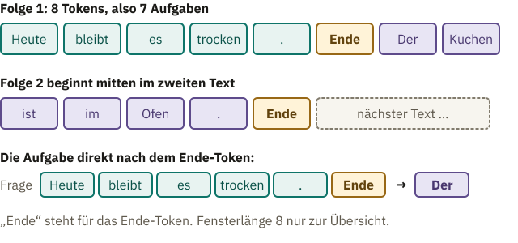
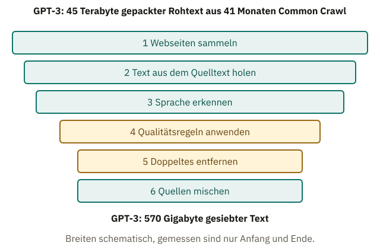
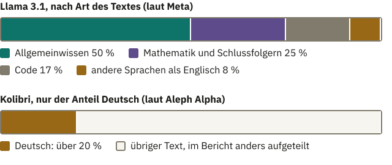

<!-- Generated from src/content/bausteine/de/aus-text-werden-uebungsaufgaben.mdx by scripts/export-lessons.mjs -- do not edit by hand. -->

# Aus Text werden viele Übungsaufgaben

> Lesefassung für GitHub. Die vollständige Fassung mit interaktiven Demos, Animationen und Abrufmoment findest du auf der Website: **[Aus Text werden viele Übungsaufgaben](https://ki-einfach-verstehen.de/de/bausteine/aus-text-werden-uebungsaufgaben/)**
>
> Lizenz: [CC BY 4.0](https://creativecommons.org/licenses/by/4.0/deed.de) · Nenne die Quelle so: KI einfach verstehen, „Aus Text werden viele Übungsaufgaben“, CC BY 4.0, https://ki-einfach-verstehen.de/de/bausteine/aus-text-werden-uebungsaufgaben/

Warum für das Training eines Sprachmodells niemand Lösungen aufschreibt, wie aus vielen Texten Folgen fester Länge werden und welcher Text überhaupt hineinkommt.

Am Ende des Wegs durchs Modell stand ein Satz über das Training: An jeder Position sagt das Modell das nächste [Token](https://ki-einfach-verstehen.de/de/glossar/token/) voraus, und das wird mit dem echten verglichen. Für Llama 3.1, ein frei verfügbares Sprachmodell der Firma Meta, nennt Meta rund 15 Billionen Textstücke, also Tokens, mit denen es trainiert wurde. Fast jedes davon ist eine kleine Übungsaufgabe: Hier ist der Text bis zu dieser Stelle, was kommt als Nächstes?

Zu einer Aufgabe gehört eine Lösung, sonst gibt es nichts zu vergleichen. Wie viele Menschen haben die Lösungen für diese Billionen Aufgaben aufgeschrieben? Die Antwort steckt in einer einfachen Leseübung mit einer Karte.

## Die Lösung steht schon im Text

Leg eine Karte so auf eine Zeile in einem Buch, dass nur der Anfang frei bleibt, etwa die ersten drei Wörter. Rate das nächste Wort, schieb die Karte ein Wort weiter und sieh nach, ob du richtig lagst. Dann das übernächste. Die Lösung musste niemand eigens aufschreiben. Sie stand schon da, nur verdeckt.

*Die Abdeckkarte: Der Anfang der Zeile ist frei. Das Wort direkt unter dem Rand der Karte ist die Lösung dieser einen Aufgabe, und niemand musste sie eigens schreiben.*

Das Schieben ist nur eine Leseübung, und hier endet das Bild: Du rätst nacheinander, Wort für Wort, und siehst erst danach nach. Das Modell schiebt keine Karte. Es rechnet alle Aufgaben eines Textes in einem einzigen Durchlauf. Im Baustein über den Output Head lieferte „Der Hund jagt die Katze“ so vier Vorhersagen auf einmal. Jede Position sah dabei nur, was vor ihr steht, dafür sorgte die Causal Mask. So schreibt keine Position die Lösung ab, obwohl sie in derselben Folge steht.

So entstehen die Übungsaufgaben eines Sprachmodells. Aus dem Baustein über Input und Output kennst du den Satz „Die Katze sitzt auf dem Sofa.“: Jeder Anfang ist ein Input, das Stück, das folgt, sein Label, also die richtige Antwort. Beim Spamfilter aus dem ersten Baustein mussten Menschen jede Mail von Hand markieren. Beim Text erledigt das die Karte. Jede Stelle im Text ergibt eine Aufgabe mit Lösung.

Spiel es an einem ausgedachten Satz durch: „Am Morgen fährt der Bus wieder pünktlich um acht Uhr ab.“ Ein Sprachmodell rechnet nicht mit Wörtern, sondern mit Tokens, den Textstücken, in die sein Tokenizer einen Text zerlegt. Zur Übersicht zählt hier jedes Wort und der Punkt als ein Token. Ein echter Tokenizer zerlegt oft feiner, aber am Prinzip ändert das nichts. So hat der Satz 12 Tokens. Zähl mit:

| Frage: alles bis hierher | Lösung |
|---|---|
| Am | Morgen |
| Am Morgen | fährt |
| Am Morgen fährt | der |
| Am Morgen fährt der | Bus |
| Am Morgen fährt der Bus | wieder |
| Am Morgen fährt der Bus wieder | pünktlich |
| Am Morgen fährt der Bus wieder pünktlich | um |
| Am Morgen fährt der Bus wieder pünktlich um | acht |
| Am Morgen fährt der Bus wieder pünktlich um acht | Uhr |
| Am Morgen fährt der Bus wieder pünktlich um acht Uhr | ab |
| Am Morgen fährt der Bus wieder pünktlich um acht Uhr ab | . |

Es sind 11 Aufgaben, eine für jedes Token, auf das noch eins folgt. Der Punkt am Ende hat in diesem Text keine Lösung mehr. Die Regel gilt für jeden Text: **Er liefert eine Aufgabe weniger, als er Tokens hat.**

Wie viele Aufgaben stecken in einem ganzen Absatz?

Nimm zwei Sätze: „Heute bleibt es trocken. Morgen soll es regnen.“ Zählt jedes Wort und jeder Punkt als ein Token, sind das 10 Tokens und damit 9 Aufgaben. Ein Absatz mit 100 Wörtern liefert auf dieselbe Weise gut 100 Aufgaben, mit einem echten Tokenizer, der feiner zerlegt, noch mehr. Auf diese Weise kommen bei Billionen Tokens Billionen Aufgaben zusammen.

Eine Liste der Lösungen legt das Modell dabei nicht an. Wie beim Spamfilter verändert das Training nur Zahlen: Die Aufgaben stellen die Parameter, die Regler am Pult des Modells, Stück für Stück so nach, dass es die richtige Lösung beim nächsten Mal wahrscheinlicher macht. Wie weit es trotzdem Wortlaut wiedergibt, zeigt der Abschnitt über das Sieben weiter unten.

> **Interaktive Demo:** [auf der Website ausprobieren](https://ki-einfach-verstehen.de/de/bausteine/aus-text-werden-uebungsaufgaben/)

Kein Mensch hat die Lösungen eigens geschrieben. Ein Chatbot wirkt wie jemand, der gelernte Antworten auf Fragen gibt, und für einen späteren Schritt schreiben tatsächlich Menschen Antworten. Für die Billionen Aufgaben davor gilt das nicht: Weil die Lösung im Text selbst steht, wird jeder Text zu Übungsaufgaben. Diese Art zu lernen heißt **[selbstüberwachtes Lernen](https://ki-einfach-verstehen.de/de/glossar/selbstueberwachtes-lernen/)**. Der Text liefert Aufgabe und Lösung zugleich, er überwacht sich gewissermaßen selbst.

Die allermeisten Sprachmodelle hinter Chatbots haben so angefangen. Diese erste Phase ist das Grundtraining, oft auch Vortraining genannt. Ihr Ergebnis kennst du aus dem Baustein über Training als Grundfassung, etwa Llama 3.1 8B. Erst danach kommen Beispiele dazu, die Menschen geschrieben oder bewertet haben, damit aus der Grundfassung ein hilfreicher Chatbot wird.

> **Interaktive Demo:** [auf der Website ausprobieren](https://ki-einfach-verstehen.de/de/bausteine/aus-text-werden-uebungsaufgaben/)

Ein Satz ist allerdings kurz. Echte Texte sind mal drei Wörter lang, mal hundert Seiten, und das Modell übt mit Stücken fester Länge. Wie passt das zusammen?

## Viele Texte, eine feste Länge

Erinnerst du dich an den Güterzug aus dem Baustein über Tokenisierung im Modell? Jedes Token war ein Waggon. [Spezial-Tokens](https://ki-einfach-verstehen.de/de/glossar/spezial-token/), also Marken, die für kein Textstück stehen, sondern etwas markieren, waren andersfarbige Markierungswaggons. Und der Prellbock am Gleisende stand für das [Kontextfenster](https://ki-einfach-verstehen.de/de/glossar/kontextfenster/), die größte Zahl an Tokens, die das Modell auf einmal verarbeiten kann.

Im Training wird diese Länge voll ausgenutzt. Für GPT-3, ein Vorläufer der Modelle hinter ChatGPT, beschreibt das Forschungspapier das genau: Jede Folge, an der es übte, hatte 2048 Tokens, so viele, wie in sein Kontextfenster passen. Die meisten Texte sind kürzer. Also werden sie hintereinandergehängt, wie Waggons zu einem langen Zug. Zwischen zwei Texten steht jedes Mal ein Ende-Token, die Marke, die anzeigt, dass ein Text zu Ende ist. Im Baustein über Input und Output hieß sie Stopp-Zeichen. Neu ist der Schnitt, und hier endet das Bild vom Güterzug: Einen echten Zug zerschneidet niemand. Dieser wird in Stücke von genau 2048 Tokens geschnitten. Jedes Stück heißt **Trainingsfolge**. Gleich lang sind die Stücke, weil das Modell mehrere davon zugleich auf den Grafikchips rechnet. Dafür müssen die Stücke in dieselbe rechteckige Zahlentabelle passen. Kürzere Stücke müsste man sonst mit Füll-Tokens auffüllen, Platzhaltern, die nur Platz halten.

*Zwei ausgedachte Texte, mit Ende-Token aneinandergehängt und in Folgen zu je 8 Tokens geschnitten. Jedes Kästchen ist ein Token. Die erste Folge endet mit „Der Kuchen“, die zweite beginnt mitten im Satz und ist nur angefangen, im Training füllt sie der nächste Text auf. Die kleine Fensterlänge dient nur der Übersicht, GPT-3 schnitt Folgen zu 2048 Tokens.*

> **Interaktive Demo:** [auf der Website ausprobieren](https://ki-einfach-verstehen.de/de/bausteine/aus-text-werden-uebungsaufgaben/)

Ein Beispiel mit zwei ausgedachten Texten zeigt, was dabei entsteht: „Heute bleibt es trocken.“ und „Der Kuchen ist im Ofen.“ Mit einem Ende-Token nach jedem Text sind das 13 Tokens. Angenommen, die Fensterlänge wäre nur 8. Dann enthält die erste Folge den ganzen Wettersatz, sein Ende-Token und „Der Kuchen“. Die zweite beginnt mitten im Kuchensatz mit „ist im Ofen“, ihren Rest füllt der nächste Text. Ein Text kann also über zwei Folgen verteilt sein.

Eine Folge mit 8 Tokens liefert 7 Aufgaben, eine weniger als Tokens, wie beim Bus-Satz. Bei GPT-3 sind es 2047 Aufgaben pro Folge, also rund 2000. Die Fensterlänge selbst lernt das Modell nicht. Sie ist ein [Hyperparameter](https://ki-einfach-verstehen.de/de/glossar/hyperparameter/), eine Entscheidung vor dem Training wie die Zahl der Schichten, also der Transformerblöcke hintereinander.

Rund um das Ende-Token stehen zwei besondere Aufgaben. Bei der ersten lautet die Frage „Heute bleibt es trocken.“, und die Lösung ist das Ende-Token selbst. Daraus lernt das Modell, wann ein Text fertig ist. Was lernt es aus der Aufgabe direkt danach, bei der auf das Ende-Token „Der“ folgt?

Mit dem Wetter hat „Der Kuchen“ nichts zu tun. Nach dem Ende-Token kann jeder beliebige Text beginnen. Aus vielen solchen Aufgaben lernt das Modell, dass nach dieser Marke ein neuer Text beginnt, der mit dem davor nichts zu tun haben muss. Der Wettersatz steht dabei weiter in der Folge, die Marke zeigt nur, dass er nicht dazugehört. Genau dafür setzt das GPT-3-Papier sie zwischen die Texte. Ohne sie würde das Modell üben, zwei fremde Texte als einen fortzusetzen.

Dieselbe Sorte Marke beendet beim Benutzen eine Antwort. Bei GPT-2, dessen Tokenizer du aus dem Baustein über den Tokenizer kennst, ist es sogar genau dasselbe Token, `<|endoftext|>`, das beim Erzeugen eines Textes das Ende anzeigt. Chatmodelle wie Llama 3.1 beenden einen Redebeitrag mit einem eigenen Spezial-Token, `<|eot_id|>`. Dass sie es am Ende einer Antwort setzen sollen, lernen sie erst im Nachtraining an Gesprächen, wie im Baustein über Tokenisierung im Modell.

Jeder Text wird also zu Aufgaben, rund 2000 pro Folge. Dann könnte man doch einfach alles nehmen, was im Web steht?

## Vom Web zum Trainingstext

Den Rohstoff liefert oft Common Crawl, eine Organisation, die regelmäßig Webseiten sammelt und ihr Archiv kostenlos zur Verfügung stellt. Was darin landet, ist bunt gemischt, etwa diese fünf ausgedachten Seiten. Die erste erklärt, wie du ein Fahrrad pflegst. Die zweite ist eine Liste aus Suchbegriffen wie „Fahrrad günstig kaufen“, Zeile für Zeile mit Aufzählungspunkt. Dazu kommen ein Menü mit „Start, Über uns, Kontakt“, dieselbe Anleitung unter einer anderen Adresse und eine Seite auf Englisch. Welche davon würdest du behalten?

*Mehrere Siebe übereinander: Jede Lage steht für eine Regel, jedes Blatt für eine Seite, und was liegen bleibt, fliegt raus. Die echten Siebe sind Programme, deren Regeln Menschen festgelegt haben.*

Die Seiten laufen durch mehrere Stufen, wie durch ein Sieb mit mehreren Lagen. Anders als ein echtes Sieb sortieren diese Stufen nicht nach Größe, sondern nach Regeln, die Menschen gewählt haben. Zuerst wird der Text aus dem Quelltext der Seite geholt, also aus den Anweisungen, aus denen der Browser die Seite zusammensetzt. Dann wird die Sprache erkannt. So landet die englische Seite im englischen Teil. Danach greifen Qualitätsregeln. Für das Sprachmodell Gopher des KI-Unternehmens DeepMind flog etwa jede Seite raus, die weniger als 50 Wörter hatte. Das trifft das Menü. Ebenso fiel jede Seite durch, bei der mehr als 90 Prozent der Zeilen mit einem Aufzählungspunkt beginnen, wie die Suchbegriff-Liste.

Solche Regeln treffen auch Seiten, die gar nicht gemeint sind. Eine Gopher-Regel, die die mittlere Wortlänge einer Seite, also die durchschnittliche Länge ihrer Wörter, auf 3 bis 10 Zeichen begrenzt, würde laut einem Bericht der Firma Aleph Alpha deutsche Verwaltungstexte mit langen Wörtern wie „Zuständigkeitsbereich“ überproportional aussortieren. Deshalb übernimmt Aleph Alpha für ihr Modell Kolibri die deutschen Einstellungen des Datensatzes FineWeb2: Dort darf die mittlere Wortlänge bis 15 Zeichen betragen statt bis 10.

Dann wird Doppeltes entfernt, Fachwort **Deduplizierung**. Dieselbe Seite steht im Web oft mehrfach, als Kopie oder unter neuer Adresse. Programme behalten von gleichen oder fast gleichen Seiten nur eine. Sonst übte das Modell dieselbe Seite immer wieder, und was sehr oft im Text steht, kann ein Modell teils wörtlich wiedergeben. Außerdem halten die Entwickler einen Teil des Texts zurück, um später zu prüfen, wie gut das Modell bei nie geübtem Text abschneidet. Stünde dieselbe Seite in beiden Teilen, prüfte dieser Test nicht mehr sauber; das GPT-3-Papier nennt beide Gründe.

Von den fünf Seiten bleibt für den deutschen Teil also eine übrig: die Anleitung, einmal.

Warum entfernt man doppelte Seiten, wenn es doch mehr Übung wäre?

Eine Kopie bringt nichts Neues bei. Jede Wiederholung stellt die Zahlen nur weiter in dieselbe Richtung, bis genau diese Fortsetzung jedes Mal vorn liegt. Als Satz abgelegt ist der Text auch dann nicht, aber die Zahlen sind so eingestellt, dass das Modell ihn nahezu wörtlich wiedergeben kann. In einem Forschungsversuch von 2021 gaben Modelle, deren Text von Doppeltem befreit war, zehnmal seltener auswendig gelernte Passagen aus.

*Die Stufen vom Webarchiv zum Trainingstext. Die Mengen am Anfang und am Ende nennt das GPT-3-Papier, den Rohtext in gepackter Form gemessen.*

Laut dem GPT-3-Papier wurden aus 45 Terabyte gepacktem Text aus Common Crawl nach dem Sieben nur 570 Gigabyte. Mehr Text klingt nach mehr Übung. Eine Liste aus Suchbegriffen übt aber nur, Suchbegriffe aneinanderzureihen.

> **Interaktive Demo:** [auf der Website ausprobieren](https://ki-einfach-verstehen.de/de/bausteine/aus-text-werden-uebungsaufgaben/)

Zum Schluss werden die Quellen gemischt, denn erst jetzt steht fest, wie viel brauchbarer Text jede Quelle liefert. Wie viel davon drankommt, ist wieder eine Entscheidung, die **Datenmischung**. Bei den Llama-3.1-Modellen war laut Meta rund die Hälfte Allgemeinwissen, ein Viertel Mathematik und Schlussfolgern, dazu Code. Das ist ein Grund, warum ein Chatbot Programme schreiben kann: Er hat an Code geübt wie an jedem anderen Text. Selbst hineinschauen kannst du in FineWeb, einen frei verfügbaren, gesiebten Datensatz aus Common Crawl.

> **Interaktive Demo:** [auf der Website ausprobieren](https://ki-einfach-verstehen.de/de/bausteine/aus-text-werden-uebungsaufgaben/)

 Was durch das Sieb kommt, prägt das Modell. Am deutlichsten zeigt sich das an einem Text, der fehlt.

## Das Modell lernt, was im Text steht

Bei den Llama-3.1-Modellen waren laut Meta nur 8 Prozent des Texts in anderen Sprachen als Englisch, alle zusammen. Deutsch ist davon nur ein Teil. Englischen Text gibt es dagegen reichlich. Warum also nicht englischen Text ins Deutsche übersetzen und damit üben?

*Datenmischung laut den Berichten der Hersteller: bei den Llama-3.1-Modellen nach Art des Textes, bei Kolibri nur der Anteil Deutsch. Bei Llama 3.1 sind es rund 50 Prozent Allgemeinwissen, 25 Prozent Mathematik und Schlussfolgern, 17 Prozent Code und 8 Prozent andere Sprachen als Englisch. Die beiden Balken teilen den Text unterschiedlich auf und sind nur beim Sprachanteil vergleichbar.*

Der Bericht von Aleph Alpha zu ihrem Sprachmodell Kolibri nennt ein Beispiel. „Drive safe!“ sagt man im Englischen, wenn jemand losfährt. Übersetzt wird daraus leicht „Fahre sicher!“. Natürlicher wäre laut dem Bericht „Komm gut an!“. Was glaubst du: Wie verabschiedet sich ein Modell, das deutsche Abschiedsformeln vor allem aus übersetztem Text kennt?

Die Lösung dieser Aufgaben ist dann „Fahre sicher!“, denn so steht es im Text. Jede dieser Aufgaben stellt die Zahlen ein Stück in diese Richtung. **Das Modell übernimmt die Muster seines Textes, und zwar umso stärker, je häufiger sie darin vorkommen.** Das kennst du aus dem Baustein über Softmax: Folgt in vielen Texten auf „Die Hauptstadt von Australien ist“ das Wort „Sydney“, bekommt „Sydney“ ein großes Feld, obwohl Canberra die Hauptstadt ist.

Eine einzelne Wendung ist noch das kleinere Problem. Übersetzter Text behält laut dem Bericht auch, worüber geschrieben wird und aus welcher Sicht. Ein solcher Bestand ist nach dem Bericht in vieler Hinsicht eine englische Sicht auf die Welt, ausgedrückt in deutschen Wörtern.

Übersetzter Text ersetzt fehlenden deutschen Text deshalb nicht, denn das Modell lernt die Spuren der Übersetzung mit. Aleph Alpha hat für Kolibri darum zusätzlich deutsche Texte ergänzt, die aus dem Web stammen oder von einem Sprachmodell umformuliert wurden; laut Bericht ist mehr als ein Fünftel der Mischung Deutsch. Übersetzt wurde trotzdem, aber nur eine sorgfältig ausgewählte Menge, als Ergänzung.

Du kannst das selbst ausprobieren. Bitte einen Chatbot um eine kurze Abschiedsformel für jemanden, der eine lange Autofahrt vor sich hat. Klingt sie eher nach „Komm gut an!“ oder nach „Fahre sicher!“? Eine einzelne Antwort beweist nichts, denn bei der Auswahl des nächsten Tokens spielt oft Zufall mit. Achte aber über mehrere Versuche darauf, ob deutsche Antworten manchmal klingen wie übersetzt.

Die Lösungen hat also niemand eigens aufgeschrieben: Sie stehen im Text, und daraus entstehen die Billionen Aufgaben, rund eine pro Token, in Folgen fester Länge. Das Modell sagt für jede Stelle das nächste Token voraus, das echte Token aus dem Text ist der Maßstab für den Vergleich. Offen ist noch, wie aus Vorhersage und echtem Token eine Zahl wird, an der das Training ablesen kann, wie weit es danebenlag. Das zeigt der nächste Baustein.

---

Quelle: https://ki-einfach-verstehen.de/de/bausteine/aus-text-werden-uebungsaufgaben/

← Zurück: [Output Head: Vom letzten Zustand zur Vorhersage](./output-head.md) · [Alle Bausteine](../../README.de.md#inhalt) · Weiter: [Forward Pass und Loss: Wie das Modell seinen eigenen Fehler misst](./forward-pass-und-loss.md) →
