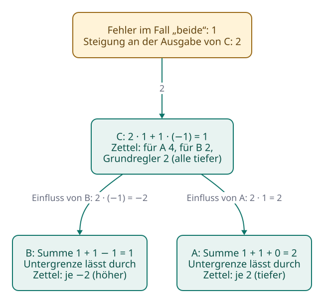
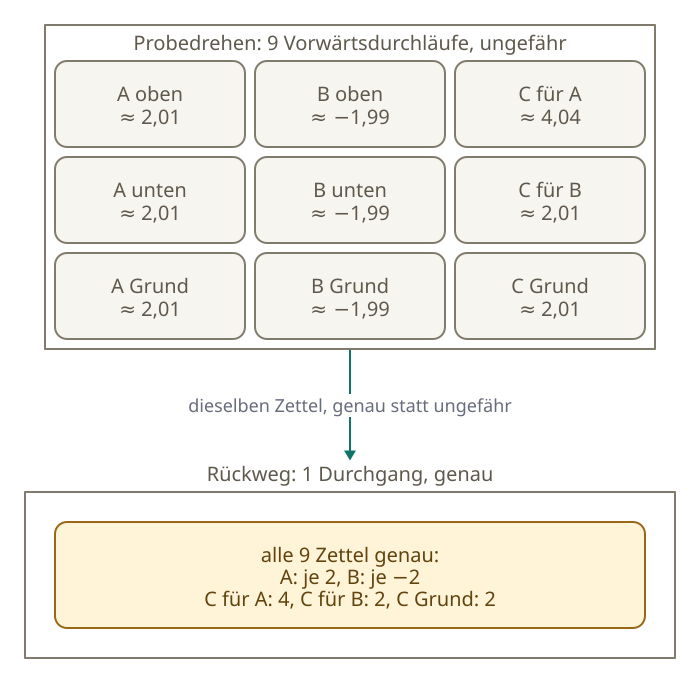
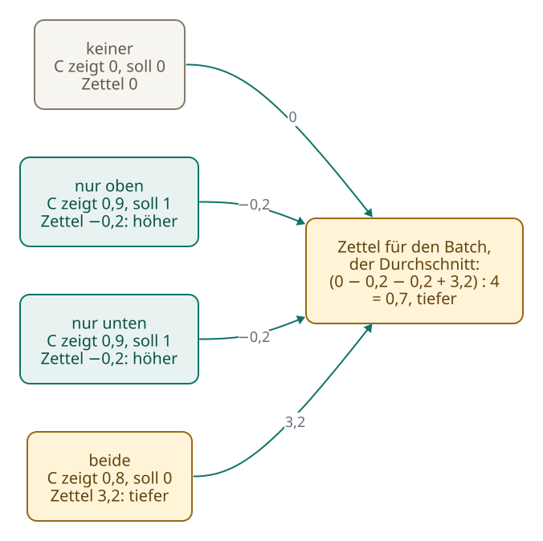

<!-- Generated from src/content/bausteine/de/backpropagation-und-gradienten.mdx by scripts/export-lessons.mjs -- do not edit by hand. -->

# Backpropagation und Gradienten: Wie das Modell weiß, was es ändern muss

> Lesefassung für GitHub. Die vollständige Fassung mit interaktiven Demos, Animationen und Abrufmoment findest du auf der Website: **[Backpropagation und Gradienten: Wie das Modell weiß, was es ändern muss](https://ki-einfach-verstehen.de/de/bausteine/backpropagation-und-gradienten/)**
>
> Lizenz: [CC BY 4.0](https://creativecommons.org/licenses/by/4.0/deed.de) · Nenne die Quelle so: KI einfach verstehen, „Backpropagation und Gradienten: Wie das Modell weiß, was es ändern muss“, CC BY 4.0, https://ki-einfach-verstehen.de/de/bausteine/backpropagation-und-gradienten/

Wie das Training aus einer einzigen Fehlerzahl für jeden Regler Richtung und Stärke ausrechnet, warum dafür ein Rückweg durch das Modell genügt und warum dabei noch kein Regler bewegt wird.

Am Ende des Vorwärtsdurchlaufs, dem Rechnen von der Eingabe durch alle [Schichten](https://ki-einfach-verstehen.de/de/glossar/schicht/) bis zur Ausgabe, steht eine einzige Zahl für den ganzen [Batch](https://ki-einfach-verstehen.de/de/glossar/batch/), den großen Stapel Text, den das Training auf einmal auswertet: der [Loss](https://ki-einfach-verstehen.de/de/glossar/loss/). Er sagt, wie falsch das Modell bei all diesen Beispielen lag. Er sagt nicht, welcher der Milliarden Regler wie viel dazu beigetragen hat. Im Baustein über Training stand dazu ein Versprechen: Ein Rechenverfahren namens [Backpropagation](https://ki-einfach-verstehen.de/de/glossar/backpropagation/) liefere die Steigung für alle Regler zugleich, in einem einzigen Durchgang rückwärts durch das Modell.

Angenommen, du willst am Treppenlicht aus dem Baustein über neuronale Netze durch Probedrehen herausfinden, welcher Regler den Fehler wie stark verändert. Wie viele zusätzliche Vorwärtsdurchläufe durch das Netz bräuchtest du dafür? Halte deine Vermutung fest.

## Ein Zettel für jeden Regler

Ein Mischpult klingt schief. Viele Regler, ein schlechter Klang: Welcher muss wohin? Das Mischpult kennst du aus den ersten Bausteinen. Seine Regler sind die [Parameter](https://ki-einfach-verstehen.de/de/glossar/parameter/) des Modells, also die Gewichte und [Grundregler](https://ki-einfach-verstehen.de/de/glossar/grundregler/), die das Training einstellt. Sie sind gespeichert und bleiben, wie sie sind, solange niemand an ihnen dreht.

Neu sind die **Zettel**. Nach jedem Batch rechnet das Training aus dem Loss und den [Zwischenwerten](https://ki-einfach-verstehen.de/de/glossar/zwischenwert/) des Vorwärtsdurchlaufs an jedem Regler einen Zettel aus, mit zwei Angaben, einer Richtung und einer Stärke: „höher, stark“ auf dem einen, „tiefer, kaum“ auf dem anderen. Anders als die Regler gehören die Zettel nicht zum fertigen Modell. Sie gelten für diesen einen Batch; für den nächsten rechnet das Training neue. Ein Zettel dreht auch keinen Regler, und er sagt nicht, wo der richtige Wert liegt.

*Das Mischpult mit Zetteln: Links läuft das Signal hinein, kleine Anzeigen über den Reglern zeigen die Zwischenwerte des Vorwärtsdurchlaufs, die große Anzeige rechts oben, wie falsch das Ergebnis ist. An jedem Regler hängt ein Zettel mit einem Pfeil: nach oben heißt „höher“, nach unten „tiefer“. Die Regler selbst stehen noch, wo sie standen.*

Was auf einem Zettel steht, kennst du ebenfalls: Es ist die **Steigung** aus dem Baustein über Training. Dort hieß Steigung, wie stark sich der Fehler bei einer winzigen Drehung genau an einer Stelle ändert. Fällt der Fehler beim Höherdrehen, steht auf dem Zettel „höher“. Steigt er, steht dort „tiefer“. Beim Apfel-Modell gab es nur einen Regler und deshalb nur eine Steigung. Ein Sprachmodell hat Milliarden Regler, und jeder braucht seine eigene. Erinnerst du dich an den Nebel-Hang? Du standest im dichten Nebel und spürtest unter den Füßen, wohin der Boden abfällt und wie steil. Genau das misst ein Zettel, nur für einen einzelnen Regler: wie steil es an der jetzigen Stelle bergab geht, wenn allein dieser Regler sich bewegt.

Alle Zettel zusammen heißen **[Gradient](https://ki-einfach-verstehen.de/de/glossar/gradient/)**: die Liste der Steigungen aller Regler, für jeden Regler Richtung und Stärke. Llama 3.1 8B, das frei veröffentlichte Modell aus dem Baustein über Training, hat laut seiner Modellseite rund acht Milliarden Parameter. Nach jedem Batch bekommt es also rund acht Milliarden Zettel.

Trotzdem gilt Backpropagation oft als Name für das ganze Lernen, weil beides meist in einem Atemzug genannt wird. Ein Lehrbuch über neuronale Netze stellt klar: Backpropagation bezeichnet nur das Verfahren, das den Gradienten berechnet. Gelernt wird mit einem anderen Verfahren, das diesen Gradienten benutzt. Nach der Backpropagation stehen also alle Regler genau wie vorher. Ob und wie weit gedreht wird, entscheidet ein eigener Schritt danach.

Woher aber kommen die Zettel? Am Treppenlicht lässt sich jeder einzelne nachrechnen.

## Rückwärts durch das Treppenlicht

Das Treppenlicht hat zwei Schalter; das Licht brennt, wenn genau einer gedrückt ist. Die [Neuronen](https://ki-einfach-verstehen.de/de/glossar/neuron/) A und B sehen beide Schalter mit dem Gewicht 1 und zählen ihren Grundregler dazu, bei A 0, bei B −1. Die Untergrenze setzt negative Summen auf null. C nimmt A mal 1 und B mal −2. Keiner, nur oben, nur unten, beide: Das ergibt 0, 1, 1, 0.

Ein Regler ist von Hand verstellt: Das Gewicht von C für B steht auf −1 statt −2. Falsch wird nur der Fall „beide“: A rechnet 2, B 1, C 2 minus 1, also 1 statt 0. Der Fehler ist wie beim Apfel-Modell die Abweichung mal sich selbst, also 1. Sprachmodelle messen ihn mit den Strafpunkten aus dem vorigen Baustein: Je kleiner die Wahrscheinlichkeit für das richtige [Token](https://ki-einfach-verstehen.de/de/glossar/token/), desto mehr Strafpunkte, an jeder Position. Der Rückweg rechnet dort dieselben Schritte mit der Steigung dieser Strafpunkte. Alle Zettel hier gelten für diesen einen Fall.

Der Rückweg beginnt an der Ausgabe von C. Sie ist kein Regler, aber an ihr hängt der Fehler. Rückt sie um 0,01 auf 1,01, wird der Fehler rund 0,02 größer; geteilt durch 0,01 ergibt das rund 2. Bei der Abweichung 0,5 (Fehler 0,25) machte dieselbe Drehung ihn rund 0,01 größer: Steigung rund 1. Diese **Steigung an C** ist bei „Abweichung mal sich selbst“ also immer zweimal die Abweichung. Für einen Regler heißt positiv „tiefer“, denn höher gedreht würde der Fehler wachsen; negativ „höher“.

Dreht sich das **Gewicht von C für B** ein Stück, ändert sich C um dieses Stück mal die Ausgabe von B, einen Zwischenwert vom Vorwärtsdurchlauf. Sein Zettel: 2 mal 1, gleich 2. Das **Gewicht für A** bekommt 2 mal 2, also 4, der **Grundregler von C** 2: alle drei „tiefer“.

Was steht auf dem Zettel des Gewichts von B am oberen Schalter: höher oder tiefer? Überleg kurz, bevor du weiterliest.

> **Interaktive Demo:** [auf der Website ausprobieren](https://ki-einfach-verstehen.de/de/bausteine/backpropagation-und-gradienten/)

Für die Regler von B rechnet der Rückweg erst den **Einfluss von B**: wie stark der Fehler auf B reagiert. Dafür zählt das verstellte Gewicht von C für B: 2 mal −1, gleich −2. Die Summe von B war 1; die Untergrenze lässt durch, Faktor 1. Das Gewicht am oberen Schalter bekommt −2 mal den gedrückten Schalter, 1: Zettel −2, höher. Ebenso das Gewicht unten und der Grundregler. Bei A ist der Einfluss 2 mal das Gewicht 1; seine drei Regler bekommen je 2, tiefer.

| Regler | Rechnung (vorne die Steigung an C) | Zettel |
|---|---|---|
| C: Gewicht für A | 2 · Ausgabe von A (2) | 4, tiefer |
| C: Gewicht für B | 2 · Ausgabe von B (1) | 2, tiefer |
| C: Grundregler | 2 · 1 | 2, tiefer |
| B: beide Gewichte, Grundregler | 2 · Gewicht von C für B (−1) · Untergrenze (1) · Schalter bzw. 1 | je −2, höher |
| A: beide Gewichte, Grundregler | 2 · Gewicht von C für A (1) · Untergrenze (1) · Schalter bzw. 1 | je 2, tiefer |

Jeder Regler hat jetzt einen Zettel. Den verstellten findet der Rückweg aber nicht: Der größte Zettel, die 4, hängt am Gewicht von C für A, das richtig steht. Ein Zettel misst, wie stark der Fehler an einem Regler hängt, nicht, wer ihn verursacht hat.

Gegenprobe am verstellten Regler: Auf −1,01 gedreht, rechnet C 0,99, und der Fehler sinkt auf rund 0,98: Steigung rund 2, wie der Zettel sagt.

[▶ Animation auf der Website ansehen](https://ki-einfach-verstehen.de/de/bausteine/backpropagation-und-gradienten/)

*Der Rückweg im Fall „beide“ Schritt für Schritt: von der Steigung an der Ausgabe von C zu den Zetteln an C, dann über den Einfluss von B und von A zu deren Reglern. Ausgedachtes Netz mit dem verstellten Gewicht −1.*

Die Untergrenze kann den Rückweg auch sperren. Angenommen, der Grundregler von C stünde auf 0,5, sodass C im Fall „keiner“ 0,5 statt 0 zeigt. Dort ist die Summe von B −1, die Untergrenze macht daraus 0: Selbst mit dem Grundregler von B auf −0,99 bleibt B bei 0, und C ändert sich nicht. Die Regler von B bekommen daraus keinen Zettel: Die Untergrenze zählt als Faktor 0.

Welcher Regler bekommt im Fall „keiner“ überhaupt einen Zettel?

Keiner. Im verstellten Netz stimmt dieser Fall, C rechnet 0. Die Abweichung ist 0, also auch die Steigung an C, und jeder Zettel ist ein Vielfaches davon. Wäre C dort falsch, bekäme der Grundregler von C einen Zettel, die Regler von B trotzdem keinen.

Beim Training des Modells hinter deinem Chatbot läuft derselbe Rückweg nach jedem Batch durch Milliarden Regler.

## Ein Rückweg statt Milliarden Proben

Dieser Rückweg heißt **[Backpropagation](https://ki-einfach-verstehen.de/de/glossar/backpropagation/)**, ungefähr „Rückwärtsausbreitung“: Vom Fehler aus geht die Rechnung [Schicht](https://ki-einfach-verstehen.de/de/glossar/schicht/) für Schicht zurück zum Eingang, und jeder Regler bekommt unterwegs seinen Zettel. Wer stattdessen probedreht, wie in der Frage vom Anfang, dreht einen Regler ein Stück, rechnet das Netz vorwärts und vergleicht den neuen Fehler mit dem alten.

> **Interaktive Demo:** [auf der Website ausprobieren](https://ki-einfach-verstehen.de/de/bausteine/backpropagation-und-gradienten/)

Beim Treppenlicht sind das neun zusätzliche Vorwärtsdurchläufe, einer pro Regler: Alle auf einmal zu drehen verriete nicht, welcher Regler wie viel beiträgt. Die Backpropagation brauchte einen einzigen Rückweg.

Warum reicht einer? Der Einfluss von B, die −2, wurde einmal berechnet und für alle drei Regler von B benutzt. Läge vor B noch eine Schicht, würde der Rückweg aus dem Einfluss von B den Einfluss dieser Schicht berechnen, wieder nur einmal, und so weiter bis zum Eingang.

*Das Getriebe: Wie stark das letzte Zahnrad mitgeht, ergibt sich aus den Übersetzungen auf dem Weg, malgenommen. Im Netz sind manche Übersetzungen gespeicherte Gewichte, andere Werte dieses Durchlaufs, etwa die Untergrenze.*

Die Rechnung funktioniert wie ein **Getriebe**: Wie stark das letzte Zahnrad mitgeht, ergibt das Produkt der Übersetzungen auf dem Weg. Für das Gewicht von B am oberen Schalter sind es die vier Faktoren aus der Tabelle: 2, −1, 1 und 1. Malgenommen: −2, der Zettel. Die ersten Übersetzungen teilen sich alle Regler von B; der Rückweg rechnet sie nur einmal. Anders als in einem echten Getriebe ist nicht jede Übersetzung fest. Die Gewichte bleiben stehen; die Untergrenze übersetzt mal mit 1, mal mit 0, je nach Eingabe.

*Probedrehen gegen Rückweg am Treppenlicht, Fall „beide“: neun zusätzliche Vorwärtsdurchläufe, einer pro Regler, gegen einen einzigen Rückweg. Beide ergeben dieselbe Richtung und fast dieselbe Stärke; nur der Rückweg rechnet genau.*

Fließt da der Fehler rückwärts und repariert die Regler? Nein, rückwärts läuft eine Rechnung mit den Werten vom Vorwärtsdurchlauf: Ohne die 2 von A und die 1 von B ließe sich kein Zettel an C ausrechnen. Deshalb hebt das Training sie auf, bis der Rückweg fertig ist. Das kostet zusätzlich Speicher, wie im Baustein über Modellgröße.

Umsonst ist der Rückweg nicht. Vorwärts rechnet jedes Gewicht einmal: Gewicht mal Eingabe. Rückwärts rechnet es zweimal: Einfluss mal Eingabe für seinen eigenen Zettel, Einfluss mal Gewicht für den Einfluss, den es an die Schicht davor weitergibt. Ein Papier von OpenAI, der Firma hinter ChatGPT, fasst das 2020 in eine Faustregel: Der Rückweg kostet etwa doppelt so viel Rechenarbeit wie der Vorwärtsdurchlauf, zusammen etwa dreimal so viel wie das reine Antworten. Das ist das „etwa dreimal so viel“ aus dem Baustein über Training. Für Llama 3.1 8B kostet ein Trainingsschritt pro Token etwa so viel wie drei Vorwärtsdurchläufe; Probedrehen bräuchte für jeden seiner acht Milliarden Regler einen eigenen.

Eine Ebene tiefer: Warum können Zettel verschwinden oder riesig werden?

In der Mathematik heißt das Malnehmen der Übersetzungen **Kettenregel** der Differentialrechnung. 1986 beschrieben David Rumelhart, Geoffrey Hinton und Ronald Williams den Rückweg für neuronale Netze in der Fachzeitschrift Nature. Andere fanden ihn etwa zur selben Zeit unabhängig; effizient angewendet wurde die Kettenregel schon seit den 1960er-Jahren.

Liegen viele Übersetzungen unter 1, schrumpft das Produkt mit jeder Schicht: Zehnmal 0,5 malgenommen ergibt weniger als ein Tausendstel. Die Zettel nahe am Eingang werden dann so klein, dass die Richtung kaum noch zu erkennen ist. Liegen viele Übersetzungen über 1, wächst das Produkt rasch, die Zettel werden riesig, und das Lernen kann unruhig werden. Das Lehrbuch über neuronale Netze nennt das das Problem der verschwindenden und explodierenden Gradienten.

Treffen kann das jedes sehr tiefe Netz, am stärksten aber Netze, die bei jedem Schritt dieselben Gewichte anwenden: Dieselbe Übersetzung kehrt wieder, und schon eine knapp unter 1 schrumpft mit jeder Wiederholung. In Netzen, in denen Werte nur von Schicht zu Schicht nach vorn laufen (Feed-Forward), hat jede Schicht eigene Gewichte, und laut dem Lehrbuch können auch sehr tiefe Netze dieser Art das Problem weitgehend vermeiden. Gegen riesige Zettel hilft eine Grenze. Beim Training von GPT-3 wurde die Gesamtgröße des Gradienten auf 1,0 begrenzt: War sie größer, wurden alle Zettel im gleichen Verhältnis verkleinert; ihre Richtungen blieben.

## Ein Zettel gilt nur hier und jetzt

Im Fall „beide“ sagt der Zettel am Gewicht von C für A „tiefer, 4“, so deutlich wie kein anderer. Was passiert, wenn das Gewicht ihm weit folgt, von 1 bis auf 0? Überleg kurz, bevor du weiterliest.

Im Fall „beide“ rechnet C dann 0 minus 1, also −1, wieder falsch, nur in die andere Richtung. Und die Fälle „nur oben“ und „nur unten“, die vorher stimmten, gehen kaputt: A rechnet 1, B rechnet 0, und C zeigt 0 statt 1. Das Licht bliebe bei genau einem gedrückten Schalter dunkel.

Leicht entsteht der Eindruck, ein Zettel zeige auf den richtigen Wert. Er zeigt aber nur die Neigung an der jetzigen Stelle. Wie im Nebel: Du spürst, wie steil der Boden unter deinen Füßen abfällt, nicht, wie der Hang zehn Schritte weiter aussieht. Wer weit ausschreitet, kann wieder bergauf landen. Deshalb **gilt ein Zettel nur für die Stellung, an der er ausgerechnet wurde**.

Er gilt außerdem nur für den Fall, aus dem er stammt. Im verstellten Netz liegen die anderen drei Fälle richtig und geben 0; über alle vier gemittelt bliebe von der 4 nur 1. Andere Beispiele geben andere Zettel, und die können einander widersprechen. Angenommen, nur das Gewicht von C für A rückt ein kleines Stück, von 1 auf 0,9. Im Fall „nur oben“ zeigt C dann 0,9 statt 1, liegt also 0,1 zu tief. Die Steigung an C ist 2 mal −0,1, gleich −0,2; mal die Ausgabe von A, 1, bleibt der Zettel −0,2, also „höher“. Im Fall „nur unten“ ebenso. Im Fall „beide“ zeigt C 0,8, liegt 0,8 zu hoch, die Steigung ist 1,6; mal die Ausgabe von A, 2, ergibt 3,2: „tiefer“.

*Ein Batch aus vier Fällen, vier Zettel für dasselbe Gewicht von C für A, nachdem es auf 0,9 gerückt ist: zweimal „höher“, einmal „tiefer“, einmal nichts. Der Zettel für den Batch ist ihr Durchschnitt. Ausgedachtes Netz, nachgerechnet.*

Deshalb rechnet das Training die Zettel für alle Beispiele eines Batch aus und fasst sie zusammen. Der Loss eines Batch ist der Durchschnitt über seine Beispiele. Jedes Beispiel geht nur mit seinem Anteil in diesen Durchschnitt ein, und mit ihm seine Steigung; deshalb ist auch jeder Zettel ein **Durchschnitt** über die Zettel aller Beispiele. Für das Gewicht von C für A ergeben 0, −0,2, −0,2 und 3,2 zusammen 2,8, durch vier geteilt 0,7: tiefer, aber viel schwächer als die 3,2 aus dem Fall „beide“ allein. Bei GPT-3 wuchs ein Batch im Lauf des Trainings auf Millionen Tokens; jedes ist ein solches Beispiel und trägt seine Zettel zum Durchschnitt bei. Dann dreht das Training die Regler ein Stück in die Richtung ihrer Zettel, und der nächste Batch bringt neue Zettel.

Bis hierhin hat sich kein Regler bewegt. Doch die Zettel sind wacklig, und der nächste Batch liefert andere. Wer entscheidet, wie weit gedreht wird, und was geschieht mit Zetteln, die sich von Batch zu Batch widersprechen? Darum geht es im nächsten Baustein über die Optimierung der Gewichte.

---

Quelle: https://ki-einfach-verstehen.de/de/bausteine/backpropagation-und-gradienten/

← Zurück: [Forward Pass und Loss: Wie das Modell seinen eigenen Fehler misst](./forward-pass-und-loss.md) · [Alle Bausteine](../../README.de.md#inhalt) · Weiter: [Optimierung: Wer die Gewichte tatsächlich ändert](./optimierung-der-gewichte.md) →
