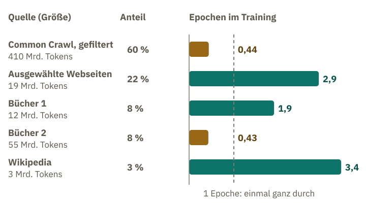
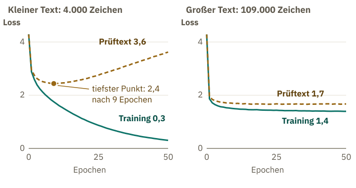
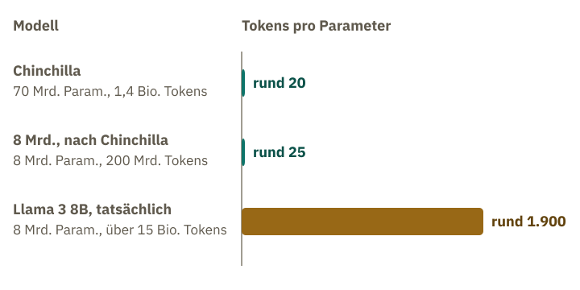

<!-- Generated from src/content/bausteine/de/batch-epoch-step-tokenbudget.mdx by scripts/export-lessons.mjs -- do not edit by hand. -->

# Batch, Epoch, Step, Tokenbudget: Wie man Trainingsfortschritt misst

> Lesefassung für GitHub. Die vollständige Fassung mit interaktiven Demos, Animationen und Abrufmoment findest du auf der Website: **[Batch, Epoch, Step, Tokenbudget: Wie man Trainingsfortschritt misst](https://ki-einfach-verstehen.de/de/bausteine/batch-epoch-step-tokenbudget/)**
>
> Lizenz: [CC BY 4.0](https://creativecommons.org/licenses/by/4.0/deed.de) · Nenne die Quelle so: KI einfach verstehen, „Batch, Epoch, Step, Tokenbudget: Wie man Trainingsfortschritt misst“, CC BY 4.0, https://ki-einfach-verstehen.de/de/bausteine/batch-epoch-step-tokenbudget/

Wie man ein Training in Schritten und Tokens zählt, warum ein Sprachmodell wie GPT-3 manche Quellen nicht einmal halb und andere mehrfach sieht, woran ein zurückgehaltener Prüftext echtes Lernen erkennt und wie viel Text auf wie viele Regler kommt.

Die Llama-3-Familie sind die Sprachmodelle der Firma Meta. Für ihr größtes Modell, Llama 3.1 405B, nennt der Forschungsbericht zwei Zahlen, die beide nach der Länge des Trainings klingen. Die erste Zahl kennst du aus dem vorigen Baustein: Der Lernraten-Plan, erst kurz hochfahren, dann lange absenken, lief bei diesem Modell über 1,2 Millionen Schritte. Was ein Schritt hier genau zählt, zeigt der Abschnitt „Aufgabe, Batch, Schritt“. Die zweite Zahl ist die Menge Text, rund 15,6 Billionen [Tokens](https://ki-einfach-verstehen.de/de/glossar/token/), also Textstücke.

Ein anderes Team trainiert ebenfalls 1,2 Millionen Schritte lang (ein Schritt ist hier eine Runde, in der alle Regler einmal rücken) und packt in jeden Schritt 4 Millionen Tokens. Wie viel Text hat sein Modell am Ende gesehen, verglichen mit den 15,6 Billionen des größten Llama-Modells? Überleg kurz, bevor du weiterliest.

## Aufgabe, Batch, Schritt

Die Antwort steckt darin, was ein einzelner Schritt verarbeitet. Erinnerst du dich an die Abdeckkarte? Sie gibt den Anfang einer Zeile frei, und das nächste Token darunter ist die Lösung. So wird jede Position einer Trainingsfolge zu einer Übungsaufgabe, einem Beispiel. Für einen ganzen Stapel solcher Folgen rechnet das Modell vorwärts, und der [Loss](https://ki-einfach-verstehen.de/de/glossar/loss/) mittelt die Strafpunkte aller Positionen zu einer einzigen Zahl. Diesen Stapel nennt man [Batch](https://ki-einfach-verstehen.de/de/glossar/batch/).

Aus dem Loss entstehen die Zettel aus dem Baustein über Backpropagation: An jedem Regler steht, wie stark und in welche Richtung sich der Loss ändert, wenn man ihn dreht. Der Optimierer dreht danach alle Regler einmal, jeden so, dass der Loss sinkt.

*Das Übungsheft: Aufgaben werden stapelweise gerechnet, nach jedem Stapel kommt eine Korrekturrunde.*

Ein Übungsheft hilft, diese Einheiten auseinanderzuhalten. Du rechnest nicht eine Aufgabe und lässt sie sofort korrigieren, sondern einen Stapel. Dann kommt die Korrektur, und du stellst deine Rechenweise ein wenig um. Im Bild ist jede Aufgabe ein Beispiel, der Stapel ist der Batch, deine Rechenweise sind die Regler, und jede Korrekturrunde ist ein Schritt. Einmal von vorn bis hinten durchs ganze Heft heißt eine **[Epoche](https://ki-einfach-verstehen.de/de/glossar/epoche/)**. An drei Stellen trägt das Bild allerdings nicht. Das Modell hat kein Heft, in dem einzelne Aufgaben liegen. Es hat nur seine Regler, und in ihnen steckt verteilt, was es aus den Aufgaben behalten hat, vor allem das, was viele Aufgaben gemeinsam haben. Kommt dieselbe Aufgabe später noch einmal dran, löst sie ein schon verändertes Modell. Wie stark es sich auf eine einzelne Aufgabe einstellt, hängt auch davon ab, wie oft sie vorkam. Außerdem rechnet ein Sprachmodell sein Heft nicht einfach Seite für Seite durch: Wie oft welcher Teil drankommt, wird vorher festgelegt.

In der Fachsprache heißt eine solche Runde **[Schritt](https://ki-einfach-verstehen.de/de/glossar/schritt/)** (englisch step). Ein Schritt rechnet einen Batch vorwärts, berechnet daraus den Loss und die Zettel und dreht danach die Regler einmal. Im Baustein über Training war ein Schritt noch die Strecke, um die ein Regler rückt. Als Zählwort meint er die ganze Runde, in der alle Regler einmal rücken.

Jetzt zur Frage vom Anfang. Das andere Team kommt auf 1,2 Millionen Schritte mal 4 Millionen Tokens, also 4,8 Billionen Tokens. Das ist knapp ein Drittel des Textes, den das größte Llama-Modell sah. Das Team hat genauso viele Schritte gemacht und trotzdem viel weniger Text gesehen. Das größte Llama-Modell begann zwar genauso, verdoppelte dann aber zweimal, bis auf 16 Millionen. **Schrittzahlen kann man nur vergleichen, wenn die Batches gleich groß sind.** Wie viel Text ein Training verarbeitet hat, zählt man deshalb in Tokens.

Die Schritte zählen also die Korrekturrunden, die Tokens den Text. Wie oft kommt derselbe Trainingstext eigentlich dran?

## Einmal durchs Heft, oder gar nicht

Viele stellen sich vor, ein Sprachmodell lese seine [Trainingsdaten](https://ki-einfach-verstehen.de/de/glossar/trainingsdaten/) immer wieder, bis es sie kann. So lernt man ja selbst: Wer sich auf eine Prüfung vorbereitet, rechnet das Übungsheft zwei- oder dreimal durch. Bei GPT-3, einem Vorläufer der Modelle hinter ChatGPT, war es anders: **Der größte Teil der verfügbaren Texte kam im Training weniger als einmal dran.** Der Bericht zu Llama 3 nennt keine Epochenzahlen.

Wie oft eine Quelle drankommt, legt die Mischung fest, die letzte Stufe beim Aufbereiten der Trainingsdaten aus dem Baustein über Übungsaufgaben. Für jede Quelle wird bestimmt, welcher Anteil der Trainingsfolgen aus ihr stammt. Der Trainingstext wird also nicht nach der Größe der Quellen verteilt, sondern nach diesen Anteilen.

Das GPT-3-Paper nennt alle Zahlen. Insgesamt verarbeitete das Training 300 Milliarden Tokens. 60 Prozent davon kamen aus einer gefilterten Sammlung von Webseiten namens Common Crawl. Für Common Crawl nennt das Paper 0,44 Epochen: Nicht einmal die Hälfte ihrer Texte kam dran. Den Rest teilten sich ausgewählte Webseiten, zwei Sammlungen von Büchern und die Wikipedia.

Die Wikipedia umfasste nur 3 Milliarden Tokens und bekam trotzdem 3 Prozent der Mischung. Wie oft, glaubst du, kam sie im Training dran?

3 Prozent von 300 Milliarden sind 9 Milliarden Tokens, bei einem Umfang von 3 Milliarden.

Die Epochen ergeben sich grob aus den gezogenen Tokens geteilt durch den Umfang. Für die Wikipedia ergibt das dreimal.

Das Paper nennt 3,4-mal; die Rechnung kommt auf drei. Das reicht, um die Größenordnung zu sehen.

*Die Trainingsmischung von GPT-3: wie oft jede Quelle im Training drankam, in Epochen.*

Warum so ungleich? Laut Paper zog das Training Quellen, die die Autoren für hochwertiger hielten, absichtlich öfter. Dafür nahmen sie „ein wenig [Überanpassung](https://ki-einfach-verstehen.de/de/glossar/ueberanpassung/)“ in Kauf, wie sie schreiben: Das Modell stellt sich dann auf einzelne Texte ein statt auf Muster, die viele gemeinsam haben. Wie viel Wiederholung schadet, zeigt eine Studie von 2023 an Sprachmodellen mit bis zu 9 Milliarden Parametern: Bis etwa vier Epochen änderte sich der Loss auf neuem Text kaum. Bei mehr Wiederholung brachte zusätzliche Rechenzeit immer weniger, schließlich gar nichts mehr. Ob das für GPT-3 genauso gilt, misst die Studie nicht.

Welche Quellen öfter drankommen, prägt das spätere Modell. Laut Meta ist es für ein gutes Sprachmodell entscheidend, die Anteile der Quellen sorgfältig festzulegen. Beim größten Llama-3-Modell stammt rund ein Sechstel der Trainingstokens aus Programmcode. Hilft dir ein Chatbot beim Programmieren, enthielt sein Vortraining sehr wahrscheinlich ebenfalls viel Code.

Weil eine Mischung jede Quelle verschieden oft durchläuft, sagt eine einzelne Epochenzahl bei Sprachmodellen wenig. Gezählt wird stattdessen, wie viele Tokens das Training insgesamt verarbeitet, Wiederholungen mitgezählt. Das ist das **[Tokenbudget](https://ki-einfach-verstehen.de/de/glossar/tokenbudget/)**: bei GPT-3 die 300 Milliarden. Das Tokenbudget legen Menschen vor dem Training fest, es ist also ein [Hyperparameter](https://ki-einfach-verstehen.de/de/glossar/hyperparameter/).

Wie viele Schritte macht ein Training? Für das größte GPT-3-Modell nennt das Paper neben den 300 Milliarden Tokens einen Batch von 3,2 Millionen Tokens. Überleg kurz, bevor du weiterliest.

> **Interaktive Demo:** [auf der Website ausprobieren](https://ki-einfach-verstehen.de/de/bausteine/batch-epoch-step-tokenbudget/)

Jeder Schritt verbraucht 3,2 Millionen der 300 Milliarden Tokens.

Wie viele Schritte das ergibt, zeigt eine Division: 300 Milliarden sind 300.000 Millionen. Geteilt durch 3,2 Millionen ergibt das knapp 94.000 Schritte. Weil der Batch anfangs kleiner war, waren es etwas mehr. Offen bleibt, woran man Überanpassung im Training überhaupt erkennt.

Passen die 1,2 Millionen Schritte von Llama 3.1 405B zur Teilung?

Mit dem größten Batch von 16 Millionen Tokens ergäben 15,6 Billionen Tokens knapp eine Million Schritte: 15,6 Billionen geteilt durch 16 Millionen sind 975.000. In den ersten Billionen Tokens waren die Batches aber nur 4 und 8 Millionen groß. Deshalb braucht der Lauf mehr Schritte, und die 1,2 Millionen liegen in derselben Größenordnung.

## Der Probetest: Lernen oder Auswendiglernen

*Der Probetest: neue Aufgaben, die im Heft nicht vorkamen, zeigen, ob der Stoff sitzt.*

Wer ein Übungsheft dreimal durchrechnet, kennt am Ende viele Lösungen auswendig. Ob er den Stoff kann, zeigt erst ein Probetest mit Aufgaben, die nicht im Heft standen. Beim Training ist es genauso. Der Loss, den das Training nach jedem Batch berechnet, misst, wie gut das Modell genau die Texte vorhersagt, an denen es gerade lernt. Er heißt deshalb **Trainings-Loss**. Er sinkt auch dann, wenn das Modell sich nur auf Eigenheiten dieser Texte einstellt. Im Übungsheft entspräche das jemandem, der die Lösungen kennt, aber den Rechenweg nicht.

Deshalb hält man vor dem Training einen Teil des Textes zurück, den **Prüftext**. Er kommt nie in einen Batch, kein Regler wird nach ihm gedreht. In regelmäßigen Abständen rechnet das Modell ihn vorwärts, und der Loss darauf heißt **[Validierungs-Loss](https://ki-einfach-verstehen.de/de/glossar/validierungs-loss/)**. Die Entwickler von GPT-3 entfernten doppelte Texte auch deshalb, damit keine Kopie des Prüftexts im Trainingstext steckt. Sonst wäre der Probetest einer mit bekannten Aufgaben.

Man zeichnet beide Werte über den Verlauf des Trainings auf. Fallen beide Kurven und bleiben nah beieinander, lernt das Modell **Muster, die auch in unbekanntem Text gelten**. Fällt der Trainings-Loss weiter, während der Validierungs-Loss wieder steigt, ist das die **Überanpassung**, englisch overfitting.

Wie das aussieht, zeigt ein kleiner echter Trainingslauf. Ein winziges Modell mit rund 14.000 Parametern sagt das nächste Zeichen vorher, jeweils aus den acht Zeichen davor. Es lernt aus Franz Kafkas Erzählung „Die Verwandlung“, deren letztes Zehntel der Prüftext ist. Zwei Läufe starten mit denselben zufälligen Startwerten für die Regler, damit nur die Textmenge den Unterschied macht. Der kleine bekommt die ersten 4.000 Zeichen, der große rund 109.000 Zeichen, fast die ganze übrige Erzählung. Beide sehen ihren Text 50-mal.

Was, glaubst du, passiert mit dem Validierungs-Loss des kleinen Laufs, wenn er dieselben 4.000 Zeichen zum zwanzigsten, dreißigsten, fünfzigsten Mal sieht?

Notiere deine Vermutung, bevor du weiterliest.

> **Interaktive Demo:** [auf der Website ausprobieren](https://ki-einfach-verstehen.de/de/bausteine/batch-epoch-step-tokenbudget/)

Beide Kurven beginnen bei rund 4,3, weil das Mini-Modell nur 67 verschiedene Zeichen zur Auswahl hat.

Ein Sprachmodell mit über 150.000 Tokens im Vokabular startet dagegen bei rund 11,9. Je mehr Tokens zur Auswahl stehen, desto höher der Startwert, weil am Anfang jedes einzelne nur einen winzigen Anteil bekommt.

Beim kleinen Lauf fällt der Validierungs-Loss neun Epochen lang und steigt danach stetig wieder. Der Trainings-Loss fällt die ganze Zeit weiter: Das Modell sagt die 4.000 bekannten Zeichen immer sicherer vorher und unbekannten Text immer schlechter.

Beim großen Lauf fällt der Validierungs-Loss bis etwa Epoche 15 und bleibt danach bei rund 1,67 stehen, während der Trainings-Loss weiter sinkt. Der Abstand zwischen beiden wächst langsam, von rund 0,2 auf rund 0,3. Ein Anstieg des Validierungs-Loss bleibt aber aus. Vom selben Start aus erreicht er auf dem Prüftext einen deutlich niedrigeren Loss.

*Ein echter kleiner Trainingslauf: Trainings- und Validierungs-Loss mit wenig und mit viel Text über 50 Epochen.*

Das Mini-Modell ist kein Sprachmodell wie das hinter deinem Chatbot: Schon Llama 3.1 8B hat über eine halbe Million Mal so viele Parameter. Das Mini-Modell kennt nur Zeichen und hat nur eine Erzählung gelesen. Es zeigt, wie man die beiden Kurven liest. Wie früh ein großes Modell kippen würde, zeigt es nicht. Hier hat das Bild eine Grenze: Ein Probetest prüft, ob ein Mensch den Stoff kann. Der Validierungs-Loss misst nur, wie gut das Modell das nächste Zeichen vorhersagt, auch bei Prüftexten, die es nie gesehen hat.

Mehr Text hilft also gegen Auswendiglernen.

## Wie viel Text für wie viele Regler

Ein Team hat Rechenzeit für genau ein Training. Soll es damit ein großes Modell kurz trainieren oder ein kleineres lang? Die Rechenzeit wächst ungefähr mit Modellgröße mal Textmenge. Ein doppelt so großes Modell braucht für jedes Token doppelt so viel Rechenarbeit und bekommt bei gleicher Rechenzeit deshalb nur halb so viel Text.

Die KI-Firma DeepMind, die zu Google gehört, hat das untersucht. Sie trainierte viele Sprachmodelle verschiedener Größe mit verschieden viel Text und verglich, welches bei gleicher Rechenzeit den kleinsten Loss erreicht. Sie fand, dass Modellgröße und Tokenbudget gleich stark wachsen sollten, doppelt so viele Parameter also mit doppelt so viel Text. Viele große Modelle jener Zeit waren demnach zu wenig trainiert. Zum Beleg trainierte DeepMind das Modell Chinchilla mit 70 Milliarden Parametern und 1,4 Billionen Tokens. Es kostete so viel Rechenzeit wie ein eigenes, viermal so großes Modell, bekam aber viermal so viel Text, und es schnitt deutlich besser ab.

Die 1,4 Billionen sind 1.400 Milliarden. Geteilt durch 70 Milliarden ergibt das 20.

Daraus ist eine verbreitete Faustregel geworden: rund 20 Tokens pro Parameter.

Llama 3 8B hat acht Milliarden Parameter. Meta schreibt, nach der Chinchilla-Rechnung wären für dieses Modell rund 200 Milliarden Tokens optimal.

Geteilt durch acht Milliarden sind das rund 25 Tokens pro Parameter. Die 20 ist eine Faustregel aus dem Chinchilla-Beispiel. Wer die Rechnung für ein bestimmtes Modell durchführt, kommt auf etwas andere Werte, Meta für sein Modell mit acht Milliarden Parametern eben auf rund 25.

Trainiert wurde es mit über fünfzehn Billionen Tokens, das sind 15.000 Milliarden.

Geteilt durch acht Milliarden ergibt das rund 1.900 Tokens pro Parameter, statt 20.

*Tokens pro Parameter: Chinchilla liegt bei rund 20, Llama 3 mit acht Milliarden Parametern bei rund 1.900.*

Ist das Verschwendung?

Meta berichtet, dass das Modell auch nach 15 Billionen Tokens noch besser wurde. Ein größeres Modell hätte dieselbe Leistung mit weniger Rechenzeit fürs Training erreicht. Kleinere Modelle sind laut Meta trotzdem meist vorzuziehen, weil sie im Betrieb viel effizienter sind. Ein fertiges Modell beantwortet nach dem Training Millionen Anfragen, und bei jedem Token, das es ausgibt, rechnen alle seine Regler mit. Ein kleineres, länger trainiertes Modell antwortet deshalb billiger und passt auf kleinere Chips, etwa in Handys.

**Fürs Training allein liegt das günstigste Verhältnis bei rund 20 Tokens pro Parameter.** Wer auch an den Betrieb denkt, trainiert ein kleineres Modell länger.

Eine Ebene tiefer: Wie Skalierungsgesetze ein Training planbar machen

Dass sich so etwas vorab planen lässt, liegt an einer Beobachtung von 2020. Forschende bei OpenAI, der Firma hinter ChatGPT, trainierten viele Sprachmodelle und veränderten dabei Größe, Textmenge und Rechenzeit (Kaplan und andere). Der Loss auf zurückgehaltenem Text sank dabei erstaunlich regelmäßig. Er folgt einem Potenzgesetz in Modellgröße, Textmenge und Rechenaufwand, teils über mehr als sieben Größenordnungen: Der größte untersuchte Wert war über zehnmillionenmal so groß wie der kleinste.

Potenzgesetz heißt hier: Jede Verzehnfachung, etwa der Parameterzahl, senkt den Loss ungefähr um denselben Anteil, solange nicht Text oder Rechenzeit knapp werden. Solche Regeln heißen **Skalierungsgesetze**.

Aus solchen Regeln lässt sich ausrechnen, wie man ein festes Rechenbudget am besten aufteilt. Nach Kaplan sollte bei wachsendem Budget vor allem das Modell größer werden. Die Chinchilla-Studie hat diese Aufteilung mit mehr Läufen und mehr Text neu bestimmt: Modell und Text sollten gleich stark wachsen. Beide Gesetze beschreiben nur den Loss, nicht einzelne Fähigkeiten wie Rechnen oder Übersetzen.

Am Ende von Millionen solcher Schritte steht ein Modell, das Text sehr gut fortsetzt. Es ist eine Grundfassung wie Llama 3.1 8B, also das Modell vor dem Nachtraining. Wie ein Chatbot auf Fragen eingehen, das hat es dabei nicht gelernt. Dafür braucht es ein Nachtraining, und darum geht es im nächsten Themenbereich, „Vom Modell zum Assistenten“.

---

Quelle: https://ki-einfach-verstehen.de/de/bausteine/batch-epoch-step-tokenbudget/

← Zurück: [Optimierung: Wer die Gewichte tatsächlich ändert](./optimierung-der-gewichte.md) · [Alle Bausteine](../../README.de.md#inhalt) · Weiter: [Warum Vorhersagen mehr ist als Nachplappern](./warum-vorhersagen-mehr-ist-als-nachplappern.md) →
