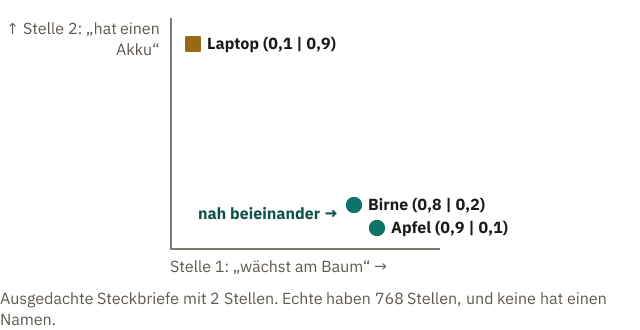
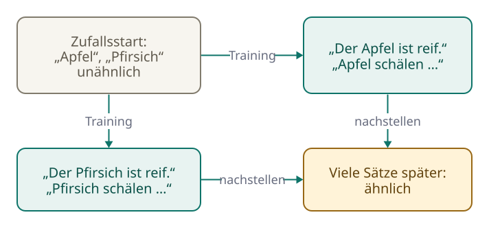
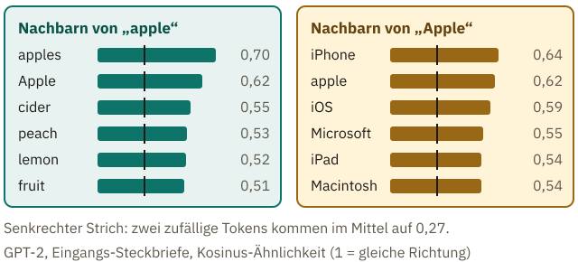
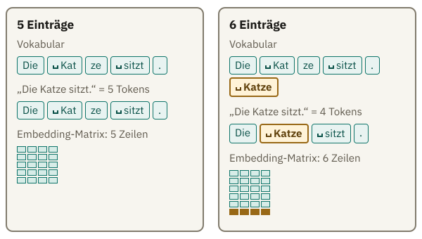

<!-- Generated from src/content/bausteine/de/embeddings.mdx by scripts/export-lessons.mjs -- do not edit by hand. -->

# Embeddings: wie aus einer Nummer ein gelernter Vektor wird

> Lesefassung für GitHub. Die vollständige Fassung mit interaktiven Demos, Animationen und Abrufmoment findest du auf der Website: **[Embeddings: wie aus einer Nummer ein gelernter Vektor wird](https://ki-einfach-verstehen.de/de/bausteine/embeddings/)**
>
> Lizenz: [CC BY 4.0](https://creativecommons.org/licenses/by/4.0/deed.de) · Nenne die Quelle so: KI einfach verstehen, „Embeddings: wie aus einer Nummer ein gelernter Vektor wird“, CC BY 4.0, https://ki-einfach-verstehen.de/de/bausteine/embeddings/

Warum eine Token-ID nichts über Ähnlichkeit verrät, wie im Training aus Zufallszahlen ähnliche Steckbriefe für ähnlich verwendete Tokens werden und was ein großes Vokabular kostet.

*Ein Barcode sagt der Kasse, welcher Artikel es ist, aber nichts darüber, was der Artikel mit anderen gemeinsam hat.*

An der Supermarktkasse verrät der Barcode genau eine Sache: welcher Artikel es ist. Dass Äpfel und Pfirsiche beide Obst sind, steht in keinem Strichcode. So geht es einem [Sprachmodell](https://ki-einfach-verstehen.de/de/glossar/sprachmodell/) mit deiner Chatnachricht. Nach dem vorigen Baustein ist sie eine Folge von [Token-IDs](https://ki-einfach-verstehen.de/de/glossar/token-id/), und jede ID sagt nur, welches Textstück gemeint ist.

Die kleinste Version des frei verfügbaren Modells GPT-2 hat ein englisches [Vokabular](https://ki-einfach-verstehen.de/de/glossar/vokabular/) (die feste Liste aller Stücke, die ein Tokenizer kennt). Wenn hier von GPT-2 die Rede ist, ist immer diese Version gemeint. Mitten im Satz, mit Leerzeichen davor, trägt „apple“ die Nummer 17180, „laptop“ die 13224 und „peach“, der Pfirsich, die 47565. Der Nummer nach liegt der Laptop viel näher am Apfel als der Pfirsich. Behandelt das Modell deshalb Apfel und Laptop als verwandt?

## Was einer Nummer fehlt

Eine Token-ID ist die Nummer auf einer Karteikarte, wie im Baustein über [Token-IDs](./token-ids-und-vokabular.md). Sie sagt, welches Textstück gemeint ist, und bedeutet selbst nichts. Vergeben hat die Nummern der Tokenizer, als er sein Vokabular aufgebaut hat, ohne Blick auf die Bedeutung. Benachbarte Nummern stehen deshalb nicht für ähnliche Stücke.

Auf der Karteikarte des Tokenizers steht zu der Nummer nur das Textstück. Das Modell benutzt dieselbe Nummer als Seitenzahl in seinem eigenen dicken Nachschlagebuch. Das kennst du aus dem Baustein über [Skalar, Vektor, Matrix und Tensor](./skalar-vektor-matrix-tensor.md). Auf jeder Seite stehen bei GPT-2 768 Zahlen. Im Rechner ist das eine Zeile einer großen Tabelle; die Token-ID ist ihre Zeilennummer. Das Modell schlägt also die Zahlen des Tokens nach, keinen Fakt wie „Frankreich | Paris“.

Diese Zeile heißt hier der **Steckbrief** des Tokens: eine feste Folge von Zahlen, die zu genau diesem Token gehört.

**Anders als Nummern lassen sich Steckbriefe vergleichen.** Ein ausgedachtes Beispiel mit nur zwei Stellen, die zum Mitdenken Namen bekommen: „wächst am Baum“ und „hat einen Akku“. Der Apfel ist bei „wächst am Baum“ stark und bei „hat einen Akku“ schwach, der Pfirsich fast genauso, der Laptop umgekehrt. Die Zahlen zeigt die Skizze unten. Echte Steckbriefe haben 768 Stellen, und keine davon trägt einen Namen.

*Ein ausgedachtes Beispiel: Jeder Steckbrief aus zwei Zahlen wird ein Pfeil vom Nullpunkt aus. Welche Pfeile zeigen in dieselbe Richtung?*

Trägt man die erste Zahl nach rechts und die zweite nach oben ab, wird jeder Steckbrief zu einem Pfeil vom Nullpunkt aus. Verglichen wird die Richtung der Pfeile, auch bei 768 Stellen, die niemand mehr zeichnen kann. Zeigen zwei Steckbriefe in eine ähnliche Richtung, heißen sie **Nachbarn**.

In der Skizze zeigen die Pfeile von Apfel und Pfirsich fast in dieselbe Richtung, der des Laptops in eine ganz andere.

## Wie aus Zufallszahlen Steckbriefe werden

Wer hat die Zahlen so eingetragen? Niemand. Vor dem Training stehen in der Tabelle Zufallszahlen. Jedes Token startet mit einem anderen Steckbrief. Üblich sind kleine Werte, zufällig um null gestreut. In diesem Zustand hat „apple“ mit „peach“ nicht mehr gemeinsam als mit „laptop“.

Dann beginnt das Training, wie im Baustein über [Parameter, Training und Benutzen](./parameter-training-inferenz-hardware.md): Das Modell sagt das nächste Token vorher, und seine [Parameter](https://ki-einfach-verstehen.de/de/glossar/parameter/), die Regler am Mischpult, werden ein Stück nachgestellt, damit die Vorhersage besser passt. Auch die Zahlen in der Tabelle sind solche Regler. Kommt ein Token in einem Trainingssatz vor, wird deshalb auch seine Zeile nachgestellt.

Angenommen, ein kleines Modell hat für „Apfel“ und „Pfirsich“ je eine eigene Zeile. In seinen Trainingstexten stehen Sätze wie „Der Apfel ist reif.“ und „Der Pfirsich ist reif.“ Nach „Apfel“ soll das Modell „ist“ vorhersagen, also wird die Zeile „Apfel“ so verstellt, dass „ist“ besser passt. Nach „Pfirsich“ folgt dasselbe. „Laptop“ steht dagegen in Sätzen wie „Der Laptop hat einen Akku.“

Warum werden die beiden Zeilen dabei einander ähnlich? Nach der Tabelle folgt für jedes Token dieselbe Rechnung mit denselben Reglern. In einem ausgedachten Spielzeugmodell hat jeder Steckbrief nur eine Zahl. Die Rechnung danach ist „mal 2“, und heraus kommt der [Score](https://ki-einfach-verstehen.de/de/glossar/score/) (eine Bewertung, wie gut ein Textstück passt) für „ist“ als nächstes Token. Für dieses Beispiel ist als Ziel ein Score von genau 10 gewählt. Zu viel ist hier so falsch wie zu wenig. Echte Scores zählen nur im Vergleich zu den anderen.

In der Zeile „Apfel“ steht anfangs eine kleine Zahl, ihr Score ist also zu klein. Weil fünf mal zwei zehn ergibt, wird die Zahl Schritt für Schritt Richtung fünf nachgestellt. In der Zeile „Pfirsich“ steht eine zu große Zahl; auch sie wandert Richtung fünf. Beide landen bei fünf, weil dieselbe Rechnung dasselbe Ergebnis liefern soll.

Nach „Laptop“ folgt dagegen „hat“. Dort soll der Score für „ist“ niedrig sein, also wandert die Zahl in der Zeile „Laptop“ nach unten, weg von der Fünf. In echten Modellen ist die Rechnung nach der Tabelle viel länger, und auch ihre Regler werden im Training nachgestellt. Auch dort gilt: **Tokens, nach denen Ähnliches folgt, werden ähnlich nachgestellt.** Bei vielen Zahlen pro Zeile heißt das: Ihre Pfeile zeigen in ähnliche Richtungen.

[▶ Animation auf der Website ansehen](https://ki-einfach-verstehen.de/de/bausteine/embeddings/)

*Ein ausgedachtes Beispiel: Weil nach „Apfel“ und nach „Pfirsich“ dasselbe folgt, werden beide Zeilen im Training ähnlich nachgestellt.*

Sprachwissenschaftler hatten die Idee dahinter schon in den 1950er-Jahren: Wörter, die in ähnlichen Umgebungen vorkommen, haben meist ähnliche Bedeutungen. Sie heißt **Verteilungshypothese**. Der Linguist J. R. Firth fasste sie 1957 so zusammen: „You shall know a word by the company it keeps“, sinngemäß: Ein Wort erkennt man an den Wörtern, mit denen es oft zusammensteht.

> **Interaktive Demo:** [auf der Website ausprobieren](https://ki-einfach-verstehen.de/de/bausteine/embeddings/)

Auch die Modelle hinter heutigen Chatbots stellen ihre Tabelle bei jedem Trainingssatz ein Stück nach. Sie lernen nach demselben Prinzip, nur mit Milliarden Sätzen statt einer Handvoll.

## Ähnliche Verwendung, ähnlicher Steckbrief

Nachprüfen lässt sich das an GPT-2, dessen Tabelle frei verfügbar ist: Man kann nachrechnen, wie ähnlich die Richtungen zweier Steckbriefe sind. Gleiche Richtung ergibt 1, rechtwinklig 0. In der Skizze zeigen Apfel und Pfirsich fast in dieselbe Richtung, Apfel und Laptop deutlich weniger.

> **Interaktive Demo:** [auf der Website ausprobieren](https://ki-einfach-verstehen.de/de/bausteine/embeddings/)

Das Rätsel vom Anfang löst sich so auf: „apple“ und „peach“ erreichen bei GPT-2 0,53, „apple“ und „laptop“ nur 0,36. Zwei zufällig gezogene Tokens kommen bei GPT-2 im Mittel auf 0,27, obwohl sie nichts miteinander zu tun haben. Der Laptop liegt also etwas über dem Zufall, der Pfirsich weit darüber, obwohl seine Nummer viel weiter weg ist. Unter den ganzen Wörtern sind „apples“ und „Apple“ die nächsten Nachbarn von „apple“. Danach folgen „cider“ (Apfelwein), „peach“, „lemon“ (Zitrone) und „fruit“ (Obst). Niemand hat dem Modell gesagt, dass das zusammengehört. Diese Wörter standen in ähnlichen Sätzen.

*Die nächsten Nachbarn von „apple“ und „Apple“ in der Tabelle von GPT-2 (Auswahl, für diesen Baustein nachgerechnet). Die Balken zeigen, wie ähnlich die Richtungen der Steckbriefe sind; 1 hieße gleich ausgerichtet. Der senkrechte Strich markiert 0,27, so viel erreichen zwei zufällige Tokens im Mittel.*

Das großgeschriebene „Apple“ ist für GPT-2 ein eigenes Token mit eigenem Steckbrief. Seine Nachbarn sind „iPhone“, „apple“, „iOS“, „Microsoft“, „iPad“ und „Macintosh“. Microsoft ist weder ein Apfel noch ein Handy. Der Name kommt nur in ähnlichen Texten vor. Ähnliche Steckbriefe stehen deshalb für **ähnliche Verwendung im Text**. Eine Definition steht in keinem Steckbrief.

Eine Ebene tiefer: Wie misst man, ob zwei Steckbriefe ähnlich sind?

Meist mit der **Kosinus-Ähnlichkeit**: 1 heißt gleiche Richtung, 0 rechtwinklig, −1 entgegengesetzt. Man nimmt die Zahlen an gleicher Stelle miteinander mal, addiert alle Produkte und teilt durch die Längen der beiden Pfeile (Wurzel aus der Summe der Quadrate). Als Formel: cos(v, w) = (v · w) / (|v| · |w|). Mit der Skizze: Apfel und Pfirsich ergeben 0,9 · 0,8 + 0,1 · 0,2 = 0,74, geteilt durch √0,82 · √0,68 ≈ 0,75, also cos ≈ 0,99.

Bei GPT-2 erreichen „apple“ und „peach“ 0,533, „apple“ und „laptop“ 0,357; 20.000 zufällige Paare im Mittel 0,27, und 95 von 100 lagen unter 0,35. Warum liegt der Zufall nicht bei 0? Alle Steckbriefe zeigen ein Stück in eine gemeinsame Grundrichtung: Beim Nachrechnen ergibt sich für jede Zeile ein positiver Kosinus zum Durchschnitt aller Zeilen. Zieht man diesen Durchschnitt ab, liegen Zufallspaare im Mittel bei 0. Entscheidend ist deshalb der Abstand zum Zufallswert.

## Embedding und Embedding-Matrix

*Steckbriefe ohne Beschriftung: Ähnlich verwendete Tokens tragen ähnliche Zahlenmuster, ein anders verwendetes Token ein anderes.*

Bei GPT-2 hat „apple“ eine ganze Zeile voller Zahlen. Die ersten drei lauten 0,119, −0,175 und 0,129. Was bedeutet die zweite davon? Das kann niemand sagen, und bei den anderen Zahlen der Zeile ist es genauso. An dieser Stelle hinkt das Bild vom Steckbrief: Ein Steckbrief auf Papier hat Felder wie Größe oder Augenfarbe, die jemand ausgefüllt hat. In GPT-2 hat kein Feld einen Namen, und auch Fachbücher halten fest, dass die einzelnen Zahlen keine klare Bedeutung haben. **Was ein Steckbrief ausdrückt, steckt in allen Zahlen zusammen.**

Eine Ebene tiefer: Was steckt in den übrigen Zahlen?

Die übrigen Zahlen der Zeile sind genauso namenlos. Eine einzelne Stelle steht in der Regel nicht für ein benanntes Merkmal wie „Obst“, und ihr Vorzeichen verrät für sich genommen nichts Greifbares. Wichtig ist das Muster aller Zahlen zusammen. Ein Vergleich mit einem Ausweis hinkt deshalb: Dort steht in jedem Feld etwas Eindeutiges, hier trägt jede Zahl nur einen Teil eines Musters bei, ähnlich wie ein einzelner Strich in einem Gesicht wenig sagt. Zwei Steckbriefe gelten als ähnlich, weil ihre Zahlen insgesamt in dieselbe Richtung zeigen, nicht weil eine bestimmte Stelle übereinstimmt. Deshalb vergleicht man nie nur eine einzelne Zahl. Wer wissen will, ob zwei Tokens verwandt sind, rechnet mit allen Zahlen zusammen.

In der Fachsprache heißt der Steckbrief eines Tokens **[Embedding](https://ki-einfach-verstehen.de/de/glossar/embedding/)**, auf Deutsch manchmal Einbettung. Weil er eine geordnete Liste von Zahlen ist, ist er ein [Vektor](https://ki-einfach-verstehen.de/de/glossar/vektor/). Die ganze Tabelle mit einer Zeile pro Token des [Vokabulars](https://ki-einfach-verstehen.de/de/glossar/vokabular/) heißt **[Embedding-Matrix](https://ki-einfach-verstehen.de/de/glossar/embedding-matrix/)**.

Bei GPT-2 hat die Embedding-Matrix eine Zeile für jeden der gut 50.000 Einträge im Vokabular. Mit 768 Zahlen pro Zeile sind das knapp 39 Millionen Zahlen, rund ein Drittel der gut hundert Millionen Parameter dieser kleinsten GPT-2-Version.

## Eine Zeile pro Token, nicht pro Wort

Hat „Apfel“ eine eigene Zeile? Das hängt davon ab, wie das Vokabular geschnitten ist. Bei GPT-2 ist „apple“ ein ganzes Token, denn sein Vokabular stammt aus englischen Texten. Deutsche Wörter zerfallen dort oft in Stücke. „Katze“ wird mit Leerzeichen davor tatsächlich zu „␣Kat“ und „ze“; das Zeichen ␣ steht für das Leerzeichen, das zum Stück gehört. „Apfel“ wird zu „␣Ap“, „f“ und „el“.

Für „Apfel“ hat die Embedding-Matrix von GPT-2 also keine eigene Zeile, nur Zeilen für die drei Stücke. Die Zeile „␣Ap“ wird auch für Wörter wie „Apotheke“ benutzt, die mit demselben Stück beginnen. Dass die drei Stücke zusammen das Obst meinen, ergibt sich erst in den Rechenstufen danach.

Warum nimmt man dann nicht einfach ein größeres Vokabular? Im Baustein über Token-IDs hatte ein ausgedachtes Mini-Vokabular fünf Einträge, „Die“, „␣Kat“, „ze“, „␣sitzt“ und „.“. „Die Katze sitzt.“ wird damit zu fünf Tokens, mit „␣Katze“ als sechstem Eintrag zu vier. Dafür bekommt die Embedding-Matrix eine sechste Zeile.

*Ein ausgedachtes Mini-Vokabular: Mit dem sechsten Eintrag „␣Katze“ wird der Satz ein Token kürzer, dafür bekommt die Embedding-Matrix eine Zeile mehr.*

Die neue Zeile kostet immer Platz in der Tabelle. Gespart wird nur, wenn „Katze“ im Text vorkommt: ein Token weniger, also eine Position weniger im [Kontextfenster](https://ki-einfach-verstehen.de/de/glossar/kontextfenster/) (die Höchstzahl an Tokens, die das Modell auf einmal verarbeitet) und eine Runde weniger beim Antworten. In einem Satz über Hunde bringt sie nichts.

## Wie groß soll das Vokabular sein?

Drei Tokenizer von OpenAI haben unterschiedlich große Vokabulare: Der von GPT-2 hat gut 50.000 Einträge, der von GPT-4, einem Modell hinter ChatGPT, rund 100.000 und der seines Nachfolgers GPT-4o rund 200.000. Das größte Vokabular hat rund viermal so viele Einträge wie das kleinste. Wird ein Satz damit auch viermal kürzer?

> **Interaktive Demo:** [auf der Website ausprobieren](https://ki-einfach-verstehen.de/de/bausteine/embeddings/)

Der Satz „Die Katze sitzt auf dem Fensterbrett.“ wird bei GPT-2 zu 14 Tokens, bei GPT-4 zu 12 und bei GPT-4o zu 9. Das größte Vokabular hat „␣Katze“ als ganzes Stück, GPT-2 muss es zerlegen. Ein englischer Satz mit demselben Inhalt braucht bei allen dreien 9 Tokens: Für seine Wörter bringen die größeren Vokabulare keine neuen Einträge mit. **Ein Eintrag spart nur dort, wo sein Textstück vorkommt.**

Die Kosten wachsen dagegen mit jedem Eintrag. Angenommen, GPT-2 hätte mit seinen 768 Zahlen pro Zeile das Vokabular von GPT-4o bekommen: Die Embedding-Matrix wäre dann rund viermal so groß und hätte mehr Zahlen als der ganze Rest des Modells, die Rechenstufen danach. Ein zweiter Preis folgt aus dem Training. Eine Zeile wird im Training vor allem dann nachgestellt, wenn ihr Token im Text vorkommt. Je größer das Vokabular, desto mehr Einträge sind so selten, dass ihre Zeile kaum Übung bekommt. Forscher fanden in verbreiteten Modellen solche untertrainierten Einträge, die seltsames Verhalten auslösen können.

Die beste Größe hängt vom Trainingsaufwand ab, so eine Studie von 2024: Größere Modelle vertragen größere Vokabulare. Ein großes Modell, das mit sehr viel Text trainiert wurde, sieht auch seltene Einträge oft genug; für ein kleines kann schon ein mittleres Vokabular zu groß sein.

## Bank bleibt Bank, vorerst

*Eine Bank im Park oder eine Bank fürs Geld: Am Eingang des Modells ist das derselbe Steckbrief.*

„Ich sitze auf der Bank im Park.“ „Ich zahle Geld bei der Bank ein.“ Am Eingang des Modells ist es dasselbe Token, also dieselbe Nummer und *dieselbe* Zeile in der Embedding-Matrix. Die Zeile legt nicht fest, welche Bedeutung gerade gemeint ist.

Trotzdem versteht ein Chatbot „Bank“ meist richtig. **Der Steckbrief aus der Tabelle ist also nur der Ausgangspunkt.**

Ob „Bank“ vorn oder hinten im Satz steht, die Zeile bleibt dieselbe. Wie die Rechenstufen danach den Satz einmischen und woher sie die Reihenfolge kennen, zeigt der nächste Baustein.

---

Quelle: https://ki-einfach-verstehen.de/de/bausteine/embeddings/

← Zurück: [Tokenisierung im Modell: Wie dein Chat zu einer Tokenfolge wird](./tokenisierung-im-modell.md) · [Alle Bausteine](../../README.de.md#inhalt) · Weiter: [Transformerblöcke und Attention: Wie Kontext eingemischt wird](./transformerbloecke-und-attention.md) →
