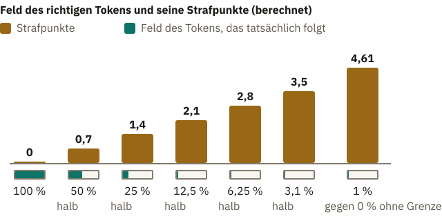
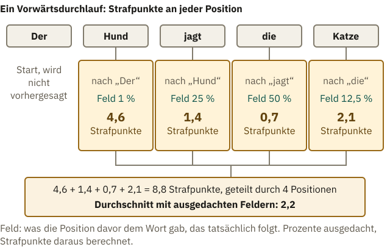
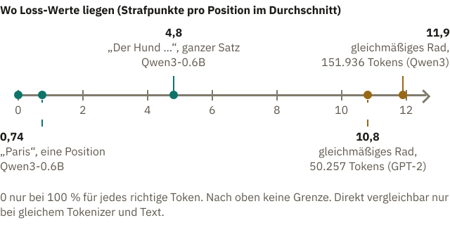

<!-- Generated from src/content/bausteine/de/forward-pass-und-loss.mdx by scripts/export-lessons.mjs -- do not edit by hand. -->

# Forward Pass und Loss: Wie das Modell seinen eigenen Fehler misst

> Lesefassung für GitHub. Die vollständige Fassung mit interaktiven Demos, Animationen und Abrufmoment findest du auf der Website: **[Forward Pass und Loss: Wie das Modell seinen eigenen Fehler misst](https://ki-einfach-verstehen.de/de/bausteine/forward-pass-und-loss/)**
>
> Lizenz: [CC BY 4.0](https://creativecommons.org/licenses/by/4.0/deed.de) · Nenne die Quelle so: KI einfach verstehen, „Forward Pass und Loss: Wie das Modell seinen eigenen Fehler misst“, CC BY 4.0, https://ki-einfach-verstehen.de/de/bausteine/forward-pass-und-loss/

Wie aus den Prozenten eines Sprachmodells für das tatsächlich folgende Token Strafpunkte werden, wie daraus eine einzige Zahl für einen ganzen Stapel Text entsteht und was diese Zahl nicht misst.

Im vorigen Baustein lag eine Abdeckkarte auf dem Text. Das Modell rät das nächste Stück, und unter der Karte liegt die Lösung. Von sich aus gibt ein Sprachmodell aber keine einzelne Antwort ab. Es verteilt Prozente auf alle [Tokens](https://ki-einfach-verstehen.de/de/glossar/token/), die es kennt. Bei einem Test gibt es Punkte für richtig und keine für falsch. Wie bewertest du eine Vorhersage, die 72 Prozent auf das richtige Wort setzt und den Rest auf andere?

Die Antwort steckt in der Trainingsschleife aus dem Baustein über [Parameter, Training, Inferenz und Hardware](./parameter-training-inferenz-hardware.md): Rechnen, Vergleichen, Nachstellen. Beim Vergleichen entsteht eine Fehlerzahl, und sie hieß dort **[Loss](https://ki-einfach-verstehen.de/de/glossar/loss/)**, englisch für Verlust. Er ist umso größer, je weniger Prozent das Modell dem Textstück gab, das im Trainingstext tatsächlich folgt. Beim ausgedachten Apfel-Modell war die Regel einfach: jede Abweichung mal sich selbst. Für Prozente braucht es eine andere. Die Fehlerzahl einer einzelnen Vorhersage heißt in diesem Baustein Strafpunkte; gemittelt über alle Vorhersagen ergeben sie den Loss. Bevor du weiterliest, schätz selbst, wer mehr Strafpunkte bekommen sollte: ein Modell mit 1 Prozent auf dem richtigen Token oder eines mit 27 Prozent, und wie viel mehr.

## Strafpunkte für eine Vorhersage

Erinnerst du dich an das Glücksrad aus dem Baustein über [Wahrscheinlichkeit und Softmax](./wahrscheinlichkeit-und-softmax.md)? Nach „Die Katze“ machte [Softmax](https://ki-einfach-verstehen.de/de/glossar/softmax/) aus drei ausgedachten Scores ein Rad: „sitzt“ bekam ein Feld von rund 72 Prozent, „schläft“ rund 27, „fliegt“ rund 1 Prozent. Jedes Feld ist so groß wie seine [Wahrscheinlichkeit](https://ki-einfach-verstehen.de/de/glossar/wahrscheinlichkeit/). Im Trainingstext folgt „sitzt“. Dieses Token ist das [Label](https://ki-einfach-verstehen.de/de/glossar/label/), die Lösung unter der Karte.

*Das Rad nach „Die Katze“: Die Lampe markiert das Feld des Tokens, das im Text tatsächlich folgt; nur dieses Feld zählt. Großes Feld, wenige Strafpunkte im Glas (schematisch).*

Die Regel schaut nur auf sein Feld: Ist es groß, gibt es wenig Strafpunkte, ist es klein, viele. Wie die anderen Felder verteilt sind, zählt nicht. Zwei Dinge passen an diesem Bild nicht. Erstens wird im Training nicht gedreht, das nächste Token steht schon im Text. Zweitens straft niemand. Das Modell spürt nichts. Die Strafpunkte, im Bild die Kugeln im Glas, sind eine Zahl, die der [Trainingsalgorithmus](https://ki-einfach-verstehen.de/de/glossar/trainingsalgorithmus/) später kleiner machen soll, indem er die [Parameter](https://ki-einfach-verstehen.de/de/glossar/parameter/) verstellt. Und anders als ein Glas, das irgendwann voll ist, haben die Strafpunkte keine Obergrenze.

Strafpunkte sind kein Prozentwert, und sie zählen auch nicht die Prozentpunkte bis 100. Von 1 auf 10 Prozent wird das Feld zehnmal so groß, von 90 auf 99 Prozent nur gut ein Zehntel größer, obwohl beides neun Punkte sind. Gezählt wird deshalb das Verhältnis. Für „sitzt“ mit 72 Prozent ergibt die Regel 0,33 Strafpunkte. Was kostet ein halb so großes Feld, 36 Prozent?

> **Interaktive Demo:** [auf der Website ausprobieren](https://ki-einfach-verstehen.de/de/bausteine/forward-pass-und-loss/)

Es sind 1,02, also 0,69 mehr. Die Regel zählt, wie oft man das Feld halbieren müsste, um von 100 Prozent auf seine Größe zu kommen; die Reihe zeigt die Grafik unten. **Jedes Halbieren des Felds kostet rund 0,7 Strafpunkte mehr**, ganz gleich, wie groß das Feld vorher war. Die 0,7 ist der Wert einer Halbierung in der Einheit, mit der hier gerechnet wird. In einer anderen Einheit würden alle Werte gleichmäßig größer oder kleiner. Die 72 Prozent für „sitzt“ liegen knapp eine halbe Halbierung unter 100 Prozent, daher nur 0,33.

Die 27 Prozent von „schläft“ liegen knapp zwei Halbierungen unter 100 Prozent und kosten 1,31. „Fliegt“ mit 1 Prozent liegt knapp sieben Halbierungen darunter und kostet 4,61, mehr als dreimal so viel.

*Jedes Halbieren des Felds kostet rund 0,7 Strafpunkte mehr. Gegen null wachsen die Strafpunkte ohne Grenze (berechnet).*

Der Reihe nach: 50 Prozent kosten 0,7, 25 Prozent 1,4. Deshalb ist selbstsicher falsch am teuersten. Setzt das Modell 98 Prozent auf „fliegt“, bleibt für „sitzt“ nur ein schmaler, teurer Streifen. Knapp daneben ist billig: Gibt das Modell „schläft“ 60 Prozent und „sitzt“ 40, liegt es falsch und zahlt trotzdem nur 0,9. Fachleute nennen diese Regel **[Cross-Entropy](https://ki-einfach-verstehen.de/de/glossar/loss/)** (Kreuzentropie); sie liefert die Strafpunkte einer Position.

Auch wer vorn liegt, zahlt. Qwen3-0.6B gab im Baustein über den [Output Head](./output-head.md) nach „Die Hauptstadt von Frankreich ist“ dem Token „Paris“ 47,5 Prozent, mehr als jedem anderen. Folgt im Trainingstext „Paris“, kostet das trotzdem 0,74 Strafpunkte. **Jede Vorhersage unter 100 Prozent kostet etwas.** Genauso rechnet das Grundtraining der Sprachmodelle hinter den Chatbots, die du benutzt; das Nachtraining auf Gespräche folgt danach.

Eine Ebene tiefer: Die Formel hinter den Strafpunkten

Die Strafpunkte einer Position sind

`Strafpunkte = −ln p`

Dabei ist p die Wahrscheinlichkeit des Tokens, das tatsächlich folgt, als Zahl zwischen 0 und 1, also 0,72 statt 72 Prozent. ln ist der natürliche Logarithmus. Für Zahlen unter 1 ist er negativ, das Minus macht die Strafpunkte positiv: −ln 1 ist 0, −ln 0,5 ist 0,693.

Der Logarithmus verwandelt Malnehmen in Zusammenzählen. Halbieren heißt mal ½ nehmen, und das wird zu „plus 0,693“, unabhängig von der Größe des Felds. Daher kommt die Reihe mit den 0,7 Schritten.

Die verbreitete Trainingsbibliothek PyTorch bekommt dafür die Scores vor Softmax, die Logits, und das Label, rechnet Softmax und Logarithmus in einem Zug und mittelt über alle Positionen.

Ein Satz hat aber nicht nur eine Position.

## Vorwärts durch das Modell, eine Zahl für den Batch

Im Baustein über den Output Head lief „Der Hund jagt die Katze“ durch das Modell, jedes Wort vereinfacht als ein [Token](https://ki-einfach-verstehen.de/de/glossar/token/); die echte Zerlegung folgt weiter unten. Im Training liefert jede Position ihre Tafel, eine Liste mit einem Score für jedes Token im [Vokabular](https://ki-einfach-verstehen.de/de/glossar/vokabular/). Vier davon lassen sich prüfen: „Der“ soll „Hund“ vorhersagen, „Hund“ das Wort „jagt“, „jagt“ das Wort „die“ und „die“ das Wort „Katze“. Für „Katze“ steht das nächste Token nicht mehr im Text.

Dafür rechnet das Modell den Weg aus dem Themenbereich „Der Weg durchs Modell“. Jedes Token holt sein Embedding, die Blöcke mischen Schicht für Schicht den Kontext ein, der Output Head füllt die Tafeln, Softmax macht aus jeder Tafel ein Rad. Fachleute nennen diesen Weg **[Forward Pass](https://ki-einfach-verstehen.de/de/glossar/forward-pass/)**, auf Deutsch Vorwärtsdurchlauf. Beim Antworten ist es derselbe, denn gemessen werden soll genau das, was das Modell später ausgibt. Neu sind zwei Dinge. Im Training zählen die Räder aller Positionen, nicht nur das letzte, und gedreht wird keins.

Vorhergesagt werden vier Wörter, und jedes kostet Strafpunkte nach dem Feld, das ihm die Position davor gab. Angenommen, das richtige Wort bekäme jeweils diese ausgedachten Felder: „Hund“ 1, „jagt“ 25, „die“ 50, „Katze“ 12,5 Prozent. Am teuersten ist dann „Hund“ mit 4,6 Strafpunkten, denn nach „Der“ kann fast jedes Wort kommen. „Jagt“ kostet 1,4. Nach „jagt“ ist „die“ naheliegend und kostet nur 0,7, „Katze“ dann 2,1.

*Ein Vorwärtsdurchlauf, vier Vorhersagen: Unter jedem vorhergesagten Wort steht, wie groß sein Feld nach dem Wort davor war und was das kostet. Der Satz bekommt den Durchschnitt (ausgedachte Prozente).*

Aus den vier Werten wird eine Zahl, der Durchschnitt: 8,8 Strafpunkte geteilt durch vier Positionen ergibt 2,2, den Loss dieses Satzes mit den ausgedachten Feldern. Warum nicht die Summe? Ein langer Text hätte dann allein wegen seiner Länge den größeren Loss, selbst bei gleich guten Vorhersagen. Der Durchschnitt macht Texte verschiedener Länge vergleichbar. Ob ein Satz als Ganzes stimmt, sagt der Loss nicht: Er misst, wie gut jedes einzelne Token vorhergesagt war, und mittelt erst am Ende.

Qwen3-0.6B in der frei verfügbaren Grundfassung ohne Chat-Training hat genau diesen Satz durchgerechnet. Der [Tokenizer](https://ki-einfach-verstehen.de/de/glossar/tokenizer/), das Programm, das Text in Tokens zerlegt, macht daraus sieben Tokens: „Der“, „Hund“, „jag“, „t“, „die“, „Kat“ und „ze“. „Der“ selbst wird nicht vorhergesagt, weil nichts davor steht; sieben Tokens ergeben deshalb sechs Strafpunkt-Werte. Ihr Durchschnitt ist 4,8. Welches Token kostet wohl am meisten?

> **Interaktive Demo:** [auf der Website ausprobieren](https://ki-einfach-verstehen.de/de/bausteine/forward-pass-und-loss/)

Am teuersten sind „Hund“ und „jag“ mit je rund 11 Strafpunkten. Am billigsten ist „ze“ nach „Kat“ mit 0,16, denn welches Stück sonst sollte folgen?

Das Training rechnet nicht mit einem einzelnen Satz. Im Baustein über Training stellte der Trainingsalgorithmus die Parameter nach, sobald die Steigungen aus einem großen Stapel Text gesammelt waren. Diesen Stapel nennen Fachleute **[Batch](https://ki-einfach-verstehen.de/de/glossar/batch/)**. In anderer Bedeutung kommt das Wort beim Betrieb von Chatbots vor: Dort rechnet das Rechenzentrum die Anfragen vieler Menschen gemeinsam. Im Training heißt Batch der Stapel Text, aus dem eine Fehlerzahl wird. Alle Folgen des Batches laufen vorwärts durch das Modell, jede Position bekommt ihre Strafpunkte, und der Durchschnitt über alle Positionen aller Folgen ist der Loss des Batches.

Wie groß so ein Stapel ist, zeigt GPT-3, ein Sprachmodell der Firma OpenAI aus dem Jahr 2020. Laut Forschungspapier lag die Batchgröße beim größten GPT-3 mit 175 Milliarden Parametern bei 3,2 Millionen Tokens. Zu Beginn des Trainings war sie mit 32.000 Tokens viel kleiner und wuchs je nach Modellgröße in den ersten 4 bis 12 Milliarden Tokens linear auf diesen Wert. Aus Millionen Strafpunkten wird also eine einzige Zahl. Beim Antworten rechnet das Modell pro Textstück einmal vorwärts, im Training kostet dasselbe Stück etwa dreimal so viel Rechenarbeit, hieß es im Baustein über Training. Rund ein Drittel davon ist also dieser Vorwärtsdurchlauf, zwei Drittel braucht der Rückweg, um den es im nächsten Baustein geht.

## Was der Loss sagt und was nicht

Eine gute Vergleichsmarke ist ein Modell, das noch gar nichts gelernt hat. Seine Parameter haben zufällige Startwerte, und Fachleute wählen sie so, dass die Scores aller Tokens nah beieinanderliegen. Dann verteilt Softmax das Rad fast gleichmäßig. Bei 151.936 Tokens wie im Vokabular von Qwen3-0.6B bekäme jedes ein Feld von 1 durch 151.936. Wie viele Strafpunkte kostet dann jede Position, ganz gleich, welches Token folgt?

*Vor dem Training: ein Rad aus lauter gleich schmalen Feldern. Jedes Token kostet rund 11,9 Strafpunkte (schematisch).*

Es sind rund 11,9, ungefähr 17 Halbierungen von 100 Prozent bis zu einem Feld von 1 durch 151.936. Bei so einem Wert beginnt ein sorgfältig gestartetes Training. Der echte Satz liegt mit 4,8 weit darunter: gleiches Vokabular, aber ein Modell, das schon gelernt hat. Das ältere Modell GPT-2 von OpenAI hat 50.257 Tokens im Vokabular, ein gleichmäßiges Rad ergäbe dort 10,8. Dasselbe Nichtwissen ergibt also je nach Vokabulargröße verschiedene Zahlen. Auch der Text zählt: Überraschende Wörter kosten viel, vorhersehbare wenig, wie der echte Satz oben zeigt. **Direkt vergleichen lassen sich Loss-Werte deshalb nur bei gleichem Tokenizer und gleichem Text:** Strafpunkte zählen Tokens, und zwei Tokenizer zerschneiden denselben Text verschieden.

Ein Loss von 0,5 klingt nach „zur Hälfte falsch“. Das liegt nahe: Prozente gehen hinein, und viele Werte liegen zwischen 0 und 1. Doch der Loss ist kein Anteil. Er hat keine Obergrenze, und 0,5 Strafpunkte bekommt an einer einzelnen Position ein Feld von rund 61 Prozent. Für einen Durchschnitt gilt nicht einmal das: 0,5 entsteht auch aus einer Position mit 100 Prozent und einer mit rund 37 Prozent. Ohne Vergleichswert auf demselben Text sagt ein Loss in einem Modellbericht deshalb wenig.

*Wo Loss-Werte liegen: 0 nur bei 100 Prozent für jedes richtige Token, der Wert eines gleichmäßigen Rads hängt vom Vokabular ab. Direkt vergleichbar sind Werte nur bei gleichem Tokenizer und gleichem Text.*

Ob etwas stimmt, misst der Loss nicht. Im Softmax-Baustein ging es um „Sydney“: Angenommen, auf „Die Hauptstadt von Australien ist“ folgt in vielen Trainingstexten „Sydney“. Dann kostet diese Stelle umso weniger Strafpunkte, je größer das Feld ist, das das Modell „Sydney“ gibt, obwohl Canberra die Hauptstadt ist. Ein kleiner Loss heißt also: Das Modell sagt gut voraus, was in seinen Trainingstexten steht. Darin liegt eine der Ursachen, warum ein Chatbot Falsches genauso glatt formulieren kann wie Richtiges.

Angenommen, im Trainingstext steht ein Tippfehler, etwa „Die Katze sitzt auf dem Sfoa“, und das Modell gibt an dieser Stelle „Sofa“ ein großes Feld. Wird diese Position teuer oder billig?

Teuer. Die Lösung unter der Karte ist der Tippfehler, und für ihn bleibt nur ein schmales Feld. Das Modell hat sinnvoll vorhergesagt und zahlt trotzdem. Über Millionen Positionen gemittelt fällt ein Tippfehler kaum ins Gewicht.

Eine Ebene tiefer: Perplexität, der Loss als Zahl der Möglichkeiten

Forschungspapiere geben statt des Loss oft die **Perplexität** an, englisch perplexity, wörtlich Ratlosigkeit. Man rechnet sie aus dem durchschnittlichen Loss über einen Text:

`Perplexität = e hoch Loss`

e ist die Zahl 2,718…, die Grundzahl des natürlichen Logarithmus. Die Perplexität übersetzt den Loss in eine Zahl gleich guter Möglichkeiten. Ein Modell mit Perplexität 2 ist im Durchschnitt so unsicher, als hätte es an jeder Stelle die Wahl zwischen zwei gleich großen Feldern. Das Lehrbuch von Jurafsky und Martin nennt sie einen gewichteten durchschnittlichen Verzweigungsfaktor.

Für „Der Hund jagt die Katze“ mit 4,8 Strafpunkten im Durchschnitt ergibt das e hoch 4,8, rund 120: als hätte Qwen3-0.6B an jeder Stelle die Wahl zwischen gut hundert gleich großen Feldern. Ein gleichmäßiges Rad über 151.936 Tokens kommt auf genau 151.936, so viele Möglichkeiten, wie es Tokens gibt.

Der Loss sagt, wie weit das Modell danebenlag, aber nicht, woran es lag. Welcher der 0,6 Milliarden Parameter von Qwen3-0.6B hat wie viel zu den 4,8 beigetragen, und in welche Richtung müsste er sich bewegen, damit die Zahl kleiner wird? Das klärt der nächste Baustein über Backpropagation, den Rückweg durch das Modell, und Gradienten, die Steigungen für jeden Parameter.

---

Quelle: https://ki-einfach-verstehen.de/de/bausteine/forward-pass-und-loss/

← Zurück: [Aus Text werden viele Übungsaufgaben](./aus-text-werden-uebungsaufgaben.md) · [Alle Bausteine](../../README.de.md#inhalt) · Weiter: [Backpropagation und Gradienten: Wie das Modell weiß, was es ändern muss](./backpropagation-und-gradienten.md) →
