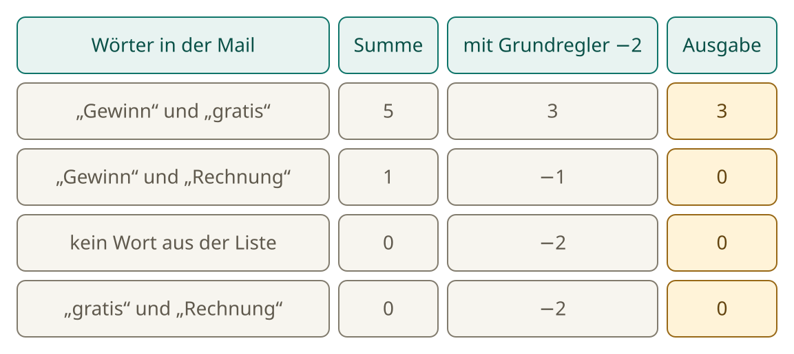
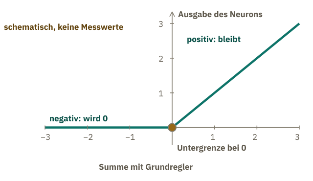
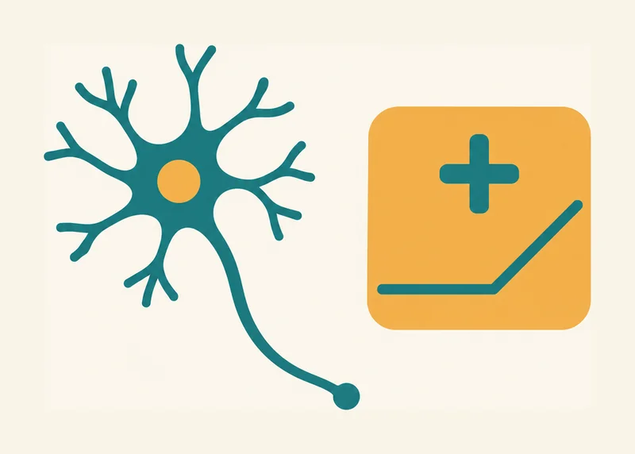

<!-- Generated from src/content/bausteine/de/kuenstliches-neuron.mdx by scripts/export-lessons.mjs -- do not edit by hand. -->

# Das künstliche Neuron: Wie aus einer Summe eine Ausgabe wird

> Lesefassung für GitHub. Die vollständige Fassung mit interaktiven Demos, Animationen und Abrufmoment findest du auf der Website: **[Das künstliche Neuron: Wie aus einer Summe eine Ausgabe wird](https://ki-einfach-verstehen.de/de/bausteine/kuenstliches-neuron/)**
>
> Lizenz: [CC BY 4.0](https://creativecommons.org/licenses/by/4.0/deed.de) · Nenne die Quelle so: KI einfach verstehen, „Das künstliche Neuron: Wie aus einer Summe eine Ausgabe wird“, CC BY 4.0, https://ki-einfach-verstehen.de/de/bausteine/kuenstliches-neuron/

Was ein künstliches Neuron ausrechnet: Gewichte, Grundregler und Untergrenze. Mit dem Spamfilter aus dem ersten Baustein lässt sich alles von Hand nachrechnen.

Ein Modell hat Milliarden Zahlen, und in keiner einzelnen steht ein Satz. Wie aus Zahlen trotzdem eine Antwort wird, lässt sich an einer sehr kleinen Rechnung zeigen: an einem [künstlichen Neuron](https://ki-einfach-verstehen.de/de/glossar/neuron/). Die Zutaten kennst du schon, denn der Spamfilter aus dem ersten Baustein hat sie auch.

## Der Spamfilter rechnet schon fast so

Erinnerst du dich an den Spamfilter? Er hatte für jedes Wort ein Gewicht gespeichert. Die Zahlen hier sind nur ausgedachte Beispiele und wurden nicht trainiert: „Gewinn“ +3, „gratis“ +2, „Rechnung“ −2. Welche Summe ergibt sich für eine Mail mit „Gewinn“ und „Rechnung“? Rate zuerst. Die Auflösung steht im nächsten Abschnitt, in Worten. Lag die Summe über 2, war die Mail Spam.

*Ein Kanal als Neuron: Die drei senkrechten Regler halten die Gewichte der drei Eingaben. Die Anzeige zeigt die Ausgabe. Den waagerechten Regler und die geknickte Linie erklären die nächsten beiden Abschnitte.*

Ein Gewicht ist also nur eine Zahl, die festlegt, wie stark ein Wort zählt. Ein positives Gewicht schiebt in Richtung Spam, ein negatives in Richtung Entwarnung. Für das Neuron ist jedes Wort eine Eingabe: 1, wenn es in der Mail steht, sonst 0. Das Gewicht wird mit dieser Eingabe malgenommen. Steht das Wort nicht drin, ergibt das 0 und zählt nicht. Stell dir das Neuron als Kanal an einem Mischpult vor. Jeder senkrechte Regler steht für das Gewicht eines Worts und bestimmt, wie stark es in die Summe eingeht. Die Anzeige rechts zeigt am Ende nur eine Zahl: die Ausgabe des Neurons.

Im Spamfilter hat jedes Wort seinen eigenen Regler, weil der Filter nur diese drei Wörter kennt. Ein Chatbot rechnet mit Summen dieser Art auch, nur mit Milliarden Reglern. Die meisten davon gehören zu keinem bestimmten Wort; ihre Eingaben sind Zahlen aus früheren Rechenschritten.

## Der Grundregler: eine Zahl, die immer mitzählt

Der Spamfilter verglich die Summe mit einer Schwelle von 2. Das Neuron baut diese Schwelle direkt in seine Rechnung ein: Es zählt eine vom Training eingestellte Zahl zur Summe. Diese Zahl heißt [Grundregler](https://ki-einfach-verstehen.de/de/glossar/grundregler/), im Englischen bias. Der Grundregler gehört zu keinem Wort und zählt bei jeder Mail gleich. Auch in Chatbot-Modellen werden Eingaben mit solchen Gewichten malgenommen und zusammengezählt; dort heißen sie Parameter.

Im ausgedachten Beispiel steht der Grundregler auf −2. Die Mail mit „Gewinn“ und „gratis“ hat die Summe 5, die mit „Gewinn“ und „Rechnung“ die Summe 1. In beiden Summen ist der Grundregler noch nicht enthalten. Er kommt danach dazu, bei jeder Mail gleich.

Bei −2 wird das Ergebnis erst positiv, wenn die Summe über 2 liegt.

−2 heißt: zwei weniger als null. Die Rechnung im Einzelnen steht in der Box.

Eine Ebene tiefer: Die Rechnung Schritt für Schritt

Bei „Gewinn“ und „gratis“ kommen die Gewichte +3 und +2 zusammen. Ihre Summe ist 3 + 2 = 5. Der Grundregler kommt danach dazu: 5 + (−2) = 3. Das Neuron rechnet also 5 − 2 = 3.

Bei „Gewinn“ und „Rechnung“ sind es +3 und −2. Ihre Summe ist 3 + (−2) = 1. Mit dem Grundregler ergibt das 1 + (−2) = −1.

Ein negatives Ergebnis verstehst du am besten am Zahlenstrahl: −2 bedeutet zwei Schritte links von null. Wer bei 0 steht und −2 dazuzählt, landet bei −2. Wer bei 3 steht und −2 dazuzählt, landet bei 1. Der Grundregler schiebt jede Summe nach unten. Nur wenn die Summe größer als 2 ist, bleibt am Ende etwas Positives übrig.

*Der Grundregler ist ein Regler mit einer festen Stellung. Er bleibt bei jeder Mail gleich.*

Zwei weitere Mails mit denselben Gewichten kannst du selbst nachrechnen: erst die Wörter zusammenzählen, dann den Grundregler dazu. Die dritte Mail hat kein Wort aus der Liste, die vierte „gratis“ und „Rechnung“. Deine Ergebnisse kannst du gleich im nächsten Abschnitt prüfen.

Nimm eine eigene Mail mit „Gewinn“, „gratis“ und „Rechnung“ und rechne sie auf Papier nach.

## Die Untergrenze: negative Werte werden null

Nach dem Grundregler kann die Zahl negativ sein. Bei drei der vier Mails ist das der Fall: Für „Gewinn“ und „Rechnung“ ergibt die Rechnung −1, für „kein Wort“ sowie für „gratis“ und „Rechnung“ jeweils −2.

Auf diese Zahl folgt eine feste Stufe, die Untergrenze. Welche Ausgabe gibt das Neuron für die zweite Mail am Ende aus: −1 oder 0? Rate zuerst. Die Regel ist einfach: Ist die Zahl negativ, wird sie null. Ist sie null oder positiv, bleibt sie, wie sie ist. In der Fachsprache heißt diese Stufe [Aktivierungsfunktion](https://ki-einfach-verstehen.de/de/glossar/aktivierungsfunktion/).

*Vier Mails mit den Gewichten aus dem Beispiel. Die Spalten zeigen die Rechnung Schritt für Schritt. Die letzte Spalte ist die Ausgabe, nachdem die Untergrenze gewirkt hat.*

Bei diesem Neuron bleibt die Untergrenze selbst beim Training unverändert. Nur die Zahlen davor ändern sich. So rechnet dieses Neuron: Es multipliziert jedes Gewicht mit seiner Eingabe (1 oder 0), addiert die Ergebnisse und den Grundregler und setzt negative Ergebnisse anschließend auf null.

Auch Chatbot-Modelle haben zwischen ihren Rechenschritten Stufen, die eingehende Zahlen verändern. Wie genau diese Stufen aussehen, hängt vom Modell ab. Warum solche Stufen nötig sind, zeigt der Baustein [Schichten](./schichten.md).

*Schematisch, keine Messwerte: Unter null bleibt die Ausgabe auf null, darüber steigt sie gerade an.*

## Die Ausgabe ist eine Zahl, kein Urteil

Der Spamfilter gab am Ende ein Ja oder Nein aus. Das Neuron gibt dagegen nur das Ergebnis seiner Rechnung aus. Die Mail mit „Gewinn“ und „gratis“ bekommt die Zahl 3, die Mail mit „Gewinn“ und „Rechnung“ die Zahl 0.

Ein Chatbot arbeitet ähnlich. Sein Modell gibt jedem möglichen nächsten Textstück eine Zahl. Das kann ein ganzes Wort, ein Wortteil oder ein Satzzeichen sein. Ein Auswahlschritt bestimmt daraus, welches Stück im Text steht.

Erst eine weitere Stelle liest die Zahl und entscheidet, ob daraus ein Urteil wird. Das einzelne Neuron fällt dieses Urteil nicht.

> **Interaktive Demo:** [auf der Website ausprobieren](https://ki-einfach-verstehen.de/de/bausteine/kuenstliches-neuron/)

## Das Gehirn-Bild: der Name, nicht die Sache

Der Name Neuron stammt von der Nervenzelle. Es kommt etwas hinein, es wird verarbeitet, es kommt etwas heraus. Von der Nervenzelle bleibt nur die Grundidee: Viele Eingaben werden unterschiedlich stark gewichtet und führen zu einer Ausgabe.

Eine echte Nervenzelle ist weit komplizierter. Das Ziel künstlicher Netze ist es nicht, das Gehirn genau nachzubilden. Auch ein Chatbot-Modell besteht aus Zahlen und Rechenschritten, nicht aus Nervenzellen.

Was lernt ein Neuron im Training, und was bleibt gleich?

*Die Nervenzelle hat dem Neuron den Namen gegeben. Die Rechenvorschrift dahinter ist eine Summe mit Grundregler und Untergrenze.*

Im Training ändern sich die Zahlen. Die Rechenvorschrift bleibt gleich. Das Neuron in diesem Baustein folgt also einer festen Rechenvorschrift; nur die eingesetzten Zahlen stellt das Training ein. Dieses Neuron ist so einfach, dass sich seine Rechnung von Hand nachrechnen lässt.

## Die ganze Rechnung

In einem Chatbot wandern die Zahlen durch viele gewichtete Summen und Stufen, die die Zahlen verändern, neben anderen Rechenschritten, bis am Ende eine Vorhersage für das nächste Textstück steht.

Eine einzelne Zahl ist aber noch kein Modell. In einem Netz gibt ein Neuron seine Ausgabe an weitere Neuronen weiter; für sie ist sie eine Eingabe, die mit einem Gewicht malgenommen wird. Eine solche weitergegebene Zahl heißt [Zwischenwert](https://ki-einfach-verstehen.de/de/glossar/zwischenwert/). Was entsteht, wenn viele Neuronen ihre Ergebnisse so weitergeben? Das zeigt der Baustein [Schichten](./schichten.md).

---

Quelle: https://ki-einfach-verstehen.de/de/bausteine/kuenstliches-neuron/

← Zurück: [Modellgröße und Hardware: Wo ein Modell Platz findet](./modellgroesse-und-hardware.md) · [Alle Bausteine](../../README.de.md#inhalt) · Weiter: [Was ein KI-Modell eigentlich ist](./was-ein-ki-modell-eigentlich-ist.md) →
