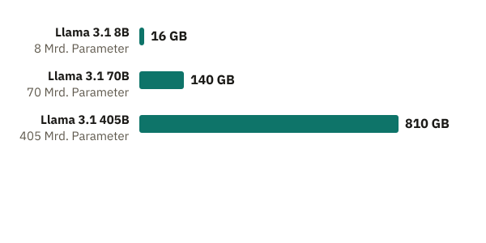
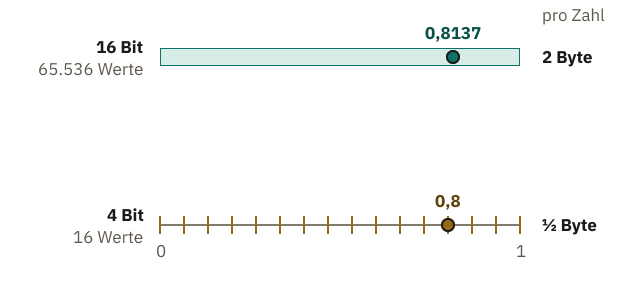
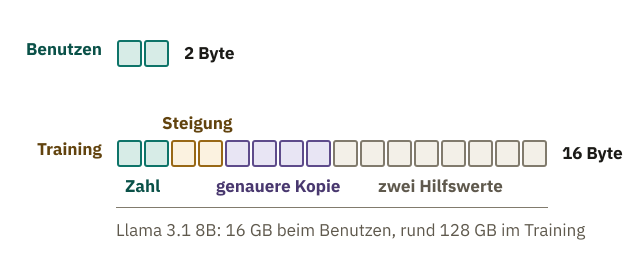

<!-- Generated from src/content/bausteine/de/modellgroesse-und-hardware.mdx by scripts/export-lessons.mjs -- do not edit by hand. -->

# Modellgröße und Hardware: Wo ein Modell Platz findet

> Lesefassung für GitHub. Die vollständige Fassung mit interaktiven Demos, Animationen und Abrufmoment findest du auf der Website: **[Modellgröße und Hardware: Wo ein Modell Platz findet](https://ki-einfach-verstehen.de/de/bausteine/modellgroesse-und-hardware/)**
>
> Lizenz: [CC BY 4.0](https://creativecommons.org/licenses/by/4.0/deed.de) · Nenne die Quelle so: KI einfach verstehen, „Modellgröße und Hardware: Wo ein Modell Platz findet“, CC BY 4.0, https://ki-einfach-verstehen.de/de/bausteine/modellgroesse-und-hardware/

Wie viel Speicher ein KI-Modell braucht, warum zuerst der Platz und nicht das Tempo entscheidet, wie Quantisierung Modelle verkleinert und warum Training noch viel mehr Speicher braucht.

Im vorigen Baustein hast du die Modelldatei von Llama 3.1 8B kennengelernt: ein kleiner Bauplan und rund acht Milliarden Zahlen, zusammen 16 Gigabyte. Auf manchen Handys läuft ein [Sprachmodell](https://ki-einfach-verstehen.de/de/glossar/sprachmodell/) direkt auf dem Gerät, bei Apple etwa eines mit rund 3 Milliarden [Parametern](https://ki-einfach-verstehen.de/de/glossar/parameter/). Große Chatbots laufen dagegen in Rechenzentren.

Was glaubst du: Liegt das vor allem daran, dass der Chip im Handy zu langsam rechnet, oder an etwas anderem?

## Wie viel Platz acht Milliarden Zahlen brauchen

Jede der acht Milliarden Zahlen ist in der Datei mit 2 Byte gespeichert, und ein Gigabyte ist eine Milliarde Byte. Woher kommen die 2 Byte? Ein Speicher besteht aus winzigen Stellen, die jeweils nur Ja oder Nein festhalten. Eine solche Stelle heißt Bit, und acht Bit ergeben ein Byte. Llama 3.1 hält jede Zahl mit 16 Bit fest, also mit 2 Byte.

Jede Kombination aus Ja und Nein steht für einen bestimmten Wert. Jedes zusätzliche Bit verdoppelt die Zahl der möglichen Werte: 4 Bit ergeben 16 Werte, 8 Bit ergeben 256.

Daraus folgt eine Faustregel: Milliarden Parameter mal Byte pro Zahl ergibt Gigabyte. Für Llama 3.1 8B heißt das 8 mal 2, also 16 Gigabyte. Meta bietet Llama 3.1 auch in einer mittleren Fassung mit 70 Milliarden Parametern an.

Was glaubst du: Wie viel Platz braucht die Fassung mit 70 Milliarden Parametern? Überleg kurz, bevor du weiterliest.

Nach der Faustregel sind es 70 mal 2, also 140 Gigabyte. Die größte Fassung der Reihe Llama 3.1, Llama 3.1 405B, kommt so auf rund 810 Gigabyte.

*Nach der Faustregel mit 2 Byte pro Zahl: Der Speicher für die Parameter wächst im selben Verhältnis wie ihre Zahl. Ganz rechts steht Llama 3.1 405B, die größte Fassung der Reihe; mehr dazu im Abschnitt Platz vor Tempo.*

Die Faustregel berücksichtigt nur die Parameter. Beim Rechnen entstehen zusätzlich Zwischenergebnisse, während das Modell deinen Text Schritt für Schritt verarbeitet. Diese Werte stehen nicht in der Datei, brauchen aber ebenfalls Platz. Weil bei jeder Nachricht das bisherige Gespräch mitverarbeitet wird, wächst ihr Anteil mit der Länge des Gesprächs. Eine feste Zahl dafür gibt es nicht. Die Faustregel ist also ein Mindestwert: Llama 3.1 8B braucht mit 16 Bit mindestens 16 Gigabyte. Auf Download-Seiten kannst du so aus der Zahl im Modellnamen abschätzen, wie groß die Datei mit 16 Bit ungefähr ist; eine Fassung mit 4 Bit ist mindestens ein Viertel davon. In der Praxis ist sie etwas größer.

## Zum Vergleich: eine Spiele-Grafikkarte

Wie groß ist das im Vergleich? Eine Beispielkarte für Spiele ist die GeForce RTX 4090 von Nvidia. Laut Hersteller hat sie 24 Gigabyte Speicher direkt auf der Karte. Llama 3.1 8B passt mit seinen 16 Gigabyte darauf, mit etwas Platz für Zwischenergebnisse. Passt ein Modell nicht vollständig in den Speicher, wird jedes Textstück deutlich langsamer, weil der fehlende Rest immer wieder nachgeladen werden muss.

## Platz vor Tempo

Wo müssen diese Gigabyte liegen, damit das Modell antwortet? Das Mischpult-Bild aus den vorigen Bausteinen hilft hier nur bis zu einem Punkt. Ein echtes Pult hat seine Schaltung fest eingebaut. Ein Modell dagegen ist eine Datei aus Bauplan und Reglerstellungen, die erst auf einen Chip geladen werden muss.

„Laufen“ heißt, ein Chip rechnet für jedes Textstück nach dem Bauplan mit den Zahlen des Modells. Den Grafikprozessor kennst du aus dem Baustein über Vektoren und Matrizen: Er führt Tausende gleichartiger Rechnungen zugleich aus.

Am schnellsten arbeitet der Grafikprozessor mit Zahlen aus seinem eigenen Speicher, der direkt neben dem Chip liegt. Dieser Speicher heißt **[Grafikspeicher](https://ki-einfach-verstehen.de/de/glossar/grafikspeicher/)**.

*Ein Grafikchip rechnet mit den Zahlen in seinem eigenen, schnellen Speicher.*

Die Datei selbst liegt im Dauerspeicher, also dort, wo auch Fotos und Apps dauerhaft abgelegt sind. Auf einem Handy ist dieser Speicher viel größer als der Arbeitsspeicher. Von dort zu lesen ist viel zu langsam, wenn für jedes Textstück alle Zahlen gebraucht werden. Zum Rechnen werden sie deshalb in den schnellen Speicher neben dem Chip kopiert (bei der Grafikkarte ist das der Grafikspeicher).

Llama 3.1 405B braucht nach der Faustregel rund 810 Gigabyte, weit mehr, als ein einzelner Grafikprozessor im Rechenzentrum fasst. Mit 16 Bit verteilt sich das Modell deshalb auf viele Chips, die sich seine Zahlen aufteilen.

**Damit ein Modell zügig antwortet, müssen alle seine Zahlen zusammen im schnellen Speicher der eingesetzten Chips liegen.** Erst danach zählt das Tempo. Bei Llama 3.1 braucht der Chip für jedes Textstück alle Zahlen. Bei einzelnen Anfragen ist deshalb meist das Holen aus dem Speicher der Engpass, nicht das Rechnen. Liegt ein Teil nur im langsamen Dauerspeicher, muss der Chip ihn für jedes Textstück nachladen. Dann wartet auch der schnellste Chip.

### Warum das Handy an seine Grenze stößt

*Ein kleines Modell passt aufs Handy. Die größten Modelle brauchen dagegen viele Chips im Rechenzentrum, weil ihre Zahlen sonst keinen Platz finden.*

Ein Handy hat keinen eigenen Grafikspeicher. Der schnelle Speicher neben seinem Chip ist der Arbeitsspeicher, den sich Modell, Betriebssystem und alle Apps teilen. Aktuelle Pixel-Handys von Google haben 8 bis 16 Gigabyte davon, viel weniger als der Dauerspeicher. Die Datei mit 16 Bit pro Zahl ist 16 Gigabyte groß und würde damit den gesamten Arbeitsspeicher des größten dieser Handys belegen. Da System und Apps ebenfalls Platz brauchen, passt das Modell nicht hinein. Bei größeren Modellen wird die Lücke noch größer. Deshalb entstehen die Antworten großer Chatbots auf Chips im Rechenzentrum – und deine Frage muss erst dorthin gelangen.

Eine Ebene tiefer: Wie groß und wie schnell der Speicher einer H100 ist

Ein Grafikprozessor für Rechenzentren, etwa die H100 von Nvidia, hat in der verbreiteten Fassung 80 Gigabyte. Selbst acht H100 mit je 80 Gigabyte fassen zusammen nur 640 Gigabyte. Für die rund 810 Gigabyte von Llama 3.1 405B reicht das nicht.

Für jedes neue Textstück wird das ganze Modell einmal durchgerechnet, also müssen alle Parameter aus dem Grafikspeicher zu den Rechenwerken wandern. Bei einzelnen Anfragen dauert dieses Laden länger als das Rechnen selbst.

Wie viele Gigabyte der Speicher pro Sekunde liefern kann, gibt die **Speicherbandbreite** an. Bei der H100 in ihrer verbreiteten SXM-Fassung sind es laut Hersteller 3,35 Terabyte pro Sekunde, also 3350 Gigabyte. Ein Überschlag mit Llama 3.1 8B: 3350 geteilt durch dessen 16 Gigabyte ergibt rund 209. Bei einer einzelnen Anfrage schafft dieser Chip mit 16-Bit-Zahlen also höchstens rund 209 Textstücke pro Sekunde, egal wie schnell er rechnet. In der Praxis sind es weniger. Deshalb rechnen Rechenzentren die Anfragen vieler Menschen gemeinsam, in einem Batch: Der Chip lädt die Parameter einmal und verwendet sie für alle Anfragen dieses Schritts. Das Tempo spielt also eine Rolle, aber erst, wenn das Modell Platz gefunden hat.

## Gröber gerundet: Quantisierung

Nach der Faustregel bräuchte Apples Handy-Modell mit 2 Byte pro Zahl 6 Gigabyte. Auf einem Handy mit 8 Gigabyte bliebe für System und Apps kaum etwas übrig. Trotzdem läuft es auf dem Gerät. Dafür wird jede Zahl mit weniger Bit gespeichert, also gröber gerundet.

Nimm die ausgedachte Zahl 0,8137. Zur Vereinfachung nehmen wir an, die erlaubten Werte liegen gleichmäßig zwischen 0 und 1. Mit 16 Bit bliebe die Zahl fast genau erhalten.

Mit 4 Bit bleiben nur 16 Werte. Zwischen 0 und 1 liegen 15 gleich große Abstände, je 1/15, also rund 0,067: 0; 0,067; 0,133 … 0,8; 0,867 … 1. Am nächsten an 0,8137 liegt 0,8; der folgende Wert, 0,867, ist schon weiter entfernt. Dieses gröbere Speichern heißt **[Quantisierung](https://ki-einfach-verstehen.de/de/glossar/quantisierung/)**. Alle Regler bleiben dabei erhalten, nur steht jeder etwas ungenauer.

*Vereinfacht, mit gleichmäßig verteilten erlaubten Werten zwischen 0 und 1: Je weniger Bit, desto weniger Werte, desto gröber wird die ausgedachte Zahl 0,8137 gerundet.*

Weniger Bit heißt weniger Platz. Mit 8 Bit braucht jede Zahl nur noch 1 Byte, mit 4 Bit ein halbes. Nach der Faustregel schrumpft Llama 3.1 8B mit 4 Bit von 16 auf rund 4 Gigabyte.

Durch die gröber gerundeten Regler verändern sich die Bewertungen für das nächste Textstück ein wenig. Das sind die [Scores](https://ki-einfach-verstehen.de/de/glossar/score/) aus dem Baustein über [Input und Output](./input-und-output.md). Meist liegt trotzdem dasselbe Textstück vorn. Je weniger Bit, desto öfter kippt die Wahl, und das Modell macht mehr Fehler. Wie stark das ausfällt, hängt vom Verfahren und von der Zahl der Bit ab. Bei 8 Bit kann die Einbuße gering bleiben. Ein Verfahren aus dem Jahr 2022 speichert die meisten Werte mit 8 Bit und die wenigen großen Ausreißer mit 16 Bit. Bei OPT-175B, einem Modell mit rund 175 Milliarden Parametern, ebenso viele wie GPT-3, ein Sprachmodell von 2020, berichten die Forschenden von keinem spürbaren Leistungsverlust. Mit weniger Bit wird es heikler. Viele Modelle zum Herunterladen gibt es deshalb in mehreren Fassungen mit unterschiedlich vielen Bit.

Was glaubst du: Mit wie vielen Bit passt Llama 3.1 8B auf ein Handy mit 8 Gigabyte? Überleg kurz, bevor du weiterliest.

> **Interaktive Demo:** [auf der Website ausprobieren](https://ki-einfach-verstehen.de/de/bausteine/modellgroesse-und-hardware/)

Mit 8 Bit wären es 8 Gigabyte und damit der gesamte Speicher. Für System und Apps bliebe nichts übrig. Mit 4 Bit sind es mindestens rund 4 Gigabyte, also etwa die Hälfte, in der Praxis etwas mehr. Für System, Apps und Zwischenergebnisse bleibt höchstens etwa die Hälfte, und das wird knapp, weil alle Apps denselben Speicher teilen. Eine vernünftige Wahl ist trotzdem 4 Bit: Llama 3.1 8B passt damit aufs Handy, wenn System und Apps wenig Speicher belegen. Mit 2 Bit wäre der Platz da; eine Studie zu Llama 3 zeigt aber, dass nachträglich auf sehr niedrige Bitbreiten verkleinerte Modelle spürbar an Leistung verlieren.

## Der Speicher im Training

Was glaubst du: Braucht das Training von Llama 3.1 8B so viel Speicher wie das Benutzen? Es sind ja dieselben acht Milliarden Parameter. Denk kurz darüber nach, bevor du weiterliest.

Es braucht deutlich mehr. Im Training ermittelt die Backpropagation für jeden Regler seine Steigung. Dieses Rechenverfahren arbeitet sich rückwärts durch das Modell; aus der Steigung ergibt sich dann der nächste Schritt des Reglers. Im Apfel-Modell aus dem vorigen Baustein bestimmte der einzige Regler den Preis pro Kilo. Dort galt dieselbe Regel: Schritt gleich Steigung mal [Lernrate](https://ki-einfach-verstehen.de/de/glossar/lernrate/). Die Lernrate bestimmt, wie weit das Training einen Regler pro Schritt dreht. Die Steigung jedes Reglers muss gespeichert bleiben, bis das Training die Steigungen vieler Textstücke gesammelt hat. Erst dann verstellt es die Regler, damit nicht jedes einzelne Textstück sie sofort verschiebt.

Außerdem sind die Schritte oft so klein, dass eine 16-Bit-Zahl sie beim Speichern wegrundet. Deshalb speichert das Training für jede Zahl eine genauere Kopie mit 32 Bit, in der sich die winzigen Schritte sammeln. Das Training rechnet weiter mit der 16-Bit-Zahl, weil das schneller geht.

Und das Trainingsverfahren Adam rechnet feiner als die Regel „Steigung mal Lernrate“. Dafür merkt es sich je Regler zwei Hilfswerte: einen für die Richtung der letzten Steigungen, einen für ihre typische Größe.

Ein Forschungspapier zum Training großer Modelle rechnet pro Parameter mit 16 Byte statt 2, also achtmal so viel. Die 16 Byte setzen sich so zusammen: 2 Byte für die Zahl, 2 Byte für ihre Steigung, 4 Byte für die Kopie mit 32 Bit und 8 Byte für die zwei Hilfswerte. Rechnet man diese 16 Byte für Llama 3.1 8B nach, ergeben sich rund 128 Gigabyte: 8 Milliarden mal 16 Byte. Das ist eine Überschlagsrechnung, kein gemessener Wert. Die 128 Gigabyte sind mehr, als ein einzelner Grafikprozessor vom Typ H100 mit 80 Gigabyte fasst. Die Zwischenergebnisse kommen noch hinzu. Schon das Training eines Modells dieser Größe verteilt sich deshalb auf mehrere Chips.

*Pro Parameter: Zum Benutzen genügen 2 Byte, im Training kommen Steigung, genauere Kopie und zwei Hilfswerte hinzu.*

Eine Ebene tiefer: Was Training zusätzlich im Speicher hält

Die 16 Byte stammen aus dem Forschungspapier zu ZeRO, einem Verfahren zum Training sehr großer Modelle. Die Rechnung gilt für Training mit gemischter Genauigkeit, also mit 16-Bit-Zahlen und der genaueren 32-Bit-Kopie daneben.

Warum die 32-Bit-Kopie nötig ist, zeigt ein Zahlenbeispiel. Bei dem 16-Bit-Format, das Llama 3.1 nutzt, liegen Werte nahe 0,8 rund 0,004 auseinander. Ein Schritt von 0,001 würde beim Speichern wieder auf den alten Wert gerundet und ginge verloren. Die 16-Bit-Zahl wird deshalb bei jedem Schritt aus der Kopie neu gerundet.

Fachleute nennen die Steigungen aller Regler zusammen **Gradient**. Das Trainingsverfahren mit den zwei Hilfswerten heißt **Adam**. Daraus berechnet Adam für jeden Regler einen eigenen, ausgeglicheneren Schritt.

Andere Rechnungen kommen auf etwas mehr. Eine Anleitung von Hugging Face nennt 18 Byte pro Parameter, weil sie die Steigungen mit 32 Bit und damit mit 4 statt 2 Byte speichert. Die Zahlen liegen dort wie hier als 16-Bit-Zahl und als 32-Bit-Kopie vor. ZeRO verteilt diese Einträge auf alle beteiligten Chips, statt sie auf jedem Chip vollständig zu speichern. Beim Benutzen mit 16 Bit fallen Steigungen, Kopie und Hilfswerte weg, die Zahlen allein reichen.

Zurück zu deiner Frage vom Anfang: Der Platz entscheidet. Die Zahlen eines großen Modells passen nicht in den Speicher eines Handys, deshalb rechnen große Chatbots im Rechenzentrum. In den Milliarden Zahlen gibt es keinen Eintrag, den du einfach aufschlagen kannst. Aus diesen Zahlen wird jede Antwort neu berechnet. Wie daraus eine Antwort wie „Paris ist die Hauptstadt von Frankreich“ entsteht, bleibt vorerst offen. Der Baustein [Das künstliche Neuron](./kuenstliches-neuron.md) zeigt zunächst, wie ein einzelnes Neuron mit seinen Zahlen rechnet.

---

Quelle: https://ki-einfach-verstehen.de/de/bausteine/modellgroesse-und-hardware/

← Zurück: [Parameter, Training und Benutzen: Wie ein Modell lernt](./parameter-training-inferenz-hardware.md) · [Alle Bausteine](../../README.de.md#inhalt) · Weiter: [Das künstliche Neuron: Wie aus einer Summe eine Ausgabe wird](./kuenstliches-neuron.md) →
