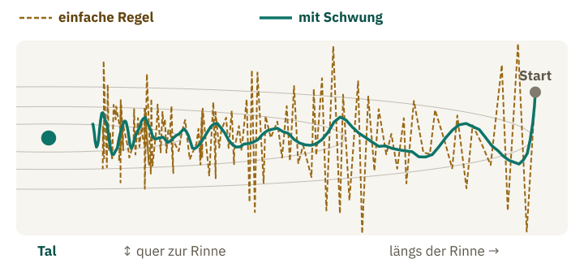
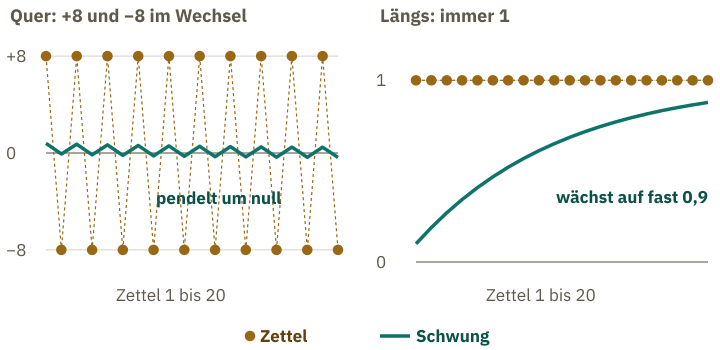
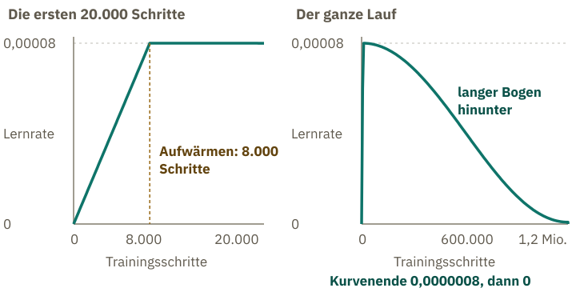

<!-- Generated from src/content/bausteine/de/optimierung-der-gewichte.mdx by scripts/export-lessons.mjs -- do not edit by hand. -->

# Optimierung: Wer die Gewichte tatsächlich ändert

> Lesefassung für GitHub. Die vollständige Fassung mit interaktiven Demos, Animationen und Abrufmoment findest du auf der Website: **[Optimierung: Wer die Gewichte tatsächlich ändert](https://ki-einfach-verstehen.de/de/bausteine/optimierung-der-gewichte/)**
>
> Lizenz: [CC BY 4.0](https://creativecommons.org/licenses/by/4.0/deed.de) · Nenne die Quelle so: KI einfach verstehen, „Optimierung: Wer die Gewichte tatsächlich ändert“, CC BY 4.0, https://ki-einfach-verstehen.de/de/bausteine/optimierung-der-gewichte/

Wie der Optimierer aus den Zetteln der Backpropagation echte Schritte macht: mit Schwung, mit einer eigenen Schrittweite für jeden Regler, mit einem leisen Zug Richtung null und nach einem Plan für die Lernrate.

Am Ende des letzten Bausteins hing am Mischpult von Llama 3.1 8B an jedem der rund acht Milliarden Regler ein Zettel. Die Backpropagation hatte ihn für einen [Batch](https://ki-einfach-verstehen.de/de/glossar/batch/) ausgerechnet, also für einen Stapel Text, für den der [Loss](https://ki-einfach-verstehen.de/de/glossar/loss/) eine einzige Fehlerzahl liefert. Jeder Regler steht für einen [Parameter](https://ki-einfach-verstehen.de/de/glossar/parameter/), seine Stellung für dessen Zahl. Sein Zettel sagt nur für diesen Batch: höher oder tiefer, und wie stark. Alle Zettel zusammen heißen Gradient. Bewegt hat sich dabei noch kein Regler.

Beim nächsten Batch zeigen viele Zettel ein wenig anders, manche sogar in die Gegenrichtung. Was glaubst du: Wohin führt es, den Zetteln jedes Mal genau zu folgen?

## Wer dreht: der Optimierer, mit Schwung

Aus dem Baustein über Training kennst du die einfachste Antwort: Schritt gleich Steigung mal [Lernrate](https://ki-einfach-verstehen.de/de/glossar/lernrate/). Ein Zettel ist genau diese Steigung, für jeden Regler einzeln: wohin es bergab geht und wie steil. Beim ausgedachten Apfel-Modell halbierte mit einer Lernrate von einem Vierundzwanzigstel jeder Schritt den Rest bis zum Tal. Mit einem Sechstel sprang der Regler zwischen 0 und 6 hin und her. Diese Regel ist eine feste Rechenvorschrift, die aus den Zetteln Schritte macht. Eine solche Vorschrift heißt **[Optimierer](https://ki-einfach-verstehen.de/de/glossar/optimierer/)**. Im Training ist der Optimierer der Teil, der die Regler Schritt für Schritt dreht.

Folgt er der einfachen Regel aufs Wort, gibt es ein Problem. Ein ausgedachtes Modell mit zwei Reglern zeigt es. Seine Fehlerzahl bildet einen Nebel-Hang wie im Baustein über Training, nur jetzt mit zwei Richtungen: Der eine Regler bewegt dich quer, der andere längs. Wo du stehst, sind die Stellungen beider Regler. Der Hang ist eine schmale Rinne: quer fällt der Boden steil zu ihrer Mitte ab, längs geht es nur sanft bergab. Mit großen Schritten landest du quer jedes Mal auf der gegenüberliegenden Seite, wie das Apfel-Modell bei 6. Dein Weg wird ein Zickzack. Kleinere Schritte beenden das Springen, aber dann kommst du längs kaum voran. Dazu wackelt der Hang: Jeder Batch liefert etwas andere Zettel.

*Eine ausgedachte Rinne von oben, das Tal liegt links. Die einfache Regel folgt jedem Zettel und zickzackt von Rand zu Rand, mit Schwung wird der Weg ruhiger.*

Ausgedachte, bewusst glatte Zahlen zeigen, wie es besser geht. Quer springst du von Seite zu Seite, also zeigen die Zettel dort abwechselnd +8 und −8. Längs sagen sie jedes Mal 1. Die Zettel gelten nur für ihren Batch und sind danach weg. Was von ihnen über die Batches hinweg bleibt, ist der **Schwung**. Er ist keine Physik, sondern eine gespeicherte Zahl pro Regler, die bei jedem Batch ein Stück vom neuen Zettel aufnimmt. Der Optimierer folgt also dem Schwung statt jedem Zettel. Der neue Schwung besteht zum größten Teil aus dem bisherigen und zu einem Zehntel aus dem neuen Zettel. Der Schritt ist dann Lernrate mal Schwung statt Lernrate mal Zettel. Was quer hin und her zeigt, hebt sich im Schwung fast auf. Was längs immer gleich zeigt, sammelt sich. Nach zwanzig Zetteln schwankt der Schwung quer nur noch wenig um null, längs ist er auf beinahe den vollen Zettel gewachsen.

*Das ausgedachte Beispiel aus dem Text: Quer heben sich die Zettel im Schwung fast auf, längs sammelt er sich bis fast auf die volle Zettelgröße.*

Das Fachwort für den Schwung ist **[Momentum](https://ki-einfach-verstehen.de/de/glossar/momentum/)**. Ein Lehrbuch beschreibt es als Durchschnitt früherer Steigungen, in dem ältere immer weniger zählen, und der Optimierer bewegt sich weiter in seine Richtung. Diese Form des Schwungs mittelt: Der neue Zettel geht nur mit 10 Prozent ein. Beim Training von GPT-3, einem Vorläufer der Modelle hinter ChatGPT, behielt es genau diese 90 Prozent. Der Anteil ist gewählt, also ein [Hyperparameter](https://ki-einfach-verstehen.de/de/glossar/hyperparameter/).

Mit dieser Mittelung bleibt der Schritt längs knapp unter dem vollen Zettel. Er wird ruhiger, und deshalb verträgt er größere Schritte, ohne quer aufzuschaukeln.

Eine Ebene tiefer: Zwei Schreibweisen des Schwungs

Die Formel des Lehrbuchs summiert die früheren Zettel ungeteilt, und bei gleicher Lernrate werden die Schritte bis zu zehnmal so groß. Die Form im Haupttext wirkt wie diese Summe mit einer zehnmal kleineren Lernrate. Bekommt ein Regler lange denselben Zettel, wächst der Schwung der Summe auf das Zehnfache dieses Zettels. Jeder neue Zettel kommt voll dazu, und der alte Schwung bleibt nur zu 90 Prozent erhalten. Der Schwung der Haupttext-Form bleibt dagegen bei diesem Zettel selbst stehen, weil er nur 10 Prozent des neuen Zettels dazunimmt. Wer beide Formen vergleicht, muss deshalb die Lernrate um den Faktor zehn umrechnen. Das Momentum-Verfahren geht auf Boris Polyak (1964) zurück.

Schwung glättet das Hin und Her. Er ändert aber nichts daran, dass manche Regler stets große Zettel bekommen und andere winzige.

## Jeder Regler seine eigene Schrittweite

In den Bausteinen über Training und Modellgröße hieß es nur: Große Sprachmodelle richten den Schritt jedes Reglers danach, wie groß seine Steigungen bisher waren, und merken sich dafür je Regler zwei Hilfswerte. Wozu?

Zwei ausgedachte Regler, je vier Zettel aus vier Batches. Statt der Mischung von oben nimmt die Tabelle vereinfacht den einfachen Durchschnitt der vier Zettel, zweimal: mit Vorzeichen, dann heben sich Plus und Minus auf, und ohne, dann zählt Minus wie Plus. Der Durchschnitt ohne Vorzeichen heißt hier übliche Größe: wie stark die Zettel im Schnitt sind, egal in welche Richtung. Bei P heben sich die Zettel mit Vorzeichen auf, ohne liegt jeder zwischen 8 und 11.

| Regler | Zettel | Durchschnitt mit Vorzeichen | übliche Größe |
|---|---|---|---|
| P | 10, −8, 9, −11 | 0 | rund 9,5 |
| Q | 0,1, 0,1, 0,1, 0,1 | 0,1 | 0,1 |

Mit der einfachen Regel macht P beim letzten Zettel einen Schritt von 11 mal Lernrate, Q einen von 0,1 mal Lernrate, also hundertzehnmal weniger. Dabei weiß P gar nicht, wohin er soll: Seine Zettel widersprechen sich. Q dagegen bekommt immer dieselbe Auskunft, nur leise. Was glaubst du: Welcher der beiden sollte eigentlich den größeren Schritt machen, auch wenn die einfache Regel es andersherum hält?

*Eine eigene Schrittweite für jede Richtung: vorsichtig, wo es steil und unruhig ist, mutig, wo es flach und beständig bergab geht.*

Ein guter Wanderer in der Rinne hätte für jede Richtung eine eigene Schrittweite, nicht für jeden Ort. Quer, wo es steil ist und die Neigung ständig wechselt, setzt er vorsichtig kurze Schritte. Längs, wo es flach, aber beständig bergab geht, schreitet er weit aus. Wo die Neigung bei seinen letzten Schritten immer wieder umschlug, wird er vorsichtiger. Der Optimierer hat so viele Richtungen, wie es Regler gibt, und kennt nur die Zettel. Er rechnet die Schrittweite für jeden von Milliarden Reglern einzeln aus.

Genau das tut das Verfahren **Adam**, 2014 von zwei Forschern vorgestellt. Es merkt sich für jeden Regler zwei Hilfswerte: den Schwung und die übliche Größe seiner Zettel. Sein Schritt: Lernrate mal Schwung, geteilt durch die übliche Größe. Bei P ist der Schwung fast null, also gibt es fast keinen Schritt. Bei Q sind Schwung und übliche Größe gleich groß; geteilt ergibt das eine volle Lernrate. Adam rechnet die Größe der Zettel also heraus: Die übliche Größe misst nur, wie stark sie sind; ob sie beständig in eine Richtung zeigen, entscheidet der Schwung.

Adam ist trotzdem kein Modell und lernt nichts dazu. Es ist eine feste Rechenvorschrift mit gewählten Einstellungen. Schwung und übliche Größe sind Zahlen, die sich das Training für jeden Regler merkt, keine Parameter des Modells. Beim Benutzen des fertigen Modells werden sie nicht gebraucht. GPT-3 wurde mit Adam trainiert.

Eine Ebene tiefer: Wie Adam die übliche Größe misst

Adam misst die übliche Größe mit einer anderen Rechnung als die Tabelle, die nur die Größenordnung zeigt. Es nimmt jeden Zettel mit sich selbst mal, dann ist jeder positiv, und führt davon einen Durchschnitt, der wie der Schwung bei jedem Batch ein Stück weitergeschrieben wird. Aus diesem Durchschnitt zieht es die Wurzel und kommt so zurück auf die Größenordnung der Zettel. Mit dem einfachen Durchschnitt aus der Tabelle sieht das bei P so aus: 10 mal 10 ist 100, 8 mal 8 ist 64, 9 mal 9 ist 81 und 11 mal 11 ist 121. Zusammen sind das 366, geteilt durch 4 also 91,5, und die Wurzel daraus ist rund 9,6, fast dieselbe übliche Größe wie in der Tabelle.

Welcher Regler bewegt sich weiter, P oder Q?

Q. Seine Schritte zeigen bei jedem Batch in dieselbe Richtung und addieren sich: nach hundert solchen Batches rund hundert Lernraten weit. Die Schritte von P sind winzig und zeigen mal hierhin, mal dorthin. Sie heben sich weitgehend auf, und P bleibt ungefähr, wo er war.

> **Interaktive Demo:** [auf der Website ausprobieren](https://ki-einfach-verstehen.de/de/bausteine/optimierung-der-gewichte/)

Mit Schwung und eigener Schrittweite ist Adam fast komplett. Im Bericht zur Llama-3-Reihe steht aber AdamW, ein Name mit einem Buchstaben mehr.

## Das W: ein leiser Zug Richtung null

Meta hat das größte Modell der Llama-3-Reihe, Llama 3.1 mit 405 Milliarden Reglern, laut eigenem Forschungspapier mit AdamW trainiert. Was bedeutet das W?

*Weight Decay wie eine kleine Feder an jedem Regler: Sie zieht ihn bei jedem Schritt ein wenig Richtung null, ganz gleich, was der Zettel sagt. Der Querbalken steht für die Null.*

Am Mischpult sieht es so aus: An jedem Regler hängt eine kleine Feder, die ihn zur Null zieht. Bei jedem Schritt rückt der Optimierer den Regler zuerst ein winziges Stück Richtung null, im Verhältnis zu seinem Wert. Danach kommt der Schritt aus Schwung und üblicher Größe, wie eben. Die Feder hat keine andere Ruhelage als null, und sie zieht immer, egal was der Zettel sagt. Diesen Zug nennt man **[Weight Decay](https://ki-einfach-verstehen.de/de/glossar/weight-decay/)**, auf Deutsch etwa Gewichtsschwund. Kein Regler wird dabei entfernt, und keiner springt auf null.

Was passiert aber mit einem Regler, dessen Zettel bei jedem Batch null sagt?

Er schrumpft, Schritt für Schritt um denselben kleinen Anteil seines Werts. Nach sehr vielen Schritten steht er nahe null. Regler, die das Modell braucht, bekommen dagegen Zettel, die dem Zug immer wieder entgegenhalten. So bleiben Regler klein, die nichts beitragen, und kein Regler wächst ohne Grund immer weiter.

Warum ein eigener Buchstabe? Man könnte den Zug auch einfach zum Zettel dazuzählen. Dann teilte Adam ihn aber zusammen mit dem Zettel durch dessen übliche Größe. Bei einem Regler mit großen Zetteln würde der Zug dadurch winzig, und gerade er spürte die Feder kaum noch. Zwei Forscher schlugen 2017 deshalb vor, den Zug getrennt vom Zettel anzuwenden, „entkoppelt“. Das W in AdamW steht für dieses getrennte Weight Decay. Wie stark die Feder zieht, ist eine gewählte Zahl, bei GPT-3 laut Forschungspapier 0,1. Verbreitete Umsetzungen multiplizieren den Zug zusätzlich mit der Lernrate: Pro Schritt wird jeder Regler um Lernrate mal 0,1 mal seinen Wert kleiner. Weil die Lernrate großer Modelle winzig ist, bleibt der Zug pro Schritt ein winziger Bruchteil des Werts.

Bleibt die Lernrate selbst: Sie stand bisher fest.

## Erst hoch, dann lange runter: der Lernraten-Plan

Wenn so viel an der Lernrate hängt, warum wählt man nicht einfach eine gute und hält sie fest?

> **Interaktive Demo:** [auf der Website ausprobieren](https://ki-einfach-verstehen.de/de/bausteine/optimierung-der-gewichte/)

Weil das Training an seinem Anfang und an seinem Ende verschiedene Schritte braucht. Gegen Ende liegt das Modell schon nahe am Tal. Die Zettel wackeln aber weiter, denn jeder Batch enthält anderen Text. Ein Lehrbuch nennt dieses Wackeln als Grund, bei der einfachen Regel die Lernrate im Lauf zu senken: Es verschwindet auch am Tiefpunkt nicht. Bei Adam wackelt der Schritt aus demselben Grund. Mit großen Schritten würde das Modell immer wieder aus dem Tal geschubst, wie das Apfel-Modell, das zwischen 0 und 6 sprang. Kleine Schritte lassen es dagegen zur Ruhe kommen.

Am Anfang stehen die Regler zufällig, die Zettel sind groß und wild. Aus so wenigen Zetteln schätzt Adam die übliche Größe nur ungenau. Seine Schrittweiten schwanken dann stark, und manche werden viel größer als nötig. Mit einer hohen Lernrate gehen solche Schritte leicht schief. Ein Forschungsteam schlug vor, dass ein langsamer Start genau diese Unsicherheit abfedert, und stützte das mit Experimenten und Theorie. Deshalb beginnt die Lernrate fast bei null und wird in kurzer Zeit hochgefahren. Das heißt **Aufwärmen**. Danach sinkt sie langsam.

Diesen vorher festgelegten Verlauf nennt man **[Lernraten-Plan](https://ki-einfach-verstehen.de/de/glossar/lernraten-plan/)**. Er ist ein Hyperparameter wie die Lernrate selbst. Beim größten Modell dieser Reihe, Llama 3.1 mit 405 Milliarden Reglern, ging es laut Meta 8.000 Schritte hoch und danach über eine Million Schritte langsam hinunter. Die genauen Werte zeigt das Diagramm. Ganz am Ende des Trainings sank die Lernrate auf null.

*Der Lernraten-Plan von Llama 3.1 mit 405 Milliarden Reglern laut Meta: links die ersten Schritte, in denen die Lernrate hochfährt, rechts der ganze Lauf, in dem das Aufwärmen nur als senkrechter Strich am Anfang erscheint.*

Was würde passieren, wenn man gegen Ende plötzlich wieder auf die Spitzenlernrate springt?

Die Schritte würden wieder groß. Das Modell liegt dann zwar nahe am Tal, aber die Zettel wackeln weiter, und jeder große Schritt schubst es ein Stück hinaus, so wie das Apfel-Modell bei einem Sechstel zwischen 0 und 6 sprang. Der Loss würde wohl wieder steigen. Deshalb endet ein Plan mit kleinen Schritten und springt nicht zurück.

Eine Ebene tiefer: Was der Optimierer pro Regler speichert

Im Baustein über Modellgröße hast du die 16 Byte pro [Parameter](https://ki-einfach-verstehen.de/de/glossar/parameter/) kennengelernt, die das Training in einer verbreiteten Einstellung braucht. Sie stammen aus dem Forschungspapier zu ZeRO, einem Verfahren zum Training sehr großer Modelle. Dort teilen sie sich so auf: 2 Byte für die 16-Bit-Zahl, 2 Byte für ihren Zettel und 12 Byte für den Optimierer. Die 12 Byte sind die genauere 32-Bit-Kopie der Zahl sowie Adams Schwung und übliche Größe, je 4 Byte.

Drei Viertel dessen, was pro Parameter gespeichert wird, gehören also dem Optimierer. Rechnet man das für Llama 3.1 8B nach, sind es rund 96 der 128 Gigabyte. Genau dort setzt ZeRO an. Trainieren viele Chips gemeinsam, muss nicht jeder die vollständigen Optimiererwerte halten. Jeder Chip hält nur seinen Anteil und stellt nur diesen Teil der Regler nach. Das Papier rechnet ein Beispiel mit 7,5 Milliarden Parametern auf 64 Chips: 120 Gigabyte pro Chip ohne Aufteilung, 31,4 Gigabyte, wenn nur der Optimiererzustand verteilt wird.

Am Anfang lagen auf den acht Milliarden Reglern von Llama 3.1 8B die Zettel bereit, und keiner hatte sich bewegt. Jetzt kennst du den, der dreht. Wie viel Text ein Modell beim Training sieht und woran man erkennt, dass es vorankommt, zeigt der [nächste Baustein](./batch-epoch-step-tokenbudget.md).

---

Quelle: https://ki-einfach-verstehen.de/de/bausteine/optimierung-der-gewichte/

← Zurück: [Backpropagation und Gradienten: Wie das Modell weiß, was es ändern muss](./backpropagation-und-gradienten.md) · [Alle Bausteine](../../README.de.md#inhalt) · Weiter: [Batch, Epoch, Step, Tokenbudget: Wie man Trainingsfortschritt misst](./batch-epoch-step-tokenbudget.md) →
