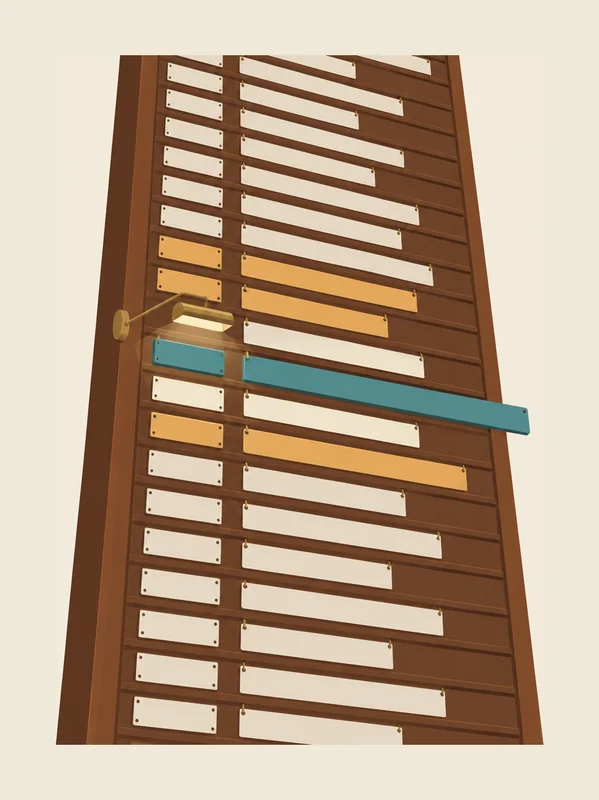
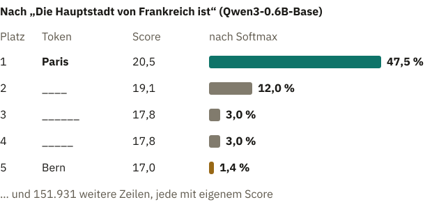
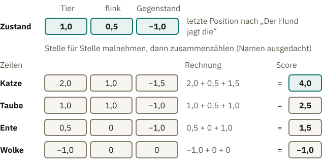
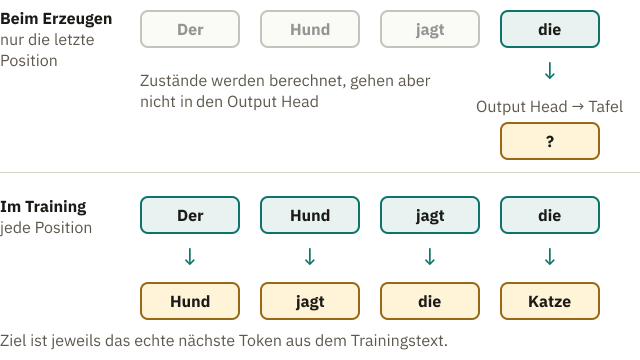
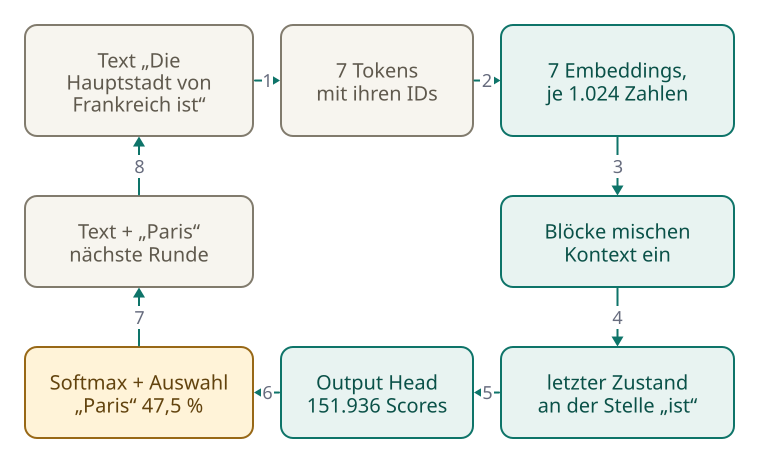

<!-- Generated from src/content/bausteine/de/output-head.mdx by scripts/export-lessons.mjs -- do not edit by hand. -->

# Output Head: Vom letzten Zustand zur Vorhersage

> Lesefassung für GitHub. Die vollständige Fassung mit interaktiven Demos, Animationen und Abrufmoment findest du auf der Website: **[Output Head: Vom letzten Zustand zur Vorhersage](https://ki-einfach-verstehen.de/de/bausteine/output-head/)**
>
> Lizenz: [CC BY 4.0](https://creativecommons.org/licenses/by/4.0/deed.de) · Nenne die Quelle so: KI einfach verstehen, „Output Head: Vom letzten Zustand zur Vorhersage“, CC BY 4.0, https://ki-einfach-verstehen.de/de/bausteine/output-head/

Wie ein Sprachmodell aus seinem letzten Zustand einen Score für jedes Token berechnet und warum dabei nur die letzte Position zählt.

Am Ende des vorigen Bausteins hatte jede Position im Text einen Zustand: eine Liste von Zahlen, in die die Blöcke nacheinander den Kontext eingemischt haben. Bei dem kleinen Sprachmodell Qwen3-0.6B sind es 1.024 Zahlen pro Position. Im Chatfenster erscheinen aber Wörter. Die Zahlenliste dahinter siehst du nicht.

Im ersten Baustein dieses Themenbereichs sagte genau dieses Modell nach „Die Hauptstadt von Frankreich ist“ mit 47,5 Prozent „Paris“ voraus. Bei einem weiteren Versuch schrieb dasselbe Modell nach diesem Satzanfang „Zürich“. Welche Rechnung führt zu den 47,5 Prozent?

## Heraus kommt eine Tafel, kein Wort

Was das Modell am Ende liefert, ist die Score-Liste, die der vorige Baustein angekündigt hat. Sie ähnelt der Punktetafel aus dem Baustein über [Wahrscheinlichkeit und Softmax](./wahrscheinlichkeit-und-softmax.md), die nach einem Quizabend die Punkte von drei Teams zeigte. Diese Tafel hat viel mehr Zeilen, bei Qwen3-0.6B sind es 151.936. Fast jede gehört zu einem [Token](https://ki-einfach-verstehen.de/de/glossar/token/), also einem Stück Text, das der [Tokenizer](https://ki-einfach-verstehen.de/de/glossar/tokenizer/) kennt. Der Tokenizer ist das Programm, das Text in solche Stücke zerlegt. Die feste Liste dieser Stücke heißt [Vokabular](https://ki-einfach-verstehen.de/de/glossar/vokabular/) und hat 151.669 Einträge. Die übrigen 267 Zeilen gehören zu keinem Stück und stehen für kein Wort. Jede Zeile bekommt einen [Score](https://ki-einfach-verstehen.de/de/glossar/score/), auch die für ein Komma oder ein chinesisches Schriftzeichen.

*Die Tafel am Ende des Modells: viele Zeilen, jede mit eigenem Punktestand. Eine Zeile liegt vorn.*

Für diesen Themenbereich lief die frei verfügbare Grundfassung von Qwen3-0.6B ohne Chat-Training auf einem gewöhnlichen Rechner. Nach „Die Hauptstadt von Frankreich ist“ erreicht „Paris“ mit 20,5 den höchsten Score. Auf Platz zwei steht mit 19,1 ein Lückenstrich „____“, wie in Arbeitsblättern und Quizfragen. Auch Platz drei und vier sind Lückenstriche, nur verschieden lang, denn jede Länge ist ein eigenes Token. Solche Texte hat das Modell im Training offenbar oft gesehen. „Bern“ folgt erst auf Platz fünf. Softmax macht aus diesen Scores Prozente.

Nach der Faustregel aus dem Softmax-Baustein gilt: Liegt ein Kandidat einen Punkt vor einem anderen, bekommt er etwa 2,7-mal so viel, bei zwei Punkten gut siebenmal so viel (2,7 · 2,7). „Paris“ liegt knapp anderthalb Punkte vor dem Lückenstrich und bekommt rund viermal so viel: 47,5 gegen 12,0 Prozent. „Bern“ liegt dreieinhalb Punkte zurück und kommt nur auf 1,4 Prozent. Alle Zeilen zusammen ergeben 100 Prozent. Die ersten fünf haben davon rund zwei Drittel, das letzte Drittel teilen sich die übrigen Zeilen in winzigen Stücken. Erst als Anteil an diesem Ganzen kommt „Paris“ auf genau 47,5 Prozent, die Zahl aus dem ersten Baustein.

*Die Spitze der echten Tafel: Aus knapp anderthalb Punkten Vorsprung macht Softmax das Vierfache.*

Dass das Modell jeden Eintrag seines Vokabulars bewertet und erst ein eigener Schritt einen auswählt, kennst du aus dem Baustein über [Input und Output](./input-und-output.md): Dort lag nach „Die Katze sitzt auf“ das Wort „dem“ vorn. **Neu ist, dass das Gewählte oft nicht einmal ein ganzes Wort ist.** Nach „Der Hund jagt die“ lagen bei Qwen3 Wortanfänge vorn, etwa „T“ (wie in „Taube“), „F“ (wie in „Fliege“) und „Kat“ (wie in „Katze“). Welches Wort daraus wird, entscheiden erst die nächsten Runden. Gewählt wird ein Token.

Scores können sogar alle negativ sein. Beim älteren Modell GPT-2, das im Versuch mitlief, lag nach „The dog chased the“ (der Hund jagte den) „dog“ mit −86,4 vorn und bekam nach Softmax trotzdem knapp 20 Prozent. Es zählen nur die Abstände zwischen den Scores: Der höchste bekommt den größten Anteil, auch wenn er negativ ist.

## Woher die Punkte kommen: eine Zeile pro Token

Den Teil des Modells, der die Tafel füllt, nennen Fachleute **[Output Head](https://ki-einfach-verstehen.de/de/glossar/output-head/)**, auf Deutsch etwa Ausgabekopf. Er ist kein weiterer Block, sondern ein viel einfacherer Rechenschritt: keine Attention, kein Einmischen, nur ein Vergleich. Für jeden Eintrag im Vokabular hat er eine Zeile mit genauso vielen Zahlen wie der Zustand. **Der Score eines Tokens misst, wie gut der Zustand zu seiner Zeile passt.**

Angenommen, Zustände hätten nur drei Zahlen und das Vokabular vier Tokens: „Katze“, „Taube“, „Ente“ und „Wolke“. Zur Anschauung heißen die drei Stellen „Tier“, „flink“ und „Gegenstand“. Nach „Der Hund jagt die“ steht an der letzten Position der Zustand (1,0 | 0,5 | −1,0): Ein Tier passt, gern ein flinkes, ein Gegenstand eher nicht. Die Zeile von „Katze“ lautet (2,0 | 1,0 | −1,5): deutlich ein Tier, flink, kein Gegenstand. Die Zahlen sagen, wie gut ein Wort nach „jagt die“ passt, nicht, was es ist.

Der Output Head rechnet Stelle für Stelle und zählt anschließend alle Ergebnisse zusammen. Für „Katze“ sieht das so aus: 1,0 mal 2,0 sind 2,0; 0,5 mal 1,0 sind 0,5; und −1,0 mal −1,5 sind plus 1,5, denn minus mal minus ist plus. Zusammen sind das 4,0, der Score von „Katze“. Diese Rechnung kennst du aus dem vorigen Baustein: Genau so wurde dort die Query (der Suchzettel) von „Bank“ mit jedem Key (dem Etikett) verglichen.

„Taube“ hat die Zeile (1,0 | 1,0 | −1,0), das ergibt 1,0 + 0,5 + 1,0 = 2,5. „Ente“ hat (0,5 | 0 | −1,0) und kommt auf 1,5. „Wolke“ hat die Zeile (−1,0 | 0 | 0). Welchen Score bekommt sie?

Es sind −1,0. Gesucht ist ein Tier, und die Wolke ist keins: An der Stelle „Tier“ ist der Zustand positiv und die Zeile negativ, das gibt Abzug. Daraus folgt die Regel hinter jedem Score: Haben Zustand und Zeile an einer Stelle dasselbe Vorzeichen, gibt es Punkte, bei entgegengesetztem Vorzeichen Abzug. Je weiter eine Zahl von null entfernt ist, desto stärker zählt sie.

Ein hoher Score heißt deshalb nicht, dass Zustand und Zeile gleich sind. Gliche der Zustand genau der Zeile von „Taube“, läge trotzdem „Katze“ vorn, mit 4,5 zu 3,0. Ihre Zahlen haben überall das Vorzeichen von „Taube“, und an zwei Stellen liegen sie weiter von null entfernt (2,0 statt 1,0 und −1,5 statt −1,0).

*Der Output Head im Kleinen: Er multipliziert den Zustand Stelle für Stelle mit jeder Zeile und zählt die Ergebnisse zusammen (ausgedachte Zahlen und Stellennamen).*

Echte Modelle rechnen genauso, nur größer. Bei Qwen3-0.6B vergleicht der Output Head den Zustand mit 151.936 Zeilen zu je 1.024 Zahlen, zusammen rund 156 Millionen im Training eingestellte [Parameter](https://ki-einfach-verstehen.de/de/glossar/parameter/). Das geschieht für jedes Token, das ein Chatbot schreibt. Namen haben die Stellen dort nicht; „Tier“, „flink“ und „Gegenstand“ waren ausgedacht.

> **Interaktive Demo:** [auf der Website ausprobieren](https://ki-einfach-verstehen.de/de/bausteine/output-head/)

Auch das Bild der Punktetafel endet hier. Auf einer Punktetafel vergibt ein Schiedsrichter Punkte nach Regeln, die sich nachlesen lassen. Die Zeilen des Output Heads hat niemand geschrieben, ihre Zahlen hat das Training eingestellt.

Eine Ebene tiefer: Der Output Head als eine einzige Matrix-Rechnung

Alle Zeilen untereinander bilden eine [Matrix](https://ki-einfach-verstehen.de/de/glossar/matrix/). Bei GPT-2 hat sie die Form 50.257 × 768: eine Zeile pro Token, 768 Zahlen pro Zeile, so viele wie der Zustand h. Alle Vergleiche zusammen sind eine einzige Multiplikation:

`Scores = h · Wᵀ`

W ist die Matrix. Das hochgestellte T heißt, dass sie gekippt wird, damit ihre Zeilen auf die Stellen des Zustands treffen. Heraus kommt ein Vektor mit 50.257 Scores. Bei GPT-2 nachgerechnet, weicht er um weniger als 0,0002 von den Scores des Modells ab. Direkt davor steht ein Ausgleichsschritt, eine Normalisierung; „letzter Zustand“ meint den Zustand danach. Fachleute nennen die Scores Logits.

Die Zeilen des Output Heads erinnern an etwas, das am Anfang des Weges stand.

## Dieselbe Tabelle am Eingang und am Ausgang

Am Eingang holt jede Token-ID ihr Embedding aus einer großen Tabelle. Im Baustein über Embeddings lagen dort etwa die Embeddings von „apple“ und „peach“ nah beieinander. Diese Tabelle hat eine Zeile pro Vokabulareintrag, jede so lang wie ein Zustand. Genau so sieht die Tabelle des Output Heads aus. Könnte es dieselbe sein?

Im Baustein über Embeddings hieß es, am Ausgang stehe meist eine zweite Tabelle. Manche Modelle teilen sie aber. Fachleute nennen das **Weight Tying**, auf Deutsch etwa „gekoppelte Gewichte“. „Gewichte“ ist ein anderes Wort für Parameter, also die Zahlen in der Tabelle. **Die Tabelle wird dann zweimal benutzt:** vorne, um zu einer ID die Zahlen zu holen, hinten, um den letzten Zustand mit jeder Zeile zu vergleichen. Ein hoher Score für „Paris“ heißt dann: Der Zustand an der letzten Position zeigt in eine ähnliche Richtung wie das Embedding von „Paris“.

*Weight Tying: Dieselbe Tabelle übersetzt am Eingang Tokens in Zahlen und vergleicht am Ausgang Zahlen mit Tokens.*

Ob ein Modell die Tabelle teilt, steht in seinem Bauplan, der kleinen Datei, die neben den Parametern jedem Modell beiliegt (Baustein über Parameter, Training und Benutzen). Bei Qwen3-0.6B steht dort Ja, beim größeren Qwen3-8B Nein: Es hat am Ausgang eine eigene, zweite Tabelle.
Das Teilen kann Sprachmodelle sogar etwas besser machen, wie Forschende 2016 zeigten, und vor allem spart es Platz.

Wie viel, zeigt eine kleine Rechnung. Die Tabelle von Qwen3-0.6B hat die rund 156 Millionen Zahlen von eben. Das ganze Modell hat rund 0,6 Milliarden Parameter, daher das „0.6B“ im Namen. Ohne Teilen kämen die 156 Millionen am Ausgang ein zweites Mal dazu, rund ein Viertel mehr. Jede Zahl braucht hier zwei Byte, so wie bei Llama 3.1 8B aus den Grundlagen, dessen acht Milliarden Zahlen 16 Gigabyte füllen. Das Teilen spart 156 Millionen mal zwei Byte, rund 0,3 Gigabyte. Gerade kleine Modelle sollen oft auf Laptop oder Handy laufen, wo jedes Gigabyte zählt.

Bisher ging es um einen einzigen Zustand. Das Modell hat aber an jeder Position einen.

## Welche Position zählt

„Die Hauptstadt von Frankreich ist“ besteht für Qwen3-0.6B aus sieben Tokens: „Die“, „Haupt“, „stadt“, „von“, „Frank“, „reich“ und „ist“. Nach dem letzten Block hat jedes davon seinen Zustand. Welcher der sieben geht in den Output Head?

**Beim Erzeugen nur einer: der Zustand der letzten Position**, hier der von „ist“. Die anderen sechs würden Tokens vorhersagen, die längst im Text stehen.

Heißt das, das Modell achtet nur auf das *letzte* Wort? Nein. Wie im vorigen Baustein beschrieben, haben die Blöcke Informationen aus allen früheren Positionen in diesen Zustand eingemischt. Das Wort „ist“ allein deutet auf keine Hauptstadt hin; erst durch den Kontext passt sein Zustand gut zur Zeile von „Paris“.

Im Training ist das anders. Dort läuft ein Stück Trainingstext durch das Modell, und jede Position liefert ihre eigene Tafel. Wie viele Vorhersagen stecken in einem einzigen Durchlauf mit „Der Hund jagt die Katze“, wenn jedes Wort ein Token ist? Überleg kurz.

Fünf Positionen liefern je eine Tafel, vier davon lassen sich direkt prüfen: „Der“ soll „Hund“ vorhersagen, „Hund“ das Wort „jagt“, „jagt“ das Wort „die“ und „die“ das Wort „Katze“. Für „Katze“ steht das nächste Token nicht mehr im Text. Abschreiben kann keine Position, obwohl der ganze Satz im Modell steckt: Die Causal Mask aus dem vorigen Baustein lässt jede Position nur sehen, was vor ihr steht. Jede bekommt den echten Text davor, nicht das, was das Modell selbst geraten hätte (Fachwort: Teacher Forcing). Deshalb wartet keine Vorhersage auf eine andere, und alle laufen gleichzeitig.

*Beim Erzeugen liefert nur die letzte Position eine Tafel. Im Training sagt jede Position ihr nächstes Token voraus, alle gleichzeitig.*

Deshalb erscheinen Antworten im Chatbot Stück für Stück, obwohl das Training ganze Texte auf einmal verarbeitet: Beim Erzeugen gibt es den echten nächsten Text noch nicht. Das nächste Token lässt sich erst berechnen, nachdem das vorige gewählt wurde.

## Eine ganze Runde, vom Text bis zum nächsten Token

Jetzt lässt sich der ganze Weg am Stück gehen. Der Text wird in Tokens zerlegt, jedes mit seiner ID. Jede ID holt ihr Embedding aus der Tabelle. Die Blöcke mischen nacheinander Kontext in die Zustände ein. Der Zustand der letzten Position geht in den Output Head, und heraus kommt die Tafel mit 151.936 Scores. Softmax macht daraus Prozente. Ein Auswahlschritt wählt ein Token, und das wird angehängt. Dann beginnt die nächste Runde mit einem Token mehr.

[▶ Animation auf der Website ansehen](https://ki-einfach-verstehen.de/de/bausteine/output-head/)

*Eine vollständige Runde durchs Modell: vom Text über Tokens, Embeddings, Blöcke und den letzten Zustand bis zur Tafel, zur Auswahl und zum angehängten Token.*

**Beim Auswahlschritt entscheidet sich, was aus der Tafel wird.** Nimmt das Modell immer das Wahrscheinlichste (Greedy-Auswahl), kommt nach „Die Hauptstadt von Frankreich ist“ immer „Paris“. Wird dagegen am Glücksrad aus dem Baustein über Softmax gedreht ([Sampling](https://ki-einfach-verstehen.de/de/glossar/sampling/)), ist das Ergebnis offen: Jedes Token hat dort ein Feld, so groß wie sein Prozentanteil. Im Versuch kam beim ersten Mal „Zürich“ heraus, beim zweiten ein Doppelpunkt und der Satz noch einmal, beim dritten „Paris“.

Wie kommt „Zürich“ aufs Rad, wenn es nicht einmal unter den ersten fünf steht? Für das Modell ist „Zürich“ kein einzelnes Token, sondern drei: „Z“, „ür“ und „ich“. Der Wortanfang „Z“ steht auf Platz 17 der Tafel, mit rund 0,6 Prozent. Dieses schmale Feld trifft ungefähr jede 170. Drehung; dass es im Versuch gleich beim ersten Mal traf, war Zufall. Ist „Z“ angehängt, folgen im Versuch „ür“ und „ich“. Der Output Head hat „Paris“ vorn gesehen; gelost hat der Auswahlschritt.

Innerhalb einer Antwort nimmt bei Greedy-Auswahl und Sampling keine Runde ein angehängtes Token zurück; jede weitere baut darauf auf. Tippst du im Chatbot auf „Neu generieren“, bleibt die erste Tafel gleich, nur wird neu gelost; ab dem ersten anderen Token ändern sich auch die weiteren.

> **Interaktive Demo:** [auf der Website ausprobieren](https://ki-einfach-verstehen.de/de/bausteine/output-head/)

Immer das Wahrscheinlichste zu nehmen, hat eine eigene Schwäche. Im Versuch setzte GPT-2 so „Der Hund jagt die“ mit „Welt des Welt des Welt des Welt des“ fort. Das ist die Wiederholungsschleife aus dem Baustein über Softmax: Steht eine Wendung schon zweimal im Text, wird ihre Wiederholung oft zur wahrscheinlichsten Fortsetzung.

Eine Ebene tiefer: Muss jede Runde alles neu gerechnet werden?

So beschrieben, läuft in jeder Runde der ganze Text erneut durchs Modell, obwohl nur ein Token dazukam. Der Ausweg heißt **KV-Cache**. Keys (die Etiketten) und Values (die Inhalte) kennst du aus dem vorigen Baustein. Die der früheren Tokens werden aufgehoben, weil spätere Tokens an ihnen nichts ändern. Pro Runde geht dann nur das neue Token durch die Blöcke.

Mit GPT-2 auf einem gewöhnlichen Rechner gemessen (nur als Größenordnung), dauerten 200 Tokens mit Cache rund 3,6 Sekunden, ohne rund 14, etwa viermal so lange. Umsonst ist der Cache nicht: Er wächst mit jedem Token und kann bei sehr langen Texten viel Speicher belegen.

## Wann die Schleife endet und was sich einstellen lässt

Erinnerst du dich an das Ende-Token aus dem Baustein über Tokenisierung im Modell, etwa `<|eot_id|>` bei Llama, das einen Redebeitrag abschließt? In den Grundlagen hieß es Stopp-Zeichen. Es hat eine eigene Zeile im Output Head und bekommt jede Runde einen Score wie alle anderen. **Das Modell zeigt das Ende an, indem genau dieses Token gewählt wird; aufhören muss die Chat-App.** Die Längengrenze dagegen ist eine Einstellung außerhalb des Modells. Hört eine lange Antwort mitten im Satz auf und bietet die App an, weiterzuschreiben, war diese Grenze erreicht.

*Von außen lässt sich allenfalls der Auswahlschritt verstellen, nicht der Output Head.*

Ob du den Auswahlschritt beeinflussen kannst, hängt vom Programm ab, über das du das Modell benutzt. Die Rechnung davor lässt sich von außen nicht ändern. Die Temperatur kennst du aus dem Baustein über Softmax: Niedrig spitzt sie das Glücksrad zu, und das große Feld wird noch größer; hoch macht sie die Felder gleichmäßiger.

Eine Ebene tiefer: Was Anbieter melden und erlauben

Programme sprechen Modelle über die Programmierschnittstelle des Anbieters an, englisch API. Sie meldet, warum eine Antwort endete: bei Anthropic „end_turn“, wenn das Modell selbst abgeschlossen hat, sonst etwa die Höchstzahl an Tokens oder eine selbst festgelegte Stoppfolge.

Neben der Temperatur gibt es dort oft Top-k und Top-p: Vor dem Drehen bleiben nur die k wahrscheinlichsten Tokens übrig, beziehungsweise nur so viele, bis sie zusammen den Anteil p erreichen. Manche Anbieter schränken sie ein (Stand Oktober 2026): Bei OpenAIs GPT-6-Modellen entfallen Temperatur und Top-p je nach Modell: bei einigen immer, bei anderen, sobald das Modell vor dem Antworten nachdenkt. Anthropic nimmt bei Modellen nach Claude Opus 4.6 nur Temperatur 1,0, kein Top-k und Top-p erst ab 0,99. Das behält 99 Prozent des Rads und streicht nur haarfeine Felder.

Die Rechnung hinter den 47,5 Prozent ist damit komplett: der letzte Zustand mal die Zeile von „Paris“, dann Softmax über alle Zeilen. Woher aber kommen die Zahlen dafür? Der letzte Zustand entsteht bei jedem Text neu, aus den Tokens und den Parametern des Modells. Die Embeddings, die Parameter in den Blöcken und die Zeilen des Output Heads dagegen hat das Training eingestellt. Es nutzt dafür die Vorhersage aus diesem Baustein: An jeder Position sagt das Modell das nächste Token voraus, und das wird mit dem echten verglichen. Wie daraus ein besseres Modell wird, zeigt der nächste Themenbereich, „Wie Lernen funktioniert“.

---

Quelle: https://ki-einfach-verstehen.de/de/bausteine/output-head/

← Zurück: [Transformerblöcke und Attention: Wie Kontext eingemischt wird](./transformerbloecke-und-attention.md) · [Alle Bausteine](../../README.de.md#inhalt)
