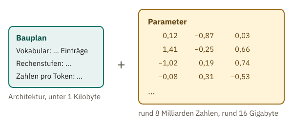
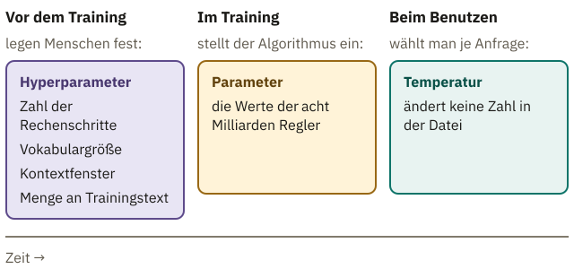
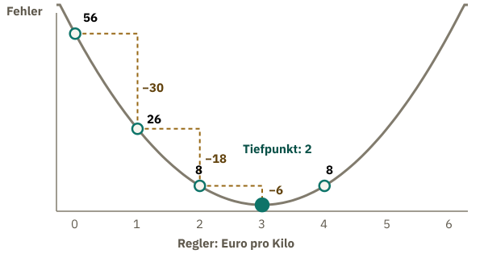
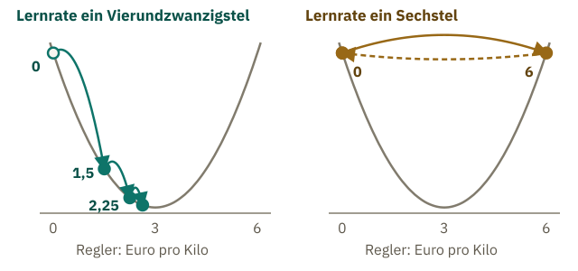
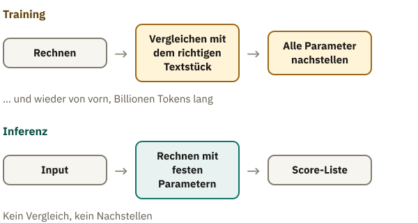

<!-- Generated from src/content/bausteine/de/parameter-training-inferenz-hardware.mdx by scripts/export-lessons.mjs -- do not edit by hand. -->

# Parameter, Training und Benutzen: Wie ein Modell lernt

> Lesefassung für GitHub. Die vollständige Fassung mit interaktiven Demos, Animationen und Abrufmoment findest du auf der Website: **[Parameter, Training und Benutzen: Wie ein Modell lernt](https://ki-einfach-verstehen.de/de/bausteine/parameter-training-inferenz-hardware/)**
>
> Lizenz: [CC BY 4.0](https://creativecommons.org/licenses/by/4.0/deed.de) · Nenne die Quelle so: KI einfach verstehen, „Parameter, Training und Benutzen: Wie ein Modell lernt“, CC BY 4.0, https://ki-einfach-verstehen.de/de/bausteine/parameter-training-inferenz-hardware/

Was in einer Modelldatei steckt, was Menschen vor dem Training festlegen, wie das Training aus dem Fehler ableitet, in welche Richtung jeder Regler bewegt werden muss und warum Lernen teurer ist als Benutzen.

Manche Sprachmodelle kann man herunterladen, etwa Llama 3.1 von Meta, dem Konzern hinter Facebook, der es im Sommer 2024 veröffentlicht hat. Llama 3.1 ist ein Sprachmodell wie das hinter ChatGPT. Die kleinste Fassung heißt Llama 3.1 8B und besteht vor allem aus rund acht Milliarden Zahlen.

Das Training hat die Zahlen eingestellt. Offen bleibt, wer festgelegt hat, wie viele es sind. Woher wusste das Training bei jeder einzelnen, ob ihr Wert steigen oder fallen musste?

## Was in einer Modelldatei steckt

Wer Llama 3.1 8B herunterlädt, bekommt vor allem zwei Arten von Dateien. Eine ist winzig und enthält eine Art Bauplan.

Die andere Art umfasst große Dateien mit rund 16 Gigabyte. Wie diese Größe zustande kommt, zeigt die Vertiefung unten. Darin stehen nur Zahlen, die [Parameter](https://ki-einfach-verstehen.de/de/glossar/parameter/) heißen: Werte, die das Training eingestellt hat, ähnlich wie die Gewichte, die der Spamfilter für jedes Wort speichert: eine Zahl pro Wort, die festlegt, wie stark das Wort zählt. Einen lesbaren Satz findest du darin nicht.

*Ein heruntergeladenes Modell besteht aus zwei Teilen: einem kleinen Bauplan und sehr vielen Zahlen.*

Das „8B“ im Namen steht für acht Milliarden Parameter. Das B kommt vom englischen billion, das hier eine Milliarde bedeutet.

Eine Ebene tiefer: Woher die 16 Gigabyte kommen

Jede dieser Zahlen braucht 2 Byte Speicher. Speicher misst man in Byte, und ein Gigabyte ist eine Milliarde Byte. So kommen die 16 Gigabyte zustande: Acht Milliarden mal 2 Byte sind 16 Milliarden Byte, also 16 Gigabyte. Warum es gerade 2 Byte sind und ob es auch mit weniger geht, zeigt der nächste Baustein.

Ein Byte besteht aus acht Ja-Nein-Stellen. Jede Stelle ist entweder aus, also 0, oder an, also 1. Mit acht solchen Stellen lassen sich 256 verschiedene Muster bilden, und jedes davon kann eine Zahl oder einen Buchstaben darstellen. So speichert ein Computer alles, was er rechnet oder anzeigt.

*Der Bauplan legt fest, wie das Pult gebaut ist. Die Parameter geben an, wie seine Regler stehen.*

Am Mischpult aus dem ersten Baustein steht jeder Regler für einen Parameter und seine Stellung für dessen Wert. Die kleine Datei ist der Bauplan: Sie beschreibt die Bauart des Modells und seine Größe, also wie viele [Schichten](https://ki-einfach-verstehen.de/de/glossar/schicht/) (Rechenstufen) es hat. Die großen Dateien halten fest, wie jeder einzelne Regler steht. Ein Teil dieser Regler gehört zu den Textstücken, in die der Tokenizer den Text zerlegt. Jedes Textstück hat seine eigene Liste gelernter Zahlen; eine solche Liste heißt Vektor, das kennst du aus dem Baustein über Vektoren und Matrizen. Wie viele solcher Listen es gibt und wie lang sie sind, steht im Bauplan. Jede dieser Zahlen ist die Stellung eines Reglers. Anders als am echten Pult trägt keiner dieser Regler eine Beschriftung.

Was glaubst du: Wenn zwei Modelle genau denselben Bauplan haben, verhalten sie sich dann auch gleich? Mach dir eine Vermutung, bevor du weiterliest.

Nicht unbedingt. Neben Llama 3.1 8B bietet Meta eine zweite Fassung an, Llama 3.1 8B Instruct. Beide haben denselben Bauplan und genau gleich viele Parameter. Die Grundfassung hat nur das Grundtraining hinter sich: Sie lernt dabei nur, das nächste Textstück vorherzusagen. Aus „Die Katze sitzt“ lernt sie so, dass danach „auf“ kommt, wie im Baustein über Input und Output. Die Instruct-Fassung wurde danach nachtrainiert, damit sie wie ein Chatbot auf Fragen und Anweisungen eingeht. Sie unterscheiden sich in den Werten ihrer Zahlen. Auf Download-Seiten erkennst du die Fassung zum Chatten am Zusatz „Instruct“ (englisch für anweisen).

Wer hat aber entschieden, dass Llama 3.1 8B acht und nicht neun Milliarden Regler hat?

## Was Menschen vor dem Training festlegen

Nicht das Training. Es stellt die Regler ein, aber es baut kein neues Pult. Wie viele Schichten das Modell hat, wie breit jede Schicht ist und wie groß das Vokabular wird, legen Menschen fest, bevor das Training beginnt. Daraus ergibt sich die Zahl der Parameter.

Im Tokenizer-Baustein lief das Verfahren [Byte Pair Encoding](https://ki-einfach-verstehen.de/de/glossar/byte-pair-encoding/) (BPE) so lange, bis das [Vokabular](https://ki-einfach-verstehen.de/de/glossar/vokabular/) (die feste Liste aller Stücke, die ein Tokenizer kennt) diese Größe hatte. Und auch das Kontextfenster steht vorher fest, also wie viele Textstücke das Modell auf einmal verarbeiten kann. Deshalb hat jeder Chatbot ein festes Kontextfenster: Es steht im Bauplan, lange bevor jemand die erste Frage stellt.

Solche Festlegungen heißen **[Hyperparameter](https://ki-einfach-verstehen.de/de/glossar/hyperparameter/)**. Dazu gehören die Maße im Bauplan und Einstellungen für den Trainingslauf selbst, etwa wie viel Text das Modell zu sehen bekommt. Das Training ändert die Hyperparameter nicht, sondern stellt die Parameter ein.

Auch die [Temperatur](https://ki-einfach-verstehen.de/de/glossar/temperatur/) aus dem vorigen Baustein wird nicht trainiert. Sie ist der Wert, der festlegt, wie viel Zufall beim Auswählen mitspielt. Ist sie deshalb ein Hyperparameter?

Nein. Hyperparameter stehen fest, bevor das Training beginnt, und prägen, welche Zahlen am Ende in der Datei stehen. Wer das fertige Modell benutzt, wählt erst dann die Temperatur, und zwar bei jeder Anfrage neu. Sie bestimmt nur, wie aus den gerade berechneten [Scores](https://ki-einfach-verstehen.de/de/glossar/score/) (den Bewertungen für jedes mögliche nächste Textstück, bei „Die Katze sitzt“ ein ausgedachter Score von 8,1 für „auf“) die Prozente werden, und ändert keine Zahl in der Datei. Eine Chat-App kann dasselbe Modell deshalb einmal mit niedriger und einmal mit hoher Temperatur laufen lassen.

*Hyperparameter stehen vor dem Training fest, die Parameter stellt das Training ein, die Temperatur wählt man erst beim Benutzen.*

Eine Ebene tiefer: Wie GPT-3 eingestellt wurde

GPT-3 aus dem ersten Baustein, ein Vorläufer der Modelle hinter ChatGPT, hat rund 175 Milliarden Parameter. Für diese größte Fassung nennt das Forschungspapier von 2020 unter anderem folgende Hyperparameter:

- **96 Schichten.** Eine Schicht ist eine Rechenstufe, die das Ergebnis der vorigen weiterverarbeitet.
- **Eine Vektorlänge von 12.288.** Jedes Textstück wird auf dem Weg durch die Schichten durch 12.288 Zwischenwerte beschrieben, die bei jeder Eingabe neu entstehen.
- **Ein Kontextfenster von 2048 Textstücken.**
- **Eine Lernrate von höchstens 0,00006.** Sie bestimmt, wie weit das Training jeden Regler pro Schritt dreht. Ihr Verlauf stand vorher fest: zu Beginn hochgefahren, danach abgesenkt.
- **Ein Batch von 3,2 Millionen Textstücken.** Er sammelt die Korrekturen aus dieser Menge und stellt dann einmal nach.

Keiner dieser Werte wurde gelernt. Wie groß das Pult ist, bestimmen die Zahl der Schichten, die Länge der Vektoren, die Größe des Vokabulars und der Aufbau jeder Schicht; zusammen ergeben sie rund 175 Milliarden Parameter. Lernrate und Batch bestimmen dagegen den Ablauf des Trainings.

Wenn alles feststeht, beginnt das Training.

## Woher kennt das Training die Richtung?

Beim Spamfilter aus dem ersten Baustein rückte der Trainingsalgorithmus die Gewichte nach jedem Fehler ein kleines Stück in die Richtung, die den Fehler verkleinert. Dort ließ sich die Richtung noch erraten. Landete eine echte Mail mit „Gewinn“ im Betreff fälschlich im Spam, stand das Gewicht von „Gewinn“ zu hoch. Bei acht Milliarden Reglern ohne Beschriftung kann niemand raten. Woher weiß der Trainingsalgorithmus dann, wohin jeder einzelne soll?

Zuerst fasst der Trainingsalgorithmus den Fehler in eine Zahl. Dafür vergleicht er die Vorhersage des Modells mit der richtigen Antwort und berechnet, wie weit sie danebenliegt. Diese Zahl heißt **Loss**, englisch für Verlust. Bei einem Sprachmodell gilt: Je weniger Prozent das Modell dem Textstück gibt, das im Trainingstext tatsächlich folgt, desto größer ist der Loss. Dieses Textstück ist zum Beispiel „auf“ nach „Die Katze sitzt“.

Ein ausgedachtes Mini-Modell mit einem einzigen Regler soll vorhersagen, was Äpfel kosten: Vorhersage gleich Regler mal Kilo. Der Regler ist also der Preis pro Kilo. Das Spielzeug zeigt nur, wie man am Fehler abliest, in welche Richtung ein Regler muss. Drei ausgedachte Einkäufe dienen als Beispiel. Sie stehen in einer kleinen Tabelle unter dem Absatz, mit den Spalten Kilo und Euro.

| Kilo | Euro |
|---|---|
| 1 | 2 |
| 1 | 4 |
| 2 | 6 |

Da es hier keine Prozente gibt, braucht das Apfel-Modell eine andere Regel für die Fehlerzahl: Jede Abweichung wird mit sich selbst multipliziert, anschließend werden die Ergebnisse addiert. Dadurch zählen zu hohe und zu niedrige Vorhersagen gleich viel, während große Abweichungen stärker wiegen.

Der Regler startet bei null, wie die Gewichte des Spamfilters. Bei null sagt das Modell jeden Einkauf mit null Euro voraus.

Die Abweichungen sind 2, 4 und 6 Euro. Quadriert und addiert ergibt das einen Fehler von 56.

Wird er kleiner, wenn der Regler auf 1 steht? Ja, er sinkt auf 26.

Bei 1 sagt das Modell für den ersten Einkauf 1 Euro voraus, für den zweiten 1 Euro und für den dritten 2 Euro.

Die Abweichung ist jeweils der Preis minus die Vorhersage. Sie beträgt also 1 Euro, 3 Euro und 4 Euro. Quadriert und addiert ergibt das 26. Der Regler muss also nach oben.

Bei 3 liegt der kleinste Fehler, bei 4 steigt er wieder. Null wird er nie, weil sich die beiden Ein-Kilo-Einkäufe widersprechen.

Ob der Fehler eines echten Modells, der von Milliarden Reglern zugleich abhängt, ebenso nur einen tiefsten Punkt hat, zeigt das Spielzeug nicht.

*Der Fehler des ausgedachten Apfel-Modells für jede Reglerstellung: Weit weg vom Tiefpunkt fällt er pro Euro stark, kurz davor kaum noch.*

Der Fehler sinkt von Stellung zu Stellung immer weniger. Wie steil der Fehler an einer Stelle ist, wie bei einem Hang, sagt die **Steigung**. Man misst sie mit einer winzigen Drehung des Reglers und rechnet aus, wie stark sich der Fehler bei einer winzigen Drehung ändert, hochgerechnet auf einen ganzen Euro. Fällt der Fehler beim Höherdrehen, muss der Regler höher. Steigt er beim Höherdrehen, muss der Regler tiefer. Wie groß die Steigung ist, verrät in diesem Tal auch die Entfernung zum Tiefpunkt: An einem steilen Hang ist er noch weit entfernt, an einem flachen schon nah.

Du stehst bei dichtem Nebel an einem Hang und willst ins Tal. Du siehst nichts, spürst aber unter den Füßen, wohin der Boden abfällt und wie steil. Das Tal ist die Reglerstellung mit dem kleinsten Fehler. Im Bild ist der Hang die Fehlerkurve. Das Training muss die Steigung an jeder Stelle ausrechnen.

Im Nebel würdest du am steilen Hang weit ausschreiten und kurz vor dem Tal vorsichtig werden. Der Trainingsalgorithmus muss seine Schrittlänge ebenfalls an die Steigung anpassen.

## Wie weit ein Schritt geht

Im Apfel-Modell gilt: Schritt gleich Steigung mal Lernrate. Die **[Lernrate](https://ki-einfach-verstehen.de/de/glossar/lernrate/)** ist eine Zahl, die Menschen vor dem Training wählen, also ein Hyperparameter. Sie bestimmt, wie weit der Regler pro Schritt gedreht wird: je größer, desto länger der Schritt. Im Beispiel ist sie ein Vierundzwanzigstel. Damit lassen sich die ersten Schritte gut nachrechnen.

Dreht man den Regler nur um ein Hundertstel, sinkt der Fehler nach der Regel von oben um knapp 0,36. Auf einen ganzen Euro hochgerechnet, also mal hundert, ergibt das die Steigung bei null: rund 36.

Ein ganzer Euro senkt den Fehler aber nur um 30, von 56 auf 26, weil die Kurve sich dabei flacht. Ob der Regler nach oben oder unten geht, zeigt der Fehler: Sinkt er beim Höherdrehen, geht der Schritt nach oben.

Der erste Schritt ist also 36 geteilt durch 24, gleich 1,5.

Der Regler rückt von null auf 1,5. Dort ist der Tiefpunkt nur noch halb so weit weg, also ist auch die Steigung halb so groß.

Der nächste Schritt ist deshalb halb so lang und führt auf 2,25.

Jeder weitere Schritt halbiert den Rest bis zum Tiefpunkt.

Was passiert mit einer viermal so großen Lernrate, also einem Sechstel? Bevor du weiterliest, überleg, wohin der Regler springt.

Der Schritt ist 36 geteilt durch 6, also sechs Euro. Der Regler springt über den Tiefpunkt auf die andere Seite des Tals. Dort ist der Fehler genauso groß wie am Anfang, denn die Kurve ist symmetrisch um den Tiefpunkt bei 3.

Bei sechs ist die Steigung genauso groß wie bei 0, nur umgekehrt: Dort steigt der Fehler beim Höherdrehen.

Der nächste Schritt ist deshalb wieder sechs Euro lang, nur zurück: 36 geteilt durch 6. Der Regler landet wieder auf 0 und springt so hin und her, ohne je unten anzukommen. Ist die Lernrate dagegen sehr klein, kommt das Training kaum voran. Die passende Lernrate finden Fachleute oft erst durch Ausprobieren über mehrere Trainingsläufe.

*Dieselbe Fehlerkurve, zwei Lernraten: Mit einem Vierundzwanzigstel halbiert jeder Schritt den Rest bis zum Tal, mit einem Sechstel springt der Regler zwischen 0 und 6 hin und her.*

> **Interaktive Demo:** [auf der Website ausprobieren](https://ki-einfach-verstehen.de/de/bausteine/parameter-training-inferenz-hardware/)

Ein echtes Modell hat Milliarden Regler. Würde man jeden einzeln ein Stück drehen und den Fehler neu messen, müsste man das ganze Modell für einen einzigen Schritt milliardenfach durchrechnen. Ein Rechenverfahren namens **Backpropagation** liefert stattdessen die Steigung für alle Regler zugleich, in einem einzigen Durchgang rückwärts durch das Modell. Jeder Regler rückt dann ein Stück bergab, also dorthin, wo der Fehler sinkt, wie beim Apfel-Modell. Wie die Backpropagation alle Steigungen in einem Durchgang findet, erfährst du im Themenbereich „Wie Lernen funktioniert“.

GPT-3 wurde mit dem Verfahren Adam trainiert. Es berechnet die Schrittlänge jedes Reglers aus der aktuellen und den früheren Steigungen; die Lernrate bleibt dabei die Stellschraube.

Beim Spamfilter war es genauso: Bei einer echten Mail mit „Gewinn“ im Betreff hätte ein höheres Gewicht den Fehler vergrößert und ein tieferes ihn verkleinert, also rückte das Gewicht ein Stück nach unten.

## Lernen kostet mehr als Benutzen

Eine Antwort im Chatfenster steht nach wenigen Sekunden da. Das Training von Llama 3.1 8B hat dagegen laut Meta 1,46 Millionen Stunden Rechenzeit gekostet, zusammengezählt über alle Spezialchips für KI-Rechnungen, die gleichzeitig daran gerechnet haben. Das Training lief auf Grafikprozessoren, die viele gleichartige Rechnungen parallel ausführen.

Beim Soundcheck vor einem Konzert spielt die Band ein paar Takte. Die Tontechnikerin hört hin und schiebt am Mischpult Regler, bis es passt. Während des Konzerts verarbeitet das Pult dann einfach, was hereinkommt. Der Soundcheck steht für das Training. Das Benutzen des fertigen Modells heißt **[Inferenz](https://ki-einfach-verstehen.de/de/glossar/inferenz/)** und entspricht dem Konzert. Jede Frage, die du einem Chatbot stellst, löst Inferenz aus.

*Der Soundcheck vor dem Konzert: Erst werden die Regler eingestellt, dann bleiben sie stehen.*

Hier hinkt das Bild allerdings an zwei Stellen. Beim Training schiebt kein Mensch nach Gehör. Die Backpropagation rechnet für alle Regler aus, wohin sie sollen. Und am echten Pult greift die Technikerin auch im Konzert noch ein. **Bei der Inferenz bewegt sich kein Regler, ganz gleich, was du eingibst.** Was ein Chatbot sich in deinem Gespräch „merkt“, wird bei jeder Nachricht als Input mitgeschickt, wie im Baustein über Input und Output. Neue Fassungen eines Modells entstehen erst in späteren Trainingsläufen.

Bevor du weiterliest: Was rechnet das Modell bei einer Antwort für jedes Textstück, und was kommt beim Training dazu?

Bei der Inferenz rechnet das Modell für jedes Textstück einmal mit seinen festen Zahlen: Input rein, [Score](https://ki-einfach-verstehen.de/de/glossar/score/)-Liste raus. Im Training beginnt es genauso. Dann vergleicht der Trainingsalgorithmus die Vorhersage mit dem Textstück, das tatsächlich folgt, und misst den Loss. Die Backpropagation liefert außerdem für jeden der acht Milliarden Regler seine Steigung. Sobald die Steigungen aus einem großen Stapel Text gesammelt sind, stellt der Trainingsalgorithmus die Regler nach.

*Training ist eine Schleife aus Rechnen, Vergleichen und Nachstellen. Inferenz ist nur der erste Schritt, mit festen Zahlen.*

Pro Textstück kostet das Training nur etwa dreimal so viel Rechenarbeit wie die Inferenz, weil die Steigungen dazukommen. Den Unterschied macht die Menge: Für eine Antwort rechnet das Modell grob geschätzt einige hundert Textstücke durch; beim Training von Llama 3.1 waren es laut Meta rund 15 Billionen Textstücke, also viele Milliarden Mal so viele.

Für die 8-Milliarden-Fassung bräuchte ein einzelner Chip für die 1,46 Millionen Stunden rund 167 Jahre (geteilt durch 8.760 Stunden im Jahr). Deshalb teilen sich viele Chips die Rechnung und arbeiten gleichzeitig daran.

Eine Ebene tiefer: Wie viel Rechenzeit das größte Llama 3.1 brauchte

Die Modellkarte von Meta nennt für das größte Llama 3.1, die Fassung mit 405 Milliarden Parametern, rund 30,8 Millionen Rechenstunden auf Chips des Typs H100. H100 ist ein Grafikchip für KI-Rechnungen. Ein einzelner Chip bräuchte dafür rechnerisch rund 3.500 Jahre. Meta hat die Rechnung deshalb auf über 16.000 H100-Chips verteilt. Dadurch dauert sie nur knapp drei Monate. Das ist nur eine grobe Überschlagsrechnung, weil die Chips nicht ständig rechnen und Zeit für die Abstimmung zwischen allen Chips verloren geht. Der Grundgedanke bleibt gleich: Viele Chips teilen sich eine Rechnung, damit sie in wenigen Monaten statt in Jahrtausenden fertig wird. Dieser Aufwand fällt für jede Fassung des Modells einmal an.

Weil aber Millionen Menschen Fragen stellen, braucht auch das Benutzen zusammengenommen große Rechenzentren.

Zurück zur Frage vom Anfang: Menschen legen Bauplan und Größe vorher fest. Das Training stellt jede der acht Milliarden Zahlen nach ihrer Steigung ein, so dass der Fehler sinkt. Wie viel Speicher dafür nötig ist und ob das aufs Handy passt, zeigt der nächste Baustein, [Modellgröße und Hardware: Wo ein Modell Platz findet](./modellgroesse-und-hardware.md).

---

Quelle: https://ki-einfach-verstehen.de/de/bausteine/parameter-training-inferenz-hardware/

← Zurück: [Wahrscheinlichkeit und Softmax: Wie ein Modell sich entscheidet](./wahrscheinlichkeit-und-softmax.md) · [Alle Bausteine](../../README.de.md#inhalt) · Weiter: [Modellgröße und Hardware: Wo ein Modell Platz findet](./modellgroesse-und-hardware.md) →
