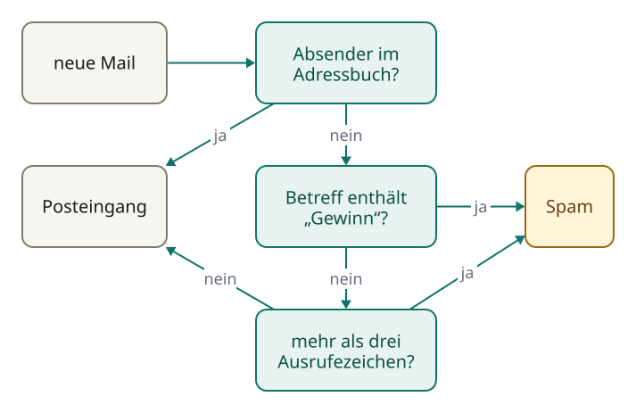
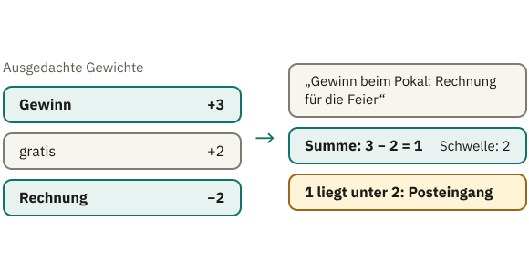
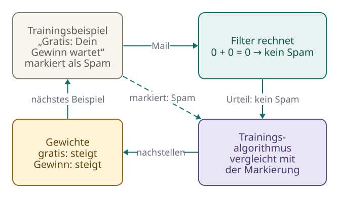
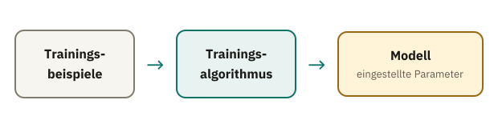

<!-- Generated from src/content/bausteine/de/programm-algorithmus-modell.mdx by scripts/export-lessons.mjs -- do not edit by hand. -->

# Programm, Algorithmus, Modell im Vergleich

> Lesefassung für GitHub. Die vollständige Fassung mit interaktiven Demos, Animationen und Abrufmoment findest du auf der Website: **[Programm, Algorithmus, Modell im Vergleich](https://ki-einfach-verstehen.de/de/bausteine/programm-algorithmus-modell/)**
>
> Lizenz: [CC BY 4.0](https://creativecommons.org/licenses/by/4.0/deed.de) · Nenne die Quelle so: KI einfach verstehen, „Programm, Algorithmus, Modell im Vergleich“, CC BY 4.0, https://ki-einfach-verstehen.de/de/bausteine/programm-algorithmus-modell/

Wie unterscheiden sich Programm, Algorithmus und Modell? Klassische Software folgt Regeln, die ein Mensch aufschreibt. Ein KI-Modell besteht aus einem festen Rechenweg und Zahlen, die im Training eingestellt wurden.

Irgendwo in deinem Postfach gibt es einen Ordner, den du selten öffnest: Spam. Dort landen Mails, die dir einen Lottogewinn versprechen oder ein Paket ankündigen, das du nie bestellt hast. Meistens sortiert der Filter richtig, obwohl du ihm nie erklärt hast, was Werbung ist. Woher weiß er das?

Die naheliegende Antwort wäre: Jemand hat ihm Regeln aufgeschrieben. Viele stellen sich [KI](https://ki-einfach-verstehen.de/de/glossar/ki/) als riesiges Regelbuch vor, das Fachleute Zeile für Zeile gefüllt haben. Bei klassischer Software trifft dieses Bild zu. Für das, was heute meist mit KI gemeint ist, erklärt es dagegen nur einen Teil: Das Verhalten eines [Modells](https://ki-einfach-verstehen.de/de/glossar/modell/), das aus Beispielen gelernt hat, steckt in Zahlen. Um diesen Unterschied zu verstehen, helfen drei Begriffe, die im Alltag oft durcheinandergehen: Programm, Algorithmus und Modell.

## Wer schreibt eigentlich die Regeln?

Angenommen, du sollst selbst einen Spamfilter bauen. Der naheliegende Weg: Du schreibst Regeln auf. Ein ausgedachter, aber typischer Filter könnte drei Regeln haben. Die gelten der Reihe nach:

1. Steht der Absender in deinem Adressbuch, kommt die Mail in den Posteingang.
2. Enthält der Betreff das Wort „Gewinn“, kommt sie in den Spam.
3. Hat sie mehr als drei Ausrufezeichen, kommt sie ebenfalls in den Spam.

Alles Übrige landet im Posteingang. Genau so arbeitet ein klassisches **[Programm](https://ki-einfach-verstehen.de/de/glossar/programm/)**: eine Folge von Anweisungen, die ein Computer Schritt für Schritt ausführt und die ein Mensch festgelegt hat.

Der Computer versteht keine dieser Regeln. Er prüft, ob eine Bedingung zutrifft, und führt aus, was dahinter steht. Alles, was der Filter kann, steht in diesen Zeilen. Willst du wissen, warum eine Mail im Spam gelandet ist, liest du nach und findest die Regel, die gegriffen hat.

*Ein Regelfilter: Jede Mail läuft an festen, von Menschen geschriebenen Bedingungen vorbei.*

Die Schritte hinter diesen Zeilen lassen sich auch ohne Computer auf einen Zettel schreiben. Eine solche genau festgelegte Vorgehensweise heißt **[Algorithmus](https://ki-einfach-verstehen.de/de/glossar/algorithmus/)**. Du kannst ihn dir wie ein Rezept vorstellen: eine Folge von Schritten, die unabhängig davon zum Ergebnis führt, wer sie ausführt. Das Programm ist die Fassung dieses Rezepts, die ein Computer ausführen kann. Der Vergleich hat allerdings eine Grenze: Ein Rezept darf „eine Prise Salz" sagen und dir den Rest überlassen. Bei einem Algorithmus muss dagegen jeder Schritt eindeutig sein.

*Ein Algorithmus gleicht einem Rezept: festgelegte Schritte, unabhängig davon, wer sie ausführt.*

Regelfilter haben eine Schwäche, die Spam-Versender schnell finden. Steht im Betreff „G3WINN" statt „Gewinn", greift die Gewinn-Regel nicht mehr. Also kommt eine Regel für die Schreibweise mit der Drei dazu, dann eine für „G-e-w-i-n-n", dann eine für das nächste Schlupfloch. Werden die Regeln strenger, erwischen sie auch echte Mails, etwa die Nachricht vom Sportverein über den Gewinn des Pokals.

Genau diese Erfahrung beschrieb der Programmierer Paul Graham im Jahr 2002. Nach eigenen Angaben hatte er rund ein halbes Jahr an Software gearbeitet, die nach einzelnen Spam-Merkmalen suchte. Je strenger er die Filter einstellte, desto mehr echte Mails sortierten sie aus. Dann versuchte er einen anderen Weg: Sein neuer Filter leitete aus Beispielen ab, wie stark jedes Wort auf Spam hindeutete. Dazu zählte Graham, wie oft jedes Wort in Spam-Mails und wie oft in normaler Post vorkam. Die Rechenweise legte er selbst fest.

## Ein Mischpult statt einer Regelliste

Ein Filter kann entscheiden, ohne dass ihm jemand Regeln wie „Wenn Gewinn, dann Spam“ schreibt: Er rechnet stattdessen mit Zahlen. Jedes Wort bekommt ein **Gewicht**, also eine Zahl. Ein ausgedachtes Beispiel zeigt das Prinzip: „Gewinn“ hat das Gewicht +3, „gratis“ +2 und „Rechnung“ −2. Alle anderen Wörter zählen 0.

Für jede Mail zählt der Filter die Gewichte der Wörter zusammen, die darin vorkommen. Diese Summe vergleicht er mit einer Grenze, der **Schwelle** 2: Liegt die Summe über 2, gilt die Mail als Spam.

Was das konkret bedeutet, zeigen zwei Mails. „Gratis: Dein Gewinn wartet“ enthält „gratis“ (+2) und „Gewinn“ (+3). Zusammen ergibt das 5 und liegt damit über der Schwelle 2: Spam. Die Mail vom Sportverein, „Gewinn beim Pokal: Rechnung für die Feier“, landet dagegen im Posteingang. „Gewinn“ zählt +3 und „Rechnung“ −2; die Summe 1 liegt unter der Schwelle. Die Summe aller Gewichte entscheidet. Nur der letzte Schritt, der Vergleich mit der Schwelle, ist eine Wenn-dann-Prüfung. Ein Mensch hat sich die Gewichte und die Schwelle in diesem Beispiel ausgedacht.

*Eine Mail mit ausgedachten Gewichten durchgerechnet: Die Summe entscheidet, nicht eine einzelne Regel.*

Ein solcher Filter ist ein kleines **[Modell](https://ki-einfach-verstehen.de/de/glossar/modell/)**: ein fester Rechenweg, dessen Ergebnis von gespeicherten Zahlen abhängt.

Diese Zahlen heißen **[Parameter](https://ki-einfach-verstehen.de/de/glossar/parameter/)**; oft nennt man sie Gewichte. Der Rechenweg selbst ist denkbar schlicht: Er zählt die Werte zusammen und vergleicht die Summe mit der Schwelle. Ein Mensch hat diesen Rechenweg festgelegt, doch er enthält keine Aussage darüber, welche Wörter auf Spam hindeuten. Das steht *allein* in den Zahlen. Ändert sich einer dieser Parameter, kann der Filter anders entscheiden, obwohl der Programmcode unverändert bleibt.

*Ein Modell gleicht einem Mischpult: Was herauskommt, hängt davon ab, wie die Regler stehen.*

Stell dir dazu ein Mischpult im Tonstudio vor: viele Schieberegler, jeder in einer bestimmten Stellung. Jeder Regler ist ein Parameter, seine Stellung entspricht einer Zahl. Im Beispielfilter steht jeder Regler für ein Wort; bei großen Modellen lässt sich eine einzelne Zahl meist nicht so benennen. Der Rechenweg bestimmt, wie das Pult die Reglerstellungen verarbeitet. Beim Spamfilter heißt das: zusammenzählen und mit der Schwelle vergleichen. Je nach Stellung der Regler klingt derselbe Song dumpf oder klar. Genauso kann derselbe Rechenweg Spam erkennen oder unbrauchbare Ergebnisse liefern – je nachdem, welche Zahlen eingesetzt sind.

Das Einstellen der Regler übernimmt das **Training**: Die Zahlen werden an vielen Beispielen nachgestellt.

> **Interaktive Demo:** [auf der Website ausprobieren](https://ki-einfach-verstehen.de/de/bausteine/programm-algorithmus-modell/)

## Wie die Regler ihre Stellung finden

Meist stellt ein **[Trainingsalgorithmus](https://ki-einfach-verstehen.de/de/glossar/trainingsalgorithmus/)** die Regler ein, nicht ein Mensch von Hand. Dafür braucht er Beispiele, bei denen das richtige Urteil schon feststeht: Tausende Mails, die Menschen vorher als Spam oder als normale Post markiert haben. Den festen Rechenweg aus dem Mischpult kennst du schon: Er berechnet die Summe und vergleicht sie mit der Schwelle. Die Zahlen selbst verändert dieser Rechenweg nicht. Erst zusammen mit den eingestellten Zahlen ergibt er das Modell.

Zu Beginn stehen alle Gewichte auf null. Der Filter kennt also kein verdächtiges Wort und lässt jede Mail durch. Dann wiederholt sich immer dieselbe Schleife:

1. Der Filter bekommt eine Mail und fällt sein Urteil: Spam oder Posteingang.
2. Der Trainingsalgorithmus vergleicht dieses Urteil mit der Markierung, die ein Mensch bei dieser Mail gesetzt hat.
3. Stimmt das Urteil nicht, werden die Gewichte der Wörter dieser Mail ein kleines Stück verschoben, sodass die Summe der Mail näher an die richtige Seite der Schwelle rückt.
4. Dann kommt die nächste Mail.

[▶ Animation auf der Website ansehen](https://ki-einfach-verstehen.de/de/bausteine/programm-algorithmus-modell/)

*Die Trainingsschleife: Urteil fällen, mit der Markierung vergleichen, Gewichte ein Stück nachstellen, nächstes Beispiel.*

Die erste Trainingsmail lautet „Gratis: Dein Gewinn wartet", markiert als Spam. Der Filter rechnet 0 + 0 = 0. Null liegt unter der Schwelle 2, also lässt er sie durch. Falsch. Also rücken die Gewichte von „gratis" und „Gewinn" ein Stück nach oben. Nach Tausenden solcher Durchgänge stehen bei typischen Werbewörtern hohe Zahlen und bei Wörtern aus normaler Post niedrige oder negative.

Überleg kurz selbst, bevor du weiterliest: Im Training taucht eine echte Mail deiner Bank auf, „Dein Gewinn aus Zinsen", markiert als normale Post. Der Filter hält sie für Spam, weil „Gewinn" inzwischen ein hohes Gewicht hat. Was passiert jetzt mit diesem Gewicht?

Das Gewicht von „Gewinn“ sinkt ein wenig. Die anderen Wörter dieser Mail, etwa „Zinsen“, sinken mit, weil sie ebenfalls zur falschen Summe beitragen. So rutschen Wörter, die oft in harmloser Post stehen, mit der Zeit unter null. Werbemails mit „Gewinn" schieben das Gewicht also immer wieder ein Stück nach oben, harmlose Mails mit „Gewinn" ein Stück nach unten. Das Gewicht bleibt dort stehen, wo sich beide Seiten die Waage halten: hoch genug für die meisten Werbemails, aber nicht so hoch, dass jede Bankmail im Spam landet.

So weit das ausgedachte Beispiel. Mit echter Post ging Graham einen anderen Weg.

## Was der Filter dabei lernt

Graham zeigte 2002, dass sich brauchbare Werte auch aus echter Post gewinnen lassen. Statt der Schleife aus dem Beispiel nutzte er dafür ein einfacheres Verfahren: Er zählte die Wörter aus. Stand ein Wort vor allem in Spam, bekam es eine hohe Zahl, ähnlich den Gewichten oben, anders berechnet. Die Zahlen kamen aus den Beispielen. Wie sie verrechnet wurden und welche Grenzen galten, legte Graham selbst fest. In Grahams eigenem Test verpasste dieser Filter weniger als 5 von 1000 Spam-Mails und sortierte keine einzige echte Mail aus. Das war eine Messung an seiner eigenen Post, keine allgemeine Studie.

Eine Ebene tiefer: Was Graham noch von Hand einstellte

Grahams Filter stellte keine Gewichte Schritt für Schritt nach wie die Schleife oben. Die Zählungen teilte er durch die Zahl der Mails in der Sammlung. Daraus ergab sich: Wie wahrscheinlich ist eine Mail mit diesem Wort Spam? Ein ausgedachtes Zahlenbeispiel, nicht Grahams Daten: Ein Wort steht in 100 von 1000 Spam-Mails und in 5 von 1000 normalen Mails. Die 5 verdoppelte Graham zu 10 (warum, steht gleich unten). Das ergibt 100 von 1000, also 0,1, für Spam und 10 von 1000, also 0,01, für normale Post. Der Anteil für Spam ist 0,1 geteilt durch (0,1 + 0,01), also rund 0,9. Fast nur in Spam vorkommende Wörter landen nahe 1, Wörter aus normaler Post nahe 0.

Diese Wortwerte stammten aus den Daten. Wie damit gerechnet wird, legte Graham selbst fest, vieles nach eigenen Angaben durch Ausprobieren:

- Jede Zählung aus der normalen Post verdoppelte er. Das drückt die Werte von Wörtern, die gelegentlich auch in echter Post stehen, etwas nach unten und schützt vor Fehlalarmen, also echten Mails im Spam.
- Er berücksichtigte nur Wörter, die insgesamt mehr als fünfmal vorkamen.
- Kein Wert lag unter 0,01 oder über 0,99. Ein einzelnes Wort war also nie ganz sicher.
- Ein Wort, das der Filter noch nie gesehen hatte, bekam 0,4. Nach eigenen Angaben fand Graham den Wert durch Ausprobieren; er liegt unter 0,5 und wirkt harmlos.

Kam eine neue Mail, nahm der Filter nur ihre 15 auffälligsten Wörter, also die am weitesten von 0,5 entfernten. Diese 15 Werte verrechnete er mit der Bayes-Regel, einer Formel aus der Wahrscheinlichkeitsrechnung, zu einem Gesamtwert. Die Formel bündelt die Hinweise der Wörter: Liegen die meisten der 15 Werte nahe 1, liegt auch der Gesamtwert nahe 1, und umgekehrt. Lag er über 0,9, galt die Mail als Spam. Wo genau diese Schwelle liegt, war laut Graham fast egal, weil kaum eine Mail in der Mitte landete.

Übertragen auf den Beispielfilter passt nur die Grundidee: Auch Grahams Wortwerte kommen aus den Beispielen. Gerechnet wird aber anders. Er verrechnet sie nach der Bayes-Regel zu einer Wahrscheinlichkeit und vergleicht diese mit 0,9. Die Zahl 2 des Beispielfilters lässt sich nicht übernehmen: Graham vergleicht eine Wahrscheinlichkeit mit 0,9, nicht eine Summe mit 2. Wie Graham die Werte berechnete und verrechnete, wählte ein Mensch: die Verdopplung, die Mindesthäufigkeit, die Grenzen 0,01 und 0,99, den Wert 0,4, die 15 Wörter und die Schwelle.

Bei einem solchen Filter heißt es oft, er habe gelernt, was Spam ist. Das ganze Vorgehen nennt sich **[maschinelles Lernen](https://ki-einfach-verstehen.de/de/glossar/maschinelles-lernen/)**. Das Wort „lernen“ passt allerdings nur mit Einschränkung: Der Filter hat nicht *verstanden*, was Werbung ist. Lernen bedeutet hier, Zahlen zu verändern – beim Beispielfilter durch Nachstellen, bis die Fehler bei den Beispielen klein waren, bei Graham durch Auszählen. Die meisten heutigen Trainingsalgorithmen arbeiten nach diesem Muster: Fehler messen, Zahlen ein Stück nachstellen, wiederholen. Der große Unterschied ist die Menge: Statt drei Gewichten wie im Beispiel stehen bei großen Modellen Milliarden von Zahlen im Spiel.

## Wo das Mischpult an seine Grenze kommt

Die Mischpult-Metapher stößt allerdings an eine Grenze. Bei einem echten Pult sind die Regler mit Bass, Höhen oder Lautstärke beschriftet. Die Parameter eines großen Modells haben keine solchen Bezeichnungen – und es gibt unvorstellbar viele davon. Das Sprachmodell GPT-3 aus dem Jahr 2020, das Texte schreibt, hat rund 175 Milliarden davon. Was eine einzelne Zahl bewirkt, lässt sich kaum beschreiben. Das Verhalten entsteht meist aus dem Zusammenspiel vieler Zahlen. Der Beispielfilter mit seinen drei Wörtern ist so klein, dass man jedes Gewicht noch lesen kann. Deshalb eignet er sich zum Erklären.

## Warum die Regelbuch-Vorstellung so hartnäckig ist

*So stellt man sich KI oft vor: ein Regelbuch, so dick, dass es für jeden Fall eine Zeile hat.*

Vieles, was du sonst jeden Tag am Computer benutzt, arbeitet mit festgelegten Anweisungen, von der Tabellenkalkulation bis zur Ampelsteuerung. Auch KI-Systeme arbeiteten lange nach diesem Prinzip. Die ersten **[Expertensysteme](https://ki-einfach-verstehen.de/de/glossar/expertensysteme/)** entstanden in den 1960er- und 1970er-Jahren, in den 1980ern waren sie weit verbreitet und gehörten zu den ersten wirklich erfolgreichen Formen von KI-Software. Sie sollten die Entscheidungen von Fachleuten nachbilden und bestanden im Kern aus großen Sammlungen von Wenn-dann-Regeln. Wer sich KI als Regelbuch vorstellt, hat also ein Bild im Kopf, das es wirklich gegeben hat. Das Bild beschreibt aber nicht die trainierten Modelle, über die heute meist gesprochen wird. Es gibt auch Kombinationen: Der Mail-Dienst Gmail von Google setzte nach einer Ankündigung von 2019 trainierte Modelle ein, daneben Filter mit festen Regeln.

Warum dieser Unterschied wichtig ist, zeigt sich, wenn etwas schiefgeht. Bei einem Regelfilter findest du die Zeile, die zur Entscheidung geführt hat, und änderst sie. In einem rein trainierten Modell gibt es keine solche Zeile. Es besteht aus einem festen Rechenweg und Zahlen. Hat ein Spamfilter ohne eingebaute Regeln nur aus Beispielen gelernt, steckt sein Verhalten in diesen Zahlen. Beim kleinen Beispielfilter verrät das Gewicht von „Gewinn" noch, dass das Wort verdächtig ist. Bei Milliarden unbeschrifteter Parameter sagt meist keine einzelne Zahl „Gewinn ist verdächtig“.

Fehler eines trainierten Modells können auch aus den Beispielen stammen. Angenommen, Menschen hätten beim Markieren harmlose Mails mit dem Wort „Rechnung“ immer als Spam eingeordnet. Der Trainingsalgorithmus hätte daraufhin das Gewicht von „Rechnung“ nach oben geschoben, und der Filter hätte diesen Fehler übernommen. Korrigieren ließe er sich durch ein neues Training mit richtig markierten Beispielen.

Zurück zur Frage vom Anfang: Woher weiß dein Spamfilter, was Werbung ist? Sein Wissen steckt in Zahlen, die ein Trainingsalgorithmus anhand vieler markierter Beispiele eingestellt hat. Nutzt der Filter zusätzlich feste Regeln, steckt ein Teil seines Wissens in Zeilen und der Rest in Zahlen. Welche Wörter verdächtig sind, hat dabei niemand einzeln aufgeschrieben. Menschen haben den Rechenweg, den Trainingsalgorithmus, die Schwelle und die markierten Beispiele festgelegt. Nach dem Training bleiben die Regler stehen. Von da an rechnet der Spamfilter mit festen Zahlen: Eine Mail geht hinein, ein Urteil kommt heraus. Da dieser Filter nichts auswürfelt, bekommt dieselbe Mail immer dasselbe Urteil. Ändert jemand die Regler, etwa durch neues Training oder von Hand, kann dasselbe Urteil anders ausfallen.

*Erst stellt der Trainingsalgorithmus die Parameter ein; der Rechenweg bleibt dabei gleich. Danach arbeitet das Modell mit diesen festen Werten.*

Ein Modell, das Texte schreibt, hat ebenfalls feste Zahlen: Milliarden davon. Warum du bei derselben Frage trotzdem nicht immer dieselbe Antwort bekommst und wo dabei Zufall mitspielt, klärt der nächste Baustein, [Input und Output](./input-und-output.md).

---

Quelle: https://ki-einfach-verstehen.de/de/bausteine/programm-algorithmus-modell/

[Alle Bausteine](../../README.de.md#inhalt) · Weiter: [Input und Output: Was ein Modell aus einer Eingabe macht](./input-und-output.md) →
