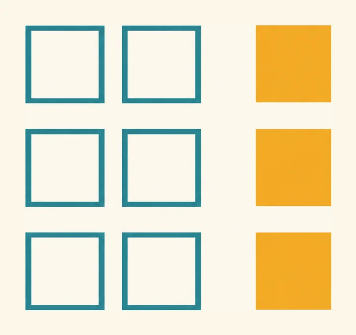
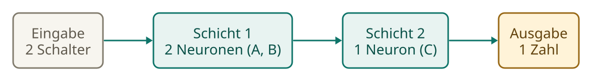
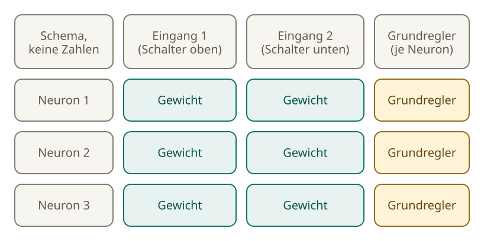
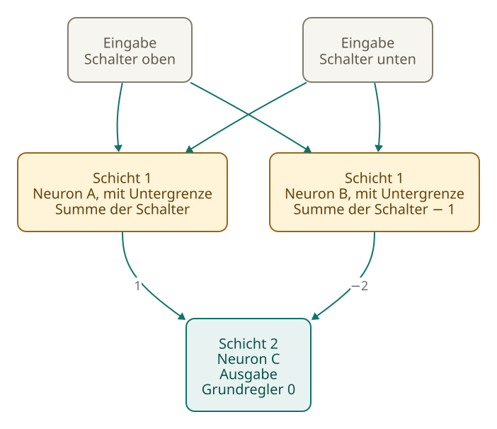
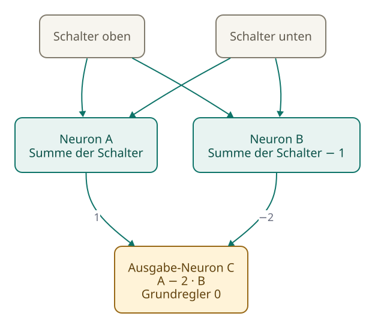

<!-- Generated from src/content/bausteine/de/schichten.mdx by scripts/export-lessons.mjs -- do not edit by hand. -->

# Schichten: Wie aus vielen Neuronen ein Netz wird

> Lesefassung für GitHub. Die vollständige Fassung mit interaktiven Demos, Animationen und Abrufmoment findest du auf der Website: **[Schichten: Wie aus vielen Neuronen ein Netz wird](https://ki-einfach-verstehen.de/de/bausteine/schichten/)**
>
> Lizenz: [CC BY 4.0](https://creativecommons.org/licenses/by/4.0/deed.de) · Nenne die Quelle so: KI einfach verstehen, „Schichten: Wie aus vielen Neuronen ein Netz wird“, CC BY 4.0, https://ki-einfach-verstehen.de/de/bausteine/schichten/

Viele Neuronen rechnen mit denselben Zahlen, und ihre Ausgaben werden zu den Eingaben der nächsten Schicht. Warum die Untergrenze einen Gipfel möglich macht, den zwei Schichten ohne sie nicht bilden, und was eine Angabe wie „96 Schichten“ meint.

Das einzelne Neuron aus den Grundlagen rechnet eine Summe, zählt einen Grundregler dazu und setzt negative Werte auf null. Ein Netz besteht aus sehr vielen solchen Neuronen. Wie sie zusammenarbeiten, hängt davon ab, wie sie angeordnet sind.

## Viele Neuronen auf denselben Zahlen

Stell dir einen Kanal an einem Mischpult vor, der Zahlen als Eingaben bekommt. Daneben stehen ein zweiter und ein dritter Kanal. Alle drei bekommen dieselben Zahlen, aber jeder hat seine eigenen Regler. Diese Gruppe nennt man eine [Schicht](https://ki-einfach-verstehen.de/de/glossar/schicht/).

Jedes Neuron rechnet für sich, mit eigenen Gewichten und eigenem Grundregler.

Der Zählkasten zeigt das für zwei Eingänge und drei Neuronen. Jede Zeile ist ein Neuron. Die beiden hellen Kästchen darin sind seine Gewichte, für jeden Eingang eins. Das bernsteinfarbene Kästchen am Ende ist sein Grundregler. Lies die Kästchen von links nach rechts: erst das Gewicht für den ersten Eingang, dann das für den zweiten, ganz am Ende der Grundregler.

*Ein Zählkasten für zwei Eingänge und drei Neuronen: Jedes Neuron hat zwei Gewichtskästchen und einen Grundregler, der bernsteinfarben markiert ist.*

Das nächste Bild zeigt den ganzen Aufbau: Zwei Schalter liefern ihre Werte an eine Schicht mit den Neuronen A und B. Deren Ausgaben fließen weiter zum Ausgabe-Neuron C. Von links nach rechts kannst du den Weg der Zahlen verfolgen. Jede Verbindung transportiert eine Zahl von einer Stelle zur nächsten. Die Eingänge selbst rechnen nicht; sie geben nur deine Eingabe weiter. Erst A, B und C rechnen. C fasst die Ausgaben von A und B am Ende zu einer einzigen Zahl zusammen. Diesen Aufbau nutzt das Beispiel mit zwei Schaltern im Abschnitt „Zwischenwerte: Die Ausgabe läuft weiter“.

*Der Aufbau des Beispiels mit zwei Schaltern: Zwei Schalter gehen in eine Schicht mit den Neuronen A und B, deren Ausgaben in das Ausgabe-Neuron C laufen. Mit diesem Aufbau rechnet das Beispiel im Abschnitt „Zwischenwerte: Die Ausgabe läuft weiter“.*

## Wie viele Zahlen stecken in einer Schicht?

Rate zuerst: Wie viele Zahlen stecken in der Schicht aus dem Zählkasten? Zähl dann Schritt für Schritt nach. Zu jedem Eingang gehört in jedem Neuron ein Gewicht. Bei zwei Eingängen hat jedes Neuron also zwei Gewichte, und die drei Neuronen haben zusammen sechs.

Dazu kommt der Grundregler. Jedes Neuron hat genau einen, also drei. Zusammen sind es neun Zahlen.

Dieselbe Regel gilt für jede andere Schicht: ein Gewicht für jeden Eingang und jedes Neuron, dazu ein Grundregler pro Neuron.

*Die Schicht aus dem Zählkasten als Tabelle: Jede Zeile ist ein Neuron, jede Spalte ein Eingang. Die Kreuzungen sind Gewichte, die Randspalte enthält die Grundregler.*

Eine andere Schicht mit drei Eingängen und zwei Neuronen hat drei mal zwei, also sechs Gewichte.

Dazu kommen zwei Grundregler, einer pro Neuron: acht Zahlen.

## Zwischenwerte: Die Ausgabe läuft weiter

Die Ausgabe einer Schicht beendet die Rechnung noch nicht: Sie wird zur Eingabe der nächsten Schicht. Eine Zahl, die auf diese Weise weitergegeben wird, heißt [Zwischenwert](https://ki-einfach-verstehen.de/de/glossar/zwischenwert/).

Das zeigt ein Beispiel mit zwei Schaltern, einem oben und einem unten – wie bei einem Treppenlicht. Die Zahlen für dieses Beispiel hat ein Mensch festgelegt; trainiert wurde nichts. Das Treppenlicht zeigt nur, wie diese Rechnung wirkt; es sagt nichts darüber, was ein echtes Modell mit Milliarden trainierter Zahlen tut. Ein gedrückter Schalter zählt als 1, ein nicht gedrückter als 0. Das Licht soll angehen, wenn genau einer der beiden Schalter gedrückt ist, also wenn C am Ende 1 zeigt.

A und B bekommen beide Schalter mit dem Gewicht 1. Bei A ist der Grundregler 0, bei B zählt er −1 dazu.

Das Ausgabe-Neuron C bekommt nur die Ausgaben von A und B. Es rechnet mit dem Gewicht 1 für A und −2 für B; sein Grundregler ist 0.

Was zeigt C, wenn beide Schalter gedrückt sind? Rate zuerst.

Die Tabelle zeigt alle drei Fälle. Die Spalte für B steht schon nach der Untergrenze, die negative Werte auf null setzt, wie das Neuron aus den Grundlagen.

| Schalter gedrückt | A | B (nach Untergrenze) | C |
|---|---|---|---|
| keiner | 0 | 0 | 0 |
| einer | 1 | 0 | 1 |
| beide | 2 | 1 | 0 |

Bei keinem gedrückten Schalter ist B eigentlich −1. Die Untergrenze macht daraus 0, und deshalb zeigt C dort 0.

[▶ Animation auf der Website ansehen](https://ki-einfach-verstehen.de/de/bausteine/schichten/)

*Zwei Schichten: Die Zwischenwerte A und B laufen in das Ausgabe-Neuron C weiter. Die Animation zeigt die Rechnung Schritt für Schritt.*

## Ohne Untergrenze fehlt der Gipfel

Die Rechnung oben hat eine feste Stufe: die Untergrenze bei den Neuronen A und B. Lass sie jetzt weg. Rate zuerst: Zeigt C, wenn kein Schalter gedrückt ist, 0 oder 2?

> **Interaktive Demo:** [auf der Website ausprobieren](https://ki-einfach-verstehen.de/de/bausteine/schichten/)

Rechne nun die vier Fälle durch. Ist kein Schalter gedrückt, bleibt B ohne Untergrenze bei −1 stehen. C rechnet dann −2 mal −1 und zeigt 2.

Bei einem oder zwei gedrückten Schaltern ändert sich nichts, denn dort war B nie negativ: C zeigt wie oben. Ordnet man die Fälle nach der Anzahl gedrückter Schalter, sinkt der Wert also jedes Mal um eins: von 2 auf 1 und dann auf 0. Für einen Gipfel müssten die Werte dagegen erst steigen und dann wieder fallen.

Der Grund gilt für jedes Netz, dessen Schichten nur gewichtete Summen plus Grundregler rechnen, ohne Untergrenze oder eine andere Stufe dazwischen. Jede Ausgabe ist eine Summe aus den Eingaben, jede mit ihrem Gewicht, plus Grundregler. Setzt man sie in die nächste Schicht ein, entsteht eine Summe aus Summen. Die lässt sich wieder zu einer einzigen Summe zusammenziehen: Jede Eingabe bekommt ein neues Gewicht: Auf jedem Weg von der Eingabe zum Ausgang werden die Gewichte malgenommen, und die Wege werden zusammengezählt. Alle Grundregler zusammen ergeben eine feste Zahl. Das gilt für zwei Schichten wie für zehn.

In diesem Beispiel haben beide Schalter dieselben Gewichte. Deshalb hängt C nur davon ab, wie viele Schalter gedrückt sind, und jeder weitere gedrückte Schalter verändert C um denselben Betrag, hier um −1. Eine Reihe, die immer um denselben Betrag fällt, kann nicht erst steigen und dann fallen.

Mit Untergrenze dagegen steigt der Wert, sobald ein Schalter gedrückt ist, und fällt wieder, wenn beide gedrückt sind. Das ist der Gipfel. Er liegt bei genau einem gedrückten Schalter, und genau diese Stelle macht das Muster „genau einer“ möglich. Ohne Untergrenze fehlt er. Dafür braucht es eine Stufe, die nicht einfach gewichtet zusammenzählt, wie die Untergrenze.

[▶ Animation auf der Website ansehen](https://ki-einfach-verstehen.de/de/bausteine/schichten/)

*Ohne Untergrenze: die Werte an A, B und C für alle Fälle. Nach der Anzahl gedrückter Schalter geordnet, sinkt der Wert gleichmäßig von 2 über 1 auf 0. Wenn die Werte so gleichmäßig fallen, entsteht kein Gipfel.*

Eine Ebene tiefer: Warum hat dieses Beispiel ohne Untergrenze keinen Gipfel?

Ohne Untergrenze ist A die Zahl der gedrückten Schalter, und B ist dieselbe Zahl minus 1. Jeder gedrückte Schalter erhöht A und B um je 1. C rechnet A minus zweimal B, also sinkt C pro gedrücktem Schalter um 1 (1 minus 2). Bei keinem gedrückten Schalter steht C auf 2, weil B den Wert −1 hat und C ihn mit −2 multipliziert. Für null, einen und zwei gedrückte Schalter ergibt das die Werte 2, 1, 0. Der Abstand zwischen zwei aufeinanderfolgenden Werten ist immer gleich groß, nämlich eins. Eine Rechnung, die so gleichmäßig fällt, hat keinen Punkt, an dem sie umkehrt. Ein Gipfel ist aber genau so ein Umkehrpunkt. Ohne Stufe dazwischen bleiben solche Schichten also eine einzige Rechnung, egal wie viele es sind. Darum entsteht in diesem Beispiel kein Gipfel.

## Was eine Modellangabe wie „96 Schichten“ meint

Bei Sprachmodellen wird oft angegeben, wie viele Schichten sie haben. GPT-3, ein Sprachmodell aus dem Jahr 2020, hat zum Beispiel 96 Schichten. Mit „Schicht“ ist hier nicht eine Schicht aus dem Zählkasten gemeint, sondern ein [Transformerblock](https://ki-einfach-verstehen.de/de/glossar/transformerblock/). 96 dieser Blöcke laufen hintereinander. Die 96 bezeichnet also die Zahl der Blöcke, nicht der Neuronen.

Zu jedem Block gehört ein [Feed-Forward-Netz](https://ki-einfach-verstehen.de/de/glossar/feed-forward-netz/). So nennt man hier ein Netz aus zwei Schichten, das seine Eingabe nur in eine Richtung verarbeitet: von vorn nach hinten. Zwischen den Schichten liegt eine Stufe, die der Untergrenze im Neuron ähnelt; ihre genaue Form hängt vom Modell ab.

*Mehrere Blöcke übereinander: Jeder Block gibt seine Zahlen an den nächsten weiter.*

Ein Block besteht aus zwei Teilen: einem Teil, in dem jedes Wort auf die Wörter davor schaut, und dem Feed-Forward-Netz. Die Zahlen, die ein Block ausgibt, sind die Eingaben des nächsten Blocks, so wie die Zwischenwerte A und B die Eingaben von C waren.

## Woher die Zahlen für die erste Schicht kommen

Die Schichten rechnen mit Zahlen. Eine Frage, die du stellst, ist aber Text, und Text ist keine Zahl. Bevor die erste Schicht rechnen kann, muss der Text also in Zahlen übersetzt werden.

Um diesen Schritt geht es im nächsten Baustein. Dort siehst du, wie Text in kleine Stücke zerfällt, wie jedes Stück eine Nummer bekommt und wie die Schichten anschließend mit diesen Nummern umgehen.

Die Gewichte sind dabei schon festgelegt. Wie sie entstehen, erklären spätere Bausteine.

---

Quelle: https://ki-einfach-verstehen.de/de/bausteine/schichten/

← Zurück: [Was ein KI-Modell eigentlich ist](./was-ein-ki-modell-eigentlich-ist.md) · [Alle Bausteine](../../README.de.md#inhalt) · Weiter: [Tokenisierung im Modell: Wie dein Chat zu einer Tokenfolge wird](./tokenisierung-im-modell.md) →
