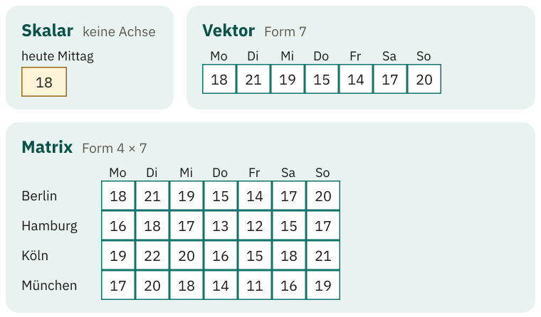
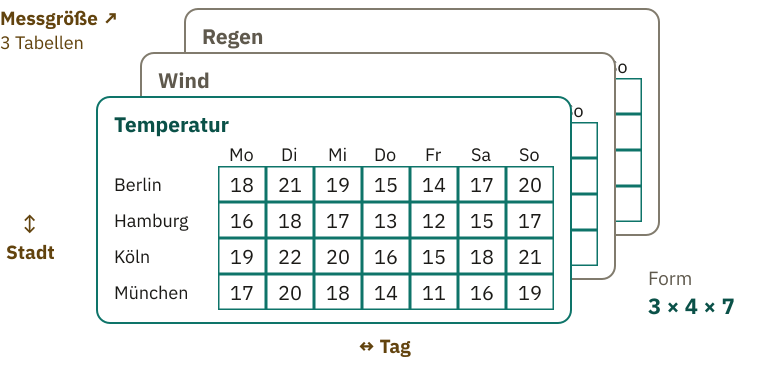
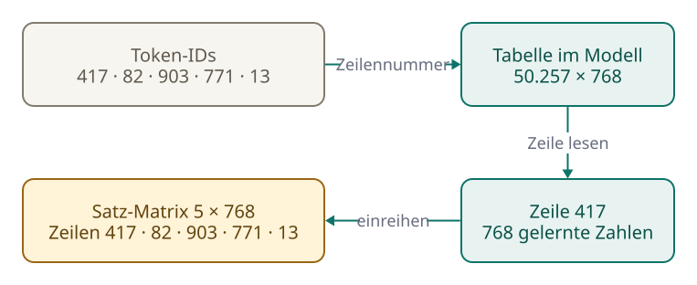

<!-- Generated from src/content/bausteine/de/skalar-vektor-matrix-tensor.mdx by scripts/export-lessons.mjs -- do not edit by hand. -->

# Skalar, Vektor, Matrix, Tensor: die Bausteine der Zahlen

> Lesefassung für GitHub. Die vollständige Fassung mit interaktiven Demos, Animationen und Abrufmoment findest du auf der Website: **[Skalar, Vektor, Matrix, Tensor: die Bausteine der Zahlen](https://ki-einfach-verstehen.de/de/bausteine/skalar-vektor-matrix-tensor/)**
>
> Lizenz: [CC BY 4.0](https://creativecommons.org/licenses/by/4.0/deed.de) · Nenne die Quelle so: KI einfach verstehen, „Skalar, Vektor, Matrix, Tensor: die Bausteine der Zahlen“, CC BY 4.0, https://ki-einfach-verstehen.de/de/bausteine/skalar-vektor-matrix-tensor/

Von der Wetter-App zum Chatbot: wie Zahl, Liste, Tabelle und Tabellenstapel zusammenhängen und warum dein Chat für ein Modell genau so ein Zahlenblock ist.

Du tippst in einen Chatbot: „Die Katze sitzt." Den ersten Schritt kennst du aus dem vorigen Baustein: Der [Tokenizer](https://ki-einfach-verstehen.de/de/glossar/tokenizer/) zerlegt den Satz in [Tokens](https://ki-einfach-verstehen.de/de/glossar/token/), und jedes Token bekommt eine Nummer. Im ausgedachten Beispiel erhält „Die" die Nummer 417. Mit ihr allein kann das Modell wenig anfangen. Es nutzt sie als Adresse und holt dort eine lange Liste gelernter Zahlen. Bei der kleinsten Version von GPT-2, einem älteren und frei verfügbaren Modell, sind es 768 Zahlen pro Token. Die fünf Tokens des Beispiels („Die“, „Kat“, „ze“, „sitzt“ und der Punkt) liefern also fünf solcher Reihen.

Dabei ordnet das Modell die Zahlen in einigen einfachen Formen an, die du aus einer Wetter-App kennst.

## Eine Zahl und eine Liste

Die Wetter-App meldet für heute Mittag 18 Grad. Das ist eine einzelne Zahl, und mehr braucht es nicht, um die Frage „Wie warm ist es?" zu beantworten. Eine einzelne Zahl heißt **[Skalar](https://ki-einfach-verstehen.de/de/glossar/skalar/)**.

*Dieselben Wetterdaten, nur verschieden angeordnet: eine Zahl für heute, eine Reihe für die Woche, eine Tabelle für mehrere Städte.*

In der Wochenvorschau steht für jeden Tag, Montag bis Sonntag, eine Zahl (ausgedacht, zwischen 14 und 21 Grad), am Donnerstag zum Beispiel 15 Grad. Hier zählt auch die Reihenfolge: Jede Zahl gehört zu dem Tag, an dem sie steht. Vertauschst du zwei Zahlen, stimmt die Vorhersage für zwei Tage nicht mehr, obwohl noch dieselben Zahlen dastehen. Eine geordnete Liste von Zahlen heißt **[Vektor](https://ki-einfach-verstehen.de/de/glossar/vektor/)**. Jede Zahl hat darin ihren festen Platz, und **der Platz gehört zur Information dazu**. Dein Chat funktioniert genauso: Die Zahlen, die das Modell für das Token „Die" holt, bilden eine geordnete Liste, also einen Vektor. Bei der kleinsten GPT-2-Version sind es 768.

Am Ende der Verarbeitung bekommt jedes mögliche nächste Textstück eine einzelne Bewertung: den [Score](https://ki-einfach-verstehen.de/de/glossar/score/) aus dem Baustein über Input und Output. Jeder dieser Scores ist ein Skalar.

## Viele Listen untereinander: die Matrix

Jetzt willst du die Woche für vier Städte vergleichen: Berlin, Hamburg, Köln und München. Am übersichtlichsten ist eine Tabelle mit einer Zeile pro Stadt und einer Spalte pro Tag. Um eine bestimmte Zahl zu finden, brauchst du zwei Angaben: Stadt und Tag. Eine solche Tabelle heißt **[Matrix](https://ki-einfach-verstehen.de/de/glossar/matrix/)**. Jede ihrer Zeilen ist wieder ein Vektor, nämlich die Woche einer Stadt.

*Skalar, Vektor, Matrix: dieselben Temperaturen, einmal als einzelne Zahl, einmal als Reihe für die Woche, einmal als Tabelle für vier Städte.*

Die Zahlen selbst sind dabei immer Temperaturen geblieben. **Geändert hat sich nur, wie sie angeordnet sind:** einzeln, in einer Reihe oder in einer Tabelle.

Auch dein Chat hat so eine Tabelle. Im Beispiel besteht dein Satz „Die Katze sitzt.“ aus fünf Tokens, und jedes bringt seine Liste mit 768 Zahlen mit. Die fünf Tokens des Beispiels sind hier ausgedacht. Schreibt man die fünf Listen als Zeilen untereinander, entsteht eine Tabelle mit fünf Zeilen, eine pro Token: eine Matrix. Wie das Modell diese Zeilen findet, zeigt ein späterer Abschnitt.

Bevor du weiterliest: Der Wetterdienst misst neben der Temperatur auch Wind und Regen, für dieselben vier Städte und sieben Tage. Wie würdest du diese Zahlen ablegen, damit nichts durcheinandergerät?

## Tabellen stapeln: der Tensor

Die naheliegende Lösung: drei Tabellen gleicher Bauart, eine für Temperatur, eine für Wind, eine für Regen. Legst du sie übereinander, entsteht ein Stapel. Um eine Zahl darin zu finden, brauchst du jetzt drei Angaben: welche Messgröße, welche Stadt, welcher Tag. „Wind, Köln, Freitag" führt zu genau einer Zahl.

*Ein Tensor als Stapel: drei gleich gebaute Tabellen für Temperatur, Wind und Regen. Jede Zahl hat eine Adresse aus Messgröße, Stadt und Tag.*

Ein solcher Stapel heißt **[Tensor](https://ki-einfach-verstehen.de/de/glossar/tensor/)**. Bei KI-Modellen ist „Tensor“ der Sammelname für Zahlenblöcke, unabhängig davon, in wie vielen Richtungen er sich ausdehnt; deshalb zählen auch Skalar, Vektor und Matrix dazu. Alle Einträge haben denselben Zahlentyp, zum Beispiel sind sie durchweg Kommazahlen. Trotzdem können sie Verschiedenes messen: Im Wetterstapel stehen Temperatur, Wind und Regen übereinander. Der Rechenchip kann dadurch alle Zahlen auf dieselbe Weise verarbeiten.

Für KI-Modelle genügt: Wenn du eine Wettertabelle lesen kannst, kannst du auch einen Tensor verstehen.

*Ein Foto für das Modell: Es zerfällt in drei gleich große Schichten, eine für Rot, eine für Grün, eine für Blau. Jede Schicht ist eine Tabelle aus Farbwerten.*

Wenn du einem Chatbot ein Foto zeigst, verarbeitet er meist zuerst einen solchen Stapel. Oft wird das Foto vorher verkleinert, doch der Aufbau aus drei Farbtabellen bleibt gleich. Jeder Bildpunkt liefert drei Werte: wie viel Rot, wie viel Grün und wie viel Blau, jeweils als Zahl von 0 bis 255. Alle Rotwerte bilden eine Tabelle, alle Grünwerte eine zweite und alle Blauwerte eine dritte. Jede davon ist so hoch und breit wie das Foto. Übereinandergestapelt haben sie denselben Aufbau wie der Wetterstapel – nur mit Farben statt Messgrößen.

Eine Ebene tiefer: Warum oft 0 bis 1?

Viele Programme rechnen die Werte vor dem Modell in Kommazahlen von 0,0 bis 1,0 um, damit alle Farbwerte in derselben Größenordnung liegen. Aus 255 wird dann 1,0 und aus 0 wird 0,0.

Der Grund: Ein Modell rechnet mit allen Zahlen gleichzeitig. Liegen Werte bei 0 und andere bei 255 nebeneinander, können die großen Zahlen eine Rechnung stärker prägen, obwohl beide nur für Helligkeit stehen. Bei Werten zwischen 0,0 und 1,0 haben alle ein ähnliches Gewicht. Das ist eine Vorbereitung, die vor dem eigentlichen Lernen passiert, und sie verändert das Bild selbst nicht: Ein Bildpunkt bleibt derselbe Bildpunkt, nur mit anderen Zahlen. Die Umrechnung teilt den Wert einfach durch 255. Für einen Rotwert von 128 ergibt sich so ungefähr 0,5. Wie genau ein Programm vorgeht, hängt von seinem Aufbau ab; die Grundidee bleibt gleich.

Schon ein Foto mit 400 Bildpunkten Höhe und 600 Bildpunkten Breite ergibt einen ziemlich großen Stapel. Wie groß und wie dieser Block aufgebaut ist, lässt sich mit seiner Form kurz beschreiben.

## Achsen und Form: wie ein Zahlenblock gebaut ist

Jede Richtung, in die sich ein Block ausdehnt, heißt **Achse**. Die Wochenliste hat eine Achse: die Tage. Die Städtetabelle hat zwei: Städte und Tage. Beim Wetterstapel sind es drei: Messgröße, Stadt und Tag. Ein einzelner Skalar hat keine Achse, denn er dehnt sich in keine Richtung aus. Trotzdem zählt auch er als Tensor, nur eben als einer ohne Achse.

Die **Form** eines Blocks gibt an, wie lang jede Achse ist. Die Anzahl der Angaben ist also die Anzahl der Achsen. Multiplizierst du die Längen, erhältst du die Gesamtzahl der Einträge.

*Die Form ist das Lineal eines Zahlenblocks: Sie nennt für jede Achse, wie lang sie ist.*

Beim Foto sieht das so aus: Es hat die Form 3 × 400 × 600: drei Farben, dazu Höhe und Breite des Fotos. Die drei Angaben stehen für drei Achsen. Wie viele Zahlen sind das wohl? Überleg kurz, bevor du weiterliest.

Es sind 720.000, und das bei einem eher kleinen Foto. Auf diese Weise lässt sich jeder Zahlenblock kurz beschreiben.

> **Interaktive Demo:** [auf der Website ausprobieren](https://ki-einfach-verstehen.de/de/bausteine/skalar-vektor-matrix-tensor/)

Eine Ebene tiefer: Ist ein Vektor nicht ein Pfeil?

Viele kennen Vektoren aus der Schule als Pfeile, und dort stimmt das auch: Zwei oder drei Zahlen lassen sich als Pfeil in eine Ebene oder in den Raum zeichnen. Bei KI-Modellen ist ein Vektor zuerst eine geordnete Zahlenliste, und die kann 768 Zahlen lang sein. Mathematisch ist sie eine Liste von 768 Koordinaten. Zeichnen ließe sie sich nur als Pfeil in einem Raum mit 768 Richtungen statt zwei oder drei – anschaulich vorstellen kann sich das niemand. Als Zahlenliste lässt sie sich dagegen genauso behandeln wie ein Vektor mit zwei Einträgen.

Ähnlich verwirrend ist das Wort „Dimension". Manche meinen damit die Zahl der Achsen („ein dreidimensionaler Block"), andere die Länge einer Achse („ein Vektor mit 768 Dimensionen" ist eine Liste mit 768 Zahlen). Die Richtung heißt Achse, die Zahl der Einträge heißt Länge.

Woher kommen die Zahlen für „Die“?

## Vom Token zum Zahlenblock

Stell dir ein dickes Nachschlagebuch vor. Es hat eine Seite für jedes Textstück, das das [Sprachmodell](https://ki-einfach-verstehen.de/de/glossar/sprachmodell/) kennt, also für jeden Eintrag seines [Vokabulars](https://ki-einfach-verstehen.de/de/glossar/vokabular/). Auf jeder Seite steht eine Liste mit 768 Zahlen. Bei der kleinsten Version von GPT-2 hat dieses Buch 50.257 Seiten.

Die [Token-ID](https://ki-einfach-verstehen.de/de/glossar/token-id/) ist einfach die Seitenzahl. Bekommt das Modell eine Nummer – im Beispiel die 417 für „Die“ –, schlägt es die entsprechende Seite auf und übernimmt die dortige Liste. Die Zahl ist ausgedacht; im echten GPT-2 steht an dieser Stelle ein anderes Textstück. **Die Token-ID wird also nicht umgerechnet, sondern nachgeschlagen: Die gewählte Zeile enthält die gelernte Zahlenliste dieses Tokens.**

Im Rechner ist das Buch eine große Tabelle, und jede Seite ist eine Zeile darin. Das Buch ist also eine Matrix der Form 50.257 × 768.

[▶ Animation auf der Website ansehen](https://ki-einfach-verstehen.de/de/bausteine/skalar-vektor-matrix-tensor/)

*Jede Token-ID wählt eine Zeile der großen Tabelle aus; die Zeilen landen der Reihe nach untereinander in der Matrix für den Satz.*

Für deinen Satz „Die Katze sitzt." wiederholt sich das fünfmal, einmal pro Token. Das Modell schlägt zu jedem Token die passende Seite auf und schreibt die fünf Listen in derselben Reihenfolge untereinander. Wie das Modell erfährt, an welcher Stelle ein Stück steht, erklärt der Baustein über [Embeddings](./embeddings.md). So entsteht die Tabelle mit fünf Zeilen, die du schon aus dem Abschnitt über die Matrix kennst.

Kein Mensch hat die Zahlen ins Buch geschrieben. Sie gehören zu den [Parametern](https://ki-einfach-verstehen.de/de/glossar/parameter/) des Modells und wurden beim Training Schritt für Schritt eingestellt. Ein unabhängig trainiertes Modell mit demselben Vokabular hat deshalb auf Seite 417 ganz andere Zahlen.

An einer Stelle hinkt der Vergleich mit dem Wetter. In der Wettertabelle hat jede Zahl eine klare Bezeichnung: Montag, Hamburg, Wind. Die einzelnen Zahlen auf Seite 417 haben dagegen meist keine solche feste Bedeutung. Niemand hat festgelegt, dass eine einzelne Zahl auf einer Seite „Tier" bedeutet. Was die Liste ausdrückt, ergibt sich erst beim Training. Darum geht es später.

## Viele Sätze, ein Stapel

*Mehrere Sätze gleichzeitig: Jeder Satz ist eine Tabelle, und alle Tabellen zusammen ergeben einen Stapel. Das oberste Blatt zeigt die fünf Zeilen eines Satzes, eine pro Token; die Farben haben hier keine Bedeutung.*

Beim Training verarbeitet das Modell meist viele Sätze gleichzeitig, in einem einzigen Rechenschritt. Jeder Satz bildet eine Tabelle wie eben, mit einer Zeile pro Token. Diese Tabellen werden wie die Wettertabellen zu einem Tensor gestapelt. So schließt sich die Kette: Die Token-ID ist eine Seitenzahl; jede Seite liefert einen Vektor; der ganze Satz wird zur Matrix; mehrere Sätze bilden einen Tensor mit drei Achsen. Damit sich ihre unterschiedlich hohen Tabellen stapeln lassen, werden die Sätze vorher auf dieselbe Länge gebracht.

Eine Ebene tiefer: Wenn Sätze verschieden lang sind

Ein ausgedachtes Beispiel: „Die Katze sitzt.“ hat fünf Tokens, ein zweiter Satz hat acht. Ihre Tabellen haben die Formen 5 × 768 und 8 × 768, und zwei verschieden hohe Tabellen ergeben keinen sauberen Stapel.

Deshalb wird der kürzere Satz aufgefüllt, auf Englisch heißt das Padding. Er bekommt hinten drei zusätzliche Stellen mit einem besonderen **Füll-Token**, das nur Platz hält. Jetzt sind beide Sätze acht Tokens lang, und der Stapel hat die Form 2 × 8 × 768: zwei Sätze, acht Positionen, 768 Zahlen pro Position.

Damit die Füllung nicht als Text zählt, bekommt das Modell eine zweite, viel kleinere Tabelle mit, die **Maske** (englisch Attention Mask). Sie hat die Form 2 × 8 und enthält nur Einsen und Nullen. Eine 1 heißt „hier steht ein echtes Token“, eine 0 heißt „hier ist nur Füllung“:

| | 1 | 2 | 3 | 4 | 5 | 6 | 7 | 8 |
| :--- | :-: | :-: | :-: | :-: | :-: | :-: | :-: | :-: |
| Satz 1 | 1 | 1 | 1 | 1 | 1 | 0 | 0 | 0 |
| Satz 2 | 1 | 1 | 1 | 1 | 1 | 1 | 1 | 1 |

Die Stellen mit einer 0 beachtet das Modell nicht.

Auch nach oben ist die Länge begrenzt. Diese Grenze heißt [Kontextfenster](https://ki-einfach-verstehen.de/de/glossar/kontextfenster/) und gibt an, wie viele Positionen ein Modell auf einmal verarbeiten kann. Bei GPT-2 sind es 1024. Ein längerer Text passt nicht vollständig in den Block. Je nach Software wird die Anfrage dann abgelehnt oder der Text abgeschnitten (Truncation). Dabei fällt je nach Einstellung das Ende oder der Anfang weg. Auffüllen und Abschneiden sorgen gemeinsam dafür, dass jeder Block eine feste, rechteckige Form hat. Verschwindet der Anfang, fehlt dem Modell die erste Frage eines langen Chats.

## Warum Modelle in Zahlenblöcken rechnen

Ob Satz, Foto oder Wetterdaten: Für das Modell ist alles ein Zahlenblock mit Achsen und einer Form, **weil sich so dieselbe Rechnung auf sehr viele Zahlen gleichzeitig anwenden lässt.**

Angenommen, alle 28 Temperaturen der Städtetabelle sollen von Celsius in Fahrenheit umgerechnet werden. Für jede Zahl gilt dieselbe Rechnung, deshalb können alle Rechnungen gleichzeitig laufen. Für solche Aufgaben sind Grafikprozessoren gemacht – die Chips, auf denen große Modelle meist laufen. Sie führen Tausende gleichartiger Rechnungen parallel aus. Weil die Zahlen in gleich gebauten Blöcken liegen, lässt sich die Arbeit in gleich große Portionen aufteilen und auf viele Recheneinheiten verteilen. Die 28 Temperaturen sind ein kleiner Happen, die 720.000 Zahlen des Fotos ein großer, doch das Muster bleibt gleich.

Große Chatbots laufen meist nicht auf deinem Handy, sondern in riesigen Rechenzentren mit solchen Chips. Dort durchlaufen die Zahlenblöcke deiner Nachricht das Modell. Ihr einheitlicher Aufbau erlaubt es, große Portionen parallel zu verarbeiten statt Zahl für Zahl.

Auch das Ergebnis des Modells ist ein Zahlenblock: die Score-Liste aus dem Baustein über Input und Output. Für das nächste Textstück enthält sie 50.257 [Scores](https://ki-einfach-verstehen.de/de/glossar/score/), einen für jeden Eintrag des Vokabulars. Diese Liste ist ein Vektor.

Offen ist noch, was mit dem Score-Vektor am Ende geschieht: Scores wie 7,1 oder −2,3 sind noch keine Wahrscheinlichkeiten. Wie daraus die Entscheidung für das nächste Token entsteht, zeigt der nächste Baustein.

---

Quelle: https://ki-einfach-verstehen.de/de/bausteine/skalar-vektor-matrix-tensor/

← Zurück: [Token-IDs: Was eine Nummer bedeutet](./token-ids-und-vokabular.md) · [Alle Bausteine](../../README.de.md#inhalt) · Weiter: [Wahrscheinlichkeit und Softmax: Wie ein Modell sich entscheidet](./wahrscheinlichkeit-und-softmax.md) →
