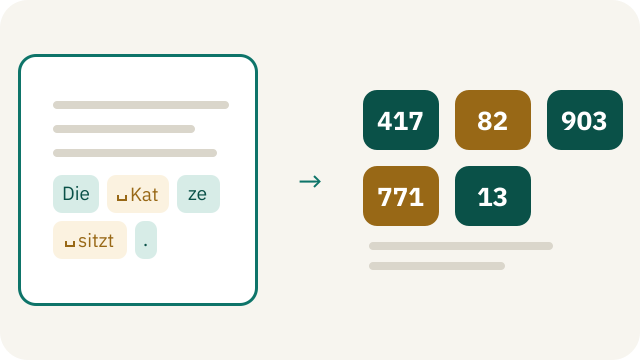
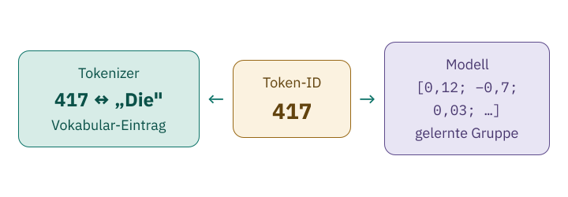
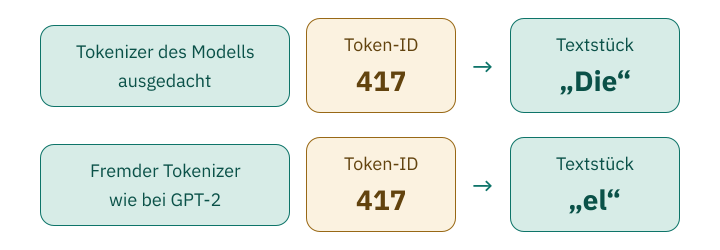

<!-- Generated from src/content/bausteine/de/token-ids-und-vokabular.mdx by scripts/export-lessons.mjs -- do not edit by hand. -->

# Token-IDs: Was eine Nummer bedeutet

> Lesefassung für GitHub. Die vollständige Fassung mit interaktiven Demos, Animationen und Abrufmoment findest du auf der Website: **[Token-IDs: Was eine Nummer bedeutet](https://ki-einfach-verstehen.de/de/bausteine/token-ids-und-vokabular/)**
>
> Lizenz: [CC BY 4.0](https://creativecommons.org/licenses/by/4.0/deed.de) · Nenne die Quelle so: KI einfach verstehen, „Token-IDs: Was eine Nummer bedeutet“, CC BY 4.0, https://ki-einfach-verstehen.de/de/bausteine/token-ids-und-vokabular/

Zeigt, was eine Token-ID ist: eine Nummer, die nur im Vokabular ihres Tokenizers gilt. Außerdem erklärt der Baustein, warum jedes Modell genau zu dem Tokenizer passt, mit dem es trainiert wurde, und warum die Nummer selbst nichts über das Stück verrät.

Ein Sprachmodell rechnet nur mit Zahlen, nie mit Text. Also bekommt jedes Stück eine Nummer, etwa das Stück „Frank“ aus „Frankreich“.

## Jedes Stück bekommt eine Nummer

Jedes Stück im [Vokabular](https://ki-einfach-verstehen.de/de/glossar/vokabular/) hat eine feste Nummer, seine **[Token-ID](https://ki-einfach-verstehen.de/de/glossar/token-id/)**. Der Tokenizer legt sie einmal fest, wenn er sein Vokabular lernt. Danach ändert sie sich nie. Die Nummer zeigt nur, an welcher Stelle im Vokabular ein Stück steht.

*Das Vokabular als Kasten: Für jedes Stück deines Satzes wird das Stück mit genau diesem Text herausgesucht, und seine Nummer wird übernommen.*

Das Vokabular ist der Kasten aus dem vorigen Baustein. Auf jedem Stück darin steht eine Nummer. Zu jedem Stück in deinem Text wird genau dieses Stück herausgesucht, und seine Nummer wird übernommen. Der Tokenizer wählt dabei nichts aus, er folgt seinen Regeln. Am Ende steht eine Reihe von Nummern da, in derselben Reihenfolge wie die Stücke. Diese Reihe entsteht für jeden Text neu, ganz gleich wie lang er ist. Auf einem Stück steht nur eine Zeichenfolge, keine Erklärung. Wer den Kasten durchsieht, erfährt nichts über den Sinn eines Stücks.

Nimm als Beispiel den Satz „Die Katze sitzt.“ Das Zeichen ␣ steht für ein Leerzeichen, das zum jeweiligen Stück gehört. Der Tokenizer hat den Satz bereits in die Stücke „Die“, „␣Kat“, „ze“, „␣sitzt“ und „.“ zerlegt. Ein Stück „␣Katze“ gibt es im Vokabular nicht, deshalb sind es zwei.

Wie viele Nummern bekommt der Satz? Rate, bevor du weiterliest.

Fünf, eine für jedes Stück. Welche Nummer auf welcher Karte steht, zeigt diese Tabelle:

| Token-ID | Textstück |
| ---: | :--- |
| 417 | „Die“ |
| 82 | „␣Kat“ |
| 903 | „ze“ |
| 771 | „␣sitzt“ |
| 13 | „.“ |

Die Stücke und Nummern in diesem Beispiel sind ausgedacht. Sie stammen nicht aus einem Training. Die fünf Karten im Bild zeigen nur einen Ausschnitt aus einem viel größeren Kasten. Deshalb sind sie nicht von 1 bis 5 nummeriert. Das echte Vokabular von GPT-2, einem älteren Sprachmodell von OpenAI, hat 50.257 Einträge, und unter 417 steht dort ein anderes Stück.

Aus dem Satz wird also die Zahlenfolge 417, 82, 903, 771, 13. Diesen Weg vom Text zu den Nummern nennt man **[Kodieren](https://ki-einfach-verstehen.de/de/glossar/tokenizer/)**. Die fünf Zahlen gehen anschließend als Input ins Modell. Auch deine Nachrichten an einen Chatbot werden auf diese Weise in Nummern umgesetzt, bevor das Modell sie sieht.

*Ein Satz wird zuerst in Textstücke zerlegt, dann wird jedes Stück über das Mini-Vokabular in seine Nummer übersetzt. Das Zeichen ␣ markiert ein Leerzeichen, das zum Stück gehört.*

## Der Rückweg: aus Nummern wird Text

Auch eine Chatbot-Antwort entsteht zunächst als Folge von Nummern. Für jedes Stück im Vokabular gibt das Modell einen [Score](https://ki-einfach-verstehen.de/de/glossar/score/) aus. Dieser bewertet, wie gut das Stück als Nächstes passt. Die Textschleife aus dem Baustein Input und Output wählt anhand dieser Werte ein Stück aus. Die Score-Liste ist nach den Nummern des Vokabulars geordnet: Eintrag 417 gehört zum Stück mit der Nummer 417. Wählt die Schleife Eintrag 82, ist damit das Stück mit der Nummer 82 ausgewählt.

Damit du die Antwort lesen kannst, geht der Tokenizer den umgekehrten Weg. Er schlägt jede Nummer nach und hängt die gespeicherten Stücke in derselben Reihenfolge aneinander. Diesen Rückweg nennt man **[Dekodieren](https://ki-einfach-verstehen.de/de/glossar/tokenizer/)**.

Aus 417, 82, 903, 771, 13 wird so wieder „Die Katze sitzt.“. Die Leerzeichen gehen dabei nicht verloren, weil sie schon in „␣Kat“ und „␣sitzt“ gespeichert sind. Auch die Reihenfolge zählt: 82, 903, 417 ergibt „KatzeDie“, mit einem Leerzeichen am Anfang.

Bevor du weiterliest: Was kommt heraus, wenn 417 und 82 die Plätze tauschen?

> **Interaktive Demo:** [auf der Website ausprobieren](https://ki-einfach-verstehen.de/de/bausteine/token-ids-und-vokabular/)

Tauschst du 417 und 82, kommt „KatDieze sitzt.“ heraus, mit einem Leerzeichen am Anfang. Jede Nummer holt nur ihr eigenes Stück zurück, samt Leerzeichen.

## Eine ID ist ein Etikett

Verrät die Zahl 417 dem Modell, dass „Die“ ein Artikel ist? Nein. Im Mini-Vokabular steht unter 417 „Die“. Im echten GPT-2-Vokabular steht dort dagegen „el“, ein Wortteil. **Eine Nummer gilt nur in ihrem Vokabular.** Die Zahl selbst trägt für das Modell keine Bedeutung. Auch ihre Größe spielt keine Rolle; das Modell nutzt sie nur zum Nachschlagen.

*Eine ID ist nur ein Etikett: eine Nummer, die nichts über den Inhalt verrät.*

Wo steckt dann das Wissen über „Die“? Beim Spamfilter aus dem ersten Baustein gab es für jedes Wort eine Zahl, ein Gewicht. Ein Sprachmodell speichert zu jeder Token-ID eine eigene Gruppe gelernter Zahlen. Im ausgedachten Beispiel stehen darin einige Zahlen, die das Training eingestellt hat. Auch das sind [Parameter](https://ki-einfach-verstehen.de/de/glossar/parameter/), die im Training eingestellt werden. Die ID sagt nur, welche Gruppe gemeint ist. Mit dieser Gruppe beginnt die Rechnung für das Stück.

*Die ID 417 führt an zwei getrennte Stellen: im Tokenizer zum Textstück „Die“ aus dem Mini-Vokabular und im Modell zu einer Gruppe gelernter Zahlen. Das Modell selbst sieht nur die Zahl.*

## Warum Tokenizer und Modell ein festes Paar sind

Kann man einem fertigen Modell einen anderen Tokenizer geben? Stell dir zwei Tokenizer mit gleich vielen Karten vor, die ihre Nummern unterschiedlich verteilen: Beim ersten steht unter 417 „Die“, beim zweiten „el“, wie bei GPT-2. Das Modell wurde mit dem ersten trainiert, erhält nun aber Nummern vom zweiten. Kommt im Text das Stück „el“ vor, liefert der fremde Tokenizer dafür 417. Was macht das Modell daraus? Überlege kurz, bevor du weiterliest.

Es holt die Gruppe, die es für 417 gelernt hat, also für „Die“. Eine Fehlermeldung gibt es hier nicht, denn 417 steht im Vokabular dieses Modells.

*Ein fremder Tokenizer hat ein eigenes Vokabular: Unter derselben Nummer 417 steht dort ein anderes Stück. Das Beispiel „Die“ ist ausgedacht, „el“ stammt aus GPT-2.*

**Deshalb gehört zu jedem Modell genau der Tokenizer, mit dem es trainiert wurde,** einschließlich seiner Regeln und seines Vokabulars. Seine Parameter hat das Modell für genau eine Zuordnung von Nummern zu Stücken gelernt. Bei einer anderen Zuordnung passen die Nummern nicht mehr zu den gelernten Gruppen. Wechselst du in einer Chat-App zu einem Modell mit anderem Tokenizer, wird deine Nachricht dort anders zerlegt und nummeriert. Oft besteht sie dann auch aus einer anderen Zahl von Tokens. Mehrere Modelle können denselben Tokenizer nutzen; sie teilen dann die Nummern, aber nicht die gelernten Zahlen.

> **Interaktive Demo:** [auf der Website ausprobieren](https://ki-einfach-verstehen.de/de/bausteine/token-ids-und-vokabular/)

## Die Nummern sind erst der Anfang

Wie diese Zahlengruppen aussehen und wie sie zusammen eine Tabelle bilden, zeigt der nächste Baustein: [Skalar, Vektor, Matrix, Tensor](./skalar-vektor-matrix-tensor.md).

---

Quelle: https://ki-einfach-verstehen.de/de/bausteine/token-ids-und-vokabular/

← Zurück: [Tokenizer: Wie Text in Tokens zerfällt](./tokenizer-ids-vokabular.md) · [Alle Bausteine](../../README.de.md#inhalt) · Weiter: [Skalar, Vektor, Matrix, Tensor: die Bausteine der Zahlen](./skalar-vektor-matrix-tensor.md) →
