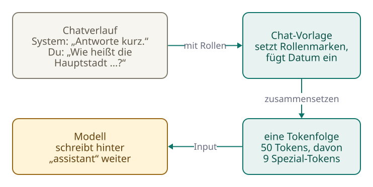
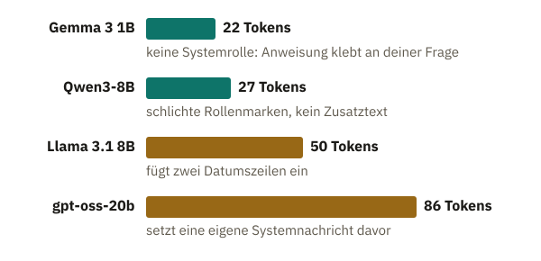
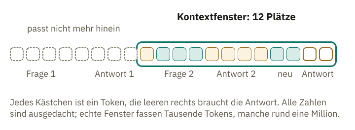
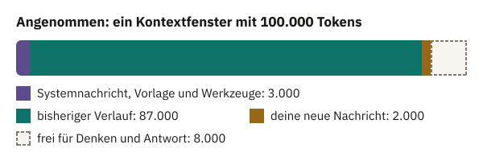

<!-- Generated from src/content/bausteine/de/tokenisierung-im-modell.mdx by scripts/export-lessons.mjs -- do not edit by hand. -->

# Tokenisierung im Modell: Wie dein Chat zu einer Tokenfolge wird

> Lesefassung für GitHub. Die vollständige Fassung mit interaktiven Demos, Animationen und Abrufmoment findest du auf der Website: **[Tokenisierung im Modell: Wie dein Chat zu einer Tokenfolge wird](https://ki-einfach-verstehen.de/de/bausteine/tokenisierung-im-modell/)**
>
> Lizenz: [CC BY 4.0](https://creativecommons.org/licenses/by/4.0/deed.de) · Nenne die Quelle so: KI einfach verstehen, „Tokenisierung im Modell: Wie dein Chat zu einer Tokenfolge wird“, CC BY 4.0, https://ki-einfach-verstehen.de/de/bausteine/tokenisierung-im-modell/

Wie aus einem Chat mit Rollen eine einzige Tokenfolge wird, wozu Spezial-Tokens dienen und was alles ins Kontextfenster passen muss.

„Wie heißt die Hauptstadt von Frankreich?“ Sechs Wörter und ein Fragezeichen. Die Chat-App hat dem Modell vorher noch die Anweisung „Antworte kurz.“ mitgegeben. Schätz, bevor du weiterliest, wie viele [Tokens](https://ki-einfach-verstehen.de/de/glossar/token/) beim [Modell](https://ki-einfach-verstehen.de/de/glossar/modell/) ankommen, wenn du die Frage abschickst.

Im ersten Baustein dieses Themenbereichs hast du die erste Station auf dem Weg durchs Modell kennengelernt: Deine Chatnachricht wird zu einer langen Folge von Tokens, in der auch steht, wer was gesagt hat. Aus den Bausteinen über [Tokenizer](./tokenizer-ids-vokabular.md) und [Token-IDs](./token-ids-und-vokabular.md) weißt du bereits, wie ein [Tokenizer](https://ki-einfach-verstehen.de/de/glossar/tokenizer/) Text in Stücke zerlegt und jedem Stück eine Nummer gibt.

## Dein Chat ist ein einziger langer Text

Im Chatfenster wirkt ein Gespräch wie eine Reihe getrennter Sprechblasen. Man könnte deshalb meinen, das Modell bekomme nur die neueste Sprechblase und erfahre die Rollen auf einem anderen Weg. Tatsächlich stehen Rollen und Nachrichten in einer einzigen Folge. Auch ältere Nachrichten werden bei jeder neuen Nachricht von dir erneut mitgeschickt. Was das für die Obergrenze an Tokens bedeutet, zeigt der Abschnitt „Warum vergisst mein Chat etwas?“ weiter unten. Aus dem Baustein über [Input und Output](./input-und-output.md) weißt du: Ein [Sprachmodell](https://ki-einfach-verstehen.de/de/glossar/sprachmodell/) hängt Runde für Runde ein Stück an einen Text an. **Mehr als eine Folge von Tokens fortsetzen kann es nicht.** Also muss die Chat-App, das Programm um das Modell herum, das ganze Gespräch in eine einzige Folge verwandeln.

Dafür gehört zu jedem Chatmodell eine **[Chat-Vorlage](https://ki-einfach-verstehen.de/de/glossar/chat-vorlage/)**: ein festes Muster, das die Nachrichten samt ihrer Rolle hintereinandersetzt. Frei verfügbare Modelle bringen sie neben ihren gelernten [Parametern](https://ki-einfach-verstehen.de/de/glossar/parameter/) als kleine Begleitdatei mit. Übliche Rollen heißen „user“ für dich, „assistant“ für das Modell und „system“ für Anweisungen des Anbieters der Chat-App. Die **Systemnachricht** lautet im Beispiel „Antworte kurz.“, und meist bekommst du sie nicht zu sehen.

Llama 3.1 8B Instruct ist ein frei verfügbares Chatmodell der Firma Meta. Seine Vorlage macht aus dem Chat vom Anfang diesen Text:

```text
<|begin_of_text|><|start_header_id|>system<|end_header_id|>

Cutting Knowledge Date: December 2023
Today Date: 26 Jul 2024

Antworte kurz.<|eot_id|><|start_header_id|>user<|end_header_id|>

Wie heißt die Hauptstadt von Frankreich?<|eot_id|><|start_header_id|>assistant<|end_header_id|>

```

Der echte Tokenizer macht daraus 50 Tokens. Nur 15 davon stammen aus dem Chat, also aus deiner Frage und der Systemnachricht. Die übrigen 35 fügt die Vorlage hinzu: Rollennamen, Zeilenumbrüche, die ebenfalls als Tokens zählen, zwei Zeilen mit Datumsangaben und mehrere Einträge in spitzen Klammern.

Diese Einträge in spitzen Klammern heißen **[Spezial-Tokens](https://ki-einfach-verstehen.de/de/glossar/spezial-token/)**, kurz Marken. Die Vorlage schreibt ihre Namen hin, und der Tokenizer wandelt jeden davon in genau ein Token mit eigenem Eintrag im Vokabular um. Dieses Token steht nicht für ein Textstück, sondern markiert die Struktur des Gesprächs. Auch das Stopp-Zeichen aus dem Baustein über Input und Output hat einen eigenen Eintrag im Vokabular: Es beendet einen Text und wird nicht angezeigt. Solche Endmarken heißen **Ende-Token**. Im Llama-Chat endet eine Antwort ohne Werkzeugaufruf mit `<|eot_id|>`. Ein Gespräch braucht deshalb mehr solcher Marken als ein einzelner Text, denn es enthält Rollen und mehrere Redebeiträge.



[▶ Animation auf der Website ansehen](https://ki-einfach-verstehen.de/de/bausteine/tokenisierung-im-modell/)

*Aus zwei Nachrichten mit Rollen wird bei Llama 3.1 eine einzige Folge aus 50 Tokens, die mit einem offenen Kopf für die Antwort endet.*


*Die Tokenfolge als Güterzug: Gewöhnliche Waggons stehen für Textstücke, andersfarbige Markierungswaggons für Spezial-Tokens. Der Prellbock am Gleisende stellt das Kontextfenster dar, das weiter unten erklärt wird. Schematisch und nicht maßstabsgetreu: gezeigt ist nur ein Ausschnitt, die Zahl der Waggons ist nicht die Tokenzahl.*

Die fertige Folge lässt sich wie ein langer Güterzug betrachten. Jeder Waggon steht für ein Token. Andersfarbige Markierungswaggons zeigen, wo ein Rollenname steht und eine Nachricht endet. Die Vorlage stellt den Zug für jede Anfrage nach dem Muster des jeweiligen Modells neu zusammen. Die Zugmetapher hat allerdings zwei Grenzen: Ein Waggon trägt keine bedeutungsvolle Ladung, sondern nur eine Nummer an der Seite, seine [Token-ID](https://ki-einfach-verstehen.de/de/glossar/token-id/) im Vokabular. Und die Markierungen wirken nur, weil das Modell im Training viele Züge mit genau diesen Markierungen gesehen hat.

## Text, den du nie geschrieben hast

Zwei Zeilen der Llama-Folge stammen weder von dir noch von der Chat-App: „Cutting Knowledge Date: December 2023“ und „Today Date: 26 Jul 2024“. Diesen **Zusatztext** fügt die Vorlage von sich aus ein. Die erste Zeile nennt den Wissensstand, denn die Texte, mit denen das Modell zuerst trainiert wurde, reichen nur bis Dezember 2023. Das zweite Datum ist voreingestellt und gilt, solange die Chat-App kein aktuelles mitgibt. Du siehst diese Zeilen nie, das Modell liest sie bei jeder Anfrage mit.

Wie viel Zusatztext hinzukommt, hängt vom Modell ab. Bei Llama 3.1 sind es 35 Tokens; andere Vorlagen fügen mal weniger, mal deutlich mehr hinzu.

<details>
<summary>Eine Ebene tiefer: Warum der Chat je nach Modell unterschiedlich groß ist</summary>

Der Chat selbst belegt je nach Modell zwischen 12 und 15 Tokens, weil jedes Modell einen eigenen Tokenizer verwendet. Für diesen Chat ohne Werkzeuge und mit dem Standard-Denkaufwand ergänzt die Chat-Vorlage bei den vier Modellen der Abbildung zwischen 10 und 74 Tokens. Werkzeuge sind Zusatzfunktionen wie eine Websuche, der Denkaufwand legt fest, wie viele Zwischenschritte ein Modell vor der Antwort schreibt. Ein Chat ist also nur ein Teil dessen, was ins Modell geht. Welche Zahl für dich gilt, hängt vom Modell der Chat-App ab. Der deutsche Chat zählt bei Llama 3.1 15 Tokens, bei gpt-oss 12: Jeder Tokenizer zerlegt denselben Text anders. Die Abbildung darunter zeigt die Zahlen für alle vier Modelle.

</details>



*Derselbe Chat, vier Chat-Vorlagen: Gemma 3 1B (Google), Qwen3-8B (Alibaba), Llama 3.1 8B (Meta), gpt-oss-20b (OpenAI). Der Teil aus dem Chat bleibt fast gleich; der Zusatz der Vorlage reicht von 10 bis 74 Tokens.*

Die längste Vorlage gehört zu gpt-oss. So heißen frei verfügbare Modelle von OpenAI, der Firma hinter ChatGPT. Sie setzt eigenen Zusatztext mit Datum und Wissensstand an den Anfang, noch vor die Systemnachricht des App-Anbieters. Auch ihre Marken sehen anders aus als bei Llama: Nachrichten beginnen mit `<|start|>`. Die fertige Antwort des Modells endet mit `<|return|>`, dem Zeichen für „Antwort fertig, hier aufhören“; beim Speichern im Verlauf steht stattdessen `<|end|>`.

Schreibst du nach der Antwort „Paris.“ noch „Und von Italien?“, wächst die Folge dann nur um deine neue Frage, oder um mehr? Schätz kurz, bevor du weiterliest.

> **Interaktive Demo:** [auf der Website ausprobieren](https://ki-einfach-verstehen.de/de/bausteine/tokenisierung-im-modell/)

Bei Llama 3.1 gehen jetzt 67 Tokens ins Modell, also 17 mehr als beim ersten Mal. Die Llama-Vorlage baut den ganzen Zug neu. Er enthält die Systemnachricht, die erste Frage, die alte Antwort und die neue Frage, jeweils mit den passenden Markierungen. Der bisherige Verlauf wird jedes Mal erneut als Input mitgeschickt, denn das Modell kennt nur, was in dieser Folge steht. **Was eine Anfrage kostet, hängt deshalb nicht nur davon ab, was du tippst.** Rechnet ein Anbieter pro Token ab, bezahlst du Zusatztext, Marken und Verlauf bei jeder Nachricht erneut mit.

## Markierungswaggons: woran das Modell Rollen und Enden erkennt


*Spezial-Tokens markieren, wo ein Redebeitrag beginnt und wo er endet.*

Woher weiß das Modell, dass es die Systemnachricht anders behandeln soll als deine Frage? An festen Marken. In der Llama-Folge steht `<|begin_of_text|>` ganz vorn und markiert den Anfang des Textes. `<|start_header_id|>` und `<|end_header_id|>` schließen einen Rollennamen ein, also „system“, „user“ oder „assistant“; zusammen bilden die drei den Kopf einer Nachricht. `<|eot_id|>` beendet einen Redebeitrag, der Name steht für „end of turn“.

Was diese Marken bedeuten, weiß das Modell aus dem Training. Nach dem **Grundtraining** mit gewöhnlichem Text wird ein Chatbot mit Beispielen nachtrainiert, damit er wie ein hilfreicher Assistent antwortet. Diese Beispielgespräche stehen in genau diesem Format, mit genau diesen Marken. Das Modell hat also gelernt, wie es nach einem Kopf mit „system“, „user“ oder „assistant“ weitergeht. Ein Modell, das nur das Grundtraining hinter sich hat, heißt **Grundmodell**.

Am Ende der Folge steht ein offener Kopf für die Rolle „assistant“, hinter dem noch nichts kommt. Was passiert, wenn dieser Kopf fehlt? Überleg kurz, bevor du weiterliest. Ohne ihn fehlt das Signal dafür, wer als Nächstes spricht. Das Modell könnte dann zum Beispiel deine Nachricht weiterschreiben, statt sie zu beantworten. Davor warnt die Anleitung zu Chat-Vorlagen von Hugging Face, einer Plattform, über die viele frei verfügbare Modelle verteilt werden.

Wann eine Antwort fertig ist, zeigt ebenfalls ein Spezial-Token an. Erinnere dich an die Textschleife: In jeder Runde erstellt das Modell eine Score-Liste mit einem Wert für jeden Eintrag des Vokabulars. Ein Auswahlschritt wählt daraus das nächste Stück und hängt es hinten an. Auch `<|eot_id|>` steht mit einem eigenen Score auf dieser Liste. Weil dieses Token in den Gesprächen des Nachtrainings am Ende jeder Antwort stand, erhält es einen hohen Score, wenn die Antwort nach den gelernten Mustern abgeschlossen ist. Die Chat-App achtet auf die Nummer dieses Tokens. Sobald der Auswahlschritt sie wählt, hört die App auf, spätestens jedoch an der eingestellten Längengrenze. **Das Modell zeigt das Ende also mit diesem Token an. Aufhören muss die Chat-App.**

Llama 3.1 gibt es als Grundmodell und als Chatmodell. Für dieses Beispiel sind zwei Ende-Tokens wichtig: Das Grundmodell beendet einen Text mit `<|end_of_text|>`, das Chatmodell eine Antwort mit `<|eot_id|>`. Die Konfiguration des Chatmodells führt außerdem `<|end_of_text|>` und `<|eom_id|>` als Stopp-Zeichen; `<|eom_id|>` steht für das Ende eines Werkzeugaufrufs. Ein Programm, das nur auf eines dieser Zeichen wartet, schreibt weiter, wenn das Modell ein anderes wählt. Das Modell schreibt dann über seine Antwort hinaus weiter, etwa mit einem erfundenen nächsten Redebeitrag, bis die Längengrenze greift.

Da die Marken nur durch das Training Bedeutung bekommen, führt auch die Vorlage eines anderen Modells zu Problemen. Schickt ein Programm einem Llama-Modell die Marken von gpt-oss, findet das Llama-Vokabular für `<|start|>` keinen Spezial-Eintrag. Der Llama-Tokenizer zerlegt die Zeichenfolge deshalb in fünf gewöhnliche Stücke: `<`, `|`, `start`, `|` und `>`. Statt eines Markierungswaggons hängen nun fünf normale Waggons im Zug, und die Folge sieht nicht mehr aus wie die Gespräche aus dem Training. Hugging Face warnt, dass Chatmodelle mit falschen Marken drastisch schlechter arbeiten. OpenAI schreibt zu gpt-oss, dass die Modelle nur mit ihrem eigenen Format korrekt funktionieren.

Wie lang darf der Zug werden? Das begrenzt das Kontextfenster.

## Warum vergisst mein Chat etwas?

In einem langen Chat scheint eine frühe Anweisung irgendwann nicht mehr zu wirken. Das liegt oft an einer Grenze für die Zahl der Tokens.

Jedes Token belegt einen eigenen Platz in der Folge, die ins Modell geht. Ein Modell verarbeitet nur eine begrenzte Zahl solcher Plätze auf einmal. Diese Höchstzahl heißt **[Kontextfenster](https://ki-einfach-verstehen.de/de/glossar/kontextfenster/)**.

Bei jeder neuen Nachricht von dir geht der ganze bisherige Verlauf erneut als Input ins Modell. Mit jeder Antwort wird dieser Verlauf länger, bis er irgendwann nicht mehr ins Fenster passt. Das hat wenig mit menschlichem Vergessen zu tun: Die frühe Anweisung fehlt dann im Input, weil das Fenster sie nicht mehr fasst. Doch selbst wenn sie noch darin steht, kann sie schwächer wirken. Bei sehr langen Texten lässt die Genauigkeit auch innerhalb des Fensters nach.



*Ein ausgedachter Chat als Folge von Tokens. Ins Kontextfenster passt nur eine feste Zahl von Plätzen; was davor liegt, ist bei dieser Nachricht nicht mehr Teil des Inputs.*

## Das Kontextfenster ist ein Budget

Beliebig lang darf der Zug nicht werden. Das Kontextfenster ist im Zugbild der Prellbock am Gleisende. Bei Llama 3.1 sind es 128K, also 131.072 Tokens (K steht für 1.024). Bei den großen Claude-Modellen von Anthropic, der Firma hinter dem Chatbot Claude, sind es rund eine Million. Zu gpt-oss steht mehr in der Box unten.

<details>
<summary>Eine Ebene tiefer: Warum gpt-oss nicht überall gleich weit zurückblickt</summary>

Die Konfiguration von gpt-oss-20b nennt ebenfalls 131.072 Tokens, also die Länge, die im Haupttext für Llama gilt. Laut dem Forschungspapier zu dem Modell gilt diese Länge aber nur für die dichten Aufmerksamkeitsschichten, also die Rechenstufen, die den ganzen Text einbeziehen. Die dichten Schichten blicken über die ganze Folge bis 131.072 Tokens zurück, die übrigen nur 128 Tokens. Für die Rechnung im Haupttext ist 131.072 die Obergrenze, bis zu der die Folge wachsen darf. Eine Schicht mit 128-Token-Fenster sieht nur die jeweils letzten 128 Stücke, was die Rechnung bei langen Texten günstiger macht. Ob ein Modell die volle Länge auch gut nutzt, ist eine andere Frage: Die Genauigkeit sinkt bei sehr langen Eingaben oft.
</details>

Viele nehmen an, in dieses Fenster müsse nur passen, was du eintippst, weil die Antwort erst danach entsteht. Doch in der Textschleife wird jedes gewählte Stück hinten angehängt und ist schon in der nächsten Runde Teil des Inputs. Deshalb **zählt alles**, wie OpenAI und Anthropic erklären: die Systemnachricht, der Zusatztext der Vorlage, angehängte Dokumente, der Verlauf, deine neue Nachricht und die Antwort selbst. Hinzu kommen Beschreibungen von Werkzeugen, etwa einer Websuche, die die Chat-App dem Modell bereitstellt, sowie die Ergebnisse dieser Werkzeuge.

Gezählt werden dabei Tokens, nicht Wörter. Ein deutscher Text füllt das Fenster deshalb oft schneller als ein gleich langer englischer: Bei Llama 3.1 ergibt der deutsche Chat aus Systemnachricht und Frage ohne Vorlage 15 Tokens; auf Englisch („Answer briefly. What is the capital of France?“) sind es 10. Wie viele Tokens ein Text genau belegt, weiß nur der Tokenizer des jeweiligen Modells. Warum das so ist, zeigt der Baustein [Tokenizer](./tokenizer-ids-vokabular.md).

Bei Modellen, die vor der Antwort „nachdenken“, kommen die **Denk-Tokens** hinzu: Zwischenschritte, die das Modell als Tokens schreibt, bevor die eigentliche Antwort beginnt. Du siehst sie oft nicht, aber sie belegen Platz.



*Ein erfundenes Beispiel: Wenn Systemnachricht, Vorlage, Werkzeuge, Verlauf und neue Nachricht 92.000 von 100.000 Tokens belegen, bleiben für Denken und Antwort zusammen nur 8.000.*

Angenommen, das Fenster deines Modells fasst 100.000 Tokens, und du chattest schon lange. Systemnachricht, Zusatztext, Werkzeuge, Verlauf und deine neue Frage belegen zusammen 92.000.

Es bleiben nur 8.000 Tokens (100.000 minus 92.000), von denen noch die Denk-Tokens abgehen. Überleg kurz: Was passiert, wenn die Antwort mehr Platz braucht? Erreicht das Modell beim Schreiben die Grenze, bricht die Antwort unvollständig ab. Hier stößt das Zugbild an seine Grenze. Ein echter Güterzug fährt fertig zusammengestellt ab, während der Zug aus Tokens beim Antworten hinten weiterwächst, bis zum Ende-Token oder bis zum Prellbock.

Ist schon die Eingabe zu lang, lehnt etwa Anthropic die Anfrage mit der Meldung „prompt is too long“ ab. Chat-Anwendungen schaffen deshalb vorher Platz. Laut Anthropic kann claude.ai die ältesten Teile eines Gesprächs nach und nach aus dem Kontextfenster entfernen. Programme, die ein Modell direkt statt über ein Chatfenster ansprechen, erhalten bei einer zu langen Anfrage dagegen oft nur eine Fehlermeldung. Geht ein Chatbot in einem langen Gespräch nicht mehr auf den Anfang ein, fährt dieser Teil möglicherweise nicht mehr im Zug mit.

## Am Ende steht eine Folge von Nummern

Bei Llama 3.1 sind aus sechs Wörtern, einem Fragezeichen und einer kurzen Anweisung 50 Tokens geworden.

Beim Modell kommt ein Zug an, dessen Waggons nur eine Nummer an der Seite tragen. Mit diesen Nummern allein lässt sich nichts Sinnvolles berechnen. Keine von ihnen sagt aus, dass „Paris“ und „Frankreich“ zusammengehören. Wie das Modell die Nummern in etwas umwandelt, mit dem es rechnen kann, zeigt der nächste Baustein.

---

Quelle: https://ki-einfach-verstehen.de/de/bausteine/tokenisierung-im-modell/

← Zurück: [Schichten: Wie aus vielen Neuronen ein Netz wird](./schichten.md) · [Alle Bausteine](../../README.de.md#inhalt) · Weiter: [Embeddings: wie aus einer Nummer ein gelernter Vektor wird](./embeddings.md) →
