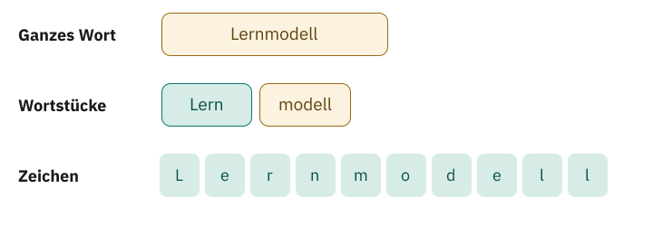
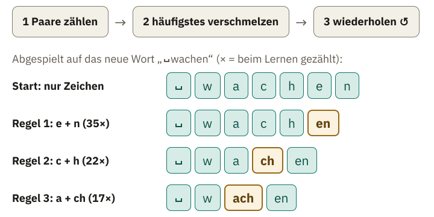
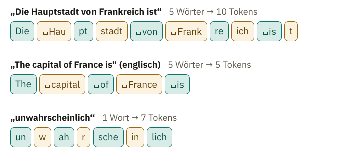

<!-- Generated from src/content/bausteine/de/tokenizer-ids-vokabular.mdx by scripts/export-lessons.mjs -- do not edit by hand. -->

# Tokenizer: Wie Text in Tokens zerfällt

> Lesefassung für GitHub. Die vollständige Fassung mit interaktiven Demos, Animationen und Abrufmoment findest du auf der Website: **[Tokenizer: Wie Text in Tokens zerfällt](https://ki-einfach-verstehen.de/de/bausteine/tokenizer-ids-vokabular/)**
>
> Lizenz: [CC BY 4.0](https://creativecommons.org/licenses/by/4.0/deed.de) · Nenne die Quelle so: KI einfach verstehen, „Tokenizer: Wie Text in Tokens zerfällt“, CC BY 4.0, https://ki-einfach-verstehen.de/de/bausteine/tokenizer-ids-vokabular/

Zeigt, wie ein Tokenizer Text in Stücke zerlegt, die er vorher durch Zählen gelernt hat, und warum die Zahl der Tokens nicht die Zahl der Wörter ist.

Bevor du weiterliest, teile dieses Wort im Kopf in Stücke: „unwahrscheinlich“. Machst du daraus ein einziges Stück, drei verständliche Teile wie „un“, „wahr“ und „scheinlich“ oder lauter einzelne Buchstaben? Halte deine Wahl fest.

Im vorigen Baustein bekam ein [Sprachmodell](https://ki-einfach-verstehen.de/de/glossar/sprachmodell/) als [Input](https://ki-einfach-verstehen.de/de/glossar/input/) einen Textanfang wie „Die Katze sitzt“ und gab für jedes Textstück, das es kennt, einen Score aus. Offen blieb, wie aus Text etwas wird, womit ein Modell rechnen kann. Was ist ein Textstück genau, und wer hat festgelegt, welche Stücke es gibt?

## Warum das Modell eine feste Liste von Stücken braucht

Warum nimmt ein Sprachmodell deinen Text nicht einfach so, wie er kommt? Das ältere Sprachmodell GPT-2 kennt 50.257 Textstücke, und seine Score-Liste hat immer genau 50.257 Einträge, einen für jedes Stück. Es geht ihm wie der Bilderkennung aus dem vorigen Baustein: Sie gibt immer genau einen Score für Katze, Hund, Fuchs und Auto aus und kann keine neue Klasse anlegen. Auch beim Sprachmodell steht die Form des Outputs fest, bevor es rechnet. Die Score-Liste lässt sich also nur bauen, wenn vorher feststeht, welche Stücke es gibt.

Dasselbe gilt für den Input. Jedes Modell rechnet nur mit der Art von Input, für die es gebaut ist: Das Sprachmodell kann nur Stücke aus seiner festen Stückliste verarbeiten, dem **[Vokabular](https://ki-einfach-verstehen.de/de/glossar/vokabular/)**. Die Score-Liste ist etwas anderes: Sie wird für jeden Input neu berechnet und hat für jedes Stück im Vokabular einen Eintrag. Deshalb muss auch deine Frage zuerst in Stücke aus dem Vokabular zerlegt werden. Jedes dieser Stücke heißt **[Token](https://ki-einfach-verstehen.de/de/glossar/token/)**.

*Bevor das Modell rechnet, wird dein Text in Stücke geschnitten.*

Bevor dein Text ins Modell geht, zerlegt ihn ein eigenes Programm, der **[Tokenizer](https://ki-einfach-verstehen.de/de/glossar/tokenizer/)**. Jede Nachricht, die du schickst, läuft zuerst durch ihn, und auch jede Antwort besteht aus seinen Stücken. Wo er schneidet, steht also fest, bevor das Modell auch nur eine Zahl berechnet. Welche Stücke soll seine Liste enthalten?

## Ganze Wörter oder einzelne Buchstaben?

Wenn jedes Wort ein Token wird, funktioniert das für eine begrenzte Sammlung von Texten, aber nicht für beliebige Texte. Die Liste bräuchte „Haus“, „Haustür“, „Haustürschlüssel“ und jede weitere Zusammensetzung, dazu gebeugte Formen wie „lernen“, „lernt“ und „gelernt“, Namen, Tippfehler und Wörter, die morgen neu entstehen. Sie kann groß werden, aber sie bleibt endlich. Was fehlt, könnte nur als Platzhalter „unbekannt“ hinein. Beim Regelfilter aus dem ersten Baustein griff die Gewinn-Regel nicht mehr, sobald im Betreff „G3WINN“ statt „Gewinn“ stand. Ein Chatbot mit fester Wortliste sähe ebenso bei jedem neuen Bandnamen nur „unbekannt“.

Eine andere Möglichkeit ist, jeden Buchstaben, jedes Leerzeichen und jedes Satzzeichen als eigenes Token zu nehmen. Damit lässt sich jedes Wort zusammensetzen, auch ein völlig neues, und die Liste bleibt klein. Dafür wird der Input lang. Das Modell erhält den Input als Folge von Tokens, und jedes Token belegt einen Platz. Wie viele solcher Plätze höchstens verfügbar sind, ist für jedes Modell festgelegt. Mehr dazu steht im Baustein [Tokenisierung im Modell](./tokenisierung-im-modell.md). „Die Katze sitzt.“ belegt mit Leerzeichen und Punkt 16 Plätze, und selbst ein häufiges „sch“ belegt jedes Mal drei. Auch die Antwort entstünde Buchstabe für Buchstabe, mit einer Runde der Schleife für jedes Zeichen.

**Ganze Wörter sind zu starr, einzelne Zeichen zu kleinteilig.**

*Dasselbe Wort, dreimal unterschiedlich fein zerlegt. Die mittlere Zerlegung ist ein Denkbeispiel.*

## Der Mittelweg: wiederverwendbare Wortstücke

Viele Tokenizer arbeiten deshalb mit **[Subword-Tokens](https://ki-einfach-verstehen.de/de/glossar/subword-token/)**, also Wortstücken. Ein Token kann ein ganzes häufiges Wort sein, ein wiederkehrender Wortteil oder ein einzelnes Zeichen. So arbeiten auch die Tokenizer hinter Chatbots wie ChatGPT. „Lernmodell“ könnte etwa in „Lern“ und „modell“ zerfallen. Das ist ein Denkbeispiel; jeder Tokenizer zerlegt anders.

*Wortstücke funktionieren wie ein Baukasten: Große fertige Stücke stehen für Häufiges bereit, kleine Teile für den Rest.*

Das funktioniert wie ein Baukasten. Häufiges liegt als großer fertiger Klotz bereit, Seltenes wird aus kleinen Klötzen zusammengesetzt, notfalls aus einzelnen Zeichen. So fällt kein Wort durch, und häufige Wörter belegen trotzdem nur wenige Plätze. Ein neues Wort muss dafür nicht bekannt sein; es entsteht aus Teilen, die schon im Kasten liegen. Die gebaute Reihe ist die Tokenfolge deines Textes; sie entsteht für jeden Text neu. Der Kasten selbst bleibt dagegen immer derselbe: Er ist das Vokabular, die feste Liste aller Stücke, die ein Tokenizer kennt. Bei GPT-2 sind es 50.257 Stücke.

Doch der Vergleich hat eine Grenze: Beim Baukasten entscheidest du selbst, welchen Klotz du nimmst. Der Tokenizer entscheidet nicht, sondern folgt festen Regeln. Auch die Form der Klötze richtet sich nicht nach ihrer Bedeutung; ein Zählverfahren bestimmt, welche Stücke im Kasten landen.

## Woher die Stücke kommen: zählen und verschmelzen

Der Tokenizer von GPT-2 hat seine Stücke mit einem Verfahren gelernt, das **[Byte Pair Encoding](https://ki-einfach-verstehen.de/de/glossar/byte-pair-encoding/)** heißt, kurz BPE. „Pair“ heißt „Paar“. Gelernt heißt hier etwas anderes als beim Spamfilter, dessen Gewichte nach Fehlern nachgestellt wurden. BPE kennt weder Fehler noch Gewichte.

Am Anfang enthält das Vokabular nur Grundbausteine. Im einfachen Beispiel sind das einzelne Zeichen, bei GPT-2 dagegen die 256 möglichen Bytes (kleine Zahlenbausteine im Computerspeicher), aus denen ein Computer Zeichen zusammensetzt. Zuerst zählt das Verfahren in einer Textsammlung, dem Übungstext, wie oft zwei Stücke direkt nebeneinanderstehen. Dann verschmilzt es das häufigste Paar zu einem neuen Stück. Dieses Stück kommt als Eintrag ins Vokabular. Jede Verschmelzung notiert das Verfahren als nummerierte **Regel**.

Die Regeln des Regelfilters aus dem ersten Baustein hatten Menschen geschrieben. Hier dagegen entstehen lesbare Regeln allein durch Zählen; kein Mensch formuliert sie. Der Tokenizer ist ein Programm, das diese Regeln nacheinander abarbeitet, ohne Gewichte, die nach Fehlern nachgestellt werden. Danach zählt das Verfahren erneut, nun mit dem neuen Stück. Das geht so lange, bis das Vokabular die vorher gewählte Größe erreicht. Echte Tokenizer lernen so Zehntausende Regeln.

Ein ausgedachter Übungstext besteht aus neun Wörtern: „lachen“ und „machen“ je zweimal, „sagen“ dreimal, „nicht“ und „lacht“ je einmal. Die Wörter sind ausgedacht, die Zählung ist echt. Jede Zählung kannst du auf dem Papier nachprüfen. Das Verfahren zählt nur Paare innerhalb eines Wortes. Welches Paar kommt wohl am häufigsten vor? Überleg kurz, bevor du weiterliest.

Es ist „e“ + „n“, 7-mal: „lachen“ und „machen“ je zweimal, „sagen“ dreimal. In jedem dieser Wörter steckt es genau einmal. Damit wird „en“ zur ersten Regel.

## Die zweite und dritte Regel

Danach zählt das Verfahren neu, denn der Übungstext besteht jetzt aus anderen Stücken. „lachen“ (zweimal) ist l | a | c | h | en, „machen“ (zweimal) m | a | c | h | en und „sagen“ (dreimal) s | a | g | en. Dazu kommen „nicht“ (einmal) als n | i | c | h | t und „lacht“ (einmal) als l | a | c | h | t. Welches Paar ist jetzt das häufigste? Zähl nach, bevor du weiterliest.

Am häufigsten ist jetzt „c“ + „h“, 6-mal; die Zählungen zeigt die Abbildung weiter unten. Das wird die zweite Regel, „ch“.

Nach Regel 2 wird „lachen“ (zweimal) zu l | a | ch | en und „machen“ (zweimal) zu m | a | ch | en. „sagen“ (dreimal) bleibt unverändert, weil es kein „ch“ enthält. „nicht“ (einmal) wird zu n | i | ch | t und „lacht“ (einmal) zu l | a | ch | t.

Beim dritten Zählen steht „ch“ fünfmal hinter einem „a“; die Abbildung zeigt die Zählung. Die dritte Regel verschmilzt beide zu „ach“.

Eine Ebene tiefer: Wie geht es weiter?

Das Verfahren zählt nach jeder Regel neu und verschmilzt weiter, bis das Vokabular seine Größe erreicht. Nach der dritten Regel ist das häufigste Paar „ach“ + „en“, 4-mal: „lachen“ und „machen“ kommen je zweimal vor, und in jedem steckt „ach“ vor „en“. Der Übungstext zeigt nur die drei Regeln, damit das Beispiel überschaubar bleibt. Bei echten Trainingstexten läuft dieselbe Zählung über riesige Mengen Text, und es entsteht eine lange Liste von Regeln. Die Reihenfolge ist dabei wichtig: Jede Regel baut auf den Stücken auf, die frühere Regeln geschaffen haben. Deshalb verschmilzt das Verfahren nicht alle Paare gleichzeitig, sondern eines nach dem anderen, und zählt nach jedem Schritt neu. Am Ende hat jedes Stück seinen festen Platz im Vokabular, und die Liste der Regeln bestimmt, wie ein neuer Text zerlegt wird.

Das Verfahren findet damit Stücke, die wie deutsche Wortteile aussehen. Was eine Endung ist, weiß es trotzdem nicht: „en“ und „ach“ wurden Regeln, weil sie häufig waren.

Echte Tokenizer zählen genauso, nur in riesigen Textmengen.

Eine Ebene tiefer: Wie BPE ohne „unbekannt“ auskommt

Byte Pair Encoding war ursprünglich ein Verfahren zur Datenkompression, das häufige Paare von **Bytes** durch ein einzelnes neues Zeichen ersetzt. Jedes sichtbare Zeichen wird durch ein oder mehrere Bytes dargestellt, ein Umlaut oder Emoji durch mehrere. Für die maschinelle Übersetzung wurde BPE so angepasst, dass es Zeichen statt Bytes verschmilzt.

Bei einem Tokenizer, der mit Zeichen beginnt, bleibt ein Problem: Ein Zeichen, das im Übungstext nie vorkam, steht nicht im Grundvokabular und gilt daher als „unbekannt“. Ein Grundvokabular mit allen Schriftzeichen der Welt hätte über 130.000 Einträge. Byte-Level-BPE, wie bei GPT-2, beginnt deshalb mit Bytes. Davon gibt es nur 256 verschiedene, und alle passen ins Grundvokabular. Selbst ein nie gesehenes Schriftzeichen lässt sich so aus Bytes zusammensetzen. Das fertige Vokabular umfasst das Grundvokabular und zusätzlich einen Eintrag für jede gelernte Regel. Manchmal kommen Sondereinträge dazu, etwa Marken für Rollen im Chat. Was sie bedeuten, erklärt der Baustein [Tokenisierung im Modell](./tokenisierung-im-modell.md).

BPE ist nicht das einzige Verfahren für Wortstücke. **[SentencePiece](https://ki-einfach-verstehen.de/de/glossar/sentencepiece/)** lernt Wortstücke, auch mit BPE, direkt aus rohen Sätzen. Es zerlegt die Sätze vorher nicht an vermuteten Wortgrenzen. Das hilft bei Sprachen, die Wortgrenzen nicht wie das Deutsche mit Leerzeichen markieren.

## Wie der fertige Tokenizer ein neues Wort zerlegt

Was macht der fertige Tokenizer mit einem Wort, das im Übungstext nie vorkam, etwa „machten“? Rate, bevor du weiterliest, in welche Stücke es mit den drei Regeln zerfällt.

Der Tokenizer zählt nicht neu. Er teilt das Wort in einzelne Zeichen und spielt seine drei Regeln in der gelernten Reihenfolge ab. Zuerst macht Regel 1 aus „e“ + „n“ das Stück „en“: m | a | c | h | t | en. Danach bildet Regel 2 aus „c“ + „h“ das Stück „ch“: m | a | ch | t | en. Zuletzt verbindet Regel 3 „a“ und „ch“: m | ach | t | en. Für das „m“ und das „t“ gibt es keine Regel, sie bleiben einzelne Zeichen.

*Oben siehst du den Lernablauf von BPE, darunter werden die drei Regeln aus dem ausgedachten Übungstext auf das neue Wort „machten“ angewendet. Die Zahlen in Klammern stammen aus den Zählungen beim Lernen; beim Zerlegen wird nicht gezählt.*

Jedes Zeichen des Übungstexts stand schon am Anfang im Vokabular. Deshalb fällt kein Wort aus diesen Zeichen durch; Unbekanntes zerfällt nur in kleinere Stücke. Der Tokenizer von GPT-2 setzt notfalls jedes Zeichen aus noch kleineren Bausteinen zusammen, den Bytes, mit denen ein Computer Zeichen speichert (mehr dazu in der Box oben). Bei ihm bleibt deshalb gar nichts unbekannt. Und weil Regeln und Reihenfolge feststehen, ergibt derselbe Text mit demselben Tokenizer immer dieselben Tokens. Schickst du dieselbe Frage in zwei neuen Chats ab, werden aus ihr beide Male dieselben Tokens. Zu verschiedenen Antworten kommt es fast immer erst danach: beim Auswahlschritt, in dem mit etwas Zufall ein Stück aus der Score-Liste des Modells gewählt wird.

Und „unwahrscheinlich“ vom Anfang? Der echte Tokenizer von GPT-2 macht daraus sieben Stücke: „un“, „w“, „ah“, „r“, „sche“, „in“ und „lich“. Die Token-Grenzen durchschneiden sogar „wahr“, denn keine der Regeln hat daraus ein ganzes Stück gebildet. Ein Tokenizer mit anderen Regeln zerlegt dasselbe Wort anders.

> **Interaktive Demo:** [auf der Website ausprobieren](https://ki-einfach-verstehen.de/de/bausteine/tokenizer-ids-vokabular/)

## Warum Tokens keine Wörter sind

Sprachmodelle messen die Länge eines Textes in Tokens, nicht in Wörtern. Sind das dieselben Zahlen?

Wer Sprachmodelle direkt aus eigenen Programmen nutzt, zahlt meist pro Token. Der Tokenizer von GPT-2 zerlegt „Die Hauptstadt von Frankreich ist“ in 10 Tokens und „The capital of France is“ in 5. Beide Sätze haben fünf Wörter. „France“ ist bei GPT-2 ein einziges Stück, „Frankreich“ wird zu „Frank“, „re“ und „ich“.

*Drei Texte, zerlegt vom echten Tokenizer von GPT-2. Die Farbe wechselt mit jedem Token. Das Zeichen ␣ markiert ein Leerzeichen; bei GPT-2 gehört es zum folgenden Wort.*

> **Interaktive Demo:** [auf der Website ausprobieren](https://ki-einfach-verstehen.de/de/bausteine/tokenizer-ids-vokabular/)

Was beim Zählen häufig war, wurde zu großen Stücken. Im gemessenen Beispiel ist „France“ ein Token, „Frankreich“ zerfällt in drei. Schon ein Tippfehler kann die Zahl erhöhen: „Frankkreich“ braucht ein Stück mehr als „Frankreich“.

Eine Ebene tiefer: Auf welchen Texten zählt GPT-2?

Der Tokenizer von GPT-2 entstand für ein Modell, dessen Trainingstexte OpenAI nicht veröffentlicht hat. Welche Texte er zum Zählen seiner Paare benutzt hat, ist nicht öffentlich aufgelistet. Ein Nachbauprojekt berichtet, dass nicht-englische Seiten entfernt wurden; ob das die Paare geprägt hat, ist nicht belegt. Daraus folgt für dich: Welche Stücke ein Tokenizer hat, spiegelt vor allem, was in den Zähltexten häufig war. Ob diese Texte viele deutsche Wörter enthielten, lässt sich aus der Liste der Stücke nur indirekt ablesen. Der Haupttext zeigt, wie das bei englischen und deutschen Wörtern aussieht. Wichtig ist dabei: Die Liste ist fest, sobald der Tokenizer gebaut ist. Jeder Text, auch ein neuer, wird danach mit genau dieser Liste zerlegt, egal woher er stammt.

Mit mehr Tokens belegt der Text mehr Plätze im Input. Oft hört man, ein Modell verstehe ein Wort schlechter, wenn es in viele Tokens zerfällt. Das klingt plausibel, weil ein ganzes Stück vollständiger wirkt als Bruchstücke. Die Zahl allein sagt aber nichts über das Verständnis. Das Modell bekommt immer den gesamten Input auf einmal – wie „Die Katze sitzt auf“ im vorigen Baustein – und nicht nur das letzte Stück. Ob es aus mehreren Stücken eine Bedeutung gewinnt, hängt davon ab, was es im Training gelernt hat, etwa dass „Frank“, „re“ und „ich“ zusammen „Frankreich“ ergeben.

**Von der Zahl der Tokens allein kannst du nicht auf das Verständnis schließen.**

Der Tokenizer zerlegt Text nur in Stücke und bewertet nicht, ob sie zum Sinn passen.

## Stücke sind noch keine Zahlen

Die Tokens sind immer noch Text, und ein Modell rechnet nur mit Zahlen. Welche Zahl jedes Stück bekommt und was diese Zahl dem Modell verrät, zeigt der nächste Baustein: [Token-IDs: Was eine Nummer bedeutet](./token-ids-und-vokabular.md).

---

Quelle: https://ki-einfach-verstehen.de/de/bausteine/tokenizer-ids-vokabular/

← Zurück: [Input und Output: Was ein Modell aus einer Eingabe macht](./input-und-output.md) · [Alle Bausteine](../../README.de.md#inhalt) · Weiter: [Token-IDs: Was eine Nummer bedeutet](./token-ids-und-vokabular.md) →
