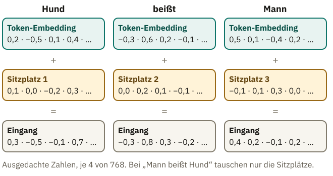
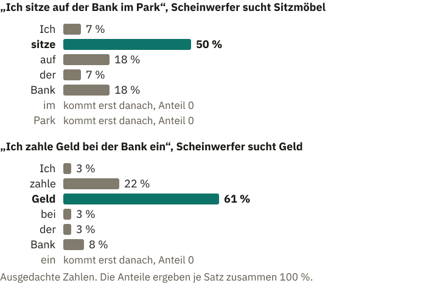
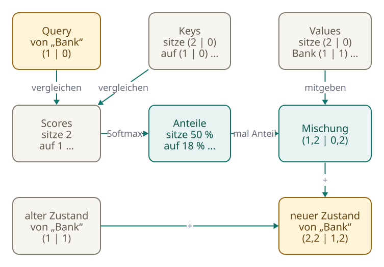
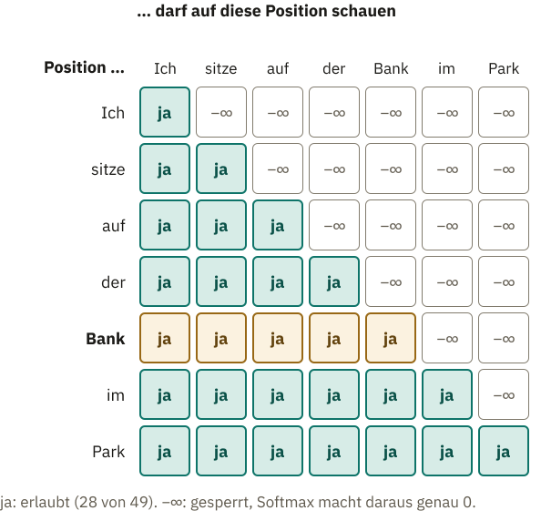
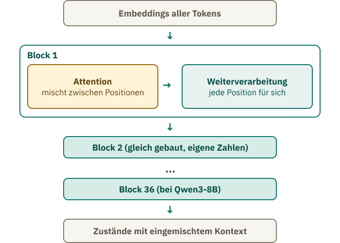

<!-- Generated from src/content/bausteine/de/transformerbloecke-und-attention.mdx by scripts/export-lessons.mjs -- do not edit by hand. -->

# Transformerblöcke und Attention: Wie Kontext eingemischt wird

> Lesefassung für GitHub. Die vollständige Fassung mit interaktiven Demos, Animationen und Abrufmoment findest du auf der Website: **[Transformerblöcke und Attention: Wie Kontext eingemischt wird](https://ki-einfach-verstehen.de/de/bausteine/transformerbloecke-und-attention/)**
>
> Lizenz: [CC BY 4.0](https://creativecommons.org/licenses/by/4.0/deed.de) · Nenne die Quelle so: KI einfach verstehen, „Transformerblöcke und Attention: Wie Kontext eingemischt wird“, CC BY 4.0, https://ki-einfach-verstehen.de/de/bausteine/transformerbloecke-und-attention/

Wie ein Sprachmodell die Information früherer Wörter in jedes Token einmischt, warum es nicht nach vorne schauen darf und wie viele Blöcke dabei arbeiten.

*„Bank“ kann Geldinstitut oder Sitzbank bedeuten: Am Wort allein erkennt man es nicht.*

Zwei Sätze: „Ich zahle Geld bei der Bank ein“ und „Ich sitze auf der Bank im Park“. Im vorigen Baustein hat jedes Token, also jedes Textstück, sein **[Embedding](https://ki-einfach-verstehen.de/de/glossar/embedding/)** bekommen, eine lange Zahlenliste aus der Nachschlagetabelle. Für „Bank“ ist sie in beiden Sätzen dieselbe. Ein Chatbot, der beide ins Englische übersetzt, muss aber einmal „bank“ und einmal „bench“ schreiben. Woher soll er das wissen?

Die Antwort steckt in vielen gleich gebauten Blöcken, jeder mit eigenen Zahlen. Diese 2017 vorgestellte Architektur heißt **[Transformer](https://ki-einfach-verstehen.de/de/glossar/transformer/)**. Darin bekommt jedes Token Information von anderen Tokens.

## Ein Embedding, zwei Bedeutungen

Wenn du „Ich sitze auf der Bank“ liest, denkst du nicht an Geld, weil du den Satz drumherum mitliest. Ein Embedding kann das nicht.

Ein Sprachmodell löst das, indem es aus jedem Embedding Schritt für Schritt neue Zahlen berechnet; die Tabelle selbst bleibt unverändert. Wie beim Mischpult laufen die Zahlen durch viele Rechenstufen. Sie heißen Blöcke, in Modellangaben meist Schichten. Das frei verfügbare Qwen3-8B, ein größeres Geschwister des dir bekannten Qwen3-0.6B-Base, hat 36 davon; in ihnen steckt der größte Teil seiner Parameter.

Die Zwischenwerte eines Tokens heißen hier sein **Zustand**. Anfangs ist er das Embedding (bei GPT-2 plus Sitzplatz, dazu unten); jeder Block schreibt ihn fort. Messungen an älteren, frei verfügbaren Modellen wie GPT-2 zeigen: In späteren Blöcken unterscheiden sich die Zustände desselben Wortes von Satz zu Satz meist stärker. Bei GPT-2 sind sie nach dem letzten Block fast ganz vom Satz geprägt.

## Der Sitzplatz im Satz

Dem Embedding fehlt noch etwas Einfacheres: wo das Token steht. „Hund beißt Mann“ und „Mann beißt Hund“ bestehen aus denselben drei Wörtern und holen dieselben drei Embeddings. Nur die Reihenfolge ist anders, und sie entscheidet, wer gebissen wird.

Die Blöcke mischen die Wörter ein, indem sie diese unterschiedlich stark zusammenzählen. Einer Summe ist die Reihenfolge aber egal: 2 + 3 ergibt dasselbe wie 3 + 2. Ohne Positionsangabe erfährt ein Token vor allem, welche Wörter es sieht; ihre Reihenfolge kann es höchstens näherungsweise erschließen. Deshalb gaben die Forschenden von 2017 die Position eigens mit, denn ihr Modell arbeitet die Wörter nicht der Reihe nach ab.

GPT-2 löst das mit einer zweiten Tabelle, mit einer Zeile für jede der 1.024 Positionen im [Kontextfenster](https://ki-einfach-verstehen.de/de/glossar/kontextfenster/) (die Höchstzahl an Tokens, die das Modell auf einmal verarbeitet). Jede Zeile ist ein Embedding für einen **Sitzplatz**: Platz 1, Platz 2 und so weiter. Auch diese Zahlen starten zufällig und werden im Training gelernt.

Beide Embeddings sind gleich lang und werden Zahl für Zahl addiert. Ausgedacht, mit nur einer Zahl: „Hund“ hat 0,2, Platz 1 hat 0,1, also geht 0,3 in die Blöcke. Auf Platz 3, wie in „Mann beißt Hund“, hat der Sitzplatz −0,1; dann geht nur 0,1 hinein. **Derselbe Hund ergibt auf einem anderen Platz eine andere Summe.** Fachsprachlich heißt das Sitzplatz-Embedding **[Positions-Embedding](https://ki-einfach-verstehen.de/de/glossar/positions-embedding/)**.

*Token-Embedding plus Sitzplatz-Embedding ergibt, was in die Blöcke geht. Bei „Mann beißt Hund“ sitzt der Hund auf Platz 3, und seine Summe fällt anders aus.*

Geht dabei verloren, welches Token es war? Bei einer Zahl schon, denn 0,3 kann auch aus 0,4 plus −0,1 entstehen. Bei 768 Zahlen kaum. An der kleinsten Version von GPT-2 wurde das mit 3.000 zufälligen Paaren aus Token und Sitzplatz nachgerechnet. In 2.994 davon, also 99,8 Prozent, zeigte von allen Token-Embeddings das des richtigen Tokens am ehesten in die Richtung der Summe.

Qwen3-8B hat keine solche Tabelle. Es berücksichtigt den Platz erst in den Blöcken: Werden dort zwei Tokens verglichen, zählt ihr Abstand mit. Bei GPT-2 ist die Summe der erste Zustand: Das Token weiß jetzt, wo es steht, aber nicht, welche Bank gemeint ist. Wie kommt die Information der anderen Wörter hinein?

## Der Scheinwerfer: Kontext gewichtet einmischen

*Schematisch, nicht der Beispielsatz: Das Licht fällt unterschiedlich hell auf die Tokens. Was hell beleuchtet ist, fließt stark ein.*

Für das Token, das gerade an der Reihe ist, gehen mehrere Scheinwerfer an. Ihr Licht verteilt sich auf die Tokens davor und auf das Token selbst. **Was hell beleuchtet ist, fließt stark in den neuen Zustand ein**, was im Halbdunkel liegt, nur wenig. Das Modell rechnet in Wirklichkeit alle Positionen gleichzeitig; hier wird nur eine herausgegriffen. Dieses Verfahren heißt **[Attention](https://ki-einfach-verstehen.de/de/glossar/attention/)**, englisch für Aufmerksamkeit. Niemand stellt die Scheinwerfer von Hand ein: Das Modell rechnet selbst aus, wie hell jede Stelle wird.

Angenommen, jeder Vektor hätte nur zwei Stellen, eine für „Sitzmöbel“ und eine für „Geld“ (ausgedachte Zahlen). Echte Vektoren haben Tausende Stellen ohne Namen. „Bank“ startet unentschieden bei (1 | 1). Der Scheinwerfer macht Hinweise auf Sitzmöbel hell. Welches Wort in „Ich sitze auf der Bank im Park“ dürfte er am hellsten beleuchten?

Am hellsten ist „sitze“ mit 50 Prozent. „auf“ und „Bank“ selbst bekommen je 18, „Ich“ und „der“ je 7, zusammen genau 100 Prozent. Die Regel kennst du aus dem Baustein über [Wahrscheinlichkeit und Softmax](./wahrscheinlichkeit-und-softmax.md): Dort machte [Softmax](https://ki-einfach-verstehen.de/de/glossar/softmax/) aus den Scores 3, 2 und −1 die Wahrscheinlichkeiten 72, 27 und 1 Prozent. Jeder Block rechnet genauso, teilt die Scores aber vorher durch eine feste Zahl, damit sie bei langen Vektoren nicht zu groß werden; das Beispiel lässt das weg. Hier sind die Prozente Lichtanteile, keine Wahrscheinlichkeiten.

Jedes Wort gibt zwei Zahlen mit, eine pro Stelle:

| Wort | Anteil | gibt mit: Sitzmöbel | gibt mit: Geld |
| :--- | ---: | ---: | ---: |
| Ich | 7 % | 0 | 0 |
| sitze | 50 % | 2 | 0 |
| auf | 18 % | 0 | 0 |
| der | 7 % | 0 | 0 |
| Bank | 18 % | 1 | 1 |

Jeder Beitrag wird mit seinem Anteil malgenommen und alles zusammengezählt. Für Sitzmöbel ergibt das 0,5 · 2 + 0,18 · 1 ≈ 1,2, für Geld 0,18 · 1 ≈ 0,2. Diese Rechnung heißt **gewichtete Summe**. Sie wird zum alten Zustand addiert, statt ihn zu ersetzen. So bleibt erhalten, was „Bank“ war: (1 | 1) plus (1,2 | 0,2) ergibt (2,2 | 1,2), deutlich Richtung Sitzmöbel.

Im Geld-Satz laufen beide Scheinwerfer; die Rechnung zeigt den Geld-Scheinwerfer. Seine Scores vor Softmax (ausgedachte Zahlen): „Geld“ 3, „zahle“ 2, „Bank“ 1, die übrigen Wörter 0. „Geld“ bekommt 61 Prozent und gibt (0 | 2), „zahle“ 22 Prozent und (0 | 1), „Bank“ 8 Prozent und (1 | 1). „Ich“, „bei“ und „der“ teilen sich die restlichen 9 Prozent und geben nichts.

An der Geld-Stelle ergibt das 0,61 · 2 + 0,22 + 0,08 ≈ 1,5, an der Sitzmöbel-Stelle nur die 0,08 von „Bank“: Die Mischung ist (0,08 | 1,5). Zum alten Zustand (1 | 1) addiert, ergibt dieser Scheinwerfer allein (1,1 | 2,5), Richtung Geldinstitut.

*Dasselbe Wort, zwei Sätze, zwei Scheinwerfer (ausgedachte Zahlen). Wörter, die erst nach „Bank“ kommen, bekommen keinen Anteil.*

## Query, Key und Value: woher die Anteile kommen

Woher weiß der Scheinwerfer, dass „sitze“ besser passt als „der“? „Bank“ kommt wie bei einer Archivsuche mit einem Suchzettel: „Gibt es hier Hinweise auf Sitzmöbel?“ Jedes Wort davor ist ein Ordner: Etikett außen, Inhalt innen. **Verglichen wird der Suchzettel mit den Etiketten, mitgenommen wird aus jedem Ordner umso mehr Inhalt, je besser sein Etikett passt.**

Im Modell heißen die drei Teile **Query** (Suchzettel), **Key** (Etikett) und **Value** (Inhalt). Alle drei sind Vektoren, berechnet aus dem Zustand eines Tokens: Die Query gehört zum Token, das an der Reihe ist, Key und Value zu jedem sichtbaren Token. Was im Rechenbeispiel jedes Wort mitgab, waren seine Values.

Das Modell nimmt Query und Key Stelle für Stelle mal und addiert. Das ergibt einen [Score](https://ki-einfach-verstehen.de/de/glossar/score/), hier dafür, wie gut Query und Key passen, nicht für ein nächstes Token. Die Query von „Bank“ sucht Sitzmöbel: (1 | 0). Mit dem Key von „sitze“, (2 | 0), ergibt das 1 · 2 + 0 · 0 = 2. Die Keys von „auf“, (1 | 0), und „Bank“, (1 | 1), ergeben je 1, die von „Ich“ und „der“, (0 | 0), ergeben 0.

Aus den Scores macht Softmax die Anteile von eben. Wie im Softmax-Baustein bekommt ein Score von 0 die Stärke 1, jeder Punkt mehr multipliziert sie mit etwa 2,72. „sitze“ (Score 2) kommt so auf 2,72 · 2,72 ≈ 7,4, „auf“ und „Bank“ (Score 1) auf je 2,72, „Ich“ und „der“ (Score 0) auf je 1. Zusammen sind das rund 14,8; 7,4 davon sind 50 Prozent. Key und Value haben verschiedene Aufgaben: Woran ein Wort gefunden wird, muss nicht das sein, was es mitbringt. „auf“ passt mit seinem Key ein wenig, bringt mit dem Value (0 | 0) aber nichts.

[▶ Animation auf der Website ansehen](https://ki-einfach-verstehen.de/de/bausteine/transformerbloecke-und-attention/)

*Ein Durchgang für „Bank“: Query und Keys vergleichen, Softmax macht Anteile daraus, die Values werden gemischt und zum alten Zustand addiert (ausgedachte Zahlen).*

> **Interaktive Demo:** [auf der Website ausprobieren](https://ki-einfach-verstehen.de/de/bausteine/transformerbloecke-und-attention/)

Woher kommen Query, Key und Value? Wieder aus gewichteten Summen: Jede Zahl des Zustands wird mit einem Faktor malgenommen und addiert. Für die Sitzmöbel-Stelle der Query von „Bank“ sind die Faktoren 0,5 und 0,5, mit dem Zustand (1 | 1) also 0,5 · 1 + 0,5 · 1 = 1, für die Geld-Stelle beide 0.

Die Faktoren stehen in einer Tabelle, einer [Matrix](https://ki-einfach-verstehen.de/de/glossar/matrix/), je eine für Query, Key und Value. Im Mischpult-Bild sind ihre Zahlen Regler, also [Parameter](https://ki-einfach-verstehen.de/de/glossar/parameter/): vom Training eingestellt und für jede Chatnachricht dieselben. Query, Key und Value sind Anzeigen, die für jeden Text neu entstehen. Im Beispiel sind die Faktoren ausgedacht; im echten Modell hat niemand festgelegt, dass „sitze“ zu „Bank“ passt.

Und „Park“, der beste Hinweis auf eine Sitzbank, bekam gar keinen Anteil. Warum?

## Nicht nach vorne schauen: die Causal Mask

„Park“ steht nach „Bank“. Sprachmodelle, die wie Chatbots von links nach rechts schreiben, haben eine feste Regel: **Jede Position sieht nur sich selbst und die Positionen davor**, nie die danach. Für „Bank“ ist „Park“ unsichtbar, obwohl es dasteht.

*Was nach dem aktuellen Token kommt, bleibt unsichtbar.*

Der Grund liegt im Training: Dort wird der ganze Satz auf einmal verarbeitet, doch jede Position soll genau das nächste Token vorhersagen. Die Position von „Bank“ soll also „im“ vorhersagen. Könnte sie „im“ bereits sehen, müsste sie es nur abschreiben.

Eine **[Causal Mask](https://ki-einfach-verstehen.de/de/glossar/causal-mask/)** setzt diese Regel um: Sie setzt den Score jeder späteren Position auf minus unendlich, bevor Softmax rechnet. Dann ist ihr Anteil *genau* 0. Für einen ganzen Satz ergibt das ein Dreieck: Das erste Wort sieht nur sich, das letzte alle.

*Die Causal Mask für „Ich sitze auf der Bank im Park“: Jede Zeile zeigt, worauf eine Position schauen darf. Hervorgehoben ist die Zeile von „Bank“.*

„Park“ dagegen darf auf alles schauen, auch zurück auf „Bank“. Das Modell sagt das nächste Wort aus dem Zustand der letzten Position voraus, und die sieht den ganzen Satz. Steht „Park“ vorn, wie in „Im Park sitze ich auf der Bank“, sieht sogar „Bank“ den „Park“.

## Viele Scheinwerfer, viele Blöcke

Das Rechenbeispiel hatte zwei Scheinwerfer, für Sitzmöbel und für Geld. Warum nicht einer für beides? Sein Licht ergibt über alle sichtbaren Tokens immer 100 Prozent. Für beide Hinweisarten zugleich muss er sein Licht aufteilen, und auch die übrigen Tokens bekommen etwas ab. Ein Block hat deshalb mehrere Scheinwerfer, **Heads** genannt, jeder mit eigener Query-Matrix. Sie rechnen gleichzeitig; ihre Mischungen werden aneinandergehängt, von einer weiteren gelernten Matrix verrechnet und zum Zustand addiert. Bei Qwen3-8B sind es 32 Heads pro Block; beim kleineren Qwen3-0.6B-Base in der Demo unten 16.

Manche Heads lassen sich deuten. Ein **Induction Head** sucht, was beim letzten Auftreten des aktuellen Tokens folgte: Stand früher im Chat „Frau Kowalczyk“ und kommt jetzt wieder „Frau“, hebt er „Kowalczyk“ hervor. Für große Modelle gibt es dafür nur Indizien, viele Heads zeigen kein benennbares Muster.

> **Interaktive Demo:** [auf der Website ausprobieren](https://ki-einfach-verstehen.de/de/bausteine/transformerbloecke-und-attention/)

Attention ist nur der erste Teil eines Blocks. Danach kommt eine **Weiterverarbeitung** (ein Feed-Forward-Netz, wie im Baustein über [Schichten](./schichten.md)). Im Transformer-Paper von 2017 übernimmt eine ReLU diese Stufe; sie setzt negative Werte auf null. Jedes Token wird dort einzeln verarbeitet. Ihr Ergebnis wird zum Zustand addiert. Attention plus Weiterverarbeitung bilden einen **[Transformerblock](https://ki-einfach-verstehen.de/de/glossar/transformerblock/)**.

Eine Ebene tiefer: Welche Stufe nutzt Qwen3-8B, ein offenes Sprachmodell?

In der öffentlichen Konfigurationsdatei von Qwen3-8B steht unter `hidden_act` der Wert `silu`. Die Weiterverarbeitung nutzt aber eine Bauart namens SwiGLU: Eine Rechnung geht durch die Stufe, die andere bleibt linear, ihr Produkt geht weiter. Die Stufe `silu` selbst ist eine abgerundete Kurve: Für große negative Eingaben geht sie gegen null, für große positive bleibt sie fast gleich der Eingabe, und dazwischen gibt es keine scharfe Ecke.

Im Modellcode geht die Ausgabe von `gate_proj` durch diese Stufe, wird mit der Ausgabe von `up_proj` multipliziert und dann durch `down_proj` geschickt.

Dieselbe Datei nennt unter `num_hidden_layers` die Zahl 36: die großen Blöcke aus diesem Baustein. Im Transformer von 2017 hatte jeder Head auch eigene Key- und Value-Matrizen. Damit weniger Speicher nötig ist, bilden die 32 Heads hier Vierergruppen; jede Gruppe teilt dieselben Keys und Values, nur die Querys sind verschieden.

*Jeder Block mischt erst zwischen den Positionen und verarbeitet dann jede Position für sich. Qwen3-8B hat 36 solcher Blöcke hintereinander.*

**Kontext kommt nur über die Attention herein.** In großen Modellen stecken trotzdem die meisten Parameter in der Weiterverarbeitung, bei Qwen3-8B rund zwei Drittel, nachgerechnet aus den veröffentlichten Werten. Vermutlich steckt dort auch Wissen; wie es abgelegt ist, ist nur zum Teil verstanden. Je nach Modell stapeln sich viele Blöcke: die kleinste Version von GPT-2 hat 12, Qwen3-8B 36, das große GPT-3 96.

Kann man an den Scheinwerfern ablesen, warum der Chatbot so antwortet?

## Was der Scheinwerfer nicht verrät

Manche Programme zeigen das Licht eines Heads als farbige Tabelle: Hier hat das Modell „hingeschaut“. Die Forschung ist vorsichtiger.

Wie wichtig ein Wort ist, lässt sich prüfen, indem man es weglässt. Eine viel zitierte Studie von 2019 machte diesen Test: Wie stark sich die Vorhersage änderte, hing oft kaum mit den Anteilen zusammen. Untersucht wurden aber Modelle älterer Bauart ohne Transformerblöcke, und andere Forschende hielten dagegen: Es komme darauf an, was man unter einer Erklärung versteht.

Über die Blöcke vermischt sich die Information immer stärker: Schon nach wenigen Blöcken ist der Zustand von „sitze“ nicht mehr nur „sitze“, und Licht auf „sitze“ in Block 20 beleuchtet eine Mischung aus vielen Wörtern. Neben dem Anteil zählt auch der Value: Ein beleuchtetes Token mit winzigem Value bringt wenig, wie „auf“ im Rechenbeispiel.

Außerdem landet auffällig viel Licht auf dem allerersten Token eines Textes, auch wenn es wenig beiträgt. Forschende nennen das **Attention Sinks**. Sie vermuten: Die Anteile müssen immer 100 Prozent ergeben; findet ein Head nichts Passendes, muss das Licht irgendwohin, und das erste Token ist für jede spätere Position sichtbar. Die Demo setzt vor ihren Satz `<|endoftext|>`, das bei Qwen Texte voneinander trennt; so wird es zum ersten Token. Qwen selbst stellt kein festes Anfangs-Token voran. Auch das große offene Sprachmodell Llama-2 mit 70 Milliarden Parametern zeigt das Muster.

Hier endet das Bild vom Scheinwerfer: Es zeigt gut, wie Information gemischt wird, **erklärt aber nicht zuverlässig, warum eine Antwort entsteht**.

„Bank“ startet mit demselben Token-Embedding; bei GPT-2 kommt ein anderer Sitzplatz dazu. In jedem Block mischt die Attention die Values des Tokens selbst und früherer Tokens anteilig hinein, nie die späterer. Beide Scheinwerfer laufen in beiden Sätzen; im Rechenbeispiel zieht „sitze“ den Zustand stärker Richtung Sitzmöbel, „Geld“ Richtung Geldinstitut. Wie aus dem Zustand eine Score-Liste über das Vokabular wird, zeigt der nächste Baustein.

---

Quelle: https://ki-einfach-verstehen.de/de/bausteine/transformerbloecke-und-attention/

← Zurück: [Embeddings: wie aus einer Nummer ein gelernter Vektor wird](./embeddings.md) · [Alle Bausteine](../../README.de.md#inhalt) · Weiter: [Output Head: Vom letzten Zustand zur Vorhersage](./output-head.md) →
