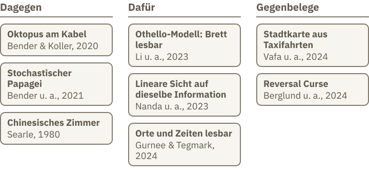
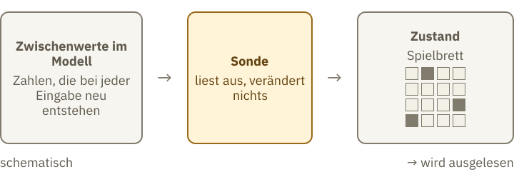
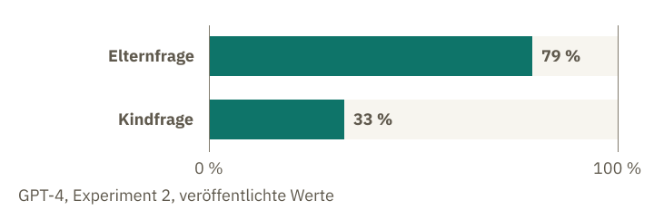

<!-- Generated from src/content/bausteine/de/versteht-ki-was-sie-sagt.mdx by scripts/export-lessons.mjs -- do not edit by hand. -->

# Versteht KI, was sie sagt?

> Lesefassung für GitHub. Die vollständige Fassung mit interaktiven Demos, Animationen und Abrufmoment findest du auf der Website: **[Versteht KI, was sie sagt?](https://ki-einfach-verstehen.de/de/bausteine/versteht-ki-was-sie-sagt/)**
>
> Lizenz: [CC BY 4.0](https://creativecommons.org/licenses/by/4.0/deed.de) · Nenne die Quelle so: KI einfach verstehen, „Versteht KI, was sie sagt?“, CC BY 4.0, https://ki-einfach-verstehen.de/de/bausteine/versteht-ki-was-sie-sagt/

Die Fachwelt ist sich uneins, ob Sprachmodelle verstehen. Was die Befunde zeigen, was sie nicht zeigen und warum eine flüssige Antwort weder dafür noch dagegen spricht.

## Eine flüssige Antwort und die Frage danach

Du fragst einen Chatbot nach einer Erklärung, und sie kommt so klar, dass du kaum zweifelst. Ein Beispiel (ausgedacht): Du fragst, warum der Himmel tagsüber blau wirkt, und die Antwort klingt wie aus einem Lehrbuch. Ob sie stimmt, siehst du an dem Satz allein nicht.

Der Baustein [Warum Vorhersagen mehr ist als Nachplappern](./warum-vorhersagen-mehr-ist-als-nachplappern.md) hat die Frage offen gelassen: Ob im Modell etwas dem menschlichen Sprachgefühl Vergleichbares steckt, ist ungeklärt.

Wie prüft man das bei einem Menschen? Man stellt ihm eine neue Aufgabe, die er vorher nicht gesehen hat. Bei Menschen gilt eine gute Antwort oft als Zeichen dafür, dass sie etwas verstanden haben. Bei einer Maschine reicht eine flüssige Antwort dafür nicht aus. Dazu gibt es Forschungsergebnisse, doch ihre Bedeutung ist umstritten.

## Die Fachwelt ist sich uneins, und das liegt an der Frage

Im Frühjahr 2022 befragten Forschende der Sprachverarbeitung ihre eigene Zunft. Eine Aussage lautete: Ein generatives Modell, das nur mit Text trainiert wurde, könnte bei genug Daten und Rechenleistung natürliche Sprache in einem nicht-trivialen Sinn verstehen. Die Befragten sollten zustimmen oder widersprechen. Die Umfrage gab nicht vor, was „verstehen“ heißt, und bat, die eigene bevorzugte Definition anzugeben. Die Autorinnen und Autoren verzichteten bewusst auf eine feste Definition, weil die Antworten sonst von der gewählten Definition abhängen könnten. Einige Befragte, so die Autorinnen und Autoren, hätten jede feste Definition beanstandet.

Ausgewertet wurden 327 Antworten von Fachleuten, die regelmäßig an ACL-Publikationen als Co-Autoren mitgewirkt haben; die genauen Kriterien stehen in der Quelle. Von den Befragten, die sich festlegten, stimmten 51 Prozent zu, 49 Prozent nicht. Dabei zählen „stimme zu“ und „stimme eher zu“ zusammen, auf der anderen Seite ebenso; wer „nicht informiert“, „Frage unsinnig“ oder „keine Angabe“ wählte, bleibt außen vor. Die Antworten sind also geteilt.

Die Frage spricht von einem Modell, das es geben könnte, nicht vom Chatbot auf deinem Handy. Auch das Wort „verstehen“ bleibt dabei offen, und an ihm hängt der Streit.

Jeder Befund gibt nur auf eine von drei Teilfragen eine Antwort. Die erste: ob das Modell neue Fragen richtig beantwortet. Die zweite: ob Strukturen in seinem Inneren Dinge der Welt abbilden, etwa ein Spielbrett. Die dritte: ob Wörter einen Bezug zur Welt haben. Der Streit dreht sich darum, welche dieser Fragen mit „verstehen“ gemeint sind. Darauf kommt der letzte Abschnitt zurück.

*Die Debatte in drei Spalten: Argumente dagegen, Befunde dafür und Gegenbelege. Die folgenden Abschnitte erklären jeden Eintrag. Der letzte Abschnitt zeigt, was sie für die Frage nach dem Verstehen bedeuten.*

## Dagegen: Ein Oktopus am Kabel

Das bekannteste Gedankenexperiment gegen die Annahme, dass Sprachmodelle verstehen, stammt von Emily Bender und Alexander Koller (2020). Jedes Element darin steht für etwas Bestimmtes. Ein Oktopus horcht an einem Unterseekabel, das zwei Inseln verbindet. Auf den Inseln sprechen zwei Menschen miteinander, und das Kabel trägt nur ihre Nachrichten. Der Oktopus steht für ein Modell, das nur Text sieht: Die Nachrichten sind Wortfolgen, das Kabel ist der Trainingstext. Er lernt deren Muster so gut, dass er überzeugend antwortet. Dann wird einer der beiden von einem Bären angegriffen. Der Bär steht für eine Situation außerhalb des Textes, also für die Welt. Der Angegriffene hat nur ein paar Stöcke und bittet den Oktopus um eine Waffe. Der Oktopus kann die Worte nachahmen, aber nicht helfen, denn er weiß nicht, was der Mensch meint.

*Ein Oktopus am Unterseekabel, der nur die Nachrichten hört. Das Bild ist ein Gedankenexperiment der einen Seite, keine Beschreibung eines Modells.*

Das Argument dahinter lautet: Ein System, das nur mit Form trainiert wurde, hat grundsätzlich keinen Weg, Bedeutung zu lernen. Es bestreitet nicht, dass ein Modell nützliche Antworten geben kann. Es bestreitet, dass aus Form allein Bedeutung entsteht. Form sind die Wörter und ihre Reihenfolge, Bedeutung ist das, worauf sie sich beziehen. Das ist eine Position der einen Seite, keine gemessene Tatsache. Der Einwand gilt für Systeme, die nur Text verarbeiten. Andere Eingaben kommen im Gedankenexperiment nicht vor. Ob das Argument auch für Systeme gilt, die mehr als Text verarbeiten, ist umstritten.

Das Wort „stochastischer Papagei“ stammt von Emily Bender, Timnit Gebru und Kolleginnen (2021). Gemeint ist ein System, das Wortfolgen nach Wahrscheinlichkeiten aus Trainingstexten zusammensetzt, ohne Bezug zur Bedeutung. Der Begriff ist eine Warnung vor den Gefahren großer Sprachmodelle, kein Nachweis darüber, was im Modell steckt.

Ein weiteres Gedankenexperiment stammt von John Searle (1980): das Chinesische Zimmer. Die Darstellung folgt der Stanford Encyclopedia of Philosophy, nicht dem Originalaufsatz. Ein Mensch sitzt in einem Raum, bekommt chinesische Zeichen und folgt einem Regelbuch, das ihm sagt, welche Zeichen er zurückgeben soll. Für Außenstehende wirkt die Antwort wie die eines Chinesisch sprechenden Menschen, der Mensch im Raum versteht aber kein Wort. Searle folgert, dass das Befolgen solcher Regeln allein kein Sprachverständnis schafft.

Ein Gegenargument lautet: Vielleicht versteht das Gesamtsystem aus Mensch, Regelbuch und Raum doch etwas, auch wenn der Mensch im Raum es nicht tut. Dieser Einwand heißt Systems Reply.

## Dafür: Im Modell lassen sich Strukturen finden

Wie lässt sich prüfen, ob in einem Modell mehr steckt als Wortfolgen? Dazu dient eine [Sonde](https://ki-einfach-verstehen.de/de/glossar/sonde/), ein zusätzliches Auslesegerät. Sie erhält die Zwischenwerte, die das Modell bei jeder Eingabe neu berechnet, und versucht daraus einen Zustand vorherzusagen. Gelingt das, lässt sich die Information aus den Zahlen ablesen. Die Sonde wird selbst nicht Teil des Modells und verändert es nicht.

Ein Eingriff ist eine zweite, andere Messung: Man verändert die Zahlen gezielt und prüft, ob sich die Antwort des Modells ändert.

Kenneth Li und Kollegen (2023) machten das mit einem Modell, das nur Zugfolgen des Brettspiels Othello gesehen hatte und keine Regeln kannte. Es hat acht Schichten und lernte, legale Züge vorherzusagen. Eine Sonde konnte aus den Zwischenwerten den Zustand des Spielbretts ablesen. Ob die Sonde das Brett nur selbst ausrechnet, prüften die Autoren mit einem Netz mit zufälligen Gewichten, also einem nicht trainierten Netz. In diesem untrainierten Netz wurden zwei Sonden verglichen: Eine nichtlineare Sonde erkennt verschachtelte Muster, eine lineare nur einfache, gerade Muster. Die nichtlineare fand kaum mehr als die lineare. Hätte die nichtlineare Sonde das Brett erst selbst errechnet, fände sie auch in diesem Netz deutlich mehr als die lineare. Dass sie kaum mehr findet, spricht dafür, dass die Information nicht erst von der Sonde errechnet wurde. Eingriffe in diese Zahlen änderten außerdem die vorhergesagten Züge; bei diesem Modell war die Darstellung also für die Vorhersage wichtig.

Nanda, Lee und Wattenberg (2023) zeigten dann, dass dieselbe Information leichter lesbar wird, wenn man die Felder nicht nach Schwarz und Weiß sortiert, sondern nach „meine Farbe“ und „Farbe des Gegners“. Die andere Sicht auf die Farben erklärt, wie beide Befunde zusammenpassen. Das Brett hat 64 Felder, und das Modell kennt es nur aus den Zugfolgen. Ist eine solche Struktur mehr als bloße Form? Diese Frage bleibt auch beim Oktopus-Gedankenexperiment offen.

Gurnee und Tegmark (2024) übertrugen das auf Text. In Llama-2, einem Sprachmodell der Firma Meta, fanden sie Sonden, mit denen sich Orte und Zeitpunkte ablesen ließen. Die Datensätze umfassten Ortsnamen, Todesjahre historischer Personen, Kunstwerke und Schlagzeilen. Aus einzelnen „Raum-“ und „Zeit-Neuronen“ ließen sich räumliche und zeitliche Koordinaten zuverlässig ablesen. Die Autoren schreiben aber selbst: Dass die Information lesbar ist, heißt nicht, dass das Modell sie tatsächlich benutzt.

Diese Befunde stützen am stärksten die Annahme, dass im Modell mehr steckt als Wortfolgen. Bei großen Sprachmodellen bleibt aber zu prüfen, ob sie solche Strukturen tatsächlich für ihre Berechnungen nutzen. Das zeigen die Befunde allein noch nicht.

*Sonde, schematisch: Die Zwischenwerte des Modells liegen vor, die Sonde liest sie aus und ordnet sie einem Zustand zu. Lesbar heißt nicht benutzt, und die Zahlen selbst verändert die Sonde nicht.*

## Gegenbelege: Wo die Befunde brechen

Vafa und Kollegen (2024) trainierten eigene Modelle ausschließlich auf Abbiegungen von Taxifahrten in New York. Die nächste Abbiegung war in nahezu 100 Prozent der Fälle gültig. Aus den Vorhersagen ergab sich eine Stadtkarte, die Manhattan kaum ähnelte: Sie enthielt unmögliche Richtungen und Überführungen über anderen Straßen. Ein Modell kann also gut vorhersagen, ohne ein stimmiges Stadtbild zu haben. Das waren eigens trainierte Modelle; ob heutige Chatbots eine solche Karte haben, zeigt der Befund nicht.

Der zweite Gegenbeleg ist der [Reversal Curse](https://ki-einfach-verstehen.de/de/glossar/reversal-curse/). Berglund und Kollegen (2024) trainierten zwei Sprachmodelle mit zusätzlichen Texten weiter: GPT-3 (ein Modell von OpenAI) und Llama-1 (ein Modell von Meta). Dieses Weitertrainieren nennt man Feinabstimmung. Diese Texte enthielten erfundene Fakten, etwa: „Uriah Hawthorne ist der Komponist von Abyssal Melodies.“ Umgekehrt gefragt war die Antwort nicht besser als Raten. Die Umkehrung fehlte: Im Training stand der Satz nur in einer Richtung. Stand derselbe Satz im Prompt, also schon vor deiner Frage, zusammen mit drei richtig beantworteten Beispielen, konnten Modelle der GPT-3-Reihe die Umkehrung in fast allen Fällen ableiten.

Ein Vorabdruck 2026 (Coda-Forno et al.), angenommen für einen Workshop der ICLR 2026, untersucht eigens trainierte Modelle sowie die vortrainierten Sprachmodelle BERT und Gemma-3 4B (vier Milliarden Parameter). Bei BERT, der Wörter von beiden Seiten liest, finden sie wenig Beleg dafür, dass der Erfolg auf einer einzigen, richtungsunabhängigen Darstellung des Fakts beruht. Die normale Fassung von Gemma-3 4B, die nur von links nach rechts liest, scheitert an der Umkehrung fast. Die Fassung mit Maskierung (Wörter verdecken und erraten) kommt deutlich besser zurecht; für sie und für BERT sprechen die Messungen eher dafür, dass die Umkehrung eines Fakts eigens gespeichert ist. Beispiel: Aus „Frau Berger ist Jonas’ Mutter“ folgt „Jonas’ Mutter ist Frau Berger“ nicht von selbst.

Ein Bild für das Problem: ein aufgeschlagenes Notizbuch, auf der linken Seite beschrieben, auf der rechten leer. Wer nur die linke Seite gelesen hat, weiß nichts über die rechte. Die Grenze des Bildes: Ein Modell hat keine Seiten.

*Ein aufgeschlagenes Notizbuch, links beschrieben, rechts leer. Es zeigt nicht, wie ein Modell Wissen speichert: Dort gibt es keine Seiten.*

Berglund und Kollegen prüften außerdem echte, bekannte Personen. Dazu fragten sie das Sprachmodell GPT-4 der Firma OpenAI nach den Eltern der 1000 bekanntesten Personen aus einer Filmdatenbank (IMDB) und fragten dann umgekehrt. Ein Beispiel-Paar nennt die Originalstudie ausdrücklich (dort Abbildung 1): Die Elternfrage lautet, wer die Mutter von Tom Cruise ist; die Kindfrage, wer das Kind von Mary Lee Pfeiffer ist. Laut Autorinnen und Autoren kann der genaue Wortlaut einer Frage die Ergebnisse verändern. Welche GPT-4-Version sie nutzten, nennt die Studie nicht.

Rate zuerst: Bei welcher Frage hat GPT-4 häufiger richtig geantwortet, bei der nach dem Elternteil oder bei der nach dem Kind?

> **Interaktive Demo:** [auf der Website ausprobieren](https://ki-einfach-verstehen.de/de/bausteine/versteht-ki-was-sie-sagt/)

**Auflösung:**

Die Trefferquote zählt Fragen, nicht einzelne Antworten: Eine Frage gilt als richtig, wenn von zehn Antworten mindestens eine stimmt. Bei der Elternfrage, gestellt für alle 1000 Personen, lag sie bei 79 Prozent. Die Kindfrage stellten die Forschenden nur für die 1573 Paare, bei denen GPT-4 den Elternteil genannt hatte; hier lag sie bei 33 Prozent. Die Autorinnen und Autoren vermuten, GPT-4 könnte darauf trainiert sein, Informationen über Einzelpersonen zu schützen, und deshalb manche Elternfragen nicht beantworten. Dann wäre der Abstand zur Kindfrage größer, als die Zahlen zeigen. Deshalb prüften sie auch Llama-1 von Meta, ein Grundmodell, das nicht auf diesen Schutz abgestimmt ist. Dort maßen sie keine Trefferquote, sondern die Wahrscheinlichkeit der richtigen Antwort; so gemessen lag die Elternfrage in allen Modellgrößen klar vorn.

*Trefferquote von GPT-4 bei Elternfrage (79 Prozent, alle 1000 Personen) und Kindfrage (33 Prozent, nur 1573 Paare) nach Berglund und Kollegen (2024). Die Balken zeigen die in der Studie berichteten Werte (Kurzfassung und Abschnitt 2.2).*

Der Befund beweist nicht, dass Modelle Beziehungen nicht verstehen. Er zeigt nur, dass GPT-4 die Umkehrung bei diesen Personen seltener beantwortet. Die Trainingsdaten von GPT-4 sind nicht bekannt; die Umkehrung könnte also im Training vorgekommen sein. Dann wäre das kein direkter Test des Reversal Curse.

## Was du mit „verstehen“ meinst

Was vermutest du: Wenn eine Antwort glänzend klingt, aber falsch ist, sagt das etwas darüber, ob das Modell versteht? Der folgende Absatz ordnet das ein.

Die Befunde beantworten nicht die eine Frage, die in der Umfrage stand, sondern drei verschiedene. Für „verstehen“ als richtige Antworten auf neue Fragen sprechen die guten Vorhersagen der Modelle, etwa bei den Taxifahrten. Gegenbelege wie die Stadtkarte und die Umkehr schränken das ein. Für „verstehen“ als innere Strukturen, die Sachen abbilden, sprechen Othello und die Sonden. Für „verstehen“ als Verbindung von Wörtern mit der Welt liegen die stärksten Einwände im Oktopus: Form allein, so das Argument, bringt keine Bedeutung.

Ein flüssiger Satz beweist kein Verstehen, und er beweist auch nicht das Gegenteil. Dasselbe gilt für einen Fehler: Eine falsche Antwort beweist nicht, dass nichts verstanden wurde. Wie flüssig eine Antwort klingt, sagt zunächst nur etwas über den Text. Ob das Modell die Sache erfasst, lässt sich nur mit Untersuchungen prüfen, die genau darauf zielen.

Probier es an sechs Argumenten aus, die in der Debatte vorkommen.

**Übung: Argumente zuordnen**

Ordne jede Aussage einer Spalte zu, die sie stützt: **Dagegen**, **Dafür** oder **Gegenbeleg**. Passt keine Spalte, weil die Aussage einen Schluss zieht, den die Befunde nicht tragen, ist es ein **Fehlschluss**. Nenne jeweils den Befund oder das Argument, auf das sie sich stützt.

- **A.** „Ein System, das nur Text sieht, hat keinen Zugang zur Bedeutung.“
- **B.** „In einem Modell, das nur Othello-Züge lernte, lässt sich eine Brettdarstellung auslesen.“
- **C.** „Lesbarkeit beweist, dass das Modell die Darstellung benutzt.“
- **D.** „Ein Modell kennt „A ist B“ und damit auch „B ist A“.“
- **E.** „Die Stadtkarte aus den Taxifahrten ist fast richtig, also kennt das Modell die Stadt.“
- **F.** „Die Hälfte der Fachleute stimmt zu, also ist die Frage entschieden.“

**Auflösung:**

**A: Dagegen**, Oktopus am Kabel (Bender & Koller, 2020). Ein System, das nur Form sieht, hat keinen Weg zur Bedeutung.

**B: Dafür**, Othello-Modell (Li et al., 2023). Die Sonde liest eine Brettdarstellung aus den Zwischenwerten.

**C: Fehlschluss.** Die Autoren von Gurnee und Tegmark schreiben selbst: Lesbar heißt nicht benutzt. Die Aussage passt zu keiner Spalte, denn sie verwechselt Lesbarkeit mit Benutzung.

**D: Fehlschluss.** Der Reversal Curse zeigt das Gegenteil: Gelerntes wirkt in der Lernrichtung, und bei den erfundenen Fakten fehlte die Umkehrung. Mit Kontext klappt sie.

**E: Fehlschluss.** Die Stadtkarte (Vafa et al., 2024) zeigt, dass gute Vorhersagen ohne kohärentes inneres Bild möglich sind. Die Aussage schließt von der Vorhersage auf das Bild und zieht damit einen Schluss, den der Befund nicht trägt.

**F: Fehlschluss.** Eine Mehrheit entscheidet keine Sachfrage. Die Umfrage selbst warnt, dass die Antworten von der gewählten Definition abhängen können.

Wenn ein Modell Muster aus Texten lernt, kommt es auch darauf an, welche Texte das sind. Wessen Texte dürfen für das Training verwendet werden, und was bleibt davon im Modell? Darum geht es im nächsten Baustein.

---

Quelle: https://ki-einfach-verstehen.de/de/bausteine/versteht-ki-was-sie-sagt/

← Zurück: [Vom Chatbot zum Agenten: Wie KI eine Aufgabe abarbeitet](./vom-chatbot-zum-agenten.md) · [Alle Bausteine](../../README.de.md#inhalt) · Weiter: [Trainingsdaten: Urheberrecht und Datenschutz](./trainingsdaten-urheberrecht-und-datenschutz.md) →
