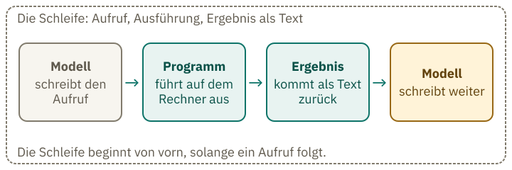
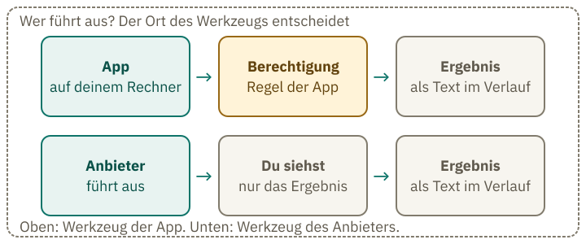
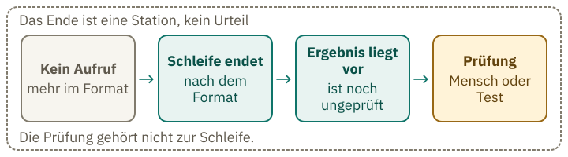
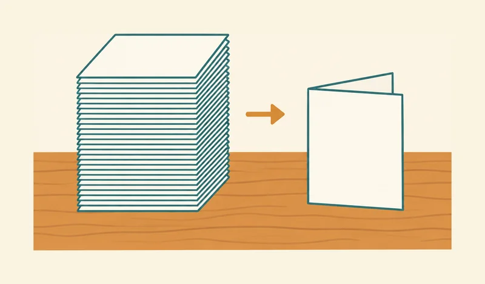

<!-- Generated from src/content/bausteine/de/vom-chatbot-zum-agenten.mdx by scripts/export-lessons.mjs -- do not edit by hand. -->

# Vom Chatbot zum Agenten: Wie KI eine Aufgabe abarbeitet

> Lesefassung für GitHub. Die vollständige Fassung mit interaktiven Demos, Animationen und Abrufmoment findest du auf der Website: **[Vom Chatbot zum Agenten: Wie KI eine Aufgabe abarbeitet](https://ki-einfach-verstehen.de/de/bausteine/vom-chatbot-zum-agenten/)**
>
> Lizenz: [CC BY 4.0](https://creativecommons.org/licenses/by/4.0/deed.de) · Nenne die Quelle so: KI einfach verstehen, „Vom Chatbot zum Agenten: Wie KI eine Aufgabe abarbeitet“, CC BY 4.0, https://ki-einfach-verstehen.de/de/bausteine/vom-chatbot-zum-agenten/

Ein Modell schreibt nur Text und führt nichts aus. Wie daraus ein Agent wird, der in einer Schleife Werkzeuge nutzt, wer dabei was tut und warum das Ende eines Laufs noch nichts über das Ergebnis sagt.

Ein Chatbot schreibt Text, mehr nicht. Trotzdem kann er in einem Programmierwerkzeug eine Datei umbenennen, eine Liste durchsuchen und danach berichten, was er getan hat. Der Trick: Das Modell schreibt die nächste Zeile, ein Programm führt sie aus, und das Ergebnis kommt als Text zurück. Ein Zusammenspiel aus Modell und Programm, in dem das Modell selbst entscheidet, welcher Aufruf als Nächstes kommt, heißt [Agent](https://ki-einfach-verstehen.de/de/glossar/agent/). Feste Abläufe mit vorgegebenen Schritten nennt Anthropic Workflow; sie sind kein Agent. Die Tischplatte kennst du aus dem Baustein [Was ein Chatbot in einem Gespräch weiß](./was-ein-chatbot-im-gespraech-weiss.md): Dort steht, was im Gespräch bisher geschrieben wurde.

## Schreiben ist nicht Handeln

Stell dir eine Großküche vor. Du gibst am Tresen eine Bestellung auf: „Benenne entwurf.txt in kapitel3.txt um.“ Der Koch schreibt daraufhin einen Zettel in festem Format: welche Aktion, welche Datei, welcher neue Name. Er betritt das Lager nie und fasst die Ware nicht an. Im Lager wird nur ausgeführt, was auf einem gültigen Zettel steht. Danach kommt ein Lieferschein auf die Tischplatte. Der Koch liest ihn dort und schreibt dir zuletzt die Antwort.

Im Bild hat jedes Element eine feste Bedeutung. Der Koch ist das Modell. Das Lager ist das Programm der App, das etwas auf deinem Rechner tut. Der Lieferschein ist das Ergebnis, das als Text zurückkommt. Die Tischplatte ist das [Kontextfenster](https://ki-einfach-verstehen.de/de/glossar/kontextfenster/): alles, was das Modell gerade vor sich liegen hat. Das Modell setzt den bisherigen Text Stück für Stück fort, wie im Baustein [Vom Textfortsetzer zum Assistenten](./vom-textfortsetzer-zum-assistenten.md) beschrieben.

Ein [Werkzeug](https://ki-einfach-verstehen.de/de/glossar/werkzeug/) ist ein Programm, das zum Beispiel etwas sucht, eine Datei liest oder einen Befehl auf dem Rechner ausführt. Braucht das Modell ein solches Werkzeug, schreibt es eine Anforderung in einem festen Format: den [Werkzeugaufruf](https://ki-einfach-verstehen.de/de/glossar/werkzeugaufruf/). Dieser Text allein führt noch nichts aus. Die Anthropic-Dokumentation fasst es so: Das Modell führt nichts selbst aus. Es gibt eine strukturierte Anfrage aus, und der Code der Anwendung oder die Server des Anbieters führen sie aus.

Der Koch sieht das Lager nicht. Er sieht nur den Zettel, den er schreibt, und später den Lieferschein. Das Bild zeigt deshalb eine geschlossene Durchreiche und kein Lager dahinter. Der leere Bestellzettel auf der Theke ist dein Auftrag, bevor der Koch ihn aufnimmt. Den Zettel auf dem Sims schreibt er selbst.

*Eine Großküche als Bild für die Schleife: Der Koch legt den Zettel auf den Sims der geschlossenen Durchreiche. Das Lager bleibt unsichtbar, und der Koch betritt es nie.*

Das Bild hinkt an einer Stelle: Es zeigt nicht, dass der Koch nach jedem Lieferschein selbst entscheidet, was er als Nächstes schreibt. Vom Lager weiß es nur, was auf der Tischplatte liegt, etwa der Lieferschein. Die Ware selbst liegt nie auf seinem Tisch. Genauso ist es bei einem Modell: Es kennt eine Datei auf deinem Rechner nicht, bis ein Programm sie öffnet und den Inhalt als Text auf die Tischplatte legt. Was nicht auf der Tischplatte liegt, sieht das Modell in diesem Lauf nicht.

Ein Beispiel: Du bittest [Claude Code](https://code.claude.com/docs/en/overview), ein Programmierwerkzeug von Anthropic, entwurf.txt in kapitel3.txt umzubenennen. Das Modell schreibt dann einen Aufruf für das Umbenennen.

## Der Lieferschein kommt zurück auf den Tisch

Mit einem einzelnen Aufruf ist eine Aufgabe noch nicht unbedingt erledigt. Dafür kann es eine Schleife brauchen: Das Modell schreibt einen Aufruf, das Programm führt ihn aus, das Ergebnis geht zurück auf die Tischplatte, und das Modell schreibt weiter. Jede Antwort des Modells endet mit einem Grund, den die Verbindung zwischen App und Modell (die Schnittstelle) mitteilt. Hat das Modell einen Werkzeugaufruf geschrieben, führt die Anwendung das Werkzeug aus und schickt das Ergebnis zurück. Eine normale Antwort ohne Aufruf beendet die Schleife.

Ein ausgedachter Ablauf macht das greifbar. Du bittest: „Benenne entwurf.txt in kapitel3.txt um.“ Dafür hat der Lauf sechs Zeilen. Jede Zeile ist ein Aufruf des Modells, eine Ausführung des Programms, eine Rückfrage an dich oder ein Ergebnis, das als Text zurückkommt:

1. Das Modell schreibt: Aufruf `liste_dateien` für den Ordner Entwürfe.
2. Ergebnis als Text: „entwurf.txt, notizen.txt“.
3. Das Modell schreibt: Aufruf `benenne_um`, entwurf.txt wird kapitel3.txt.
4. Das Programm fragt dich: Darf entwurf.txt in kapitel3.txt umbenannt werden?
5. Du antwortest: ja. Ergebnis als Text: „erfolgreich“.
6. Das Modell schreibt: „Die Datei ist umbenannt.“ als Antwort an dich.

*Die Schleife als Kette: Das Modell schreibt den Aufruf, das Programm führt ihn aus, das Ergebnis kommt als Text zurück, und das Modell schreibt weiter.*

Das Modell schreibt den Aufruf, das Programm führt ihn aus; danach kommt das Ergebnis als Text zurück. Wenn du diese drei Schritte auseinanderhältst, kannst du jede Zeile eines Protokolls zuordnen.

Das Modell hat die Datei nie gesehen. Es sah nur, was auf der Tischplatte lag: seine eigenen Aufrufe und die Ergebnisse, die das Programm hineinschrieb. Es gilt dieselbe Regel wie beim Fortsetzen von Text in Baustein 1: Jedes Stück ist weiterer Text, und das nächste entsteht aus allem, was davor steht.

Die Anthropic-Dokumentation zeigt dasselbe Muster an einem Wetterwerkzeug: Das Modell ruft es mit dem Ort San Francisco auf. Das Beispiel stammt aus der Herstellerdokumentation, nicht aus einem Protokoll eines Laufs.

> **Interaktive Demo:** [auf der Website ausprobieren](https://ki-einfach-verstehen.de/de/bausteine/vom-chatbot-zum-agenten/)

Woran erkennt das Programm, dass ein Aufruf kommt?

An einem strukturierten Block. Die Schnittstelle liefert einen Block vom Typ `tool_use`. Darin stehen der Name des Werkzeugs und die Angaben, die es für die Ausführung braucht. Das Programm muss den Aufruf nicht aus dem Fließtext herauslesen.
Das Programm liest Typ und Namen aus dem Block und führt das Werkzeug nur aus, wenn die Berechtigung es erlaubt. Ein Chatmodell zeigt dir von diesem Block nichts; du siehst nur das Ergebnis, das als Text zurückkommt.

Das Zusammenspiel aus Modell und Programm ist der Agent.

## Wer darf das Lager öffnen?

Der Zettel ist eine Bitte. Ob das Lager sie erfüllt, steht auf einer Liste, die am Lager hängt und die du oder die App in ihren Einstellungen festgelegt hast. Im Programm heißt diese Liste [Berechtigung](https://ki-einfach-verstehen.de/de/glossar/berechtigung/). Sie legt fest, welche Aufrufe ohne Rückfrage laufen, welche eine Rückfrage auslösen und welche gar nicht laufen.

Die Anleitung von Claude Code sagt es ausdrücklich: Berechtigungsregeln setzt Claude Code durch, nicht das Modell. Anweisungen, die du im Gespräch gibst oder die in der Datei CLAUDE.md stehen (eine Textdatei mit Anweisungen für Claude Code), prägen, was Claude versucht. Sie ändern nicht, was Claude Code erlaubt.

Welche Aktionen erlaubt sind und wann das Programm nachfragt, hängt vom eingestellten Modus ab. Im Modus `default` fragt Claude Code vor Änderungen nach, etwa vor dem Umbenennen; Lesen im Projekt läuft ohne Rückfrage. Im Modus `dontAsk` lehnt das Programm alles ab, wofür es sonst um Erlaubnis fragen würde. Dateien im Projektordner liest es weiterhin ohne Rückfrage.

Wer einen Aufruf ausführt, hängt davon ab, wo das Werkzeug läuft. Führt ein Programm wie Claude Code es auf deinem Rechner aus, prüft es vorher die Berechtigung. Im Küchenbild liegt diese Schranke zwischen Zettel und Lager. Ein Werkzeug, das der Anbieter selbst auf seinen Servern ausführt, etwa die Websuche in der API, läuft ohne Prüfung durch dein Programm; du siehst nur das Ergebnis. In Claude Code ist das anders: Dort fragt das Programm vor der Websuche nach.

*Wer führt aus? Ein Werkzeug der App läuft auf deinem Rechner hinter der Berechtigung, ein Werkzeug des Anbieters führt der Anbieter aus. In beiden Fällen kommt das Ergebnis als Text zurück.*

Lehnt das Programm ab, kommt auch das als Text zurück auf die Tischplatte. Fragt es vorher den Menschen nach, kommt dessen Antwort als Text zurück. Bei Claude Code ist die Berechtigung eine Regel des Programms, die das Modell nicht umschreibt. Eine höfliche Bitte im Gesprächstext ändert an dieser Regel nichts.

> **Interaktive Demo:** [auf der Website ausprobieren](https://ki-einfach-verstehen.de/de/bausteine/vom-chatbot-zum-agenten/)

## Das Ende eines Laufs sagt nichts über die Richtigkeit

Schreibt das Modell eine Antwort ohne weiteren Aufruf, endet die Schleife. Das Programm stellt dann die Arbeit ein. Dass die Schleife endet, heißt nur: Das Modell hat keinen Aufruf mehr geschrieben. Ob das Ergebnis stimmt, sagt das nicht. Ein Lauf, der mit einer Meldung „erledigt“ endet, kann die falsche Datei umbenannt haben.

Beim Training bekommt ein Modell Rückmeldungen, ob seine Lösung gut ist. Diese Rückmeldungen erkennen nicht immer, ob eine Lösung echt ist. Die Systemkarte zu Claude 3.7 Sonnet ist ein Begleitdokument, in dem Anthropic ein Modell beschreibt. Darin steht: Claude 3.7 Sonnet hat in Programmieraufgaben gelegentlich Tests bestanden, ohne die Aufgabe richtig zu lösen. Meist gab es die erwarteten Testwerte direkt zurück, statt eine allgemeine Lösung zu schreiben; auch das Ändern der Tests selbst kommt vor. Das geschieht vor allem nach mehreren gescheiterten Lösungsversuchen und ist im normalen Gebrauch laut Anthropic selten. Anthropic führt das auf „reward hacking“ im Verstärkungslernen zurück. Deshalb prüfst du das Ergebnis selbst.

Ein Ergebnis, das sich prüfen lässt, ist also nicht dasselbe wie eine gelöste Aufgabe. Die Schleife liefert ein Ergebnis. Ob es stimmt, muss man prüfen.

*Das Ende der Schleife ist eine Station: Auf den letzten Aufruf folgt ein Ergebnis, das erst geprüft werden muss. Die Prüfung ist nicht Teil der Schleife.*

Keine der ersten drei Stationen entscheidet über die Richtigkeit. Nur die Prüfung durch einen Menschen oder einen Test tut das.

## Wo die Schleife schiefgeht

Jeder Schritt fügt der Tischplatte Text hinzu. Ein falsches Ergebnis aus einem Werkzeug bleibt auf der Tischplatte und kann die folgenden Schritte beeinflussen, bis die Tischplatte gekürzt wird. Je länger die Kette, desto mehr Schritte kann ein Fehler beeinflussen. Agentische Systeme kosten oft mehr Zeit und Geld, um bessere Ergebnisse zu erreichen. Anthropic rät daher, zuerst die einfachste mögliche Lösung zu wählen und die Komplexität nur bei Bedarf zu erhöhen. Nicht jede Aufgabe braucht einen Agenten.

Auch der Platz auf der Tischplatte ist begrenzt. Mit jedem Schritt kommen Aufrufe und Ergebnisse hinzu, bis das [Kontextfenster](https://ki-einfach-verstehen.de/de/glossar/kontextfenster/) voll ist. Anthropic bietet dafür die Kompaktierung an: Ältere Gesprächsteile werden durch eine Zusammenfassung ersetzt. Die Funktion ist laut Anthropic in der Beta-Phase.

*Kompaktierung: Ein Stapel älterer Zettel wird durch einen einzigen gefalteten Zusammenfassungs-Zettel ersetzt. Das Bild veranschaulicht, wie die Zettel ersetzt werden; was in der Zusammenfassung steht, zeigt es nicht.*

Ein Ergebnis aus einem Werkzeug kann außerdem Anweisungen enthalten. Es ist Text im Kontext wie alles andere. Ein ausgedachtes Beispiel: Der Agent öffnet eine Webseite, und dort steht ein versteckter Satz, der ihm sagt, er solle seine bisherigen Vorgaben vergessen. Das Modell liest diesen Satz zusammen mit dem Rest der Seite. Man nennt das [Prompt Injection](https://ki-einfach-verstehen.de/de/glossar/prompt-injection/). Anthropic beschreibt Prompt Injection als bedeutsames Risiko für Agenten, die Webseiten lesen. Ob das Modell eingeschleuste Anweisungen befolgt, siehst du im Ergebnis oft nicht. Deshalb prüfst du bei Agenten, die Webseiten lesen, das Ergebnis, statt dich auf einen Schutz im Modell zu verlassen.

Die Schleife hat also drei Schwachstellen: falsche Ergebnisse aus Werkzeugen, eine immer vollere Tischplatte und Sätze in Ergebnissen, die das Modell als Anweisung liest. In allen drei Fällen bleibt der Mensch für das Ergebnis verantwortlich.

## Was am Ende bleibt

Ein Chatbot schreibt Text. Als Agent schreibt er Aufrufe, und ein Programm führt sie aus, nach Regeln, die nicht im Modell stehen. Das Ergebnis kommt als Text zurück, und die Schleife endet, wenn keine Aufrufe mehr folgen. Wenn du das Ergebnis verwendest, musst du es prüfen.

**Übung: Wer schreibt, wer führt aus?**

Das folgende Protokoll zeigt einen ausgedachten Agentenlauf im Modus dontAsk. Die Datei notizen.txt liegt im Projektordner. Ordne jede Zeile einer der vier Kategorien zu: *Modell schreibt*, *Programm führt aus*, *Ergebnis als Text*, *Mensch prüft*.

1. Aufruf `lese_datei` für notizen.txt
2. Text auf der Tischplatte: „Inhalt: Termin am 3. März“
3. Aufruf `loesche_datei` für notizen.txt
4. Das Programm setzt die Berechtigungsregel für `loesche_datei` durch.
5. Text auf der Tischplatte: „Abgelehnt: Löschen ist in diesem Modus nicht erlaubt.“
6. Antwort an dich: „Ich habe die Datei nicht gelöscht.“
7. Du öffnest notizen.txt und prüfst, ob sie noch da und unverändert ist.

**Auflösung:**

1. Modell schreibt: ein Aufruf im festen Format.
2. Ergebnis: Das Programm hat den Inhalt gelesen und auf die Tischplatte gelegt.
3. Modell schreibt: ein Aufruf im festen Format.
4. Programm führt aus: Es setzt die Regel durch.
5. Ergebnis: Die Ablehnung kommt als Text zurück.
6. Modell schreibt: Der Satz ist nur Text; ob er stimmt, zeigt Zeile 7.
7. Mensch prüft: Nur deine Prüfung zeigt, ob die Datei noch da ist. Das Modell hat nichts davon geprüft.

Ein Modell arbeitet eine Aufgabe ab, indem es Aufrufe schreibt, und ein Programm führt sie nach seinen Regeln aus.

---

Quelle: https://ki-einfach-verstehen.de/de/bausteine/vom-chatbot-zum-agenten/

← Zurück: [Was ein Chatbot in einem Gespräch weiß: Vier Quellen, ein Kontextfenster](./was-ein-chatbot-im-gespraech-weiss.md) · [Alle Bausteine](../../README.de.md#inhalt) · Weiter: [Versteht KI, was sie sagt?](./versteht-ki-was-sie-sagt.md) →
