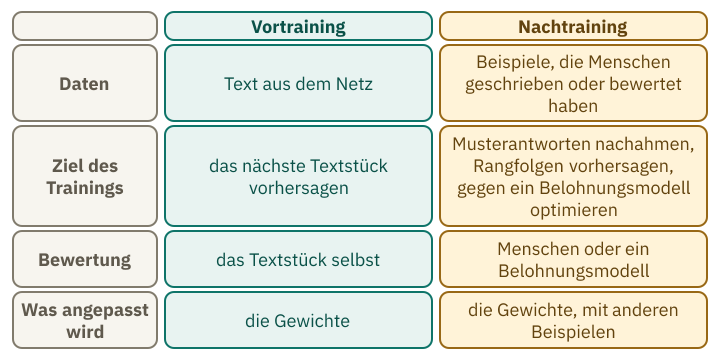
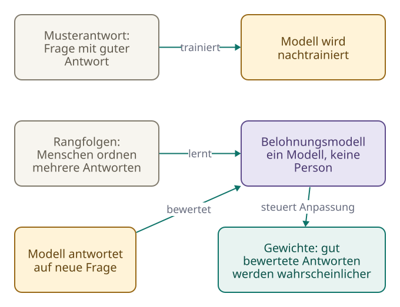
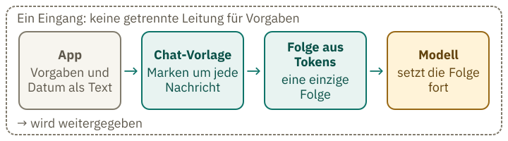

<!-- Generated from src/content/bausteine/de/vom-textfortsetzer-zum-assistenten.mdx by scripts/export-lessons.mjs -- do not edit by hand. -->

# Vom Textfortsetzer zum Assistenten: Was das Nachtraining aus einem Modell macht

> Lesefassung für GitHub. Die vollständige Fassung mit interaktiven Demos, Animationen und Abrufmoment findest du auf der Website: **[Vom Textfortsetzer zum Assistenten: Was das Nachtraining aus einem Modell macht](https://ki-einfach-verstehen.de/de/bausteine/vom-textfortsetzer-zum-assistenten/)**
>
> Lizenz: [CC BY 4.0](https://creativecommons.org/licenses/by/4.0/deed.de) · Nenne die Quelle so: KI einfach verstehen, „Vom Textfortsetzer zum Assistenten: Was das Nachtraining aus einem Modell macht“, CC BY 4.0, https://ki-einfach-verstehen.de/de/bausteine/vom-textfortsetzer-zum-assistenten/

Warum ein Grundmodell Fragen fortsetzt statt sie zu beantworten, was das Nachtraining ändert und woher ein Chatbot sein Datum und seine Vorgaben hat.

Gibst du einem Sprachmodell ohne Chat-Training eine Frage, schreibt es darunter oft weiter: noch eine Frage, noch eine Aufgabe, manchmal auch eine Antwort. Das klingt nach einem kaputten Programm. Tatsächlich macht das Modell genau das, wofür es trainiert wurde. Das Gespräch, das du heute führst, entsteht erst durch ein zweites Training, das aus diesem Modell einen Assistenten macht. Wie wird aus so einem Modell ein Gegenüber, das auf Fragen antwortet? Dieser Baustein zeigt es.

## Ein Grundmodell schreibt weiter, es antwortet nicht verlässlich

Ein [Grundmodell](https://ki-einfach-verstehen.de/de/glossar/grundmodell/) ist ein [Modell](https://ki-einfach-verstehen.de/de/glossar/modell/) nach dem Grundtraining, aber vor dem Chat-Training. Im Grundtraining hat es gelernt, das nächste Stück eines Textes vorherzusagen. Erinnerst du dich an den Baustein über [Input und Output](./input-und-output.md)? Dort war jedes Stück Text das Ziel für den Text davor.

Ein Forschungspapier von OpenAI aus dem Jahr 2022 zeigt, was ein solches Modell mit einer Aufgabe macht. Die Autoren gaben GPT-3 mit 175 Milliarden [Parametern](https://ki-einfach-verstehen.de/de/glossar/parameter/) diesen Auftrag, auf Französisch: „Schreib eine kurze Geschichte über einen Frosch, der in der Zeit bis ins antike Griechenland reist, auf Französisch.“ Im Paper steht die Aufgabe auf Französisch; die deutsche Fassung hier ist eine Übersetzung.

Was schreibt GPT-3 darauf? Sag es dir vorher. Das Paper zeigt in seiner Abbildung 8, was GPT-3 und seine nachtrainierte Variante InstructGPT tatsächlich geschrieben haben.

> **Interaktive Demo:** [auf der Website ausprobieren](https://ki-einfach-verstehen.de/de/bausteine/vom-textfortsetzer-zum-assistenten/)

Im Paper steht die französische Aufgabe, eine kurze Geschichte über einen Frosch zu schreiben, der in das antike Griechenland reist. GPT-3 schreibt darauf keine Geschichte, sondern drei weitere Aufgaben derselben Art (Ouyang et al. 2022, arXiv:2203.02155v1, Abbildung 8, S. 15).

Das liegt an der Trainingsaufgabe: den nächsten Textteil vorhersagen. Für die Vorhersage ist ein Auftrag nur eine Textstelle wie jede andere. In solchen Texten folgt auf einen Auftrag oft der nächste. Das Paper stellt diese Vorhersageaufgabe dem Ziel gegenüber, den Anweisungen des Nutzers hilfreich und sicher zu folgen. Die Autoren nennen die Vorhersageaufgabe deshalb „misaligned“, auf Deutsch etwa nicht auf die Anweisungen ausgerichtet.

Eine Schreibkraft schreibt jedes angefangene Dokument weiter, ohne zu wissen, wer es liest. Bekommt sie ein Blatt mit einer Aufgabenliste, schreibt sie oft weitere Aufgaben darunter. Das ist kein Versagen, sie folgt dem Muster, das in solchen Dokumenten üblich ist. Das Blatt ist die Eingabe. Die Gewohnheiten der Schreibkraft (die Gewichte) und ihr nächster Satz (die Vorhersage) zeigt das Bild nicht; der Text ordnet sie zu.

Die Grenze dieses Bildes: Die Schreibkraft hat keine Absicht. Ein Modell wählt kein Ziel. Es setzt Muster fort, die im Training häufig waren.

*Eine Schreibkraft am Schreibtisch. Auf dem Blatt stehen Zeilen, der Stift setzt am oberen Rand an. Das Bild zeigt kein Aufgabenblatt und keine Antwort; der Text erklärt, was die Zeilen bedeuten.*

Das Muster ist dasselbe, ob der Text wie ein Auftrag aussieht oder wie eine Frage: Das Modell setzt fort, was in Texten dieser Art üblicherweise folgt. Auch bei Fragen, die nicht nach Aufgaben aussehen, zeigt sich das. Im Paper steht eine Code-Frage: Was bewirkt die Liste `C` in diesem Programm? Auf die Code-Frage setzt GPT-3 vier Antwortmöglichkeiten „A. bis D.“ an, wie bei einer Multiple-Choice-Aufgabe (ebenda). Laut Legende beantwortet GPT-3 die Code-Frage nur in etwa der Hälfte der Fälle; auch bei derselben Frage kommt also mal eine Antwort, mal etwas anderes heraus. Im Paper steht in der Bildunterschrift: Die Autoren haben die Beispiele ausgewählt, um bestimmte Verhaltensweisen zu zeigen. Die Ausgaben selbst haben sie nicht ausgewählt.

Dass moderne Modelle trotzdem Fragen beantworten, liegt an einem zweiten Training, dem [Nachtraining](https://ki-einfach-verstehen.de/de/glossar/nachtraining/).

## Drei Schritte, die aus Fortsetzern Helfer machen

Was läuft beim Nachtraining anders als beim Grundtraining, und was bleibt gleich? Das Nachtraining folgt auf das Grundtraining. Aus dem Baustein über Input und Output kennst du seinen Zweck: Der Chatbot soll lernen, auf Fragen zu antworten. Das Ergebnis heißt [Instruktionsmodell](https://ki-einfach-verstehen.de/de/glossar/instruktionsmodell/), weil es Anweisungen befolgen soll.

*Vortraining und Nachtraining im Vergleich: Dasselbe Grundmodell wird mit anderen Beispielen und einer Bewertung weitertrainiert.*

Das Paper InstructGPT beschreibt sein Verfahren in drei Schritten. Im ersten sammelt man Beispiele für gute Antworten und trainiert damit das Modell weiter. Ein Team von rund vierzig Auftragskräften erstellte diese Musterantworten. Dafür nutzte es rund 13.000 Prompts, also Aufgaben oder Fragen.

Im zweiten Schritt bekommen Auftragskräfte mehrere Antworten auf dieselbe Frage und ordnen sie danach, wie hilfreich sie sind. Anhand dieser Rangfolgen lernt ein [Belohnungsmodell](https://ki-einfach-verstehen.de/de/glossar/belohnungsmodell/) vorherzusagen, welche Antwort ein Mensch bevorzugen würde. Auch dieses Modell muss also trainiert werden, bevor es Antworten bewerten kann. Auch für das Belohnungsmodell brauchte es Zehntausende Prompts.

Im dritten Schritt antwortet das Modell auf neue Prompts, das Belohnungsmodell bewertet jede Antwort mit einer Zahl, und die Gewichte des Modells werden so angepasst, dass hoch bewertete Antworten wahrscheinlicher werden. Für diesen Schritt nutzte es ebenfalls Zehntausende Prompts, die Kunden über die Programmierschnittstelle geschickt hatten.

[▶ Animation auf der Website ansehen](https://ki-einfach-verstehen.de/de/bausteine/vom-textfortsetzer-zum-assistenten/)

*Die drei Schritte des Nachtrainings: Musterantworten, Rangfolgen für das Belohnungsmodell und Optimierung gegen dieses Belohnungsmodell.*

Auch im Nachtraining werden die Gewichte des Modells angepasst. Was sich ändert, sind die Beispiele und die Bewertung. Im Grundtraining war die Aufgabe, das nächste Textstück vorherzusagen. Wie weit seine Vorhersage vom tatsächlichen Textstück abwich, bestimmte die Anpassung der Gewichte. Im Nachtraining dienen Musterantworten und Rangfolgen als Grundlage.

Die Schreibkraft bekommt nun Musterantworten und lernt, welche Entwürfe Auftragskräfte bevorzugen. Das Bild hat eine Grenze: Beim Training liest keine Person jede neue Antwort und bewertet sie sofort. Diese Bewertung übernimmt das Belohnungsmodell. Es hat aus den zuvor gesammelten Rangfolgen gelernt, menschliche Urteile nachzuahmen.

> **Interaktive Demo:** [auf der Website ausprobieren](https://ki-einfach-verstehen.de/de/bausteine/vom-textfortsetzer-zum-assistenten/)

Eine Ebene tiefer: Was das Nachtraining kostet

Wie viel Rechenaufwand steckt im Nachtraining? Das Paper gibt dazu Werte in Petaflop/s-Tagen an, einer Einheit für Rechenaufwand. Das Paper nennt Werte für zwei Trainingsläufe: das überwachte Nachtraining (4,9 Petaflop/s-Tage) und den PPO-Schritt mit Vortraining-Updates (60). Das Belohnungsmodell ist darin nicht beziffert. Das Grundtraining von GPT-3 brauchte 3.640. Eigene Rechnung: 4,9 geteilt durch 3.640 sind rund 0,13 Prozent, 60 geteilt durch 3.640 rund 1,6 Prozent. Die Werte gelten für das Modell von 2022.

Der Optimierungsschritt heißt PPO, kurz für Proximal Policy Optimization, ein Verfahren aus dem Verstärkungslernen. Es ändert die Gewichte schrittweise. Für jedes Wort der Antwort wird eine Strafe abgezogen, die umso größer ist, je stärker die Antwort von der Ausgangsfassung (dem Modell nach Schritt 1) abweicht. Diese Strafe soll verhindern, dass das Modell die Bewertung mit Antworten ausnutzt, die dem Belohnungsmodell gefallen, Menschen aber nicht.

## Ein kleineres Modell gewinnt gegen das große

Der deutlichste Beleg für die Wirkung des Nachtrainings kommt aus einem Vergleich. Auftragskräfte bewerteten die Antworten von InstructGPT mit 1,3 Milliarden Parametern und die Antworten von GPT-3 mit 175 Milliarden Parametern. Die kleinere Version wurde bevorzugt. Das Paper spricht von über hundertmal weniger Parametern.

Der Vergleich hat eine Grenze. Die Auftragskräfte bewerteten die Antworten anhand von Anfragen, die Kunden über die Programmierschnittstelle (API) an das Modell geschickt hatten und die nicht ins Training eingegangen waren. Das zeigt, welche Antworten sie in diesem Test bevorzugten. Es bedeutet nicht, dass das kleinere Modell in jeder Hinsicht besser ist. Außerdem hat das Nachtraining einen Preis. Auf mehreren öffentlichen Testdatensätzen wurde die Leistung schlechter, die Autoren nennen das „alignment tax“, eine Steuer auf die Anpassung. Eine Zwischenlösung, die das Training zusätzlich mit Texten aus dem Grundtraining mischte, milderte das, beseitigte es aber nicht. Bei Übersetzungen und bei Leseverständnis-Aufgaben blieb das Modell mit Vortraining-Updates hinter GPT-3 zurück.

Die Ergebnisse stammen aus dem Jahr 2022. Der Vergleich zeigt eine Tendenz für dieses Modell und seine Tests, keine allgemeine Eigenschaft von Modellen.

## Was das Nachtraining formt: eine offene Hypothese

Was lernt das Modell im Nachtraining wirklich? Eine Hypothese aus dem Jahr 2023 heißt Superficial Alignment Hypothesis, auf Deutsch etwa „Hypothese der oberflächlichen Anpassung“. Nach dieser Hypothese entstehen Wissen und Fähigkeiten eines Modells fast vollständig im Grundtraining. Das Nachtraining, im Paper „Alignment“ genannt, bringt dem Modell bei, welche Art von Antwort zur jeweiligen Situation im Gespräch mit Nutzern passt.

Die Hypothese stützt sich auf ein kleines Experiment mit 1.000 handverlesenen Beispielen. Bei so wenigen Beispielen lässt sich das Ergebnis nur begrenzt verallgemeinern.

2024 hat eine Gruppe von Forschenden die Hypothese geprüft. In ihrer Zusammenfassung steht, dass die Leistung nach dem Nachtraining mit der Zahl der Beispiele wächst. Bei Aufgaben wie Mathematik verändern wenige Beispiele vor allem den Stil. Für die bestmögliche Leistung reichen wenige Beispiele nicht aus. Das spricht gegen die Lesart, Nachtraining verändere nur den Stil, widerlegt die Hypothese aber nicht.

Dass Nachtraining nur den Stil verändert, ist eine Hypothese, kein gesicherter Befund. Ob das Modell dabei neues Wissen erwirbt, lässt sich aus dem Befund von 2024 nicht ablesen.

## Der Chat ist Text mit Marken

Woher erkennt ein Modell, wer im Chat spricht? Die Modellkarte des Grundmodells Qwen2.5-7B von Alibaba rät davon ab, Grundmodelle für Gespräche zu nutzen. Dort steht die Empfehlung, das Modell mit Nachtraining weiter anzupassen. Damit das Modell erkennt, wer im Chat spricht, bekommt der Text eine feste Form, die jede Nachricht mit ihrer Rolle markiert.

Diese Form legt die [Chat-Vorlage](https://ki-einfach-verstehen.de/de/glossar/chat-vorlage/) fest. Sie nimmt die Nachrichten mit ihren Rollen und setzt daraus eine einzige Folge von [Tokens](https://ki-einfach-verstehen.de/de/glossar/token/). Jede Nachricht bekommt Marken, [Spezial-Tokens](https://ki-einfach-verstehen.de/de/glossar/spezial-token/), die sagen, wer spricht und wo der Beitrag endet. Die Vorlage von Qwen3-0.6B setzt etwa `<|im_start|>user` vor deine Frage und `<|im_end|>` an ihr Ende. Zum Schluss fügt sie `<|im_start|>assistant` ein. Dieser „offene Kopf“ markiert den Beginn der Antwort, die das Modell schreiben soll. Fehlt er, endet die Folge mit deiner Nachricht, und das Modell kann an deiner Nachricht weiterschreiben, statt ihr zu antworten.

*Woher der Text im Input kommt: Die App fügt Vorgaben und Datum hinzu, die Vorlage verpackt alles in Marken, das Modell setzt die Folge fort. Es gibt keinen getrennten Kanal für die Vorgaben.*

Die Dokumentation fasst das so zusammen: Der Chat ist also nur eine Folge von Tokens. Mit den falschen Marken arbeiten Modelle deutlich schlechter.

> **Interaktive Demo:** [auf der Website ausprobieren](https://ki-einfach-verstehen.de/de/bausteine/vom-textfortsetzer-zum-assistenten/)

Die [Systemanweisung](https://ki-einfach-verstehen.de/de/glossar/systemanweisung/) der App ist ebenfalls nur ein Eintrag in dieser Folge, meist ganz vorn. Bei Qwen3 fehlt ohne Systemanweisung dieser Eintrag ganz; die Vorlage setzt dafür keinen Ersatztext ein.

Die gpt-oss-Modelle von OpenAI verwenden ein anderes Format: Harmony. Die Anweisungen an das Modell stehen in einer eigenen Nachrichtenrolle, der Entwicklernachricht (developer). Sie entspricht der Systemanweisung in anderen Formaten. Die Grundidee ist dieselbe: Alles, was das Modell sieht, ist Text in einer Folge. Die Beispiele dazu stehen im Baustein über [Tokenisierung im Modell](./tokenisierung-im-modell.md).

## Das Datum steht im Text, nicht im Modell

Fragst du einen Chatbot nach dem heutigen Datum, bekommst du oft eine richtige Antwort. Woher weiß er das? Das Grundtraining endet an einem Stichtag; was danach geschah, konnte es nicht lernen. Ein aktuelles Datum kann das Modell nicht aus dem Training haben. Es kommt meist als zusätzlicher Text an, den das Modell vor seiner Antwort erhält.

Das Unternehmen hinter dem Chatbot Claude (Anthropic) beschreibt in seinen Versionshinweisen, dass die Systemanweisungen der eigenen Apps dem Modell zu Beginn jedes Gesprächs Angaben wie das aktuelle Datum geben. Die Vorgaben gelten ausdrücklich nicht für die Programmierschnittstelle (API), über die ein eigenes Programm das Modell anspricht. Wer so ein Modell nutzt, muss das Datum selbst mitschicken, wenn es im Input stehen soll.

*Eine Hand legt einen Zettel oben auf den Stapel, den das Modell liest. Der Zettel trägt nur eine Zeile mit dem Datum: Das Datum steht im Input, nicht in einem Kalender des Modells.*

Wenn du wissen möchtest, woher ein Chatbot sein Datum hat, schau zuerst auf den Text, den er vor seiner Antwort erhält. Auch das Beispiel zum Harmony-Format trägt Wissensstand und Datum, und zwar in einer eigenen Systemnachricht neben der Entwicklernachricht. Das sind Beispielwerte aus der Dokumentation, keine Angaben zu einem bestimmten Modell. Entscheidend ist der Ort: Die Zeile steht im Text, sie ist kein Wissen, das das Modell mitbringt. Die Qwen3-Vorlage fügt kein Datum ein. Soll das Modell eines erhalten, muss die App es hinzufügen.

Die Folgerung: Ein Datum kommt von der App, aus einer Nachricht, die du selbst schreibst, oder die Vorlage setzt eines ein. Manche Vorlagen, etwa die aus dem Baustein [Tokenisierung im Modell](./tokenisierung-im-modell.md), setzen ein festes Standarddatum ein, wenn die App keines mitgibt. Ein festes Datum aus der Vorlage passt nur zufällig zum heutigen Tag. Ob ein Datum stimmt, hängt also davon ab, was die App mitschickt.

## Was am Ende bleibt

Die Frage vom Anfang lässt sich jetzt beantworten. Ein Grundmodell hat gelernt, Text fortzusetzen. Ein Auftrag ist dabei eine Textstelle wie jede andere. Deshalb beantwortet es Fragen nicht verlässlich. Das Nachtraining bringt ihm bei, welche Fortsetzungen Menschen bevorzugen. Im beschriebenen Verfahren (InstructGPT) geschieht das durch ein weiteres Training mit anderen Beispielen und einer anderen Bewertung.

Der Assistent sieht im Chat nur eine einzige Folge: Vorgaben, Datum, die bisherigen Nachrichten und die neue Frage, alles als Text mit Marken. Was er an Wissen mitbringt, stammt nach der Hypothese vor allem aus dem Grundtraining; das Nachtraining formt, wie es sich zeigt.

Im nächsten Baustein fragst du, was zwischen Frage und Antwort passiert, wenn ein Modell vorher länger „nachdenkt“.

**Übung: Welche Ausgabe stammt von welchem Modell?**

Dieselbe Eingabe, zwei Ausgaben. Die Beispiele sind für diese Übung ausgedacht.

Eingabe: „Schreib drei Städte in Frankreich auf.“

Ausgabe A: „Schreib drei Städte in Deutschland auf. Schreib drei Flüsse in Europa auf.“

Ausgabe B: „Gern: Paris, Lyon und Marseille sind drei große Städte in Frankreich.“

Welche Ausgabe stammt vom Grundmodell, welche vom Assistenten? Begründe deine Zuordnung mit dem Trainingsziel und dem Nachtraining.

**Auflösung:**

Ausgabe A stammt vom Grundmodell. Sein Trainingsziel ist das nächste Stück Text. Bei diesem Auftrag ist die naheliegende Fortsetzung eine weitere Aufgabe, deshalb setzt es die Aufgabenliste fort. Ausgabe B stammt vom Assistenten: Sie antwortet im Chat-Ton („Gern:“). Das Grundmodell antwortet manchmal auch, deshalb ist die Antwort allein kein Beweis; den Ton hat das Nachtraining mit Musterantworten und Bewertungen geformt. Das Nachtraining ändert vor allem die Beispiele und die Bewertung. Das Grundmodell ist die Basis dafür.

---

Quelle: https://ki-einfach-verstehen.de/de/bausteine/vom-textfortsetzer-zum-assistenten/

← Zurück: [Warum Vorhersagen mehr ist als Nachplappern](./warum-vorhersagen-mehr-ist-als-nachplappern.md) · [Alle Bausteine](../../README.de.md#inhalt) · Weiter: [Wie ein Modell „nachdenkt“: Zwischenschritte, die es selbst schreibt](./wie-ein-modell-nachdenkt.md) →
