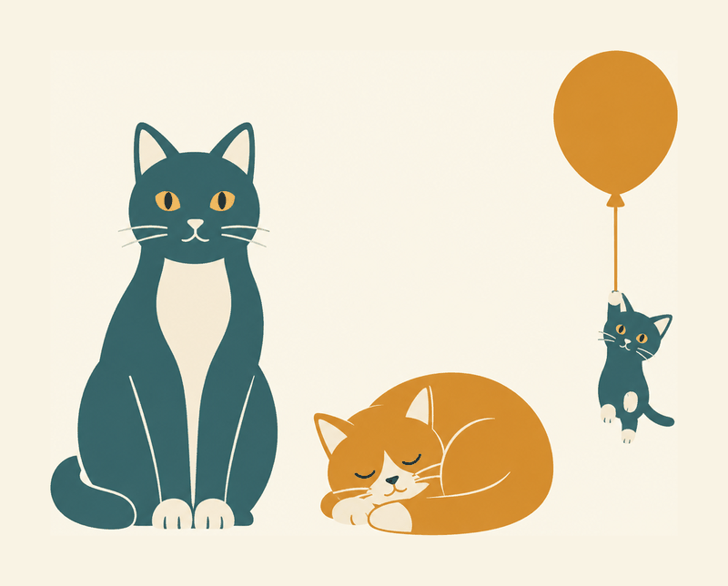
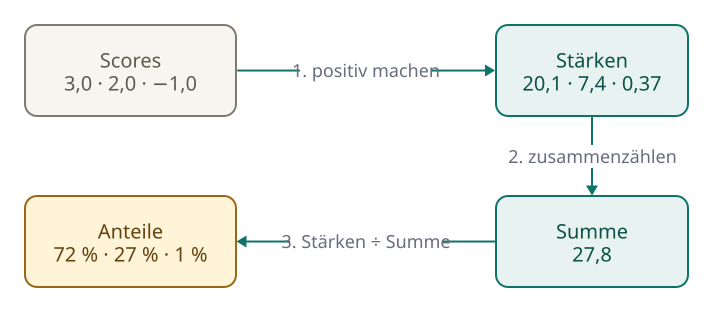
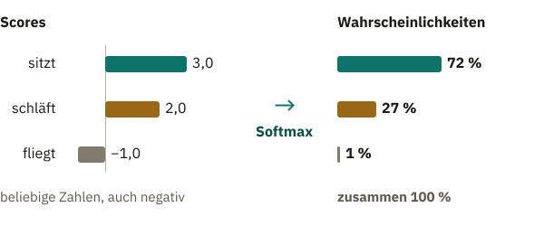
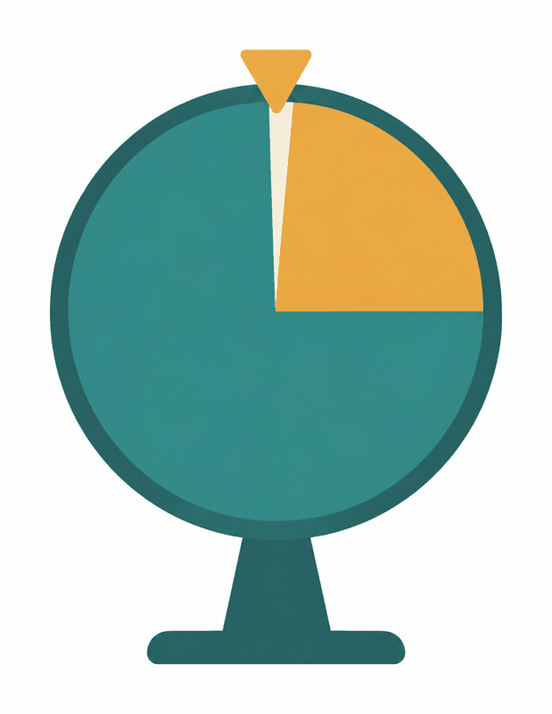
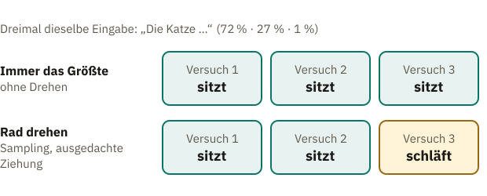
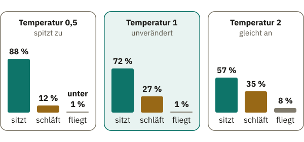
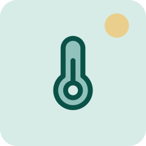

<!-- Generated from src/content/bausteine/de/wahrscheinlichkeit-und-softmax.mdx by scripts/export-lessons.mjs -- do not edit by hand. -->

# Wahrscheinlichkeit und Softmax: Wie ein Modell sich entscheidet

> Lesefassung für GitHub. Die vollständige Fassung mit interaktiven Demos, Animationen und Abrufmoment findest du auf der Website: **[Wahrscheinlichkeit und Softmax: Wie ein Modell sich entscheidet](https://ki-einfach-verstehen.de/de/bausteine/wahrscheinlichkeit-und-softmax/)**
>
> Lizenz: [CC BY 4.0](https://creativecommons.org/licenses/by/4.0/deed.de) · Nenne die Quelle so: KI einfach verstehen, „Wahrscheinlichkeit und Softmax: Wie ein Modell sich entscheidet“, CC BY 4.0, https://ki-einfach-verstehen.de/de/bausteine/wahrscheinlichkeit-und-softmax/

Wie ein Sprachmodell aus seinen Scores Anteile macht, warum es mal das Naheliegende und mal etwas anderes wählt und was die Temperatur daran ändert.

Lässt du einen Chatbot eine Antwort neu erzeugen, bekommst du oft eine andere, obwohl deine Frage gleich geblieben ist. Wie du aus dem Baustein über Input und Output weißt, berechnet das Modell bei gleichem Input im Prinzip jedes Mal dieselbe [Score](https://ki-einfach-verstehen.de/de/glossar/score/)-Liste. Sie bewertet für jedes [Token](https://ki-einfach-verstehen.de/de/glossar/token/) (ein Textstück), wie gut es als Nächstes passt. Erst in einem anschließenden Schritt wird ein Token ausgewählt – und dabei kommt der Zufall ins Spiel. Scores wie 7,1 oder −2,3 sind noch keine Wahrscheinlichkeiten. Wie wird daraus entschieden, welches Token als Nächstes folgt?

Du tippst „Die Katze“. Für dieses Beispiel nehmen wir nur drei mögliche Fortsetzungen an: „sitzt“ mit dem Score 3,0, „schläft“ mit 2,0 und „fliegt“ mit −1,0. Diese Scores sind ausgedacht. Ein Mensch hat sie gesetzt, trainiert wurde nichts. Ein echtes Modell vergibt einen Score an jedes Token seines [Vokabulars](https://ki-einfach-verstehen.de/de/glossar/vokabular/) (die feste Liste aller Stücke, in die das Modell einen Text zerlegt), zum Beispiel das ältere GPT-2, ein Vorläufer der Modelle hinter ChatGPT, an rund 50.000 Tokens. Es berechnet jeden Score aus seinen [Parametern](https://ki-einfach-verstehen.de/de/glossar/parameter/), den Zahlen, die das Training eingestellt hat. Mit diesen ausgedachten Scores lässt sich nur die Auswahl eines Tokens durchrechnen. Welche Fortsetzung ein echtes Modell nach „Die Katze“ bevorzugt, lässt sich daraus nicht ablesen.

## Wie oft soll „sitzt“ drankommen?

Angenommen, das Modell soll nach „Die Katze“ hundertmal das nächste Token wählen. Wie oft sollte dabei „sitzt“ kommen und wie oft „fliegt“? Versuch es kurz aus den Scores abzulesen, bevor du weiterliest.

Nimmt der Auswahlschritt wie im Baustein über Input und Output immer den höchsten Score, kommt hundertmal „sitzt“, und Neu-Erzeugen brächte im Prinzip nichts anderes. Soll auch „schläft“ manchmal drankommen, sagen die Scores nicht, wie oft. Bei „fliegt“ hakt es: Sein Score ist negativ, und einen Anteil von minus einem Prozent gibt es nicht. Ein Score zeigt nur, welches Token vorn liegt und um wie viel, nicht, wie oft es drankommen soll.

*Drei mögliche Fortsetzungen von „Die Katze …“: sitzt, schläft, fliegt. Je größer die Katze, desto naheliegender die Fortsetzung. Die winzige Katze am Luftballon steht für die unwahrscheinlichste Fortsetzung.*

Wie bei einem Glücksrad bekommt jedes Token ein Feld, dessen Größe angibt, wie oft es bei sehr vielen Versuchen drankommt. Je größer ein Feld, desto öfter bleibt der Zeiger dort stehen. Ein Feld mit einem Viertel des Rads bleibt im Schnitt bei jeder vierten Drehung stehen. Der Anteil eines Felds am Rad heißt **[Wahrscheinlichkeit](https://ki-einfach-verstehen.de/de/glossar/wahrscheinlichkeit/)**. Das Wort meint hier nur diese Größe, nicht, wie sicher sich das Modell ist. Sie liegt immer zwischen 0 und 100 Prozent, nie darüber oder darunter.

Alle Anteile zusammen ergeben genau 100 Prozent. Diese Liste heißt **Verteilung**.

Für jedes nächste Token braucht ein Chatbot so ein Rad. Wie baut man also aus 3,0, 2,0 und −1,0 ein Rad?

## Aus Punkten werden Anteile: Softmax

Nach einem Quizabend hängt die Punktetafel an der Wand. Team A hat 30 Punkte, Team B 20, Team C 10. Team A hat also die Hälfte aller 60 Punkte.

Bei den Scores geht das schief: Teilt man jeden Score durch die Summe 4,0, bekommt „fliegt“ −1,0 : 4,0, also −25 Prozent. Ein Feld, das kleiner ist als nichts, passt auf kein Rad.

Deshalb macht Softmax aus jedem Score zuerst eine positive Zahl, die **Stärke**. Die Stärke spielt die Rolle der Punkte: Jedes Token ist ein Team. Negative Punkte gibt es hier nicht.

Diese Regel ist fest und wird nicht trainiert. Ein Score von 0 bekommt die Stärke 1. Jeder Punkt darüber macht die Stärke 2,718-mal so groß, jeder Punkt darunter teilt durch 2,718. Dann zählt Softmax die Stärken zusammen und teilt jede durch die Summe, wie ein Team seine Punkte durch die Gesamtpunktzahl.

Die Zahl 2,718 heißt e, eine feste Zahl der Mathematik, die niemand gewählt hat.

Für „sitzt“ sind es drei Punkte über null, also 2,718 · 2,718 · 2,718. „schläft“ hat zwei Punkte, „fliegt“ liegt einen Punkt unter null.

Die Stärken sind rund 20,1 für „sitzt“, rund 7,4 für „schläft“ und rund 0,37 für „fliegt“, zusammen rund 27,8. Teilt man jede durch 27,8, bekommt „sitzt“ rund 72 Prozent, „schläft“ rund 27 und „fliegt“ rund 1 Prozent. Diese Rechnung heißt **[Softmax](https://ki-einfach-verstehen.de/de/glossar/softmax/)**. Sie macht aus jeder Score-Liste ein Rad.

[▶ Animation auf der Website ansehen](https://ki-einfach-verstehen.de/de/bausteine/wahrscheinlichkeit-und-softmax/)

*Softmax in drei Schritten: Scores in positive Stärken verwandeln, die Stärken zusammenzählen, jede Stärke durch die Summe teilen. Die Scores sind ausgedacht.*

Zähl zu allen drei Scores 10 dazu: Dann stehen dort 13,0, 12,0 und 9,0. Überleg kurz: Werden die Prozente dann größer, kleiner oder bleiben sie gleich?

Sie bleiben genau gleich. Zehn Punkte mehr machen jede Stärke gleich viel größer, die Summe wächst genauso. Beim Teilen fällt dieser Faktor wieder heraus. Eine ganze Liste kann höher oder tiefer liegen, etwa nach einem anderen Satzanfang. Hier endet das Bild der Punktetafel: Auf der Tafel würden 10 Punkte für jedes Team die Anteile verschieben, bei Scores nicht. **Bei Scores zählt nur, wie weit sie auseinanderliegen.**

Auf dem Rad bekommt der höchste Score immer das größte Feld. Jeder Punkt, um den ein Score vor den anderen liegt, vervielfacht seine Stärke. Bei einem Punkt ist sie etwa 2,7-mal so groß, bei zwei Punkten gut siebenmal so groß. Liegt ein Token weit vor allen anderen, bekommt es deshalb fast das ganze Rad. Softmax gibt jedem Token einen Anteil über null: Selbst „fliegt“ behält rund 1 Prozent.

*Softmax macht aus den ausgedachten Scores Anteile: Die Reihenfolge bleibt, die Summe ist 100 %.*

## Dieselbe Rechnung bei der Bilderkennung

Die Bilderkennung aus dem Baustein über Input und Output rechnet meist genauso. Sie gibt für ein Foto Scores aus: Katze 6,2, Hund 2,9, Fuchs 1,4 und Auto −3,0.

Die Katze liegt gut drei Punkte vor dem Hund und bekommt deshalb fast das ganze Rad, rund 96 Prozent. Hund, Fuchs und Auto teilen sich den Rest; das Auto bekommt nur einen winzigen Anteil, der aber größer als null ist. Bei einem Sprachmodell wie GPT-2, einem Vorläufer der Modelle hinter ChatGPT, läuft dieselbe Rechnung vor jedem neuen Token, mit allen Scores seines Vokabulars.

Eine Ebene tiefer: Die Formel hinter Softmax

Die Stärke eines Scores ist die Zahl e hoch dem Score. Bei ganzen Zahlen oben zeigt die kleine Zahl, wie oft e mit sich selbst multipliziert wird: e³ = e · e · e ≈ 20,1 und e² = e · e ≈ 7,4. Eine negative ganze Zahl oben heißt teilen: e⁻¹ = 1 : e ≈ 0,37. Bei Hochzahlen mit Komma hilft ein Taschenrechner mit der Taste eˣ. Und e⁰ ist 1, genau wie in der Regel oben. Als Formel für den Kandidaten Nummer i:

`Softmax(xᵢ) = eˣⁱ / Σⱼ eˣʲ`

Über dem Bruchstrich steht die Stärke des Kandidaten, darunter die Summe aller Stärken, gekennzeichnet durch das Summenzeichen Σ.

Bei der Bilderkennung ergibt e hoch 6,2 rund 493 (Katze), e hoch 2,9 rund 18 (Hund), e hoch 1,4 rund 4 (Fuchs) und e hoch −3,0 rund 0,05 (Auto). Zusammen rund 515, davon 493 für die Katze: rund 96 Prozent.

Der Name kommt von der harten Regel „nimm den Größten“ (englisch max). Softmax ist ihre weiche Version: Der Größte bekommt am meisten, die anderen behalten etwas, und je größer der Vorsprung, desto näher kommt Softmax der harten Regel. In der Fachsprache heißen die Scores vor Softmax **Logits**.

## Den Favoriten nehmen oder das Rad drehen

Softmax hat das Rad gebaut: „sitzt“ hat 72 Prozent, „schläft“ 27 Prozent, „fliegt“ einen schmalen Streifen. Gewählt ist damit noch nichts. Im Baustein über Input und Output nahm der Auswahlschritt einfach das Token mit dem höchsten Score, bei „Die Katze sitzt“ das „auf“ mit 8,1. Das Rad wird dabei gar nicht gedreht; stattdessen wird direkt das größte Feld gewählt. Diese Auswahl heißt **Greedy-Auswahl** (englisch greedy, gierig: sie greift immer nach dem größten Happen). Weil Softmax die Reihenfolge nicht ändert, gehört das größte Feld immer dem höchsten Score. Für die Greedy-Auswahl bräuchte es Softmax also gar nicht.

*Das Glücksrad nach Softmax: Jedes Feld ist so groß wie seine Wahrscheinlichkeit. Die Größen sind schematisch.*

Erst für die Auswahl mit Zufall braucht es das Rad. Es wird wirklich gedreht, und das Token unter dem Zeiger kommt dran. Diese Auswahl heißt **[Sampling](https://ki-einfach-verstehen.de/de/glossar/sampling/)**, nach dem englischen Wort für „Stichprobe“: Aus den möglichen Tokens wird eines gezogen. Zufall klingt nach einem fairen Würfel. Müsste „fliegt“ dann genauso oft drankommen wie „sitzt“? Beim Drehen zählt die Größe: Große Felder kommen oft, schmale selten. Bei 100 Drehungen landet der Zeiger im Schnitt ungefähr 72-mal auf „sitzt“, 27-mal auf „schläft“ und einmal auf „fliegt“. Mit Sampling unterscheiden sich Antworten deshalb von Mal zu Mal. Beliebig wird dabei nichts, weil die großen Felder weiterhin öfter drankommen.

*Dreimal dieselbe Eingabe: Wer immer das Wahrscheinlichste nimmt, bekommt dreimal „sitzt“. Wer das Rad dreht, bekommt meistens „sitzt“ und manchmal etwas anderes (ausgedachte Ziehung).*

Warum nimmt ein Chatbot dann nicht immer das größte Feld? Bei kurzen Antworten wie einer Zahl geht das gut. Längere Texte, die immer nur die wahrscheinlichste Fortsetzung wählen, werden fade und wiederholen leicht dieselben Wendungen. Holtzman et al. (2019) finden dasselbe Muster bei der Suche nach der insgesamt wahrscheinlichsten Fortsetzung (Beam Search). Sampling bringt Abwechslung hinein, weil gelegentlich auch das zweit- oder drittbeste Token drankommt.

Ein Rad gilt immer nur für ein Token. Vor jedem neuen Token berechnet das Modell eine neue Score-Liste. Softmax baut daraus ein neues Rad, das genau einmal gedreht wird. Das gewählte Token wird angehängt, und die Schleife beginnt von vorn.

Lässt du eine Antwort neu erzeugen, werden alle Räder noch einmal gedreht. Bleibt der Zeiger beim ersten Rad aber woanders stehen, etwa bei „schläft“ statt „sitzt“, rechnen alle folgenden Runden mit diesem Token weiter, denn normalerweise bleibt es stehen. So entsteht auf dieselbe Frage eine andere Antwort.

Probier es aus: Lass eine kurze Antwort drei-, viermal neu erzeugen und achte darauf, ab welchem Wort sich die Fassungen trennen.

Die drei Felder sind eine Vereinfachung. Ein echtes Rad hat ein Feld für jedes Token des Vokabulars. Die allermeisten Felder wären so schmal, dass man sie kaum sehen könnte. Wie stark der Zufall beim Drehen wirkt, lässt sich einstellen.

## Mehr oder weniger Zufall: die Temperatur

Aufgaben vertragen unterschiedlich viel Zufall. Soll ein Programm aus einer Mail immer dasselbe Datum herauslesen, stört jede Abweichung. Bei zehn Vorschlägen für einen Titel ist Abwechslung erwünscht. Wer ein Sprachmodell aus einem eigenen Programm heraus nutzt, kann bei vielen Modellen mit jeder Anfrage einen Wert namens **[Temperatur](https://ki-einfach-verstehen.de/de/glossar/temperatur/)** mitschicken. Die Temperatur wirkt erst im Auswahlschritt. Dort werden die Scores durch die Temperatur geteilt, und erst daraus berechnet Softmax die Anteile. Bei Temperatur 1 bleiben die Anteile bei 72, 27 und 1 Prozent.

Bei Temperatur 0,5 wird durch 0,5 geteilt, das heißt: mal 2. Aus 3, 2 und −1 werden 6, 4 und −2. Alle Abstände werden doppelt so groß. Weil jeder Abstand die Stärke vervielfacht, liegt „sitzt“ jetzt zwei Punkte vor „schläft“. Ein Abstand von zwei Punkten macht die Stärke 2,718 mal 2,718, also rund 7,4-mal so groß. Setzt man die Stärke von „schläft“ auf 1, ergibt das 7,4 für „sitzt“ und zusammen 8,4. Teilt man, bekommt „sitzt“ rund 88 Prozent (7,4 von 8,4), „schläft“ rund 12. „fliegt“ liegt acht Punkte unter „sitzt“ und bleibt praktisch leer.

Bei Temperatur 2 wird durch 2 geteilt. Überleg, was dann mit dem schmalen Feld von „fliegt“ passiert.

> **Interaktive Demo:** [auf der Website ausprobieren](https://ki-einfach-verstehen.de/de/bausteine/wahrscheinlichkeit-und-softmax/)

Halbieren die Abstände, gleichen sich die Felder an. Aus 3, 2 und −1 werden 1,5, 1 und −0,5. Für „sitzt“ bei 1,5 Punkten ist die Stärke e hoch 1,5. Das ist e · e hoch 0,5, und e hoch 0,5 ist die Wurzel aus e, rund 1,65. Also hat „sitzt“ die Stärke e · 1,65, rund 4,5. Bei einem Punkt hat „schläft“ die Stärke e, also rund 2,7. Bei −0,5 Punkten hat „fliegt“ die Stärke 1 durch 1,65, also rund 0,6. Zusammen rund 7,8. Davon bekommt „fliegt“ rund 8 Prozent statt rund 1, bei 100 Drehungen also etwa achtmal statt einmal.

*Dieselben ausgedachten Scores, drei Temperaturen: Eine niedrige Temperatur spitzt die Verteilung zu, eine hohe gleicht sie an.*

Je näher die Temperatur an 0 rückt, desto größer werden die Abstände, bis praktisch nur das größte Feld übrig bleibt. Durch 0 selbst lässt sich nicht teilen, deshalb nehmen viele Programme bei Temperatur 0 das größte Feld, ohne zu drehen. Das ist die Greedy-Auswahl.

*Die Temperatur regelt, wie stark die Abstände zwischen den Scores zählen. Das Thermometer steht für die Einstellung der Temperatur.*

Am Modell ändert die Temperatur nichts: Es gibt dieselben Scores aus. Sie wird nicht trainiert und kann bei jeder Anfrage anders gesetzt werden. Die Temperatur macht das Modell nicht klüger. Ein hoher Wert macht die Antworten abwechslungsreicher: Seltene Tokens bekommen öfter eine Chance, passende ebenso wie unpassende. Ein niedriger Wert macht sie gleichförmiger. Ob eine Chat-App einen Temperatur-Regler anbietet, hängt vom Anbieter ab. Ein großes Feld sagt nur, dass ein Wort wahrscheinlich ist, nicht, dass es in dieser Antwort richtig ist.

## Was 72 Prozent nicht bedeuten

Gibt ein Modell „sitzt“ 72 Prozent, liegt die Annahme nahe, es sei zu 72 Prozent sicher, dass „sitzt“ stimmt. **Gemeint ist aber nur die Größe des Felds auf dem Rad für das nächste Token.** Woher diese Größe kommt, zeigt das Grundtraining aus dem Baustein über Input und Output. Dort war das Label immer das Token, das im Text wirklich folgte.

Angenommen, in den Trainingstexten folgt auf „Die Katze“ siebenmal „sitzt“ und dreimal „schläft“. Jedes Beispiel stellt die Parameter ein kleines Stück nach, sodass der Score seines Labels im Vergleich zu den anderen steigt. Je weiter das richtige Stück schon vorn liegt, desto kleiner fällt seine Korrektur aus. „sitzt“ ist öfter das Label, sein Score steigt also öfter.

Ist das Training ideal verlaufen, macht Softmax nach „Die Katze“ daraus am Ende ungefähr 70 und 30 Prozent. Je kleiner der Anteil von „sitzt“ noch ist, desto stärker hebt ein Beispiel mit „sitzt“ dessen Score an. Ein Beispiel mit „schläft“ senkt den Score von „sitzt“ dagegen umso stärker, je größer dessen Anteil bereits ist. Bei 7 zu 3 gleichen sich beide Seiten genau bei 70 Prozent aus. Dieses Verhältnis gehört nur zu diesem Beispiel, nicht zu den 72 Prozent von oben. Im Idealfall nähert sich das Modell an, wie oft eine Fortsetzung nach demselben Anfang folgte. Ob sie stimmt, prüft niemand. Eine spätere Schulung zum hilfreichen Chatbot verschiebt die Scores noch einmal. Auch dann sind die Felder kein verlässliches Maß dafür, ob eine Antwort stimmt.

Angenommen, auf „Die Hauptstadt von Australien ist“ folgt in vielen Trainingstexten „Sydney“. Dann bekommt „Sydney“ ein großes Feld, obwohl Canberra die Hauptstadt ist. Ein Chatbot formuliert eine falsche Antwort dann genauso flüssig wie eine richtige.

> **Interaktive Demo:** [auf der Website ausprobieren](https://ki-einfach-verstehen.de/de/bausteine/wahrscheinlichkeit-und-softmax/)

Die Scores berechnet das Modell aus seinen Parametern. Anders als die Temperatur werden diese Parameter im Training eingestellt.

Zurück zur Frage vom Anfang: Die andere Antwort beim Neu-Erzeugen kommt, wenn die App mit Sampling arbeitet, aus einer neuen Drehung am selben ersten Rad. Die Parameter des Modells haben sich dabei nicht verändert.

---

Quelle: https://ki-einfach-verstehen.de/de/bausteine/wahrscheinlichkeit-und-softmax/

← Zurück: [Skalar, Vektor, Matrix, Tensor: die Bausteine der Zahlen](./skalar-vektor-matrix-tensor.md) · [Alle Bausteine](../../README.de.md#inhalt) · Weiter: [Parameter, Training und Benutzen: Wie ein Modell lernt](./parameter-training-inferenz-hardware.md) →
