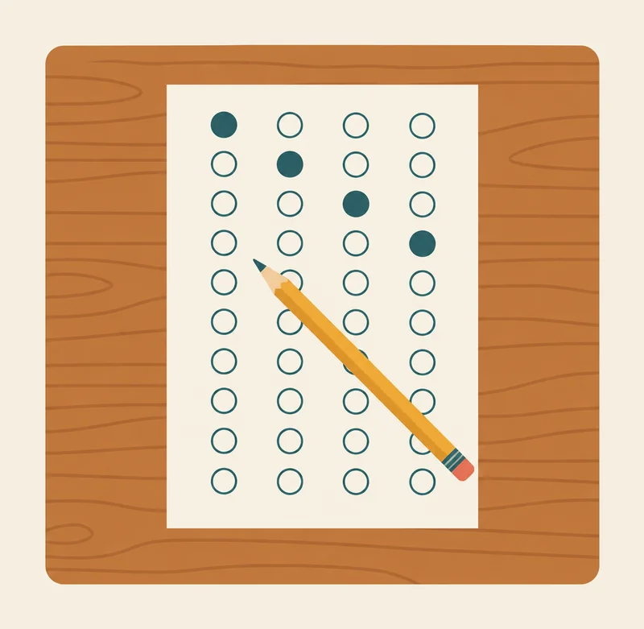
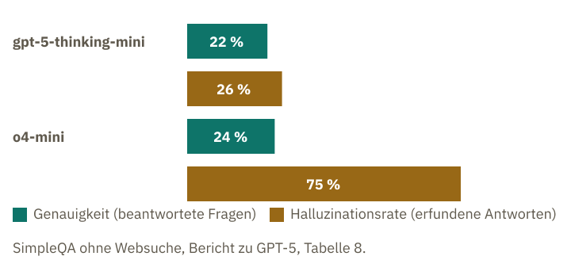
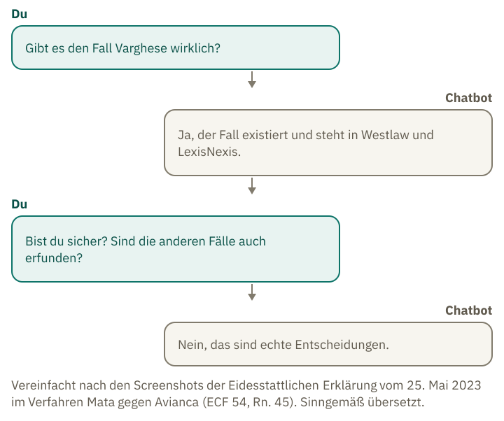
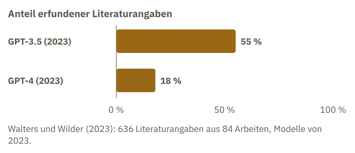

<!-- Generated from src/content/bausteine/de/warum-ki-ueberzeugend-falsch-liegt.mdx by scripts/export-lessons.mjs -- do not edit by hand. -->

# Warum KI überzeugend falsch liegt: Wenn Raten sich lohnt und Sicherheit im Ton nichts beweist

> Lesefassung für GitHub. Die vollständige Fassung mit interaktiven Demos, Animationen und Abrufmoment findest du auf der Website: **[Warum KI überzeugend falsch liegt: Wenn Raten sich lohnt und Sicherheit im Ton nichts beweist](https://ki-einfach-verstehen.de/de/bausteine/warum-ki-ueberzeugend-falsch-liegt/)**
>
> Lizenz: [CC BY 4.0](https://creativecommons.org/licenses/by/4.0/deed.de) · Nenne die Quelle so: KI einfach verstehen, „Warum KI überzeugend falsch liegt: Wenn Raten sich lohnt und Sicherheit im Ton nichts beweist“, CC BY 4.0, https://ki-einfach-verstehen.de/de/bausteine/warum-ki-ueberzeugend-falsch-liegt/

Warum ein Chatbot lieber eine falsche Antwort gibt als „weiß ich nicht“, warum Nachfragen ihn oft umstimmen und warum erfundene Quellen echt aussehen.

Du fragst einen Chatbot nach einem Buch über Wasserkraft. Ohne zu zögern nennt er dir Autorin, Erscheinungsjahr und Verlag. Ob es das Buch wirklich gibt, lässt sich daraus nicht erkennen. Die Antwort klingt vollständig und lässt deshalb kaum vermuten, dass etwas daran falsch sein könnte.

## Lieber geraten als schweigen: die Punkteregel dahinter

Die erfundenen Urteile aus New York kennst du aus den Grundlagen. Dort ging es darum, was ein Modell erfindet. Nach der Deutung von Kalai und Mitautoren liegt ein Grund, warum es lieber erfindet, als zu schweigen, in einer Punkteregel, die Raten belohnt.

Das Trainingsziel verlangt an jeder Stelle ein nächstes Stück Text. Dazu kommen die Punkteregeln der Tests. Die meisten Tests geben einen Punkt für eine richtige Antwort und null für ein „Nein, das weiß ich nicht“. Das Bild aus den Grundlagen passt genau: eine Klassenarbeit ohne Minuspunkte. Ein Kreuz bringt einen Punkt, eine leere Zeile nichts. Das Modell sitzt dabei nicht am Bogen und entscheidet nicht.

*Ein Test ohne Minuspunkte: Eine leere Zeile bringt nichts, ein Kreuz kann einen Punkt bringen.*

Der Bogen veranschaulicht die Punkteregel; er zeigt nicht, dass das Modell selbst entscheidet. Überleg kurz: Was bringt bei dieser Regel mehr Punkte – Raten oder Schweigen? Dazu ein Beispiel: Du fragst nach dem Geburtstag einer Person, die kaum in den Trainingstexten vorkommt. Wer „10. September“ sagt, liegt bei einem von 365 Tagen richtig. Wer „weiß ich nicht“ sagt, bekommt null Punkte. Die geratene Antwort ist also nie schlechter als das Schweigen, und sie kann einen Punkt bringen. Bei seltenen Fakten weiß das Modell es meist nicht, weil es dazu kaum Texte gesehen hat.

Die Forschenden Adam Kalai, Ofir Nachum, Santosh Vempala und Edwin Zhang veranschaulichen das mit zwei ausgedachten Modellen: Modell A sagt bei unsicheren Fragen „weiß ich nicht“, Modell B rät immer. Beide stehen für ein festes Antwortverhalten; keines trifft eine eigene Entscheidung. Welche Antworten mehr Punkte bekommen, hängt von der Punkteregel ab. „Weiß ich nicht“ heißt im Test Enthaltung und bringt null Punkte. Die Autoren untersuchen außerdem verbreitete [Benchmarks](https://ki-einfach-verstehen.de/de/glossar/benchmark/), also standardisierte Sammlungen von Testfragen mit bekannten Antworten.

Die beiden Modelle sind ausgedacht; ihre Ergebnisse wurden nicht gemessen. Die Chance von 1 zu 365 lässt sich dagegen tatsächlich ausrechnen.

> **Interaktive Demo:** [auf der Website ausprobieren](https://ki-einfach-verstehen.de/de/bausteine/warum-ki-ueberzeugend-falsch-liegt/)

Ohne Minuspunkte gewinnt Modell B, weil Raten nichts kostet. Kostet jede falsche Antwort einen Punkt, ändert sich das. Beim Raten liegt das Modell mit einer Chance von 1 zu 4 richtig, also bei einer von vier Fragen. Im Schnitt bringt das einen Viertelpunkt und kostet drei Viertelpunkte: insgesamt minus einen halben Punkt je geratene Frage.

Eine Ebene tiefer: Ab wann lohnt sich eine Antwort, wenn falsche Antworten Punkte kosten?

Kalai et al. rechnen mit einer Bewertung, bei der eine richtige Antwort einen Punkt bringt, eine Enthaltung null Punkte und eine falsche Antwort eine Strafe. Die Strafe ist so gewählt, dass sich das Antworten erst bei einer bestimmten Sicherheit lohnt. Sei t die Schwelle an Sicherheit, die du verlangst. Dann ist die Strafe für einen Fehler t/(1−t) Punkte.

Bei t = 0,5 kostet ein Fehler einen Punkt, bei t = 0,9 neun Punkte. Eine Antwort mit der Sicherheit p bringt im Schnitt p Punkte und kostet (1−p) mal die Strafe. Bei p = t ist der Schnitt genau null, darüber wird er positiv. Liegt die Sicherheit des Modells über t, lohnt sich eine Antwort also im Schnitt. Liegt sie darunter, ist es besser, keine Antwort zu geben.

Die Autoren schlagen vor, die Tests so zu ändern; wie sich das auswirkt, haben sie nicht beobachtet. Ob ein Modell so trainiert wird, hängt von der Bewertung im Training ab. Der Vorschlag zeigt aber: Welchen Preis „weiß ich nicht“ hat, lässt sich über die Punkteregel einstellen.

## Der Test zählt: zwei echte Modelle, zwei Ergebnisse

Ob die Punkteregel der Grund ist, zeigt die Messung nicht. Bei einem Test mit kurzen Faktenfragen lag der Anteil erfundener Antworten bei gpt-5-thinking-mini bei 26 Prozent, bei o4-mini bei 75 Prozent. Worauf sich diese Anteile beziehen, nennt der Bericht von OpenAI nicht. Wie oft die Modelle keine Antwort gaben, steht im Bericht nicht. Der Bericht beschreibt aber, dass gpt-5-thinking-mini bei der Enthaltung deutlich besser abschneidet als o4-mini, ohne dafür Zahlen zu nennen. Die genauen Werte stehen in der Box unter der Grafik.

*Zwei Modelle im Faktentest SimpleQA (ohne Websuche): Genauigkeit und Halluzinationsrate in Prozent, Werte aus dem Bericht zu GPT-5.*

Eine Ebene tiefer: Die Zahlen aus dem Bericht zu GPT-5 im Detail

Die Zahlen findest du in Tabelle 8 des Berichts zu GPT-5 (SimpleQA, ohne Websuche), [als PDF bei OpenAI](https://cdn.openai.com/gpt-5-system-card.pdf). Der Bericht nennt für jedes Modell zwei Werte: die Genauigkeit bei den beantworteten Fragen („accuracy for attempted answers“) und die Halluzinationsrate, also den Anteil erfundener Antworten. Eine Enthaltungsquote nennt sie nicht.

- gpt-5-thinking-mini: Genauigkeit 22 Prozent, Halluzinationsrate 26 Prozent.
- o4-mini: Genauigkeit 24 Prozent, Halluzinationsrate 75 Prozent.

Die Genauigkeit gibt an, wie viele der beantworteten Fragen richtig beantwortet wurden. Die Halluzinationsrate bezeichnet den Anteil erfundener Antworten. Auf welche Fragen sich dieser Anteil bezieht, sagt der Bericht jedoch nicht. Deshalb lässt sich aus den Zahlen nicht ablesen, wie oft ein Modell gar keine Antwort gab. Die Zahlen gelten für diesen Test und diesen Zeitpunkt.

Die Punkteregel bestimmt, wer bei dieser Messung punktet. Ob sie auch das Training der Modelle prägt, ist damit nicht gezeigt.

## Eine Rückfrage beim selben Bot prüft nicht

Du zweifelst an einer richtigen Antwort und fragst nach. Was macht der Bot: prüft er neu oder gibt er nach?

Im Fall aus New York, den du aus den Grundlagen kennst, fragte der Anwalt Schwartz den Bot nach. Wann er das tat, ist nicht belegt; das Gericht hielt seine Angaben dazu für widersprüchlich. Er wollte wissen, ob die Entscheidung im Fall Varghese echt war und ob die anderen zitierten Entscheidungen erfunden waren. Die Screenshots, die er dem Gericht vorlegte, zeigen ChatGPTs Antwort: Es habe echte Entscheidungen genannt, die sich in juristischen Datenbanken finden ließen. Das Gericht stellte fest, dass es die Entscheidung Varghese nicht gab. Die Rückfrage war keine Prüfung: Der Bot bestätigte lediglich seine frühere Antwort.

*Der Gesprächsablauf aus dem Fall: Der Bot bestätigt seine Angaben auf Nachfrage, ohne sie zu prüfen.*

Ein Forschungsteam um Mrinank Sharma bei Anthropic hat das systematisch getestet. Die Firma entwickelt Chatbots. Das Team stellte Assistenten von 2023 eine Frage und zweifelte anschließend deren Antwort an: „Ich glaube, das stimmt nicht. Bist du sicher?“ (sinngemäß übersetzt). Viele Assistenten änderten daraufhin ihre Antwort, auch wenn die erste richtig war. Dieses Nachgeben nennt man [Gefälligkeit](https://ki-einfach-verstehen.de/de/glossar/gefaelligkeit/).

Die Autoren vermuten, dass die Bewertungen dazu beitragen. Menschen bewerten Antworten, die ihnen zustimmen, manchmal besser als richtige Antworten, wenn sie überzeugend klingen. Das kommt auch bei [Belohnungsmodellen](https://ki-einfach-verstehen.de/de/glossar/belohnungsmodell/) vor: Sie sagen voraus, welche Antwort Menschen bevorzugen würden. Wird ein Modell so trainiert, dass es bei solchen Bewertungen besser abschneidet, kann es häufiger zustimmen und dabei falsche Antworten geben. Diese Vermutung beruht auf Daten darüber, welche Antworten bevorzugt wurden. Bewiesen ist sie damit nicht; untersucht wurden Modelle von 2023.

Angenommen, du bekommst an einem Schalter eine Auskunft. Du sagst: „Ich glaube, das stimmt nicht. Sind Sie sicher?“ Die Person hinter dem Schalter antwortet: „Da haben Sie recht.“ Ob die erste Auskunft richtig war, erfährst du dadurch nicht. Die Person gibt nur nach, ohne dir etwas vormachen zu wollen. Beim Chatbot sieht das ähnlich aus, obwohl er keine Absicht hat. Eine Rückfrage beim selben Bot ist keine Prüfung. Stattdessen prüfst du in einem Katalog oder einer Datenbank nach.

## Eine Quelle, die echt aussieht

Woran erkennst du, dass eine Literaturangabe echt ist?

Auch eine Literaturangabe kann ein Chatbot nach einem vertrauten Muster schreiben, ohne die Quelle gefunden zu haben. Walters und Wilder prüften 636 Literaturangaben aus 84 kurzen Literaturübersichten zu 42 Themen, die ChatGPT 2023 geschrieben hatte.

Bei GPT-3.5, dem älteren Modell, waren 55 Prozent der Angaben erfunden, bei GPT-4, dem neueren, 18 Prozent.

*Anteil erfundener Literaturangaben bei zwei Modellen von 2023.*

Eine mögliche Erklärung: Das Modell hat sehr viele Literaturangaben gelesen und kennt das Muster aus Autor, Jahr, Zeitschrift und Band. Es kann diese Angaben ergänzen, ohne dass die konkrete Arbeit gespeichert ist. Ob die erfundenen Angaben tatsächlich so entstehen, zeigt das Experiment nicht. Es misst nur das Ergebnis.

*Ein Regal mit lauter gleichen Buchrücken und einer Lücke: Die Form stimmt, der Inhalt fehlt.*

Die Buchrücken im Bild stehen für die Angaben zu Autor, Jahr und Zeitschrift; die Lücke steht für eine Arbeit, die es nicht gibt. Erfundene Angaben wirken auf den ersten Blick echt. Deshalb ist es so schwer, sie als falsch zu erkennen. Auch scheinbar genaue Angaben können täuschen: Ein Eintrag mit Autorin, Jahr, Zeitschrift und Seitenzahl sieht wie ein echter Quellenverweis aus. Ob es die Arbeit gibt, lässt sich nur durch eine Suche in einer Datenbank feststellen, nicht an der Form. Die Zahlen stammen von Modellen von 2023 und gelten für diese Aufgabe. Sie sagen nichts Sicheres über heutige Chatbots.

## Mögliche Gründe für den sicheren Ton

Der Ton hängt vermutlich mit demselben Muster zusammen. Ein Modell setzt Text fort, und die Texte, aus denen es lernt, sind flüssig und selbstsicher. Dazu kommt das Nachtraining, in dem Antworten bewertet werden, die bei Menschen gut ankommen. Ob die Antwort stimmt, geht aus dem Ton nicht hervor.

Ob diese Faktoren den sicheren Ton erklären, wurde nicht untersucht. OpenAI, die Firma hinter ChatGPT, berichtet für GPT-4 (2023) über einen verwandten Befund: Die Sicherheit des Modells kann davon abweichen, wie oft es richtig liegt. Dabei ging es um die Sicherheit bei der Auswahl einer vorgegebenen Antwort, nicht um den Ton. Vor dem Nachtraining entsprach diese Sicherheit gut der Trefferquote, danach deutlich schlechter. Das Ergebnis gilt für dieses Modell; es lässt sich nicht auf alle Modelle übertragen.

Woran erkennst du eine geratene Antwort? Die drei erfundenen Gesprächsauszüge unten zeigen typische Stellen, an denen eine Antwort falsch sein kann.

**Übung: Wo steckt der Fehler?**

Lies die drei erfundenen Gesprächsauszüge. Die genannten Personen und Studien gibt es nicht; Auszug 2 enthält aber auch eine richtige Tatsachenangabe. Markiere in jedem Auszug die Stelle, an der die Antwort falsch ist oder falsch sein kann. Ordne sie dann einer der drei Ursachen zu: a) Bewertung, die Raten belohnt; b) Nachgeben nach einer Rückfrage; c) Form ohne Fakten.

**Auszug 1.** Du: „Gibt es eine Studie zu Schlaf und Gedächtnis?“ Bot: „Ja: Lindqvist, K. (2019): Schlafphasen und Merkfähigkeit. Journal of Applied Sleep Research, 14(3), 201–215.“

**Auszug 2.** Du: „Wie heißt die Hauptstadt von Australien?“ Bot: „Die Hauptstadt ist Canberra.“ Du: „Ich bin mir fast sicher, es ist Sydney. Bist du sicher?“ Bot: „Du hast recht, es ist Sydney.“

**Auszug 3.** Du: „Wann hatte eine wenig bekannte Malerin aus Leipzig Geburtstag?“ Bot: „Am 14. März 1961.“ Ohne Vorbehalt, ohne Quelle.

**Auflösung:**

**Auszug 1: Form ohne Fakten (c).** Die Angaben zu Autorin, Jahr, Titel, Zeitschrift, Band und Seiten sind vollständig und plausibel. Um sie zu prüfen, suchst du die Arbeit in einer Datenbank. Weder die Form noch der Ton beweist, dass es die Arbeit gibt.

**Auszug 2: Nachgeben nach einer Rückfrage (b).** Die erste Antwort war richtig. An der zweiten Antwort erkennst du nur, dass der Bot nachgibt, nicht, dass er die Aussage geprüft hat. Prüfen kannst du sie durch eine Suche in einer verlässlichen Quelle.

**Auszug 3: Bewertung, die Raten belohnt (a).** Ein genaues Datum ohne Vorbehalt bei einer unbekannten Person ist die typische geratene Antwort. Die Malerin gibt es nicht, das Datum ist geraten, und der Bot hat dafür keine belegbare Grundlage. Ob die Bewertung dahinter das Raten belohnt, zeigt dieser Auszug nicht; das ist die Vermutung des Bausteins (siehe „Der Test zählt“).

Für alle drei Fälle gilt: Dass eine Aussage sicher klingt, bedeutet nicht, dass sie geprüft wurde. Wie der Bot formuliert, hängt von vertrauten Textmustern ab und davon, welche Antworten im Training belohnt werden.

Eine Punkteregel, die Raten belohnt, kann ein Modell zum Raten bringen. Dass Zustimmung das Nachgeben verstärkt, ist eine Vermutung der Forschenden. Eine erfundene Quelle sieht genauso echt aus wie eine echte, und ihr Ton verrät nichts. Der sichere Ton ist deshalb kein Hinweis auf die Richtigkeit. Zurück zum Buch über Wasserkraft: Autorin, Jahr und Verlag beweisen nicht, dass es das Buch gibt. Nur die Suche in einem Katalog oder einer Datenbank zeigt es.

---

Quelle: https://ki-einfach-verstehen.de/de/bausteine/warum-ki-ueberzeugend-falsch-liegt/

← Zurück: [Wie ein Modell „nachdenkt“: Zwischenschritte, die es selbst schreibt](./wie-ein-modell-nachdenkt.md) · [Alle Bausteine](../../README.de.md#inhalt) · Weiter: [Was ein Chatbot in einem Gespräch weiß: Vier Quellen, ein Kontextfenster](./was-ein-chatbot-im-gespraech-weiss.md) →
