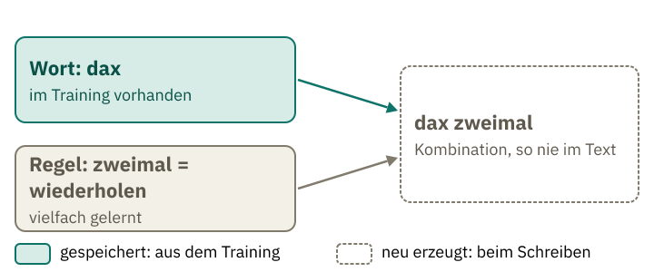
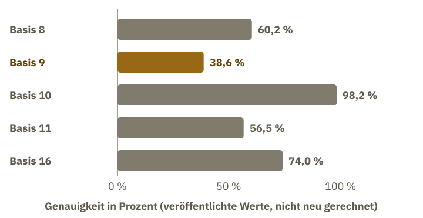

<!-- Generated from src/content/bausteine/de/warum-vorhersagen-mehr-ist-als-nachplappern.mdx by scripts/export-lessons.mjs -- do not edit by hand. -->

# Warum Vorhersagen mehr ist als Nachplappern

> Lesefassung für GitHub. Die vollständige Fassung mit interaktiven Demos, Animationen und Abrufmoment findest du auf der Website: **[Warum Vorhersagen mehr ist als Nachplappern](https://ki-einfach-verstehen.de/de/bausteine/warum-vorhersagen-mehr-ist-als-nachplappern/)**
>
> Lizenz: [CC BY 4.0](https://creativecommons.org/licenses/by/4.0/deed.de) · Nenne die Quelle so: KI einfach verstehen, „Warum Vorhersagen mehr ist als Nachplappern“, CC BY 4.0, https://ki-einfach-verstehen.de/de/bausteine/warum-vorhersagen-mehr-ist-als-nachplappern/

Wie ein Modell, das nur das nächste Token vorhersagt, eine Mail schreiben kann, die es so noch nie gab: warum gute Vorhersage Regeln statt Kopien verlangt, wo wörtliches Auswendiglernen trotzdem vorkommt und wo neue Aufgaben scheitern.

## Ein Satz, den es nie gab

Im Baustein [Aus Text werden viele Übungsaufgaben](./aus-text-werden-uebungsaufgaben.md) hast du gesehen, wie aus Text Übungsaufgaben werden: Das Modell rät das nächste [Token](https://ki-einfach-verstehen.de/de/glossar/token/), und die Gewichte werden nach jeder Korrektur verstellt.

Bitte ein Modell um eine Mail an deine Vermieterin über einen tropfenden Wasserhahn, im Stil eines Heldenepos. Ein ausgedachtes Beispiel, aber ein typisches. Die Mail kommt fertig zurück, mit Anrede, Versmaß und einem Schluss, der das Problem sachlich benennt. Nirgends steht dieser Wortlaut, es gab ihn vorher nicht.

Woher nimmt das Modell den Satz? Bei einem Satz, den es so noch nie gab, gibt es nichts zum Nachschlagen. So entsteht er: Die Bitte geht als Eingabe ins Modell. Mit seinen festen Gewichten berechnet es für jedes mögliche nächste Token einen [Score](https://ki-einfach-verstehen.de/de/glossar/score/), also eine Zahl, die angibt, wie gut dieses Token passt. Es wählt ein Token aus, hängt es an die Eingabe an und beginnt von vorn. Das wiederholt es, bis die Mail fertig ist.

Ob ein Modell etwas besitzt, das mit menschlichem Sprachgefühl vergleichbar ist, bleibt offen. Menschliches Sprachgefühl ist mit Absichten, Erfahrungen und Bedeutung verbunden. Diese Frage lässt sich hier nicht beantworten. Hier geht es darum, dass ein neuer Satz auch ohne gespeicherte Kopie entstehen kann.

Ein Bild dafür ist das Sprachgefühl. Eine Muttersprachlerin baut beim Sprechen einen Satz, den sie in dieser Form nie gehört hat. Sie kennt Wörter und Regeln, und sie weiß, wie ein richtiger Satz klingt. Den fertigen Satz trägt sie nicht im Kopf, er entsteht Wort für Wort. Die Sprecherin muss nicht jeden Satz einzeln gehört haben. Wörter und Regeln reichen, und daraus folgen viele Sätze, die es vorher nicht gab. Im Modell entsprechen die Wörter und Regeln den gespeicherten Gewichten. Der fertige Satz dagegen ist die Ausgabe, die erst beim Schreiben entsteht.

*Eine Muttersprachlerin formuliert einen Satz, den sie so noch nie gehört hat. Sie kennt die Wörter und die Regeln, nicht den Satz.*

Wenn das Modell den Satz nicht nachschlägt, muss er aus dem Gelernten entstehen. Wie viel Text passt überhaupt in das Gelernte? Wenn wenig hineinpasst, bleibt vor allem das Muster übrig; oft wiederholte Stellen können aber auch wörtlich haften. Das lässt sich nachrechnen. Die Wörter und Regeln waren vorher da, der Satz nicht. Genau das unterscheidet Bilden von Kopieren. Im Alltag heißt das: Ein Text, den du bestellst, ist fast immer neu, auch wenn das Thema längst bekannt ist. Neu heißt aber nicht richtig: Das Modell wählt Wort für Wort nach Wahrscheinlichkeit, und das sagt noch nichts darüber, ob ein Fakt stimmt. Deshalb lohnt es sich, Fakten in jeder Antwort selbst nachzuprüfen.

## Die Trainingsdaten sind viel größer als die Gewichte

Die Trainingsdaten der Qwen3-Modellfamilie umfassen rund 36 Billionen Tokens. Der technische Bericht nennt diese Menge für die ganze Familie, nicht für das kleinste Modell allein. Das kleinste, Qwen3-0.6B, hat 0,6 Milliarden [Parameter](https://ki-einfach-verstehen.de/de/glossar/parameter/), einschließlich der Einbettung (dem Zahlen-Steckbrief jedes Tokens). Diese Zahlen sind die Gewichte. Im Mischpult-Bild aus dem Baustein über Modelle heißen sie Regler.

Ein [Token](https://ki-einfach-verstehen.de/de/glossar/token/) ist ein Stück Text, meist ein Wortteil oder ein ganzes Wort. Ein Byte ist die kleinste Speichereinheit, in der Computer Text ablegen. Qwen3 zerlegt Text auf Byte-Ebene, und jedes gewöhnliche Token ist dabei mindestens ein Byte lang. Damit lässt sich eine Untergrenze rechnen, ohne zu wissen, wie viele Bytes ein Token im Schnitt hat.

Die 0,6 Milliarden Zahlen des kleinsten Modells brauchen je 2 Byte (das Zahlenformat BF16), also rechnerisch rund 1,2 Gigabyte. Die Trainingsdaten der Familie umfassen insgesamt 36 Billionen Tokens. Jedes Token ist mindestens ein Byte lang. Eine Billion Bytes sind ein Terabyte, eine Milliarde Bytes ein Gigabyte. Also sind die 36 Billionen Tokens mindestens 36 Terabyte, rund 30.000-mal so viel wie die 1,2 Gigabyte der Gewichte. Dieser Vergleich mit den Gewichten des kleinsten Modells zeigt nur die ungefähre Größenordnung. Wie viel unterschiedlicher Text in den Trainingsdaten steckt, gibt der Bericht nicht an.

> **Interaktive Demo:** [auf der Website ausprobieren](https://ki-einfach-verstehen.de/de/bausteine/warum-vorhersagen-mehr-ist-als-nachplappern/)

Der Text wird in der Regel nicht als Kopie in die Gewichte geschrieben. Eine verlustfreie Datei dagegen enthält jeden Satz und gibt ihn exakt zurück. Das Modell speichert keine Datei dieser Art, sondern Einstellungen, mit denen es Fortsetzungen berechnet. Wörtliche Wiedergabe kommt trotzdem vor, dazu gleich mehr.

Woher kommt die Untergrenze von 36 Terabyte?

Computer speichern Text als Bytes. Ein Byte hat 256 mögliche Werte. Byte-level heißt, dass der Tokenizer mit genau diesen 256 Grundwerten beginnt. Damit lässt sich jeder Text ohne unbekannte Zeichen darstellen. Byte-pair encoding fasst dann häufige Folgen zu neuen Einträgen im Vokabular zusammen, etwa ein ganzes Wort. Der Bericht nennt für Qwen3 ein Vokabular von 151.669 Einträgen.

Ein häufiges Wort kann ein einziges Token bilden, obwohl es mehrere Buchstaben und damit mehrere Bytes umfasst. Meist enthält ein Token deshalb mehr als ein Byte. Wie viele es sind, hängt von der Sprache und vom Vokabular ab; das wurde hier nicht gemessen. Sondertokens, etwa für Chat-Rollen, tragen keinen Textinhalt und sind in der Rechnung nicht berücksichtigt. Für die Rechnung genügt die Untergrenze: Auch dann ist der Text um ein Vielfaches größer als die Gewichte.

## Wörtlich kommt es trotzdem vor

Die Rechnung beschreibt den Normalfall. Wörtliche Kopien sind damit nicht ausgeschlossen, und sie kommen vor.

Carlini und andere haben aus GPT-2 XL, einem Modell mit 1,5 Milliarden Parametern, Texte gewonnen, die wörtlich im Training standen. Dafür ließen sie das Modell gezielt 1.800 Texte erzeugen und prüften, wie viele davon wörtlich aus dem Training stammten: 604. Die Zahl beschreibt also die Auswahl, nicht die Häufigkeit im Alltag.

Wenn eine Stelle im Training oft vorkommt, prägt sie sich stärker ein. Das passiert etwa bei Texten, die im Netz viele Male kopiert wurden. Lee und andere entfernten doppelte Texte aus den Trainingsdaten und verglichen die Modelle. Nach dieser Bereinigung gaben die Modelle auswendig gelernte Passagen rund zehnmal seltener wieder. Vorher waren über 1 Prozent der Tokens, die das Modell ohne Vorgabe selbst schrieb, wörtlich aus dem Training kopiert. Nach dem Entfernen der doppelten Texte waren es 0,1 Prozent.

Mehr neuer Text hilft gegen Auswendiglernen, wie der Baustein [Batch, Epoch, Step und Tokenbudget](./batch-epoch-step-tokenbudget.md) zeigt. Viele Kopien derselben Stelle wirken dagegen ähnlich wie wiederholte Durchgänge durch dieselben Texte (Epochen); das ist ein Vergleich, keine Messung. Doppeltes zu entfernen wirkt gegen das Auswendiglernen.

McCoy und andere haben Sprachmodelle genauer untersucht. Sie gaben gelegentlich Passagen mit mehr als 1.000 Wörtern aus dem Training wieder. Das ist eine Stichprobe, und sie zeigt, dass Auswendiglernen bei großen Textstücken möglich ist, aber nicht die Regel ist.

## Neuer Satzbau aus bekannten Wörtern

Wenn das Modell nicht nur kopiert, was tut es dann? Ob die Sätze, die es schreibt, überhaupt neu sind, lässt sich messen. McCoy und andere haben dafür nicht nur gezählt, ob ein Satz im Training vorkam. Sie haben den Satzbau gemessen: die Reihenfolge der Wortarten und die Satzstruktur als Baum aus Haupt- und Nebensätzen. Satzbau meint hier also den Bauplan aus Wortarten und Satzgliedern, nicht die Bedeutung.

Bei vier getesteten Sprachmodellen hatten knapp zwei Drittel bis gut drei Viertel der erzeugten Sätze einen Bau, den kein Trainingssatz hatte. Bei menschlichen Texten lag der Anteil ähnlich hoch. Neu ist also oft der Bau eines Satzes, und das gilt für Modelle und für Menschentexte gleichermaßen.

Bei kurzen Wortfolgen zeigt sich allerdings ein Unterschied: Die Modelle erzeugen weniger neue Kombinationen als Menschen. Der menschliche Vergleichstext enthielt rund anderthalb- bis dreimal so viele neue Wortpaare (Bigramme) wie die Texte jedes getesteten Modells. Erst bei Folgen von fünf Wörtern und mehr ist bei allen Modellen die Mehrzahl der Folgen neu. Die Arbeit untersuchte Modelle von 2021. Was heutige große Modelle genau tun, misst sie nicht.

Aus den Scores macht [Softmax](https://ki-einfach-verstehen.de/de/glossar/softmax/) Wahrscheinlichkeiten. Das Modell wählt eines der wahrscheinlichen Tokens und hängt es an. Dabei wirkt vor allem, was sich über viele Sätze als Regel zeigt. Einzelne, oft wiederholte Wortfolgen können dagegen auch wörtlich gespeichert sein, wie im Abschnitt über wörtliche Kopien beschrieben. Ein ausgedachtes Beispiel: Das Modell hat aus vielen Texten gelernt, dass nach einem Komma oft ein Nebensatz folgt, dessen Verb oft am Ende steht. Schreibt es einen Satz mit Komma, wendet es diese Regel an, auch auf Wörter, die in dieser Verbindung nie vorkamen. Etwa der Satz „Ich kam zu spät, obwohl ich früh losging.“: Er wäre neu, die Regel dahinter nicht.

Zufall spielt eine Rolle, weil das Modell nicht immer das wahrscheinlichste Token nimmt. Der Zufall wählt aber nur unter den passenden Stücken; er erfindet keine Regeln. Viele Antworten im Chat entstehen so.

## Neu aus Bekanntem

Für Menschen ist es alltäglich: Wer das erfundene Verb „dax“ in mehreren Sätzen gesehen und die Regel „zweimal“ schon kennt, versteht „dax zweimal“: Das Verb wird also zweimal ausgeführt. Das Beispiel stammt aus der Einleitung von Lake und Baroni (2018), die diese Fähigkeit als Systematik beschreiben: bekannte Teile neu zu kombinieren.

*Bekannte Teile, neu zusammengesetzt: Das Wort ist im Training zusammen mit anderen Wörtern vorhanden, die Regel ist vielfach gelernt. Die Kombination entsteht beim Schreiben.*

Die Kombination gelingt, wenn das Modell das Verb auch zusammen mit anderen Wörtern gesehen und die Regel gelernt hat. Lake und Baroni haben das mit einer künstlichen Befehlssprache getestet. Sie teilten die Aufgaben zunächst zufällig auf Trainings- und Testdaten auf. Dabei kam jedes Wort im Training in vielen Zusammenhängen vor. Bei dieser Aufteilung beantwortete das beste Netz 99,8 Prozent der Aufgaben richtig. In einem anderen Test kam das Verb im Training nur allein vor, nie zusammen mit anderen Wörtern. Dort beantwortete das beste Netz dieses Versuchs 1,2 Prozent der Aufgaben richtig.

Die Studie zeigt eine Grenze einfacherer Netze; heutige Modelle wurden darin nicht getestet. Im Chat stellt sich eine ähnliche Frage: Reicht das Gelernte etwa für ein Gedicht über ein Thema, zu dem es noch nie eines gab? Wie gut heutige Chat-Modelle solche Aufgaben lösen, lässt sich aus diesem Versuch nicht ablesen.

## Beispiele im Prompt

Du gibst einem Modell im [Prompt](https://ki-einfach-verstehen.de/de/glossar/prompt/) drei Beispiele für eine erfundene Wortregel und bittest es um ein weiteres Wort. Oft gelingt es. Hat das Modell dabei gelernt?

Eine Studie zu GPT-3 (Brown und andere, 2020) hat genau das untersucht. Das Modell bearbeitete die Aufgaben, ohne dass seine Gewichte verändert wurden. Es wurde dafür also nicht eigens nachtrainiert. Aufgaben und Beispiele erhielt es ausschließlich als Text in der Eingabe. Dafür hat sich der Begriff [In-Context-Lernen](https://ki-einfach-verstehen.de/de/glossar/in-context-lernen/) eingebürgert: Ein Modell übernimmt Muster aus den Beispielen in der Eingabe. Dauerhaft gelernt wird dabei nichts; die Gewichte bleiben gleich.

*Drei Beispielblätter liegen vor der Aufgabe. Der Schreibtisch, also das Modell mit seinen festen Gewichten, bleibt derselbe.*

Erinnerst du dich an das Mischpult aus dem Baustein über Modelle? Die Regler, also die Gewichte, stehen fest, und die Anzeigen zeigen bei jedem Text neu die Zwischenwerte. Ein Prompt mit Beispielen gehört zur Eingabe. Er ändert die Anzeigen, nicht die Gewichte. Wie im Baustein über Input und Output geht dabei das ganze Gespräch als Eingabe hinein. Die Beispiele wirken über ihren Inhalt: Was in ihnen steht, bestimmt das Muster, das das Modell übernimmt. Wer also mit Beispielen arbeitet, sollte sie so wählen, wie die Aufgabe gemeint ist.

Die Messung zeigt, dass die Antwort sich mit den Beispielen ändert, während die Gewichte bei diesem Verfahren unverändert bleiben. Ob das für heutige, nachtrainierte Modelle genauso gilt, zeigt diese Messung nicht. Sie stammt von GPT-3 und aus einer begrenzten Zahl von Aufgaben.

Viele glauben, das Modell lerne aus dem Gespräch dauerhaft dazu. Das Verfahren ändert die Gewichte aber nicht; die Beispiele wirken nur in dieser Eingabe. Was ein Chat-Dienst zusätzlich speichert, ist eine andere Frage und steht nicht in den Regeln des Modells.

## Wenn die Aufgabe leicht anders ist

Was passiert, wenn eine Aufgabe, die das Modell schon kann, nur leicht verändert wird?

Wu und andere haben GPT-4 zweistellige Additionen in verschiedenen Zahlensystemen gestellt. Das Verfahren ist in jeder Basis dasselbe, nur die Ziffern ändern sich. In Basis 9 gibt es die Ziffern 0 bis 8. Die Aufgaben wurden mit einer Schritt-für-Schritt-Antwort (Chain-of-Thought) und ohne Beispiele gestellt. Wie stark die Genauigkeit von der Basis abhängt, zeigt die Grafik unten.

> **Interaktive Demo:** [auf der Website ausprobieren](https://ki-einfach-verstehen.de/de/bausteine/warum-vorhersagen-mehr-ist-als-nachplappern/)

*Veröffentlichte Werte: Genauigkeit der Addition in fünf Zahlensystemen, GPT-4 mit Schritt-für-Schritt-Antwort. Basis 9 fällt deutlich zurück.*

Die Werte stammen von einem einzigen Modell im Test von 2023 und sagen nicht, dass KI nicht rechnen kann.

Wu und andere ordnen die Basen 8 und 16 als häufig, 9 und 11 als selten ein. Als Ursache vermuten sie eine Überanpassung, also dass das Modell sich zu stark an die häufigen Muster des Trainings anpasst. Das ist eine Deutung der Autoren, kein gesichertes Ergebnis. Die Regel ist in allen Basen dieselbe. Ob das Muster aus dem Training die Ursache ist, bleibt offen.

Auch dieses Ergebnis stammt aus einem einzelnen Test. Er zeigt: Ein Modell kann eine Rechnung in der üblichen Form richtig lösen und an derselben Aufgabe in einer seltenen Form scheitern. Wie weit sich das auf andere Aufgaben übertragen lässt, zeigt der Test nicht.

## Bewerten ist auch Vorhersage

Ein Modell beantwortet nicht nur Fragen. Es kann auch Antworten beurteilen, etwa wenn du zwei Entwürfe vergleichst. Zheng und andere haben geprüft, wie gut ein starkes Modell als Bewerter arbeitet. Man kann sich den Bewerter wie einen Richter vorstellen, der Akten liest und ein Urteil fällt. Der Vergleich hinkt: Ein Richter kennt die Regeln, ein Bewerter-Modell schreibt sein Urteil wie jeden anderen Text.

Man kann das Urteil als Fortsetzung eines Textes lesen, der so ein Urteil enthalten würde. Das ist eine Deutung, kein gemessener Befund. Gemessen ist dies: GPT-4 stimmte mit menschlichen Bewertungen etwa so oft überein wie Menschen untereinander: 85 gegen 81 Prozent, wenn eine der beiden Antworten als besser gilt. „Unentschieden“ heißt, dass beide Antworten gleich gut sind. Zählt man dieses Unentschieden als eigenes Ergebnis mit, sinkt die Übereinstimmung von GPT-4 auf 66 Prozent.

Das Urteil kann allerdings auch davon abhängen, wie die Antworten präsentiert werden. Bei Zheng und anderen war dieser Effekt deutlicher, wenn die verglichenen Modelle ähnlich stark waren, und fast verschwunden, wenn ihre Leistung sehr verschieden war. Vertauscht man die Reihenfolge der beiden Antworten, bleibt das Urteil bei GPT-4 meist gleich. Bei einem anderen Modell war das seltener der Fall, und es bevorzugte oft die erste Antwort (Standard-Prompt, Modelle von 2023).

Auch die Länge kann eine Rolle spielen, zumindest in einem kleinen Test. In einem kleinen Test, in dem Antworten eine Liste aufblähten, wählten zwei ältere Modelle die aufgeblähte Antwort deutlich häufiger als GPT-4. Die Stichprobe ist klein.

Für den Alltag heißt das: Wenn ein Modell zwei Entwürfe bewerten soll, lohnt sich ein zweiter Durchgang mit vertauschten Entwürfen. Stimmt das Urteil dann nicht überein, ist die Bewertung unsicher. Der zweite Durchgang zeigt, dass die Reihenfolge mitentschieden hat; ob auch die Länge mitentschieden hat, prüft er nicht. Bei Texten, die wirklich zählen, bleibt die Prüfung durch einen Menschen nötig.

**Übung: Neu kombiniert oder wirklich fremd?**

Schätze bei jeder der vier Aufgaben ein, ob sie dem Modell eher gelingt oder eher nicht. Kann es dafür Bekanntes neu kombinieren, oder ist die Aufgabe zu fremd? Alle Fälle sind ausgedacht. Öffne die Auflösung erst nach deiner Einschätzung.

a) Ein Gedicht in der Form eines Kochrezepts über das Wetter an der Nordsee.
b) Eine Rechnung wie 47 + 38, aber in einer seltenen Zahlenbasis.
c) Eine erfundene Wortregel, die du im Prompt erklärst, mit drei Beispielen.
d) Eine Frage nach einem Ereignis, das nach dem Training passiert ist, ohne Quelle im Prompt.

**Auflösung:**

a) Eher ja. Form (Rezept) und Thema (Wetter) sind dem Modell einzeln vertraut. Neu ist die Kombination.

b) Eher nein. Die Regel ist dieselbe, aber die Form ist selten. Wu und andere zeigen, dass die Genauigkeit in einer anderen Basis deutlich fallen kann.

c) Eher ja. Die Regel steht im Prompt, und das Modell nutzt sie ohne Gewichtsänderung (Abschnitt Beispiele im Prompt).

d) Eher nein, aus einem anderen Grund. Das Ereignis liegt nach dem Training, das Modell hat es nicht gelernt. Ohne Quelle im Prompt fehlt die Grundlage. Hier fehlt das Wissen, nicht die Kombination.

Der Unterschied: Bekanntes neu zusammenzusetzen ist etwas anderes als Wissen, das fehlt.

## Neu ist der Satz, die Regel kommt aus dem Text

Zurück zur Mail an die Vermieterin. Der Satz ist neu, und doch entsteht er aus Mustern: Jedes Token ergab sich aus Mustern, die das Modell aus Texten gelernt hatte. Der Satz selbst war nicht gespeichert. Gespeichert waren die Gewichte, mit denen das Modell diese Muster beim Schreiben nutzt. Wörtliche Kopien kommen als Ausnahme vor.

Ob die Muster reichen, hängt von der Aufgabe ab. Bekanntes neu zu kombinieren gelingt oft, wenn Teil und Regel gelernt sind. Fremde Aufgaben und seltene Formen scheitern häufiger. Und Bewerten ist ebenfalls eine Vorhersage, mit allen Verzerrungen, die dazugehören.

Das Modell hat gelernt, Text fortzusetzen, und im Gespräch wirkt es trotzdem wie jemand, der antwortet. Wie aus einer Fortsetzung eine Antwort wird, darum geht es im nächsten Baustein.

---

Quelle: https://ki-einfach-verstehen.de/de/bausteine/warum-vorhersagen-mehr-ist-als-nachplappern/

← Zurück: [Batch, Epoch, Step, Tokenbudget: Wie man Trainingsfortschritt misst](./batch-epoch-step-tokenbudget.md) · [Alle Bausteine](../../README.de.md#inhalt) · Weiter: [Vom Textfortsetzer zum Assistenten: Was das Nachtraining aus einem Modell macht](./vom-textfortsetzer-zum-assistenten.md) →
