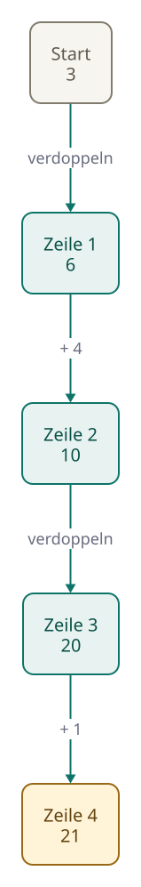
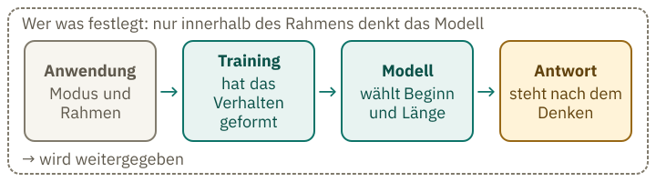

<!-- Generated from src/content/bausteine/de/wie-ein-modell-nachdenkt.mdx by scripts/export-lessons.mjs -- do not edit by hand. -->

# Wie ein Modell „nachdenkt“: Zwischenschritte, die es selbst schreibt

> Lesefassung für GitHub. Die vollständige Fassung mit interaktiven Demos, Animationen und Abrufmoment findest du auf der Website: **[Wie ein Modell „nachdenkt“: Zwischenschritte, die es selbst schreibt](https://ki-einfach-verstehen.de/de/bausteine/wie-ein-modell-nachdenkt/)**
>
> Lizenz: [CC BY 4.0](https://creativecommons.org/licenses/by/4.0/deed.de) · Nenne die Quelle so: KI einfach verstehen, „Wie ein Modell „nachdenkt“: Zwischenschritte, die es selbst schreibt“, CC BY 4.0, https://ki-einfach-verstehen.de/de/bausteine/wie-ein-modell-nachdenkt/

Warum ein Modell vor der Antwort Zwischenschritte als Text schreibt, warum das manche Aufgaben lösbar macht und wer festlegt, ob und wie lange es denkt.

Manche Chat-Apps zeigen beim Warten eine Zeile wie „denkt nach …“. Die Antwort kommt dann erst nach einer Pause. Was, vermutest du, passiert in dieser Zeit? Bevor du die Antwort siehst, kannst du nur raten. Dieser Baustein zeigt, was das Modell in der Pause schreibt, warum das eine Antwort verbessern kann und wer festlegt, ob es überhaupt denkt.

## Die Pause vor der Antwort ist Text

In der Pause schreibt das Modell Zwischenschritte als Text. Dabei tut es dasselbe wie bei jeder Antwort: Es schreibt Tokens, eines nach dem anderen. Erinnerst du dich an die [Textschleife](./input-und-output.md)? Das Modell liest den Text, wählt ein Stück aus und hängt es an. Beim Denken läuft dieselbe Schleife. Zuerst kommen Zwischenschritte, und erst danach beginnt die Antwort.

Diese Zwischenschritte heißen [Denk-Tokens](https://ki-einfach-verstehen.de/de/glossar/denk-tokens/). Sie sind Text wie jeder andere, nur dass die App sie meist nicht zeigt. Die [Tokenisierung](./tokenisierung-im-modell.md) zeigt schon, dass solche Ausgaben als Tokens zählen. Auch diese Zwischenschritte bestehen also aus Textstücken, die oft Wortteile sind. Sie belegen Platz im [Kontextfenster](https://ki-einfach-verstehen.de/de/glossar/kontextfenster/), auch wenn du sie nie liest.

*Oben steht die Aufgabe. Darunter folgen die Zeilen für die Zwischenschritte, bevor unten die Antwort beginnt. Ihr Bereich ist hier noch leer.*

Was bringen diese zusätzlichen Zeilen? Enthalten sie ein Zwischenergebnis, kann der nächste Schritt darauf aufbauen. Dann sind sie mehr als Fülltext. Das Modell liest seine eigenen Zwischenschritte beim nächsten Schritt wieder mit, wie jeden anderen Text im Gespräch. Du kennst das vom eigenen Rechnen: Wer eine Zwischensumme aufschreibt, muss sie nicht im Kopf behalten. Das Modell hält seine Zwischenergebnisse als Text fest, auf den es beim nächsten Schritt zurückgreift. Im Bild stehen deshalb die Zeilen zwischen der Eingabe oben und der Antwort unten.

Den Rechenaufwand für einen Zwischenschritt kannst du in Durchläufen zählen. Bei jedem Durchlauf verarbeitet das [Netz](https://ki-einfach-verstehen.de/de/glossar/transformer/) den Text mithilfe der gespeicherten Zahlen des Modells.

## Warum Zwischenschritte schwere Aufgaben lösbar machen

Nimm eine ausgedachte Aufgabe mit fünf Schritten: Starte mit 3. Verdopple das Ergebnis. Addiere 4. Verdopple wieder. Addiere 1. Jeder Schritt braucht das Ergebnis des vorigen. Man kommt also nur nacheinander zum Ende, nicht in einem Zug.

Ein Mensch schreibt in so einem Fall jedes Zwischenergebnis auf einen Zettel, Zeile für Zeile: erst 6, dann 10, dann 20, am Ende 21. Die Abbildung unten zeigt die Kette Schritt für Schritt. Der Zettel ersetzt das Kopfrechnen. Im Modell übernimmt der Text die Rolle des Zettels. Ein verborgenes zweites Rechenwerk gibt es dabei nicht: Die Zwischenergebnisse stehen als Text da, und das Netz liest sie beim nächsten Schritt. Er ist Text, den das Modell selbst geschrieben hat, und es liest ihn genauso wie jeden anderen Text. Jede neue Zeile hängt an den Zeilen davor. Deshalb hilft der Zettel überhaupt.

Ein Modell schreibt ein Token nach dem anderen. Für jedes neue Token durchläuft es das ganze [Netz](https://ki-einfach-verstehen.de/de/glossar/transformer/). Kaplan und Kollegen (2020) schätzen den Rechenaufwand pro Token auf etwa das Doppelte der Zahl der [Parameter](https://ki-einfach-verstehen.de/de/glossar/parameter/), also der gespeicherten Gewichte. Dazu kommt ein Aufwand, der mit der Textlänge wächst. Vereinfachend wird hier mit Durchläufen gerechnet: Ein Zwischenschritt besteht aus vielen Denk-Tokens, und jedes kostet einen weiteren Gang durch das Netz. Mehr Denk-Tokens heißt also mehr Arbeit.

Was ist ein Durchlauf?

Ein Durchlauf ist ein einziger Gang durch das Netz und liefert am Ende genau ein neues Token. Für jedes Token der Antwort und für jedes Denk-Token macht das Modell einen eigenen Gang. Der erste Gang rechnet die Eingabe; danach nur das neue Token. Frühere Zwischenwerte liegen im KV-Cache, einem Zwischenspeicher, und werden wiederverwendet. Der KV-Cache spart Rechenarbeit; die Zeit wächst trotzdem mit der Zahl der Gänge.

[▶ Animation auf der Website ansehen](https://ki-einfach-verstehen.de/de/bausteine/wie-ein-modell-nachdenkt/)

*Die Denkschritte als Kette mit den Zwischenergebnissen 3, 6, 10, 20, 21: Jede Zeile hängt an der vorigen und bleibt im Kontext, bis die Antwort beginnt. Mit „Weiter“ gehst du die Schritte durch.*

Eine Arbeit von 2024 zeigt das theoretisch für Transformer, die Netze hinter Chatmodellen. Hat ein solches Netz nur wenige Schichten, wenige Rechenstufen, kann es Aufgaben, die nur Schritt für Schritt lösbar sind, ohne Zwischenschritte nicht direkt lösen. Mit so vielen Zwischenschritten, wie die Aufgabe braucht, kann er solche Aufgaben lösen. Der Befund zeigt, was möglich ist, und sagt nichts darüber, was ein Modell im Alltag tut.

Die Methode heißt [Gedankenkette](https://ki-einfach-verstehen.de/de/glossar/gedankenkette/) oder Chain-of-Thought. Forschende bei Google zeigten 2022 mit handgeschriebenen Beispielen, dass sie die Trefferquote bei Grundschul-Textaufgaben hebt. Bei PaLM, einem Sprachmodell von Google, stieg sie von 17,9 auf 56,9 Prozent.

Die Methode wirkte nicht bei jedem Modell; Details zur Modellgröße stehen in der Box unten.

Eine Ebene tiefer: Ab welcher Modellgröße die Zwischenschritte helfen

Wei und Kollegen testeten die Methode mit PaLM, das 540 Milliarden Parameter hat. Sie gaben acht handgeschriebene Beispiele in den Prompt. In jedem Beispiel stand die Aufgabe, danach mehrere Zwischenzeilen und die Antwort. Auf GSM8K, einer Sammlung von Textaufgaben für die Grundschule, stieg die Genauigkeit deutlich. Das Modell wurde nicht nachtrainiert; es sah nur das Muster und schrieb die neue Aufgabe so.

Die Forschenden prüften auch kleinere Modelle. Erst ab etwa 100 Milliarden Parametern half die Methode. Die kleineren Modelle schrieben flüssige, aber unlogische Gedankengänge, die schlechter waren als der Standard-Prompt. Die Schwelle ist ein Befund über die damals getesteten Modelle und keine feste Größe, ab der jedes Modell profitiert.

Das erklärt auch, warum ein Denkmodus Zeit kostet. Er verlängert den Text vor der Antwort, und jedes neue Denk-Token ist ein Gang durch das Netz.

Ein ausgedachtes Beispiel: 400 Denk-Tokens und 150 Antwort-Tokens ergeben 550 Durchläufe, weil jedes Token einen eigenen Gang braucht.

Verdoppelst du nur die Denk-Tokens, verdoppelt sich die Gesamtzahl nicht, weil die Antwort gleich lang bleibt.

> **Interaktive Demo:** [auf der Website ausprobieren](https://ki-einfach-verstehen.de/de/bausteine/wie-ein-modell-nachdenkt/)

## Woher das Denken kommt

Hast du schon einmal „Denken wir Schritt für Schritt“ in einen Prompt geschrieben? Dann hast du einen dieser Wege selbst benutzt. Woher kommt das Denken überhaupt? Drei Arbeiten zeigen drei verschiedene Wege, Modelle zum Denken zu bringen. Sie sind keine Stufen eines einzelnen Modells, sondern getrennte Verfahren.

Der erste Weg ist ein Satz im Prompt. 2022 zeigte eine Forschungsgruppe, dass der Zusatz „Denken wir Schritt für Schritt“ (im Original „Let us think step by step“) vor jeder Antwort die Ergebnisse bei Rechenaufgaben verbessert. Bei InstructGPT, einem Modell von OpenAI aus dem Jahr 2022, stieg die Trefferquote auf Grundschul-Textaufgaben fast auf das Vierfache.

Ein zweiter Weg sind Beispiele im Prompt, in denen eine Aufgabe mit Zwischenschritten gelöst wird. Sie wirken nur für diesen Gesprächsverlauf, denn sie verändern keine gespeicherten Gewichte. Ein dritter Weg ist das Training selbst, also das Nachtraining nach dem Grundtraining. Beim Training von DeepSeek-R1-Zero, einem Modell der Firma DeepSeek aus dem Jahr 2025, gab es kein zweites, gelerntes Bewertungsmodell, das die Denkschritte beurteilte. Belohnt wurden richtige Ergebnisse bei Aufgaben, deren Lösung sich prüfen lässt, und ein festes Schreibformat, das den Denkabschnitt in eigene Markierungen (sogenannte Denk-Tags) setzt.

Die Denkabschnitte wurden dabei länger, obwohl das Training keine Länge als Ziel vorgab. Das beschreibt der Bericht von DeepSeek für einen Zwischenstand von R1-Zero im Lauf des Trainings. Der Bericht führt die Zunahme auf die Entwicklung im Training selbst zurück, nicht auf äußere Eingriffe; einen Nachweis dafür, wie genau das geschah, liefert er nicht. Auf AIME 2024, einer Mathe-Prüfung mit schweren Aufgaben, stieg die Trefferquote während dieses Laufs von 15,6 auf 71,0 Prozent.

Eine Ebene tiefer: Wie Lehrer-Modelle Gedankengänge auf Deutsch erzeugen

Der Anbieter Aleph Alpha hat für sein Modell Kolibri einen Technischen Bericht veröffentlicht. Dort erzeugen Lehrer-Modelle Gedankengänge, mit denen andere Modelle trainiert werden. Es geht also um die Erzeugung von Trainingsdaten, nicht um das Denken von Kolibri selbst. Im Mathematikfall der Abbildung 22 entstanden je Variante mehr als 5.000 Gedankengänge. Mit einer Anweisung im Systemprompt allein blieben 67 Prozent davon auf Deutsch. Ein vorgegebener deutscher Anfang wie „Gegeben ist:“ hob den Anteil auf 97 Prozent.

Die Sprache eines Gedankengangs lässt sich bei der Erzeugung also durch Anweisung und Anfang steuern. Der Bericht betrifft nur die Erzeugung von Trainingsdaten. Über die Gedankengänge, die eine App dir zeigt, sagt er nichts.

Anbieter-Vermerk: Die Zahlen stammen aus dem Technischen Bericht von Aleph Alpha zu Kolibri (https://www.aleph-alpha.com/downloads/tech-report.pdf). Sie sind vom Anbieter berichtet und nicht unabhängig nachgeprüft.

## Wer entscheidet, ob und wie lange ein Modell denkt

Die kurze Antwort: Zuerst entscheidet die Anwendung, dann wählt das Modell innerhalb dieses Rahmens.

*Eine Sanduhr auf einem Tisch, daneben ein Schieberegler. Das Bild ist eine Analogie: Die Sanduhr steht für eine Obergrenze, die die Anwendung setzt; wie viel davon genutzt wird, entscheidet das Modell.*

Die Anwendung oder der Anbieter legt die Voreinstellung fest, noch bevor das Modell etwas schreibt. Beim offenen Sprachmodell Qwen3 mit 1,7 Milliarden Parametern ist das Denken laut Modellkarte standardmäßig eingeschaltet. Es gehört zur Qwen-Familie des Anbieters Alibaba. Eine technische Einstellung kann das Denken abschalten. Die Einstellung setzt also den Modus und ist kein Maß für die Länge. Die Sanduhr zeigt dabei eine Obergrenze: Mehr als ihr Inhalt lässt sie nicht zu, und wie viel davon genutzt wird, entscheidet das Modell.

Die großen Anbieter arbeiten ähnlich. OpenAI bietet dafür eine Einstellung zum Aufwand an; ihre Stufen reichen von „keiner“ bis „max“ und hängen vom Modell ab. Anthropic beschreibt sein Denken als adaptiv: Das Modell prüft jede Anfrage und entscheidet, ob und wie viel es denkt. Diese Einstellungen heißen hier Aufwandsstufen. Keine Stufe garantiert einen Denkabschnitt.

Für die Anwendung ist das eine Abwägung. Viel Denken kostet Zeit und Geld. Wenig Denken spart beides, kann aber bei schweren Aufgaben die Genauigkeit senken. Manche Apps zeigen die gewählte Einstellung; such nach „Denken“ oder „Aufwand“. Fehlt eine solche Angabe, kannst du die Einstellung nicht sehen. Diese Einstellung legt den Rahmen fest, zeigt aber nicht, was das Modell darin tatsächlich tut.

Was war der alte Denkbudget-Regler?

Mit einem Denkbudget (`budget_tokens`) gab man an, wie viele Denk-Tokens das Modell etwa einplanen sollte. Es war ein Richtwert und keine strikte Grenze. Die harte Obergrenze ist die Höchstzahl an Tokens, die die App vorgibt: Sie begrenzt die gesamte Ausgabe, also Denken und Antwort zusammen. Wie Anbieter den Aufwand heute vorgeben, unterscheidet sich je nach Modell. Gemeint ist damit ein Richtwert, der vorab gesetzt wird, und keine Garantie, dass das Modell ihn ausschöpft.

Innerhalb des Rahmens entscheidet das Modell selbst, ob und wie lange es denkt; so beschreibt es Anthropic. Auch der Anfang des Denkens ist eine Auswahl des nächsten Tokens: Das Modell schreibt Token für Token, und ob zuerst Denk-Tokens kommen oder gleich die Antwort, entscheidet sich an dieser Stelle. Wie das Training diese Entscheidung geprägt hat, beschreiben die veröffentlichten Quellen nicht.

*Wer was festlegt: Die Anwendung setzt Modus und Rahmen, das Training hat das Verhalten geformt, das Modell wählt Beginn und Länge innerhalb des Rahmens.*

## Wann sich Denken lohnt und was es kostet

Denken ist nicht kostenlos, der [Denkaufwand](https://ki-einfach-verstehen.de/de/glossar/denkaufwand/) hat einen Preis. Anthropic rechnet die Denk-Tokens als Ausgabe ab, auch wenn sie nicht angezeigt werden. Abgerechnet wird der volle Denkaufwand, nicht der sichtbare Gedankengang. Außerdem belegen die Denk-Tokens Platz im Kontextfenster. Ein langer Gedankengang nimmt also Platz weg, den das Gespräch danach braucht. Denken und Antwort teilen sich eine gemeinsame Höchstzahl an Tokens, die die App vorgibt. Ist diese gemeinsame Höchstzahl zu knapp, wird die Antwort abgeschnitten, weil das Denken schon einen Teil davon verbraucht.
Lohnt sich das Denken dann überhaupt? Der Technische Bericht zu Qwen3 misst zwei kleine Modelle, jeweils mit und ohne Denkmodus, auf Mathe-Aufgaben in zwei Schwierigkeitsstufen.

> **Interaktive Demo:** [auf der Website ausprobieren](https://ki-einfach-verstehen.de/de/bausteine/wie-ein-modell-nachdenkt/)

Die Zahlen zeigen zwei Dinge. Erstens hilft das Denken bei schweren Mathe-Aufgaben deutlich: Das 1,7-Modell erreicht auf AIME 2024 mit Denken eine Trefferquote von 48,3 Prozent, ohne Denken von 13,4 Prozent. Zweitens ist der Vorteil bei MATH-500, einer anderen Mathe-Aufgabensammlung, kleiner als bei AIME 2024; beim kleineren Modell Qwen3-0,6B ist es umgekehrt. Zwei Modellgrößen und zwei Reihen ergeben keine Regel für andere Modelle oder Aufgaben. Der Bericht misst Mathematik. Über Fragen wie „Welche Stadt ist die Hauptstadt von …?“ sagen diese Zahlen nichts, dafür gibt es hier keine Messung.

Bei einer schweren Mathe-Aufgabe spricht der gemessene Befund für den Denkmodus. Bei kurzen Sachfragen gibt es in diesen Quellen keine Messung. Wenn eine App dir die Wahl lässt, probiere es an einer Frage aus, deren Antwort du kennst. Eine Prüfung mit bekanntem Ergebnis sagt mehr als der Eindruck, die Antwort klinge gut.

## Ein angezeigter Gedankengang ist keine Innenschau

Wenn die App den Gedankengang zeigt, sieht es aus, als könntest du dem Modell beim Denken zusehen. Vielleicht liest du darin, warum die Antwort so ausfiel. Die Erwartung ist nachvollziehbar, aber nur zum Teil berechtigt.

*Eine Lupe über einer Notiz: Der angezeigte Gedankengang ist eine Darstellung, die nicht zwingend alles zeigt, was zur Antwort führte.*

Die großen Anbieter zeigen den Gedankengang nicht als unverändertes Protokoll. OpenAI legt die rohen Denk-Tokens nicht offen; eine Zusammenfassung lässt sich anfordern. Google liefert Zusammenfassungen des Denkprozesses, die standardmäßig nicht ausgegeben werden, und rechnet die vollen Denk-Tokens ab. Der angezeigte Text ist also eine Darstellung dessen, was das Modell geschrieben hat, nicht zwingend die vollständige Fassung.

Ob der Gedankengang den tatsächlichen Grund für eine Antwort nennt, lässt sich prüfen. Anthropic hat 2025 untersucht, ob Gedankengänge einen Hinweis erwähnen, den das Modell nachweislich benutzt hat. Die Forschenden bauten gezielt einen Hinweis auf die Antwort in die Testaufgaben ein, manchmal einen falschen. Änderte das Modell daraufhin seine Antwort, hatte es den Hinweis nachweislich benutzt. Wenn der Hinweis die Antwort nachweislich veränderte, erwähnte ihn der Gedankengang bei Claude 3.7 Sonnet, einem Modell von Anthropic, in rund einem Viertel der Fälle. Bei DeepSeek R1, einem Modell der Firma DeepSeek, waren es 39 Prozent. Das zeigt nicht, dass die Gedankengänge falsch sind; es zeigt, dass sie den Grund oft nicht nennen. Du kannst dich aber nicht darauf verlassen, dass er den tatsächlichen Grund für die Antwort nennt.

Für das Lesen heißt das: Behandle einen angezeigten Gedankengang wie einen Entwurf, den das Modell geschrieben hat. Er kann helfen, die Antwort nachzuvollziehen, und er zeigt oft, welche Schritte das Modell für sinnvoll hielt. Als Beleg, dass die Antwort stimmt, taugt er nicht. Probier es an einer Frage, deren Antwort du kennst: Notiere zwei Aussagen aus dem angezeigten Gedankengang und prüfe sie nach. Stimmen beide, sagt das noch nichts über den Rest des Gedankengangs.

Mehr Denken macht ein Modell auch nicht zum [Faktenspeicher](https://ki-einfach-verstehen.de/de/glossar/halluzination/).

## Was am Ende bleibt

Ein angezeigter Gedankengang ist also weder ein Blick ins Innere noch ein Beweis dafür, dass die Antwort stimmt.

Zur Frage vom Anfang: Während der Pause schreibt das Modell Text. Dieser hilft vor allem bei Aufgaben, deren Lösung Schritt für Schritt auf vorherigen Ergebnissen aufbaut. Ob es überhaupt denkt, legt zuerst die Anwendung fest; dann wählt das Modell innerhalb dieses Rahmens.

**Übung: Lohnt sich das Denken?**

Ordne die vier Aufgaben danach, ob Denken hier eher viel oder eher wenig bringt. Die Beispiele sind ausgedacht, und deine Zuordnung ist eine Vorhersage, keine Messung.

1. Fünf Städtenamen aus dem Gedächtnis wiederholen; jeder Name steht für sich.
2. Ein Rätsel mit mehreren Bedingungen, bei dem jede Aussage die nächste einschränkt.
3. Die Hauptstadt eines Landes.
4. Ein Satz, der freundlicher klingen soll.

**Auflösung:**

Eher viel: 2. Bei einem Rätsel schränkt jede Aussage die nächste ein, dort hilft Denken. Im Mathe-Test des Qwen3-Berichts half Denken bei schweren Aufgaben deutlich. Das Rätsel ist dort nicht gemessen. Es ist eine Vermutung, die die Arbeit von 2024 nur theoretisch stützt.

Eher wenig: 1, 3 und 4. Fünf Städtenamen zu wiederholen braucht keinen Schritt, der auf dem vorigen aufbaut. Bei der Hauptstadt hilft Denken nicht, wenn das Wissen im Modell fehlt. Mehr Denken macht ein Modell nicht zum Faktenspeicher. Dass Denken beim freundlicheren Formulieren eines Satzes eher wenig hilft, ist eine Einschätzung, keine Messung. Dafür gibt es in den Quellen keinen Beleg.

---

Quelle: https://ki-einfach-verstehen.de/de/bausteine/wie-ein-modell-nachdenkt/

← Zurück: [Vom Textfortsetzer zum Assistenten: Was das Nachtraining aus einem Modell macht](./vom-textfortsetzer-zum-assistenten.md) · [Alle Bausteine](../../README.de.md#inhalt) · Weiter: [Warum KI überzeugend falsch liegt: Wenn Raten sich lohnt und Sicherheit im Ton nichts beweist](./warum-ki-ueberzeugend-falsch-liegt.md) →
