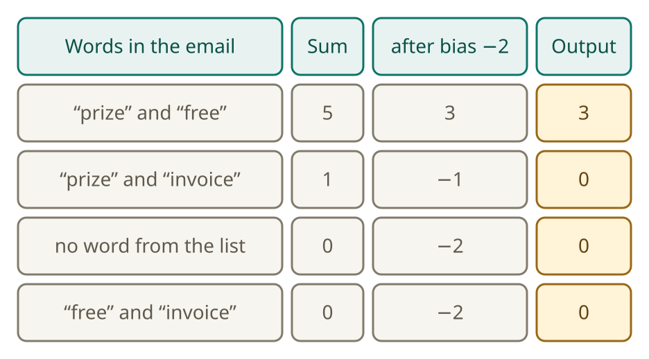
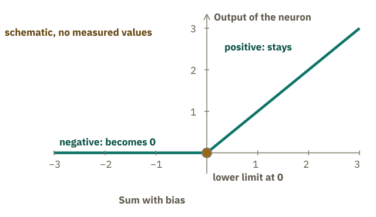

<!-- Generated from src/content/bausteine/en/artificial-neuron.mdx by scripts/export-lessons.mjs -- do not edit by hand. -->

# The Artificial Neuron: How a Sum Becomes an Output

> Reading copy for GitHub. The full version with interactive demos, animations and recall moments is on the website: **[The Artificial Neuron: How a Sum Becomes an Output](https://ki-einfach-verstehen.de/en/lessons/artificial-neuron/)**
>
> Licence: [CC BY 4.0](https://creativecommons.org/licenses/by/4.0/deed.en) · Credit it as: KI einfach verstehen, “The Artificial Neuron: How a Sum Becomes an Output”, CC BY 4.0, https://ki-einfach-verstehen.de/en/lessons/artificial-neuron/

What an artificial neuron calculates: weights, bias and a lower limit. Follow the spam-filter example from the first lesson and work through every step by hand.

A model contains billions of numbers, yet not one of them is a sentence. To see how those numbers can still produce an answer, start with one small calculation: an [artificial neuron](https://ki-einfach-verstehen.de/en/glossary/neuron/). You already know the ingredients, because the spam filter from the first lesson uses them too.

## The spam filter already calculates almost like a neuron

Remember the spam filter from the first lesson? It stored one weight for each word. For this example, the weights are made-up numbers chosen by hand, not learned during training: “prize” +3, “free” +2, “invoice” −2. An email contains “prize” and “invoice”. What total does the filter calculate? Make a guess before the next section works through the answer. A sum above 2 meant that the email was spam.

A weight is simply a number that sets how strongly a word counts. A positive weight pushes toward spam, a negative one pushes away from it. For the neuron, each word gets its own input number: 1 if it appears in the email, otherwise 0. The weight is multiplied by this input, so a word that is not in the email gives 0 and does not count.

*One mixing-desk channel shown as a neuron: three vertical sliders hold the input weights. The display shows the output. The next two sections explain the horizontal slider and the bent line.*

Think of the neuron as a channel on a mixing desk. Each vertical slider holds the weight of one word and sets how loudly it goes into the sum. The display on the right shows only one number at the end, for the current email: the output of the neuron. In the spam filter, each word has its own slider because the filter knows only these three words. A chatbot also calculates with sums of this kind, only with billions of sliders. Most of them belong to no particular word; their inputs are numbers from earlier calculation steps.

## The bias: a number that always counts

The spam filter compared the sum with a threshold of 2. A neuron builds the same threshold into its calculation as a [bias](https://ki-einfach-verstehen.de/en/glossary/bias/), a number that training sets and that is added to the sum. With a bias of −2, the sum must be above 2 before the result becomes positive. The bias belongs to no word and is the same for every email. Chatbot models, too, multiply inputs by weights and add them up.

In the example, the bias is −2. The email with “prize” and “free” has the sum 3 + 2 = 5, and the email with “prize” and “invoice” has the sum 3 − 2 = 1. Both sums are still without the bias. With the bias, the first email gives 5 − 2 = 3.

Think of −2 as moving two steps down the number line. Starting at 0 takes you to −2; starting at 3 takes you to 1.

*The bias is a slider with a fixed position. It stays the same for every email.*

You can work out two more emails with the same weights yourself: add the values for their words, then add the bias. The third email contains none of the listed words, the fourth contains “free” and “invoice.” You can check your results in the next section.

Try a calculation of your own: an email with “prize”, “free” and “invoice”. Work it out on paper.

## The lower limit: negative values become zero

After the bias, the number can be negative. This happens for three of the four emails: with “prize” and “invoice” it gives −1, with no word from the list it gives −2, and with “free” and “invoice” it gives −2.

Behind the sum sits a fixed step, the lower limit. For the second email, the sum after the bias is −1: which output does the neuron give in the end, −1 or 0? Guess first. The rule is simple: if the number is negative, it becomes zero. If it is zero or positive, it stays as it is. In technical language, this step is called an [activation function](https://ki-einfach-verstehen.de/en/glossary/activation-function/).

*Four emails with the weights from the example. The columns show the calculation step by step. The last column is the output, after the lower limit has acted.*

In this neuron, the lower limit has no value that training can change. Its rule stays fixed; only the numbers fed into it change. The neuron multiplies each weight by its input (1 or 0), adds the results and the bias, then turns any negative result into zero.

Chatbot models also have steps between their calculations that change incoming numbers. The exact rule depends on the model. Without this step, several calculation steps in a row would end up as one single calculation. The lesson [Layers](https://ki-einfach-verstehen.de/en/lessons/layers/) shows how.

*Schematic, no measured values: below zero the output stays at zero, above it rises in a straight line.*

## The output is a number, not a verdict

The spam filter ended with a yes-or-no decision. The neuron produces only the result of its calculation. The email with “prize” and “free” gets 3; the email with “prize” and “invoice” gets 0.

A chatbot works in a similar way: its model gives a number for every possible next piece of text, which can be a whole word, part of a word or a punctuation mark. A selection step then picks one of these pieces.

In the spam filter, another part uses this number to decide whether the email is spam. A single neuron does not make that decision itself.

> **Interactive demo:** [try it on the website](https://ki-einfach-verstehen.de/en/lessons/artificial-neuron/)

## The brain picture: the name, not the thing

The term neuron comes from the nerve cell. Something goes in, something happens to it, and something comes out. The calculation borrows only one basic idea from a nerve cell: many inputs, weighted differently, produce one output.

A real nerve cell is far more complicated. The aim of artificial networks is not to copy the brain exactly. A chatbot model, too, consists of numbers and calculation steps, not of nerve cells.

What does a neuron learn in training, and what stays the same?

*The nerve cell gave the neuron its name. The calculation rule behind it is a sum with a bias and a lower limit.*

During training, the numbers change, but the calculation rule stays the same. The neuron in this lesson therefore follows a fixed calculation; only the numbers it uses are set by training. This neuron is simple enough to work out by hand.

## The whole calculation

This neuron uses three steps: multiply each weight by its input and add the results, add the bias, then apply the lower limit. In a chatbot, numbers pass through many weighted sums and steps that change them, next to other calculations, before the model predicts the next piece of text.

One number alone does not make a model. In a network, a neuron passes its output on to other neurons; for them it is an input that gets multiplied by a weight. Such a passed-on number is called an [intermediate value](https://ki-einfach-verstehen.de/en/glossary/intermediate-value/). So what comes out when many neurons pass their results on like this? The lesson [Layers](https://ki-einfach-verstehen.de/en/lessons/layers/) shows this.

---

Source: https://ki-einfach-verstehen.de/en/lessons/artificial-neuron/

← Previous: [Model Size and Hardware: Where a Model Fits](./model-size-and-hardware.md) · [All lessons](../../README.md#contents) · Next: [What an AI Model Actually Is](./what-an-ai-model-actually-is.md) →
