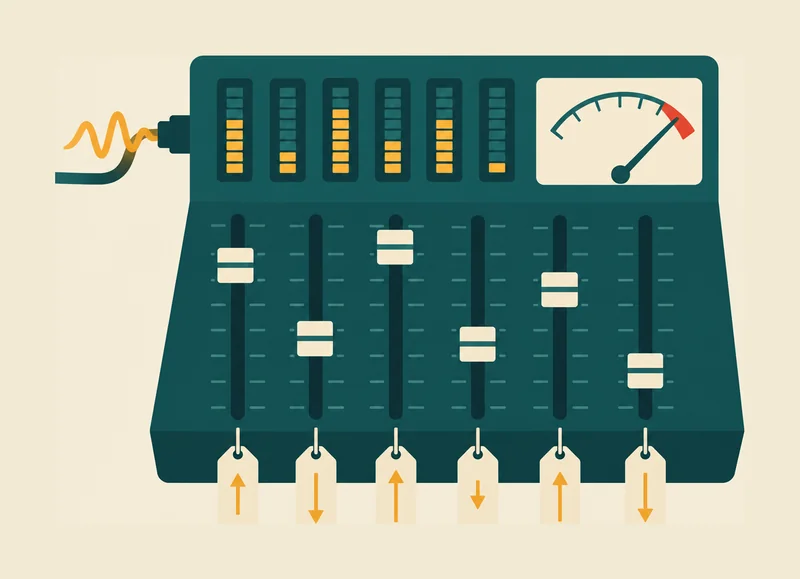
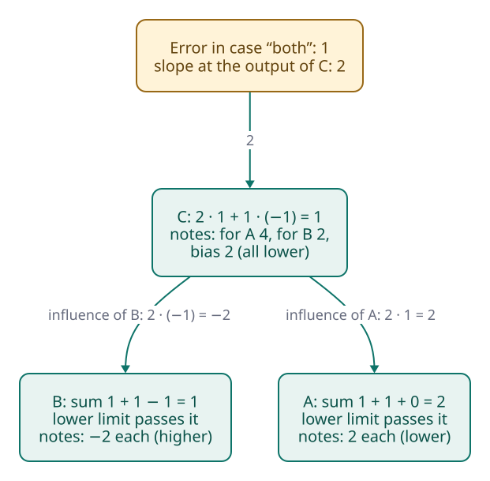
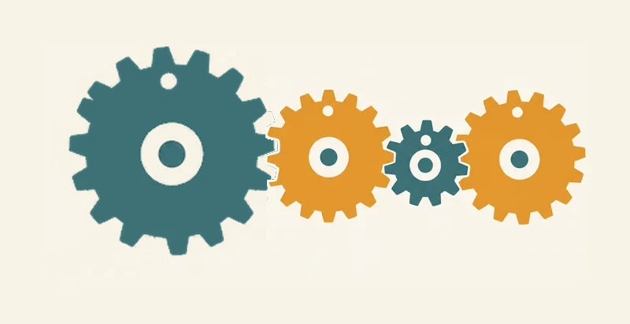
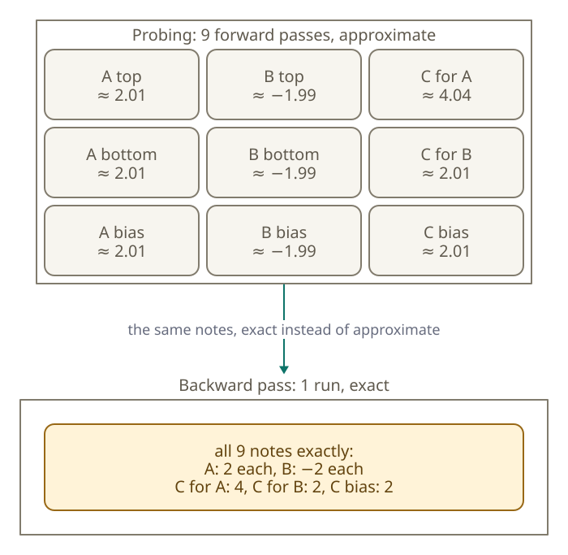
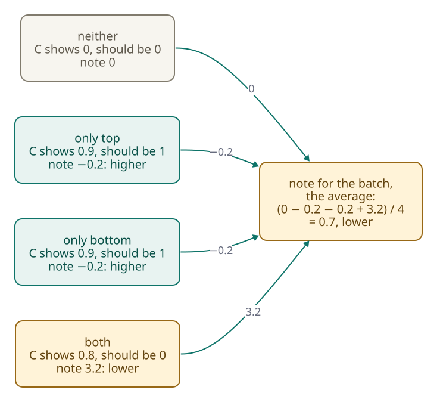

<!-- Generated from src/content/bausteine/en/backpropagation-and-gradients.mdx by scripts/export-lessons.mjs -- do not edit by hand. -->

# Backpropagation and Gradients: How the Model Knows What to Change

> Reading copy for GitHub. The full version with interactive demos, animations and recall moments is on the website: **[Backpropagation and Gradients: How the Model Knows What to Change](https://ki-einfach-verstehen.de/en/lessons/backpropagation-and-gradients/)**
>
> Licence: [CC BY 4.0](https://creativecommons.org/licenses/by/4.0/deed.en) · Credit it as: KI einfach verstehen, “Backpropagation and Gradients: How the Model Knows What to Change”, CC BY 4.0, https://ki-einfach-verstehen.de/en/lessons/backpropagation-and-gradients/

How training turns a single error number into a direction and a strength for every fader, why one pass backwards through the model is enough, and why no fader moves along the way.

At the end of the forward pass, the computation from the input through all [layers](https://ki-einfach-verstehen.de/en/glossary/layer/) to the output, there is a single number for the whole [batch](https://ki-einfach-verstehen.de/en/glossary/batch/), the big stack of text that training evaluates at once: the [loss](https://ki-einfach-verstehen.de/en/glossary/loss/). It says how wrong the model was across all these examples. It does not say which of the billions of faders contributed how much. The lesson on training made a promise about this: a method called [backpropagation](https://ki-einfach-verstehen.de/en/glossary/backpropagation/) gives the slope for all faders at once, in a single pass backward through the model.

Picture the stair light from the lesson on layers: a small network with two switches, where the light is on when exactly one is pressed. Suppose you want to find out by probing which fader changes the error and how strongly. How many extra forward passes through the network would you need? Hold on to your guess.

## A note for every fader

A mixing desk sounds off. Many faders, one bad sound: which one has to go where? Its faders are the model’s [parameters](https://ki-einfach-verstehen.de/en/glossary/parameters/), the weights and [biases](https://ki-einfach-verstehen.de/en/glossary/bias/) that training sets. They are stored and stay as they are while nobody turns them.

What is new are the **notes**. After every batch, training uses the loss and the [intermediate values](https://ki-einfach-verstehen.de/en/glossary/intermediate-value/) of the forward pass to compute a note at every fader, with two pieces of information, a direction and a strength: “higher, strongly” on one, “lower, barely” on another. Unlike the faders, the notes are not part of the finished model. They hold for this one batch; for the next one, training computes new ones. A note does not turn a fader, and it does not say where the right value lies.

*The mixing desk with notes: the signal comes in on the left, small meters above the faders show the intermediate values of the forward pass, and the large meter at the top right shows how wrong the result is. A note with an arrow hangs on every fader: up means “higher”, down means “lower”. The faders themselves are still where they were.*

You already know what is on a note: the **slope** from the lesson on training, how strongly the error changes with a tiny turn at exactly one spot. If the error falls when the fader goes up, the note says “higher”; if it rises, “lower”. The apple model had one fader, the price per kilo, and so only one slope. A language model has billions of faders, and each one needs its own. Like the hillside in the fog, a note tells you how steeply the ground falls for this one fader alone.

All the notes together are called the **[gradient](https://ki-einfach-verstehen.de/en/glossary/gradient/)**: the list of the slopes of all faders, a direction and a strength for each. Llama 3.1 8B, the open model from the lesson on training, has about eight billion parameters according to its model page. So after every batch it gets about eight billion notes.

Backpropagation is often taken as the name for all of learning. A textbook on neural networks is clear: the word only names the method that computes the gradient. Learning uses this gradient in another method, and after backpropagation every fader is still where it was. A separate step decides whether and how far to turn.

But where do the notes come from? On the stair light, every single one can be worked out by hand.

## Backwards through the stair light

The stair light is a made-up mini network: a person sets its weights, nothing was trained. The [neurons](https://ki-einfach-verstehen.de/en/glossary/neuron/) A and B both see the two switches with weight 1 and add their bias: 0 for A, −1 for B. The lower limit sets negative sums to 0. C takes A times 1 and B times −2. These are the outputs for the four cases:

| Case | A | B | C |
|---|---|---|---|
| neither | 0 | 0 | 0 |
| only top | 1 | 0 | 1 |
| only bottom | 1 | 0 | 1 |
| both | 2 | 1 | 0 |

One fader is set wrong: C’s weight for B is −1 instead of −2. Only the case “both” goes wrong: C shows 1 instead of 0. Here the error is the deviation times itself: C is 1 too high, the right value is 0, so 1 times 1 is 1. Language models measure their error with penalty points from the previous lesson, which grow the less probable the right [token](https://ki-einfach-verstehen.de/en/glossary/token/) was. The backward pass does the same kind of calculation for them, only with the slope of these penalty points. All notes hold for this one case.

The backward pass starts at C’s output. It is not a fader, but the error hangs on it. If it moves a small step, the error grows by about twice the size of that step. For “deviation times itself”, the slope at C is therefore always twice the deviation. For a fader, positive means “lower”, since turning it up would make the error grow; negative, “higher”.

One level deeper: How much does the error grow with a small step?

The error is C times C, because the correct value is 0. If C moves by 0.01 to 1.01, it becomes 1.01 times 1.01, which is 1.0201, so about 0.02 larger than before. Divided by the step of 0.01, that is about 2: the slope at C at this spot. At a deviation of 0.5 the slope would be about 1, again twice the deviation.

The check on the wrong fader: turn C’s weight for B from −1 to −1.01, and in the case “both” C computes 2 minus 1.01, so 0.99. The error then falls to 0.99 times 0.99, about 0.98. That is a drop of about 0.02 for a step of 0.01, so a slope of about 2, as the note says.

If C’s weight for B turns a little, C changes by that step times B’s output, an intermediate value from the forward pass. The note is the slope at C times this output, so 2. C’s weight for A gets 2 times 2, so 4, and C’s bias 2: all three “lower”.

Does the note on B’s weight for the top switch say higher or lower? Think first.

> **Interactive demo:** [try it on the website](https://ki-einfach-verstehen.de/en/lessons/backpropagation-and-gradients/)

For B’s faders, the backward pass first computes the **influence of B**: how strongly the error reacts to B. B acts on C through C’s weight for B, so the slope at C times that weight counts: 2 times −1, so −2. The lower limit passes B’s positive sum through. If a sum is below zero, the lower limit turns it into 0, and that neuron’s faders get no note. The weight at the top switch gets −2 times the pressed switch: note −2, higher.

A counterexample shows the block: Suppose C’s bias stood at 0.5: then C shows 0.5 in the case “neither”. There B’s sum is −1, which falls below zero; B’s faders get no note in this case.

| Fader | Calculation (slope at C first) | Note |
|---|---|---|
| C: weight for A | 2 · output of A (2) | 4, lower |
| C: weight for B | 2 · output of B (1) | 2, lower |
| C: bias | 2 · 1 | 2, lower |
| B: both weights, bias | 2 · C’s weight for B (−1) · lower limit (1) · input (1: pressed switch; for the bias, 1) | −2 each, higher |
| A: both weights, bias | 2 · C’s weight for A (1) · lower limit (1) · input (1: pressed switch; for the bias, 1) | 2 each, lower |

The largest note, the 4, hangs on C’s weight for A, which is correct. The wrong fader, C’s weight for B, gets only 2, but in the right direction, lower. A note measures how strongly the error depends on a fader, not who caused it.

*The backward pass in the case “both”: notes for each fader, grouped per neuron: at C 4, 2 and 2, all lower; at B −2, higher; at A 2, lower. Invented network with the weight set wrong to −1.*

## One backward pass instead of billions of probes

This backward pass is called **[backpropagation](https://ki-einfach-verstehen.de/en/glossary/backpropagation/)**, roughly “spreading backwards”: from the error, the calculation goes back [layer](https://ki-einfach-verstehen.de/en/glossary/layer/) by layer to the input, and every fader gets its note. Probing, as in the opening question, means turning one fader a little, running the network forwards and comparing the new error with the old one.

> **Interactive demo:** [try it on the website](https://ki-einfach-verstehen.de/en/lessons/backpropagation-and-gradients/)

For the stair light, that is nine extra forward passes, one per fader: turning all at once would not show which fader contributes what. Backpropagation needed a single backward pass.

Why is one enough? B’s influence, the −2, was computed once and used for all three of B’s faders. With another layer before B, the backward pass would compute that layer’s influence from B’s, again only once, and so on back to the input.

*The gear train: how strongly the last gear turns along follows from the ratios along the way, multiplied together. In the network, some ratios are stored weights, others are values of this pass, such as the lower limit.*

The calculation works like a **gear train**: the ratios along the way, multiplied, tell how strongly the last gear turns. For B’s weight at the top switch these are the four factors from the table, giving −2, the note. All of B’s faders share the first three factors; only the last, each fader’s input, differs. Unlike a real gear train, the weights stay put; the lower limit and the input of each fader change their ratio, to 1 or to 0.

*Probing against the backward pass on the stair light, case “both”: nine extra forward passes, one per fader, against a single backward pass. Both give the same direction and almost the same strength; only the backward pass is exact.*

Does the error flow backwards and repair the faders? No: what runs backwards is a calculation with the values from the forward pass. Without the 2 from A and the 1 from B, no note at C could be computed. So training keeps these values until the backward pass is done.

The way back is not free. Forwards, every weight is computed once: weight times input. Backwards, twice: once as influence times input for its own note, once as influence times weight for the layer before. A 2020 paper from OpenAI, the company behind ChatGPT, gives a rule of thumb: the backward pass takes about twice the compute of the forward pass, so a training step costs about three times as much as answering. For Llama 3.1 8B, a training step per token thus costs about three forward passes.

One level deeper: Why can notes vanish or become huge?

In mathematics, multiplying the ratios along the way is the **chain rule**. Paul Werbos described the backward pass in general terms in his 1974 dissertation; for neural networks he presented it in 1981 at a conference, published in 1982. In 1986, David Rumelhart, Geoffrey Hinton and Ronald Williams made it known in the journal Nature; others had independently rediscovered it around then.

If many ratios are below 1, the product shrinks with every layer: ten times 0.5 multiplied together gives less than a thousandth. The notes near the input then become so small that their direction can hardly be recognized. If many ratios are above 1, the product grows fast, the notes become huge, and learning can become unstable. The textbook on neural networks calls this the problem of vanishing and exploding gradients.

Any deep network can run into this, but the worst are networks that apply the same weights at every step: the same ratio returns, and even one just below 1 shrinks with each repetition. In networks where values only pass forward from layer to layer (feed-forward), every layer has its own weights, and according to the textbook even very deep networks of this kind can largely avoid the problem. A limit helps against huge notes. In training GPT-3, the overall size of the gradient was capped at 1.0: if it was larger, all notes were scaled down proportionally, so their directions stayed.

## A note only holds here and now

In the case “both”, the note on C’s weight for A is the strongest of all: “lower, 4”. What happens if the weight follows it far, from one down to zero? Think briefly first.

In the case “both”, C then computes zero times two, plus minus one times one. That gives minus one: wrong again, only in the other direction. And the cases “only top” and “only bottom”, which were right before, break: A computes one, B computes zero, and C shows zero instead of one. With exactly one switch pressed, the light would stay dark.

It is easy to think a note points to the right value. But it only shows the slope at the current position, as in the fog: you feel the tilt under your feet, not the hillside further on. Whoever strides far may end up going uphill again. That is why **a note only holds for the position at which it was calculated**.

It also holds only for the case it comes from. In the network with the wrong weight, the other three cases are right, so their notes are zero. Other examples give other notes, and these can contradict each other. If only C’s weight for A moves to 0.9, the case “only top” calls for turning up, so “higher”, and the case “both” for turning down, so “lower”. The notes contradict each other.

One level deeper: How do the notes −0.2 and 3.2 come about?

The calculation is always the same: slope at C times output of A. In the case “only top” the weight stands at 0.9: C computes 0.9 times 1 and shows 0.9 instead of 1, so it is 0.1 too low. The slope at C is then 2 times (−0.1), so −0.2. Times A’s output, 1, the note is −0.2, so “higher”. In the case “only bottom” it is the same.

In the case “both”, C computes 0.9 times 2 minus 1, so 0.8. It is 0.8 too high, so the slope is 2 times 0.8, which is 1.6. Times A’s output, 2, the note is 3.2, so “lower”. That the slope is positive here and negative there follows from C’s position: too low means “higher”, too high means “lower”.

*A batch of four cases: four notes for the same weight, C’s weight for A, after it has moved to 0.9: twice “higher”, once “lower”, once nothing. The note for the batch is their average. Invented network, worked out.*

That is why training computes the notes for all examples of a batch and averages them: the loss of a batch is the average over its examples, and each example enters that average only with its share and its slope. So each note is an **average** too. For C’s weight for A, the four notes add up to 2.8; divided by four, 0.7: lower, but much weaker than the 3.2 of the case “both” alone. During training of GPT-3, an early language model from OpenAI, a batch grew to millions of tokens. Each token is one such example and adds its notes to the average. Then training turns the faders a little in the direction of their notes, and the next batch brings new notes.

So far, no fader has moved. How far to turn, and what happens to notes that contradict each other, is the subject of the next lesson, on optimizing the weights.

---

Source: https://ki-einfach-verstehen.de/en/lessons/backpropagation-and-gradients/

← Previous: [Forward Pass and Loss: How the Model Measures Its Own Error](./forward-pass-and-loss.md) · [All lessons](../../README.md#contents) · Next: [Optimization: What Actually Changes the Weights](./optimization-of-the-weights.md) →
