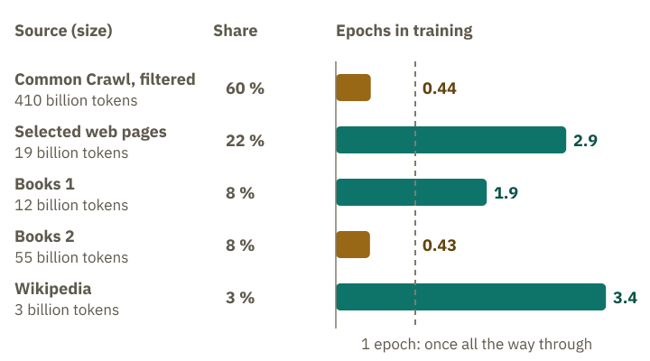
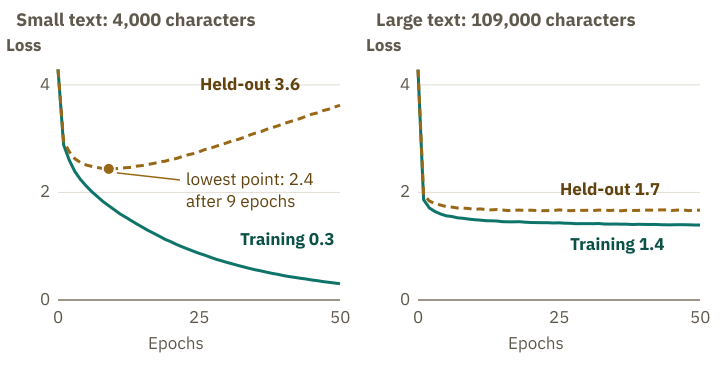
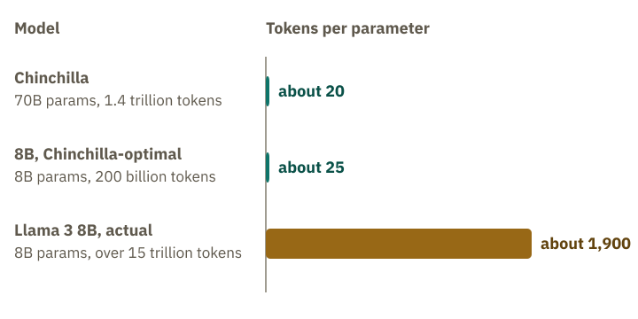

<!-- Generated from src/content/bausteine/en/batch-epoch-step-token-budget.mdx by scripts/export-lessons.mjs -- do not edit by hand. -->

# Batch, Epoch, Step, Token Budget: How Training Progress Is Measured

> Reading copy for GitHub. The full version with interactive demos, animations and recall moments is on the website: **[Batch, Epoch, Step, Token Budget: How Training Progress Is Measured](https://ki-einfach-verstehen.de/en/lessons/batch-epoch-step-token-budget/)**
>
> Licence: [CC BY 4.0](https://creativecommons.org/licenses/by/4.0/deed.en) · Credit it as: KI einfach verstehen, “Batch, Epoch, Step, Token Budget: How Training Progress Is Measured”, CC BY 4.0, https://ki-einfach-verstehen.de/en/lessons/batch-epoch-step-token-budget/

How a training run is counted in steps and tokens, why a language model like GPT-3 sees some sources not even halfway and others several times, how a held-out text tells real learning apart, and how much text goes with how many faders.

The Llama 3 family are the language models from the company Meta. For its largest model, Llama 3.1 405B with 405 billion [parameters](https://ki-einfach-verstehen.de/en/glossary/parameters/), the research report gives two numbers that both sound like the length of training. You know the first one from the previous lesson: the learning-rate schedule, up briefly first, then down for a long time, ran over 1.2 million steps for this model. The second is the amount of text, about 15.6 trillion [tokens](https://ki-einfach-verstehen.de/en/glossary/token/), that is, pieces of text.

Another team also trains for 1.2 million steps and puts 4 million tokens into each step. How much text has its model seen by the end, compared with Llama 3.1 405B’s 15.6 trillion? Think for a moment before you read on.

## Problem, batch, step

The answer lies in what a single step processes. Remember the cover card? It uncovers the beginning of a line, and the next token underneath is the solution. That way, every position in a training sequence becomes a practice problem, an example. For a whole stack of such sequences the model computes forward, and the [loss](https://ki-einfach-verstehen.de/en/glossary/loss/) averages the penalty points of all positions into one single number. This stack is called a [batch](https://ki-einfach-verstehen.de/en/glossary/batch/). From the loss come the notes from the lesson on backpropagation: each fader carries how strongly and in which direction the loss changes when you turn it. All the notes together are the gradient. The optimizer then turns every fader once, each one so that the loss falls.

*The workbook: problems are worked in stacks, and after each stack comes a round of corrections.*

A workbook helps keep these units apart. You do not have each problem corrected right away, but a whole stack. Then comes the correction, and you adjust your way of working a little. In the picture, each problem is an example, the stack is the batch, your way of working is the faders, and each round of corrections is a step. Once through the whole workbook is called an **[epoch](https://ki-einfach-verstehen.de/en/glossary/epoch/)**. The picture fails in two places. The model has no workbook in which individual problems are kept. It only has its faders, and spread across them is what it has kept from the problems, above all what many problems have in common. If the same problem comes up again later, an already changed model solves it. How strongly it adapts to a single problem also depends on how often that problem came up. And a language model does not simply work through its workbook page by page: how often each part comes up is decided in advance.

Such a round is called a **[step](https://ki-einfach-verstehen.de/en/glossary/step/)**: one batch forward, the loss, the notes, one turn. In the lesson on training, a step was still the distance a fader moves. As a unit of counting it means the whole round in which every fader moves once.

Now to the question from the start. Each step of the other team processes 4 million tokens. After 1.2 million steps, that is 4.8 trillion tokens, just under a third of Llama 3.1 405B. The team took just as many steps and still saw far less text. Llama 3.1 405B also started with 4 million tokens per step, but then doubled twice, up to 16 million. **Step counts can only be compared if the batches are the same size.** So the text a run has processed is counted in tokens.

The word batch has a second meaning. A chatbot service groups many people’s requests into a batch and computes them together to keep the graphics chips busy. No fader moves then. In training, the batch is the stack of examples after which the faders are turned once.

So the steps count the rounds of corrections, the tokens count the text. How often does the same training text actually come up?

## Once through the workbook, or not at all

Many imagine a language model reads its [training data](https://ki-einfach-verstehen.de/en/glossary/training-data/) again and again until it knows it. That is how you learn: before an exam, you work through the workbook two or three times. With GPT-3, a predecessor of the models behind ChatGPT, it was different: **most of the available text did not come up even halfway.** The Llama 3 report gives no epoch counts; it only names some data drawn more often, such as math.

How often a source comes up is set by the mix, the last stage of preparing the training data from the lesson on practice problems. For each source, a share of the training sequences is set. The training text is distributed by these shares, not by the size of the sources.

The 2020 GPT-3 paper gives all the numbers. Training processed 300 billion tokens. 60 percent of them, 180 billion, came from a filtered collection of web pages called Common Crawl. But it held 410 billion tokens. In a mix, epochs are counted per source; for Common Crawl the paper gives 0.44: not even half of its texts came up. The rest was shared among selected web pages, two collections of books and Wikipedia.

Wikipedia held only 3 billion tokens and still got 3 percent of the mix. How often do you think it came up in training?

3 percent of 300 billion is 9 billion tokens. The tokens training draws from a source, divided by its size, give roughly its epochs: 9 billion divided by 3 billion is 3. The paper gives 3.4 times. Its table does not add up exactly for every source; the rule gives the order of magnitude.

*GPT-3’s training mix: the size of each source, its share of the training tokens and how often it came up.*

Why so uneven? According to the paper, training deliberately drew more often from sources the authors considered higher quality. In exchange, they accepted “a small amount of [overfitting](https://ki-einfach-verstehen.de/en/glossary/overfitting/)”: the model then adapts to individual texts instead of to patterns many texts share. How much repetition hurts was measured by a 2023 study on language models with up to 9 billion parameters: up to about four epochs, the loss barely changed compared with all-new text. With more repetition, additional compute brought less and less, eventually nothing.

Which sources come up more often shapes the later model. According to Meta, setting the shares carefully is critical for a good language model. For Llama 3.1 405B, about 17 percent of the training tokens come from code. If a chatbot helps you code, its pre-training very likely contained a lot of code.

Because a mix repeats each source a different number of times, one epoch count says little. Instead, you count all the tokens training processes, repetitions included. That is the **[token budget](https://ki-einfach-verstehen.de/en/glossary/token-budget/)**: 300 billion for GPT-3, 15.6 trillion for Llama 3.1 405B. In the workbook, it would be the number of problems solved, whether for the first or the third time. People set the token budget before training, so it is a [hyperparameter](https://ki-einfach-verstehen.de/en/glossary/hyperparameter/).

How many steps does a training run take? For the largest GPT-3 model, with 175 billion parameters, the paper also gives a batch of 3.2 million tokens. Take a moment to think before you read on.

> **Interactive demo:** [try it on the website](https://ki-einfach-verstehen.de/en/lessons/batch-epoch-step-token-budget/)

Dividing is enough: 300 billion divided by 3.2 million is nearly 94,000 steps. The batch started smaller, so there were a few more.

Do Llama 3.1 405B’s 1.2 million steps fit the division?

With the largest batch of 16 million tokens, 15.6 trillion tokens would give 975,000 steps. But in the first trillions of tokens, the batches were only 4 and 8 million. So the run needs more steps; 1.2 million is the same order of magnitude.

## The practice test: learning or memorizing

*The practice test: new problems that were not in the workbook show whether the material has sunk in.*

If you work through a workbook three times, by the end you know many solutions by heart. Whether you have mastered the material only shows in a practice test with problems that were not in the workbook. It is the same with training. The loss that training computes after each batch measures how well the model predicts exactly the texts it is learning from right now. It is called the **training loss**. It falls even when the model only adapts to quirks of those texts. In the workbook, that would be someone who knows the solutions but not how to get there.

That is why part of the text is held back before training: the **held-out text**. It never goes into a batch, and no fader is turned according to it. At regular intervals the model computes it forward, and the loss on it is called the **[validation loss](https://ki-einfach-verstehen.de/en/glossary/validation-loss/)**. The developers of GPT-3 removed duplicate texts partly so that no copy of the held-out text would hide in the training text. Otherwise the practice test would be one with familiar problems.

Both values are recorded during training. If both curves fall and stay close together, the model is learning **patterns that also hold in unseen text**. If the training loss keeps falling while the validation loss rises again, that is the **overfitting** the GPT-3 paper accepted.

A small, real training run shows what that looks like. A tiny model with about 14,000 parameters predicts the next character, each time from the eight characters before it. It learns from Franz Kafka’s story “The Metamorphosis” in the German original, whose last tenth is the held-out text. Two runs start from the same random fader settings. The small one gets the first 4,000 characters, the large one about 109,000 characters, almost all of the rest of the story. Both see their text 50 times.

What do you think happens to the validation loss of the small run when it sees the same 4,000 characters for the twentieth, thirtieth, fiftieth time?

> **Interactive demo:** [try it on the website](https://ki-einfach-verstehen.de/en/lessons/batch-epoch-step-token-budget/)

Both curves start at about 4.3. A model with the vocabulary of Qwen3-0.6B, by contrast, starts at about 11.9, as in the lesson on forward pass and loss. The mini model knows only 67 different characters instead of over 150,000 tokens. In the small run, the validation loss falls for nine epochs and then rises steadily again. The training loss keeps falling throughout: the model predicts the 4,000 familiar characters ever more confidently and unseen text ever worse. In the large run, both curves fall and stay close together. From the same start, it reaches a clearly lower loss on the held-out text.

*A real small training run: training and validation loss with little and with a lot of text over 50 epochs.*

The mini model is not a language model like the one behind your chatbot: even Llama 3.1 8B has more than half a million times as many parameters. The mini model only knows characters and has only read one story. It shows how to read the two curves. It does not show how early a large model would tip over. The practice test picture also limps a little. A low validation loss does not mean the model knows the held-out texts. It has never seen them and predicts them well because the patterns from the training text also hold there.

So more text helps against memorizing.

## How much text for how many faders

A team has compute for one training run. Should it train a large model briefly or a smaller one for longer? The compute grows roughly with model size times amount of text. A model twice as large needs twice the computation per token, so for the same compute it gets only half the text.

Google’s AI company DeepMind looked into this in 2022. It trained over 400 language models of various sizes on various amounts of text and compared which reached the lowest loss for the same compute. It found that model size and token budget should grow equally, so twice the parameters with twice the text. On this finding, many large models of the time were undertrained. As proof, DeepMind trained Chinchilla with 70 billion parameters and 1.4 trillion tokens. It cost as much compute as DeepMind’s own Gopher, four times as large, but got four times the text and did clearly better.

1.4 trillion divided by 70 billion gives 20. This became a common rule of thumb: about 20 tokens per parameter.

Llama 3 8B, the predecessor of Llama 3.1 8B from the lesson on training, has eight billion parameters. Meta writes that by the Chinchilla calculation, about 200 billion tokens would be optimal here. It was trained on over 15 trillion. That is about 1,900 tokens per parameter instead of 20.

*Tokens per parameter: Chinchilla is at about 20, Llama 3 with eight billion parameters at about 1,900.*

Is that a waste?

Meta reports that the model was still improving after 15 trillion tokens. A larger model would have reached the same performance with less training compute. According to Meta, smaller models are still generally preferable because they are much more efficient in use. A finished model answers millions of requests, and every token it outputs is computed with all its faders. A smaller model trained for longer answers more cheaply and fits on smaller chips, like the models for phones from the lesson on model size.

**For training alone, the cheapest ratio is about 20 tokens per parameter.** If you also count running it, you train a smaller model for longer.

One level deeper: How scaling laws make a training run predictable

This planning rests on an observation from 2020. Researchers at OpenAI, the company behind ChatGPT, trained many language models of varying size, amount of text and compute (Kaplan and others). The loss on held-out text fell remarkably regularly. It follows a power law in model size, amount of text and compute, sometimes across more than seven orders of magnitude: the largest value studied was over ten million times the smallest.

A power law here means: every tenfold increase, say in the number of parameters, lowers the loss by roughly the same proportion, as long as neither text nor compute runs short. Plot both axes logarithmically, with equal spacing for 1, 10, 100, 1,000, and it becomes a straight line. Rules like this are called **scaling laws**.

From the lines you can work out how best to split a fixed compute budget. According to Kaplan, mainly the model should grow as the budget grows. In 2022, the Chinchilla study redid this with more runs and more text: model and text should grow equally. Both laws only describe the loss, not individual abilities such as arithmetic or translation.

At the end of millions of such steps stands a model that continues text very well, a base version like Llama 3.1 8B, which stood next to the Instruct version in the lesson on training. It has not learned to respond to questions the way a chatbot does. That takes post-training, and that is what the next topic area, “From Model to Assistant”, is about.

---

Source: https://ki-einfach-verstehen.de/en/lessons/batch-epoch-step-token-budget/

← Previous: [Optimization: What Actually Changes the Weights](./optimization-of-the-weights.md) · [All lessons](../../README.md#contents) · Next: [Why Prediction Is More Than Parroting](./why-prediction-is-more-than-parroting.md) →
