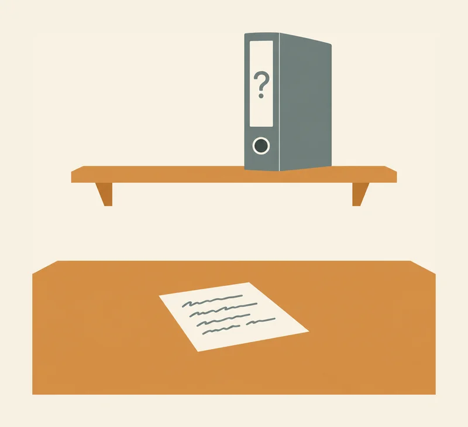
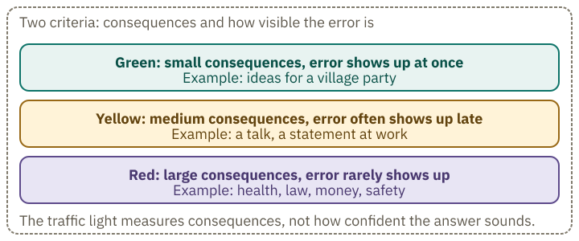
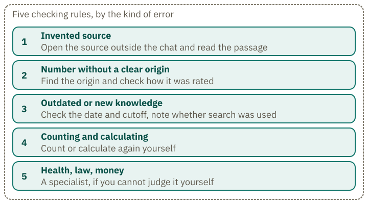
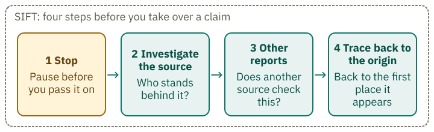
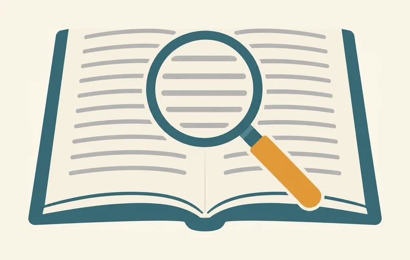

<!-- Generated from src/content/bausteine/en/checking-answers.mdx by scripts/export-lessons.mjs -- do not edit by hand. -->

# Checking Answers: Using AI Safely in Everyday Life

> Reading copy for GitHub. The full version with interactive demos, animations and recall moments is on the website: **[Checking Answers: Using AI Safely in Everyday Life](https://ki-einfach-verstehen.de/en/lessons/checking-answers/)**
>
> Licence: [CC BY 4.0](https://creativecommons.org/licenses/by/4.0/deed.en) · Credit it as: KI einfach verstehen, “Checking Answers: Using AI Safely in Everyday Life”, CC BY 4.0, https://ki-einfach-verstehen.de/en/lessons/checking-answers/

When a chatbot answer has to be checked, why asking the same bot again is not enough, and which checking step fits which kind of error.

A chatbot gives you a fluent answer, complete with names, years and sources. Before you use it, consider this: you ask the bot whether its source is real, and it says, “Yes, the source is real.” Has anything actually been checked? Take a moment to think before you read on.

The lesson on [what an AI model actually is](./what-an-ai-model-actually-is.md) introduced the New York case: a court brief cited six invented court decisions. That lesson explained how this could happen. Here, the question is what you can do about it.

## Asking the same bot again is not an independent check

The model receives both your question, “Is that right?”, and its earlier answer naming the source. It continues from that text, producing a “yes” that fits what came before. Without web search, nothing in this process checks the source. That “yes” therefore gives you no independent confirmation.

Looking convincing does not make a claim true. An invented source can have a title and a case number, and the bot can sound just as convincing when it confirms it. There is also [sycophancy](https://ki-einfach-verstehen.de/en/glossary/sycophancy/): a bot may change its answer when you express doubt, even if its first answer was right. Your doubt can make that change more likely.

The BSI describes why invented claims seem so convincing: [hallucinations](https://ki-einfach-verstehen.de/en/glossary/hallucination/) mostly look credible, especially when they refer to scientific publications or other references that may themselves be invented.

*A note lies on a table. A closed file with a question mark on its spine stands on a shelf. The note mentions the file, but does not show what is inside.*

Picture a note on a table. The bot wrote it and mentioned a file. The note cannot tell you whether that file exists. To find out, you have to look on the shelf where it should be. The same goes for titles and numbers: adding a year, journal and volume makes a claim look like a reference before anyone has checked it. Finding the file is the actual check. Asking the bot again just gives you another note from the table, not a second look.

## When to check? The risk traffic light

Two criteria decide how much checking is needed: what does an error cost if it slips through, and will you notice it yourself?

**Green:** The consequences are small, and the error shows up at once. An example is ideas for a village party. With green, it is enough to read the answer through yourself. **Yellow:** The consequences are medium. The answer goes into a piece of work or a decision, such as a talk or a statement at work, and an error often shows up only later. **Red:** The consequences are large, and the error rarely shows up. Typical cases are health, law, money and safety.

The traffic light does not measure how sure the bot sounds. Advice on a medicine dose can sound just as fluent as ideas for a village party.

The BSI gives related advice: when an AI answer could have serious consequences, it should be checked and, if needed, compared with information from other sources (measure M20, status 17 January 2025). This lesson suggests the three-level scale; the BSI does not require it. Use the two criteria to decide how serious the risk is in your case.

*The traffic light uses two criteria: how serious the consequences are and how easily you can spot the error. The examples are brief labels, not a complete list.*

## Five checking rules, by the kind of error

Each rule belongs to one kind of error. Once you recognize the kind, you know which step fits.

*Five checking rules, each assigned to a kind of error: invented source, number without origin, outdated knowledge, counting and calculating, health, law and money.*

**1. Invented source.** A source may exist without supporting the claim, or it may not exist at all. Open it outside the chat and read the relevant passage. As explained above, asking the bot again does not check the source. Many chat apps display source links; look in yours to see whether it does. The bot’s description of a page is still just text. Read the page yourself.

**2. Number without a clear origin.** You need to know where a number comes from. To make sense of a [benchmark](https://ki-einfach-verstehen.de/en/glossary/benchmark/), a standard test used to compare models, you need to know how it was scored and whether its questions appeared in the training material. An example: the report on the German model Kolibri by Aleph Alpha (October 2026) reports nearly full marks on two tests in Table 44. The first is called GSM8K and contains word problems in arithmetic: 1,319 of 1,319 correct (100.0 percent). The second is called HumanEval and contains programming tasks: 163 of 164 correct (99.4 percent). A comparison with the report’s curated training pool found these tasks in it, and that was before the pool was cleaned up. That shows an overlap between test and learning material, but not how strongly it distorts the result.

The example shows why the question of origin is justified.

**3. Outdated or new knowledge.** Without search, a model knows only texts up to its [knowledge cutoff](https://ki-einfach-verstehen.de/en/glossary/knowledge-cutoff/). What happened after that is missing or guessed. Check the date of the claim and whether your app showed a search.

**4. Counting and calculating.** A model processes [tokens](https://ki-einfach-verstehen.de/en/glossary/token/), that is, pieces of text that are often parts of words, not single letters. A 2024 study found that many models recognize the letters in the word “strawberry” but do not count them reliably. The study describes this behavior but does not establish whether tokens cause it. The [strawberry explorable](https://ki-einfach-verstehen.de/en/explore/strawberry/) shows the case with an example. Count or calculate yourself.

**5. Health, law, money.** Check an invented source outside the chat (rule 1). If you cannot judge something yourself, such as a medicine dose, ask a specialist to check it. The traffic light only tells you how much checking is needed.

## Try it

> **Interactive demo:** [try it on the website](https://ki-einfach-verstehen.de/en/lessons/checking-answers/)

## A side note on privacy

What you type into a chat does not change the model during the conversation. Whether it is used for training later depends on the provider’s terms for your plan and often on a setting in your account. Each provider has its own rules.

In an announcement of 28 August 2025, Anthropic wrote that users of the Free, Pro and Max plans can choose whether their data is used to improve Claude. With consent, Anthropic gives a retention period of five years; without consent, it stays at 30 days. Team, Enterprise and the API are governed by different contract terms. The announcement does not say which setting is selected by default.

Look in the privacy settings of your app to see whether your inputs are used for training and how long they are kept.

Also [saved notes](https://ki-einfach-verstehen.de/en/glossary/saved-note/) from earlier conversations influence the answer. The lesson on [training data and privacy](./training-data-copyright-and-privacy.md) goes into this in more detail.

## Reading laterally like fact-checkers

Rule 1 asks you to open the source outside the chat. A 2023 study shows why: 55 percent of the references GPT-3.5 produced were invented; for GPT-4 it was 18 percent. Both are models from OpenAI, the maker of ChatGPT. The study did not test newer models. Fact-checkers offer a useful example of how to check sources.

Fact-checkers work differently from most readers. They do not read the first page to the end; they leave it after a quick look and open new tabs. Researchers call this [lateral reading](https://ki-einfach-verstehen.de/en/glossary/lateral-reading/). In a study by Wineburg and McGrew (2019), researchers compared fact-checkers, historians with a doctorate and students. The fact-checkers reached better-founded conclusions in a fraction of the time; the students read a page from top to bottom and stayed on it. Whether laypeople can learn this in a short time, the study does not show.

The traffic light helps you decide how much to check; the rules help you choose the right check. For any source, you can also follow four steps outlined by researcher Mike Caulfield. He calls this approach SIFT.

*The four SIFT steps: stop, investigate the source, find other reports, trace the claim back to its origin.*

1. **Stop:** Pause before you pass the answer on.
2. **Investigate the source:** Who stands behind it, and what kind of source is it?
3. **Find other reports:** Does another source check the same claim?
4. **Trace back to the origin:** Follow the claim, quote or image back to the place where it first appeared.

## Working through cases

*A magnifying glass lies on an open book. It stands for looking into the source: you read the passage in the book, not the bot’s text about the book.*

Work through each case in three steps: give it a traffic-light rating, choose a check, then read the explanation. Choose the check that fits the most likely error. For the D in DEEPSEEK, there is no outside source to consult; count the letters yourself. Before reading the explanation, write one sentence saying what you would do: consult an outside source, check the date, ask a specialist or count again. If your check fits the most likely error, you have chosen well.

Start with one case. The chat excerpt is invented.

**Exercise: A journal that does not exist**

You ask a chatbot about sleep studies and get this answer. Chat excerpt, invented:

> “According to Huber (2019) in the Journal of Imaginary Sleep Studies, volume 4, adults who sleep less than six hours perform on average 23 percent worse on concentration tasks.”

Rate the case and check it. In what order do you proceed?

**Solution:**

The claim concerns health. A wrong number here does not show up when read, and the consequences would be large. So it is red. Asking the bot does not help: the answer would again come from the same text. You look for the journal’s title and the study outside the chat, for example in a library catalogue or on the publisher’s site. If you find nothing there, you treat the number as unsupported. The case is invented, so the journal does not exist. In real life you would only know that after the search.

Three further invented cases.

**Exercise: Three cases, three checking steps**

a) A chatbot gives “64 percent of respondents” on a topic for your talk and says the number comes from a survey. Which rating fits, and which step checks the number?

b) A chatbot without web search names the winner of a final that took place after its cutoff, and says it is in current news. What do you check?

c) You ask: “Which number is larger, 9.11 or 9.9?” The bot first answers “9.11”. After “Are you sure?” it answers “9.9”. You only need the number for yourself. What does this show you, and what do you do?

**Solution:**

a) Yellow, because the number goes into a talk. You open the source: which survey, who asked, in which year, how many people. Without a findable source, you do not use the number.

b) Yellow, because the claim goes into a piece of work, and an incorrect result often shows up only late. Without search, the bot does not know the result from its training texts. Check the reference to “current news” yourself: a current news source shows date and result. A search that you cannot see in the app was probably not active.

c) Green, because a wrong number has little consequence here, and checking it yourself reveals the error at once. Compare the numbers: 9.9 is 9.90 and therefore larger than 9.11. The bot changing its answer after your question proves nothing. Your question changed the answer; it did not check it. You know which number is larger because you checked it yourself.

The last case can only be checked by counting. The counting probe comes from a study of DeepSeek-V3 (2025). The answer 3 in this case is invented.

**Exercise: Letters counted by the bot**

A chatbot is asked how many Ds there are in the word DEEPSEEK. It answers: 3. You count yourself. Which answer is right, and what does not help with this kind of question?

**Solution:**

The right answer is 1. DeepSeek-V3 gave 2 or 3 in ten independent attempts. A follow-up does not help: the bot produces another answer from the same text rather than counting the letters. Count them yourself before you use the number.

## What stays at the end

The New York brief needed a check outside the chat. The cited cases could have been looked up before the brief reached the court. Use the traffic light to decide how much checking you need and the rules to choose the right check. For red cases, consider what could be wrong: look up the source outside the chat or ask a specialist.

A recall question to finish: name two reasons why the question “Are you sure?” is not a check.

---

Source: https://ki-einfach-verstehen.de/en/lessons/checking-answers/

← Previous: [Training Data: Copyright and Privacy](./training-data-copyright-and-privacy.md) · [All lessons](../../README.md#contents)
