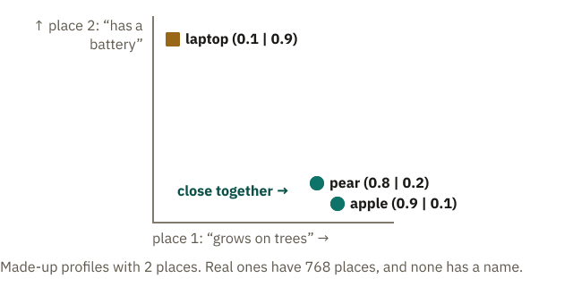
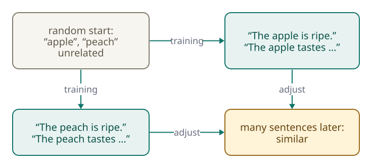
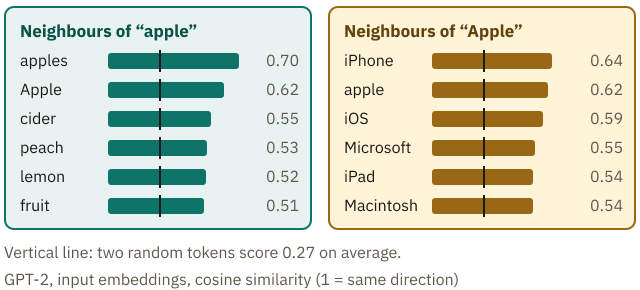
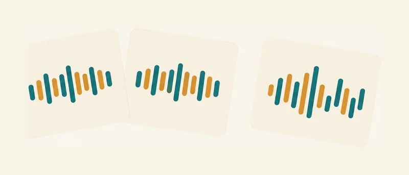
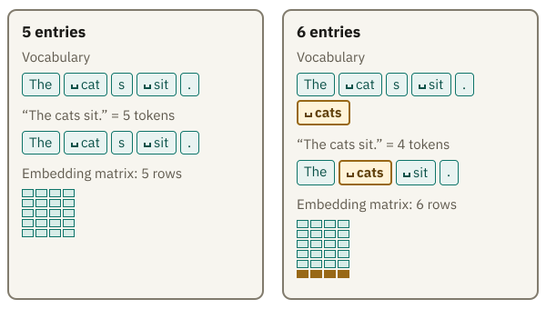

<!-- Generated from src/content/bausteine/en/embeddings.mdx by scripts/export-lessons.mjs -- do not edit by hand. -->

# Embeddings: How a Number Becomes a Learned Vector

> Reading copy for GitHub. The full version with interactive demos, animations and recall moments is on the website: **[Embeddings: How a Number Becomes a Learned Vector](https://ki-einfach-verstehen.de/en/lessons/embeddings/)**
>
> Licence: [CC BY 4.0](https://creativecommons.org/licenses/by/4.0/deed.en) · Credit it as: KI einfach verstehen, “Embeddings: How a Number Becomes a Learned Vector”, CC BY 4.0, https://ki-einfach-verstehen.de/en/lessons/embeddings/

Why a token ID tells the model nothing about similarity, how training turns random numbers into similar profiles for tokens used in similar ways, and what a large vocabulary costs.

*A barcode tells the checkout which item it is, but nothing about what the item has in common with others.*

At the supermarket checkout, the barcode reveals exactly one thing: which item it is. No barcode says that apples and peaches are both fruit. The same goes for a [language model](https://ki-einfach-verstehen.de/en/glossary/language-model/) and your chat message. From the previous lesson, you know that your message is a sequence of [token IDs](https://ki-einfach-verstehen.de/en/glossary/token-id/), each saying only which piece of text is meant.

The smallest version of the freely available model GPT-2 has an English [vocabulary](https://ki-einfach-verstehen.de/en/glossary/vocabulary/) (the fixed list of all pieces a tokenizer knows). Whenever GPT-2 is mentioned here, it means this version. Mid-sentence, with a space in front, “apple” has the number 17180, “laptop” 13224, and “peach” 47565. By number, the laptop is much closer to the apple than the peach is. Does the model therefore treat apple and laptop as related?

## What a number lacks

A token ID is the number on an index card, as in the lesson on [token IDs](./token-ids-and-vocabulary.md). It says which piece of text is meant and means nothing in itself. The tokenizer assigned the numbers while building its vocabulary, without regard to meaning. So neighboring numbers do not stand for similar pieces.

The tokenizer’s card holds only the piece of text. The model uses the same number as a page number in its own thick reference book. You know this from the lesson on [scalar, vector, matrix, and tensor](./scalar-vector-matrix-tensor.md). In GPT-2, every page holds 768 numbers. In the computer, that is one row of a large table; the token ID is its row number. So the model looks up the token’s numbers, not a fact like “France | Paris.”

Here, this row is called the token’s **profile**: a fixed sequence of numbers belonging to this token alone.

**Unlike numbers, profiles can be compared.** In a made-up example, the profile has only two places, labeled “grows on trees” and “has a battery.” The apple scores high on the first and low on the second, the peach almost the same, and the laptop the other way round. The sketch below shows the numbers. Real profiles have 768 places, and none has a name.

*A made-up example: each profile of two numbers becomes an arrow from the origin. Which arrows point in the same direction?*

Plot the first number to the right and the second upward, and each profile becomes an arrow from the origin. The arrows are compared by direction, even with 768 places that nobody can draw. If two profiles point in a similar direction, they are called **neighbors**.

In the sketch, the arrows of apple and peach point almost the same way, the laptop’s in a quite different one.

## How random numbers become profiles

Who entered these numbers? Nobody. Before training, the table holds random numbers, usually small values scattered around zero, and every token starts with a different profile. At this point, “apple” shares as little with “peach” as with “laptop”.

Training then works as in the lesson on [parameters, training, and use](./parameters-training-inference-hardware.md): the model predicts the next token. Then its [parameters](https://ki-einfach-verstehen.de/en/glossary/parameters/), the faders on the mixing desk, are adjusted a little so the prediction fits better. The numbers in the table are such faders too. So whenever a token occurs in a training sentence, its row is adjusted as well.

Suppose a small model has one row each for “apple” and “peach.” Its training texts contain sentences like “The apple is ripe.” and “The peach is ripe.” After “apple,” the model should predict “is,” so the row “apple” is shifted until “is” fits better. The same follows “peach.” “Laptop,” by contrast, appears in sentences like “The laptop has a battery.”

Why do the two rows become similar? After the table, every token goes through the same computation with the same faders. In a made-up toy model, each profile has a single number. The computation after it is “times 2,” giving the [score](https://ki-einfach-verstehen.de/en/glossary/score/) (an assessment of how well a piece of text fits) for “is” as the next token. For this example, the score should be exactly 10; too much is as wrong as too little. Real scores only count relative to the others.

The row “apple” starts with a small number, so its score is too low. Because five times two makes ten, the number is nudged step by step toward five. The row “peach” holds a number that is too large; it also moves toward five. Both end up at five, because the same computation should deliver the same result.

After “laptop,” by contrast, comes “has.” There the score for “is” should be low, so the number in the row “laptop” moves down, away from five. In real models, the computation after the table is much longer, and its faders are adjusted in training too. In those models too, **tokens followed by similar things are adjusted alike.** With many numbers per row, their arrows point in similar directions.

[▶ watch the animation on the website](https://ki-einfach-verstehen.de/en/lessons/embeddings/)

*A made-up example: because the same thing follows “apple” and “peach,” both rows are adjusted alike during training.*

Linguists had this idea as early as the 1950s: words that occur in similar contexts tend to have similar meanings. It is called the **distributional hypothesis**. The linguist J. R. Firth summed it up in 1957: “You shall know a word by the company it keeps.”

> **Interactive demo:** [try it on the website](https://ki-einfach-verstehen.de/en/lessons/embeddings/)

Today’s chatbot models learn their table the same way, only with billions of sentences instead of a handful.

## Similar use, similar profile

You can check this on GPT-2, whose table is freely available. You can work out for yourself how similar the directions of two profiles are. The same direction gives 1, a right angle 0. In the sketch, apple and peach point in almost the same direction, apple and laptop much less.

> **Interactive demo:** [try it on the website](https://ki-einfach-verstehen.de/en/lessons/embeddings/)

This solves the opening puzzle: in GPT-2, “apple” and “peach” reach 0.53, “apple” and “laptop” only 0.36. Two random tokens average 0.27 in GPT-2, although they have nothing to do with each other. So the laptop lies a little above chance, the peach far above it, although its number is much farther away. Among whole words, the nearest neighbors of “apple” are “apples” and “Apple,” followed by “cider,” “peach,” “lemon,” and “fruit.” Nobody told the model they belong together; they appeared in similar sentences.

*The nearest neighbors of “apple” and “Apple” in GPT-2’s table (a selection, recomputed for this lesson). The bars show how similar the directions of the profiles are; 1 would mean pointing the same way. The vertical line marks 0.27, what two random tokens reach on average.*

For GPT-2, the capitalized “Apple” is a separate token with its own profile. Its neighbors are “iPhone,” “apple,” “iOS,” “Microsoft,” “iPad,” and “Macintosh.” Microsoft is neither an apple nor a phone; the name just occurs in similar texts. So similar profiles stand for **similar use in text**. No profile contains a definition.

One level deeper: how do you measure whether two profiles are similar?

Usually with **cosine similarity**: 1 means the same direction, 0 a right angle, −1 opposite. Multiply the numbers in the same place, add up the products, and divide by the lengths of the two arrows (the square root of the sum of the squares). As a formula: cos(v, w) = (v · w) / (|v| · |w|). With the sketch: apple and peach give 0.9 · 0.8 + 0.1 · 0.2 = 0.74, divided by √0.82 · √0.68 ≈ 0.75, so cos ≈ 0.99.

In GPT-2, apple and peach reach 0.533, apple and laptop 0.357; 20,000 random pairs average 0.27, and 95 out of 100 were below 0.35. Why is chance not at 0? All profiles point a little in one shared direction: every row has a positive cosine with the average of all rows. Subtract this average, and random pairs average 0. What matters, then, is the distance from the random value.

## Embedding and embedding matrix

*Profiles without labels: tokens used in similar ways carry similar patterns of numbers; a token used differently carries a different one.*

In GPT-2, “apple” has a whole row of numbers. The first three are 0.119, −0.175, and 0.129. What does the second one mean? Nobody can say, and the same goes for the other numbers in the row. The profile analogy has a limit here: a profile on paper has fields like height or eye color that someone filled in. In GPT-2, no field has a name, and textbooks note that the individual numbers have no clear meaning. **What a profile expresses lies in all its numbers together.**

One level deeper: what lies in the other numbers?

The other numbers in the row are just as nameless. A single place usually does not stand for a named feature such as “fruit,” and its sign alone reveals nothing tangible. What matters is the pattern of all the numbers together. The ID-card comparison breaks down here: a card has fields that each hold something unambiguous, whereas each number in a profile contributes only a part of a pattern, much as a single stroke in a face says little. Two profiles count as similar because their numbers together point in the same direction, not because one particular place matches. So nobody compares just a single number. Anyone who wants to know whether two tokens are related computes with all the numbers together.

In technical terms, a token’s profile is called its **[embedding](https://ki-einfach-verstehen.de/en/glossary/embedding/)**. Because it is an ordered list of numbers, it is a [vector](https://ki-einfach-verstehen.de/en/glossary/vector/). The whole table with one row per token of the [vocabulary](https://ki-einfach-verstehen.de/en/glossary/vocabulary/) is called the **[embedding matrix](https://ki-einfach-verstehen.de/en/glossary/embedding-matrix/)**.

In GPT-2, the embedding matrix has one row for each of its just over 50,000 vocabulary entries. At 768 numbers per row, that makes almost 39 million numbers, about a third of the more than one hundred million parameters of this smallest GPT-2 version.

## One row per token, not per word

Does “Apfel” (German for apple) get a row of its own? That depends on how the vocabulary is cut. In GPT-2, “apple” is a whole token, because its vocabulary comes from English texts. German words often split into pieces in GPT-2. “Katze” (cat), with a space in front, becomes “␣Kat” and “ze”; the symbol ␣ stands for the space that belongs to the piece. “Apfel” (apple) becomes “␣Ap,” “f,” and “el.”

So GPT-2’s embedding matrix has no row for “Apfel,” only rows for the three pieces. The row “␣Ap” is also used for words such as “Apotheke” (pharmacy) that begin with the same piece. That the three pieces together mean the fruit only emerges in the computing stages after the table.

Why not simply take a larger vocabulary? In the lesson on token IDs, a made-up mini vocabulary had five entries: “The,” “␣cat,” “s,” “␣sit,” and “.”. With it, “The cats sit.” becomes five tokens; with “␣cats” as a sixth entry, four. In return, the embedding matrix gets a sixth row.

*A made-up mini vocabulary: with the sixth entry “␣cats,” the sentence gets one token shorter, but the embedding matrix gets one more row.*

The new row always costs space in the table. It saves a token only when “cats” occurs in the text: one fewer position in the [context window](https://ki-einfach-verstehen.de/en/glossary/context-window/) (the maximum number of tokens the model processes at once) and one fewer round when answering. In a sentence about dogs, it saves nothing.

## How big should the vocabulary be?

Three tokenizers from OpenAI have different vocabulary sizes. GPT-2’s has more than 50,000 entries, GPT-4’s (a model behind ChatGPT) about 100,000, and its successor GPT-4o’s about 200,000. The largest has about four times as many entries as the smallest. Does a sentence then get four times shorter?

> **Interactive demo:** [try it on the website](https://ki-einfach-verstehen.de/en/lessons/embeddings/)

“The cat is sitting on the windowsill.” needs 9 tokens with all three: for its words, the larger vocabularies bring no new entries. The German sentence “Die Katze sitzt auf dem Fensterbrett.” becomes 14 tokens in GPT-2, 12 in GPT-4, and 9 in GPT-4o. The largest vocabulary holds “␣Katze” whole; GPT-2 has to split it. **An entry only saves where its piece of text occurs.**

The costs grow with every entry. Suppose GPT-2 had GPT-4o’s vocabulary, still with 768 numbers per row. Its embedding matrix would be about four times as large. It would have more numbers than the rest of the model, the computing stages after it. A second cost comes from training. During training, a row is adjusted mainly when its token occurs in the text. The larger the vocabulary, the more entries are so rare that their rows get little practice. Researchers found such undertrained entries in widely used models, where they can trigger strange behavior.

The best size depends on the training effort, according to a 2024 study: larger models can handle larger vocabularies. A large model, trained on a great deal of text, sees even rare entries often enough; for a small one, even a medium-sized vocabulary can be too large.

## A bank is a bank, for now

*A bank to sit on or a bank for your money: at the model’s input, it is the same profile.*

“I sit on the bank in the park.” “I pay money into the bank.” At the model’s input, it is the same token: same number, *the same* row in the embedding matrix. The row does not fix which meaning is meant here.

Even so, a chatbot usually understands “bank” correctly. **So the profile from the table is only the starting point.**

The profile does not reveal where “bank” stands in the sentence either: for the same token ID, the model looks up the same row, whether the token comes at the start of the sentence or at the end. How the computing stages after it mix in the rest of the sentence, and how they keep track of the order, is the topic of the next lesson.

---

Source: https://ki-einfach-verstehen.de/en/lessons/embeddings/

← Previous: [Tokenization Inside the Model: How Your Chat Becomes a Token Sequence](./tokenization-inside-the-model.md) · [All lessons](../../README.md#contents) · Next: [Transformer Blocks and Attention: How Context Gets Mixed In](./transformer-blocks-and-attention.md) →
