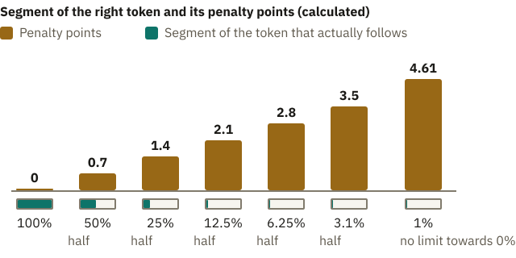
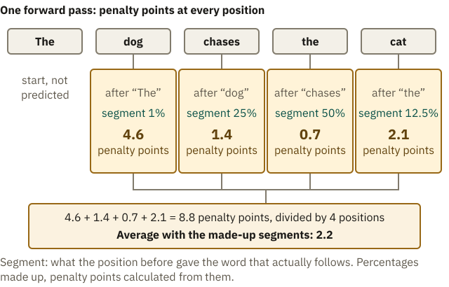
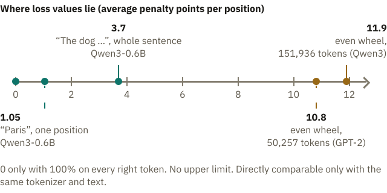

<!-- Generated from src/content/bausteine/en/forward-pass-and-loss.mdx by scripts/export-lessons.mjs -- do not edit by hand. -->

# Forward Pass and Loss: How the Model Measures Its Own Error

> Reading copy for GitHub. The full version with interactive demos, animations and recall moments is on the website: **[Forward Pass and Loss: How the Model Measures Its Own Error](https://ki-einfach-verstehen.de/en/lessons/forward-pass-and-loss/)**
>
> Licence: [CC BY 4.0](https://creativecommons.org/licenses/by/4.0/deed.en) · Credit it as: KI einfach verstehen, “Forward Pass and Loss: How the Model Measures Its Own Error”, CC BY 4.0, https://ki-einfach-verstehen.de/en/lessons/forward-pass-and-loss/

How a language model’s percentages for the token that actually follows turn into penalty points, how a whole stack of text becomes one single number, and what that number does not measure.

In the previous lesson, a cover card lay on the text. The model guesses the next piece, and the answer lies under the card. On its own, though, a language model does not give a single answer. It spreads percentages across all the [tokens](https://ki-einfach-verstehen.de/en/glossary/token/) it knows. In a test, you get points for right and none for wrong. How do you score a prediction that puts 72 percent on the right word and the rest on others?

The answer lies in the training loop from the lesson on [parameters, training and use](./parameters-training-inference-hardware.md): compute, compare, adjust. Comparing produces an error number, and there it was called the **[loss](https://ki-einfach-verstehen.de/en/glossary/loss/)**. It is larger the fewer percent the model gave the piece of text that actually follows in the training text. Remember the made-up apple model? There, each deviation between prediction and price was multiplied by itself. Percentages need a different rule. In this lesson, the error number of a single prediction is called penalty points; averaged over all predictions, they give the loss. Before you read on, estimate for yourself who should get more penalty points: a model with 1 percent on the right token or one with 27 percent, and how many more.

## Penalty points for one prediction

Remember the prize wheel from the [probability and softmax](./probability-and-softmax.md) lesson? After “The cat”, [softmax](https://ki-einfach-verstehen.de/en/glossary/softmax/) turned three made-up scores into a wheel: “sat” got a segment of about 72 percent, “slept” about 27, “flew” about 1 percent. Each segment is as large as its [probability](https://ki-einfach-verstehen.de/en/glossary/probability/). In the training text, “sat” follows: this token is the [label](https://ki-einfach-verstehen.de/en/glossary/label/), the answer under the card.

*The wheel after “The cat”: the lamp marks the segment of the token that actually follows in the text; only this segment counts. Large segment, few penalty points in the jar (schematic).*

The rule looks only at its segment: large means few penalty points, small means many. The other segments do not count. Two things do not fit the picture. First, nothing is spun in training; the next token is already in the text. Second, nobody punishes; the model feels nothing. The penalty points, the balls in the jar, are a number the [training algorithm](https://ki-einfach-verstehen.de/en/glossary/training-algorithm/) later tries to shrink by adjusting the [parameters](https://ki-einfach-verstehen.de/en/glossary/parameters/). Unlike a jar, penalty points never fill up: they have no upper limit.

Penalty points are not a percentage, nor do they count the percentage points that are missing. A gain of a few percentage points makes a big difference to a small segment and almost none to a large one.

So the rule counts how many halvings it takes to get from the whole wheel down to the segment’s size. **Every halving of the segment costs about 0.7 penalty points more.** The smaller the segment, the more expensive.

*Every halving of the segment costs about 0.7 penalty points more. Towards zero, the penalty points grow without limit (calculated).*

For “sat” with 72 percent, that is just under half a halving, so 0.33 penalty points.

“Slept” at 27 percent costs about 1.3. “Flew” at 1 percent costs more than three times as much.

What does a segment half that size cost, 36 percent?

> **Interactive demo:** [try it on the website](https://ki-einfach-verstehen.de/en/lessons/forward-pass-and-loss/)

At 36 percent it is 1.02, one halving more than at 72 percent. Where that number comes from is shown in the box at the end of this section.

With 98 percent on “flew”, “sat” is left a narrow, expensive strip. That is the confidently wrong prediction, and it costs the most.

A near miss is cheap: if the model gives “slept” 60 percent and “sat” 40, it still pays only about 0.9. Experts call this rule **cross-entropy**; it gives one position’s penalty points.

Even the front-runner pays. In the [output head](./output-head.md) lesson, the small, openly available model Qwen3-0.6B gave “Paris” almost half the probability after the German “Die Hauptstadt von Frankreich ist”. The English “The capital of France is” splits into other tokens, and there “Paris” gets about a third, again more than any other token. If “Paris” follows in the text, it still pays. Each position counts only the segment that follows in the text; the average comes later. This holds whether the model is sure or unsure, and whether the word is common or rare. **Every prediction below 100 percent costs something.** This is exactly how the language models behind your chatbots are pretrained; training on conversations follows.

One level deeper: the formula behind the penalty points

The penalty points of a position are

`penalty points = −ln p`

Here p is the probability of the token that actually follows, written as 0.72 instead of 72 percent. ln is the natural logarithm. For numbers below 1 it is negative; the minus makes the penalty points positive: −ln 0.5 is 0.693.

The logarithm turns multiplying into adding. Halving means multiplying by ½, and that becomes “plus 0.693”, whatever the segment’s size. Hence the series with its 0.7 steps.

The widely used training library PyTorch takes the scores before softmax, the logits, and the label, computes softmax and logarithm in one go and averages over all positions.

But a sentence has more than one position.

## Forward through the model, one number for the batch

In the output-head lesson, “The dog chases the cat” ran through the model, each word simplified as one [token](https://ki-einfach-verstehen.de/en/glossary/token/). In training, every position delivers its scoreboard, a score for every token in the vocabulary. Four can be checked: “The” should predict “dog”, “dog” the word “chases”, “chases” the word “the”, and “the” the word “cat”. For “cat”, no next token is left in the text.

The model runs the familiar path: each token fetches its profile, the embedding. The blocks mix in the context, layer by layer. The output head turns this into a list with one value per token for each position, softmax into a wheel. Experts call this path the **[forward pass](https://ki-einfach-verstehen.de/en/glossary/forward-pass/)**.

Answering takes the same path. So training measures what the model later outputs. In training, each position gets the true text before it; when answering, it gets what the model has written so far.

Four words are predicted, and each costs penalty points by the segment the position before gave it.

The segments are made up: for “dog” the right word gets 1 percent, for “cat” 12.5 percent. The others are in the graphic.

The most expensive is “dog”: after “The”, many words are possible, so the right one gets a small segment. After “chases”, “the” is obvious and cheap.

*One forward pass, four predictions: under each predicted word you see how large its segment was after the word before, and what that costs. The sentence gets the average (made-up percentages).*

The four values become one average: 8.8 penalty points divided by four positions gives 2.2, the loss of this sentence. Why not the sum? Then a long text would get a larger loss for its length, even with equally good predictions. The average makes texts of different lengths comparable. The loss does not say whether a sentence as a whole is true: it measures each token’s prediction and only averages at the end.

Now with real numbers: Qwen3-0.6B, the openly available base model without chat training, computed this sentence.

Its [tokenizer](https://ki-einfach-verstehen.de/en/glossary/tokenizer/), the program that splits text into tokens, cuts it into six: “The”, “dog”, “ch”, “ases”, “the” and “cat”. “The” is not predicted, as nothing precedes it; so six tokens give five penalty-point values. Their average is 3.7. Which token likely costs the most?

> **Interactive demo:** [try it on the website](https://ki-einfach-verstehen.de/en/lessons/forward-pass-and-loss/)

The most expensive are “dog” and “ch”, at about 9.5 and 6.4 penalty points. After “The”, the model expected “following” (48 percent), so “dog” got a tiny segment. After “The dog”, it expected “is” (15 percent), so “ch” got almost nothing.

The cheapest is “ases” after “ch” at 0.24: which other piece should follow?

Training does not use single sentences. In the training lesson, the algorithm adjusted the parameters once the slopes from a large stack of text were collected. Experts call this stack a **[batch](https://ki-einfach-verstehen.de/en/glossary/batch/)**. In the input-and-output lesson, “batch” meant many requests at once; here it is the stack from which one error number is computed. All its sequences run forward, every position gets its penalty points, and the average over all positions is the loss of the batch.

GPT-3, OpenAI’s language model from 2020, shows how large such a stack is. Per its research paper, the batch size of the largest version was about 3.2 million tokens. So millions of penalty points become one number.

When answering, each new token needs a forward pass, because the model writes token by token. In training, a finished piece runs forward once, all positions at once. Then comes the way back, during which the error travels through the model; it takes about twice the computation of the forward pass. So in training a piece costs about three times as much as one forward pass.

What does this one number say, and what does it not say?

## What the loss says and what it does not

A useful reference point is a model without any training. Its parameters start with random values, so all token scores are close together. Then softmax spreads the wheel almost evenly. With the 151,936 tokens of Qwen3-0.6B, each token would get an equally large segment. How many penalty points does each position cost then, whichever token follows?

*Before training: a wheel of nothing but equally narrow segments. Every token costs about 11.9 penalty points (schematic).*

It is about 11.9 penalty points, roughly 17 halvings from 100 percent down to a tiny segment. A carefully started training run begins at such a value. The real sentence, at 3.7, is far below, with the same vocabulary: that model has learned. Every token here gets the same small segment, however the sentence goes on and whichever word follows. The wheel knows nothing about the text; it guesses. A learned model spreads its segments unevenly, depending on the sentence it reads.

OpenAI’s older GPT-2 has a smaller vocabulary, about 50,000 tokens, so its even wheel costs about 10.8. The same ignorance gives different numbers depending on the vocabulary.

The text counts too: surprising words cost a lot, predictable ones little. A different sentence gives a different average, and two tokenizers cut the same text differently. **So loss values can only be compared directly with the same tokenizer and the same text.**

A loss of 0.5 sounds like “half wrong”. That is an easy guess, since percentages go in and many values are between 0 and 1. But the loss is not a share.

It has no upper limit: the smaller the segment of a single position, the more penalty points it costs.

An average can give 0.5 too, for instance from a confident position with 0 penalty points and one with about 1. Without a comparison value on the same text, a loss says little.

*Where loss values lie: 0 only with 100 percent for every right token; an even wheel depends on the vocabulary. Values are directly comparable only with the same tokenizer and the same text.*

The loss does not measure truth. Remember “Sydney” from the softmax lesson: if many training texts follow “The capital of Australia is” with “Sydney”, that costs less the larger the segment for “Sydney” is, even though Canberra is the capital. A small loss means only: well predicted, what the training texts contain. That is one reason a chatbot can phrase falsehoods as smoothly as truths.

Suppose the training text has a typo, say “The cat sat on the sfoa”, and the model gives “sofa” a large segment. Will this position be expensive or cheap?

Expensive. The answer under the card is the typo, which gets only a narrow segment. The model made a sensible prediction and pays anyway.

One level deeper: perplexity, the loss as a number of options

Research papers often give the **perplexity** instead of the loss. It comes from the average loss over a text:

`perplexity = e to the power of the loss`

e is the number 2.718…, the base of the natural logarithm. Perplexity translates the loss into a number of equally good options. A model with perplexity 2 is on average as unsure as if it had to choose between two equally large segments at every point. The textbook by Jurafsky and Martin calls it a weighted average branching factor.

For “The dog chases the cat” with 3.7 penalty points on average, that gives e to the power of 3.7, about 40: as if Qwen3-0.6B were choosing between about forty equally large segments each time. An even wheel over 151,936 tokens comes to exactly 151,936, one option per token.

The loss says how far off the model was, but not why. Which of the 0.6 billion parameters of Qwen3-0.6B contributed how much to the 3.7? The next lesson on backpropagation (the way back through the model) and gradients (the slopes) answers that.

---

Source: https://ki-einfach-verstehen.de/en/lessons/forward-pass-and-loss/

← Previous: [Text Becomes Many Practice Problems](./text-becomes-many-practice-problems.md) · [All lessons](../../README.md#contents) · Next: [Backpropagation and Gradients: How the Model Knows What to Change](./backpropagation-and-gradients.md) →
