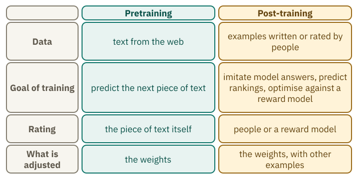
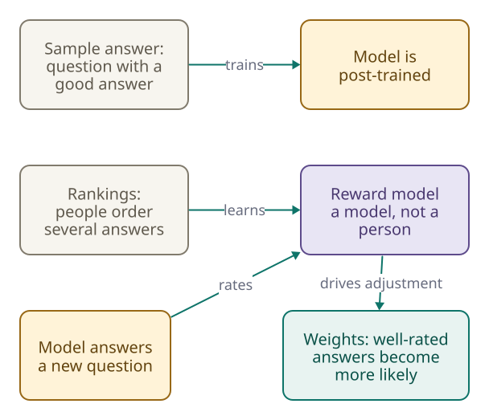
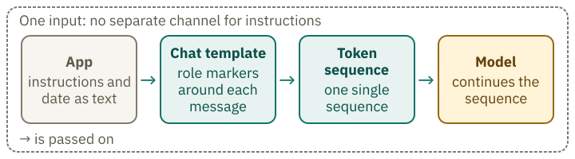

<!-- Generated from src/content/bausteine/en/from-text-predictor-to-assistant.mdx by scripts/export-lessons.mjs -- do not edit by hand. -->

# From Text Predictor to Assistant: What Post-Training Makes of a Model

> Reading copy for GitHub. The full version with interactive demos, animations and recall moments is on the website: **[From Text Predictor to Assistant: What Post-Training Makes of a Model](https://ki-einfach-verstehen.de/en/lessons/from-text-predictor-to-assistant/)**
>
> Licence: [CC BY 4.0](https://creativecommons.org/licenses/by/4.0/deed.en) · Credit it as: KI einfach verstehen, “From Text Predictor to Assistant: What Post-Training Makes of a Model”, CC BY 4.0, https://ki-einfach-verstehen.de/en/lessons/from-text-predictor-to-assistant/

Why a base model continues questions instead of answering them, what post-training changes, and where a chatbot gets its date and its instructions.

If you give a language model without chat training a question, it often keeps writing underneath: another question, another task, sometimes even an answer. That sounds like a broken program. In fact, the model does exactly what it was trained to do. The chatbot you talk to today has gone through another stage of training that turns the model into an assistant. How does that training teach it to answer your questions?

## A base model continues text, it does not answer reliably

A [base model](https://ki-einfach-verstehen.de/en/glossary/base-model/) is a [model](https://ki-einfach-verstehen.de/en/glossary/model/) after pretraining, but before chat training. In pretraining it learned to predict the next piece of a text. Remember the lesson on [input and output](./input-and-output.md)? There, every piece of text was the target for the text before it.

A research paper from OpenAI in 2022 shows what such a model does with a task. The authors gave GPT-3, with 175 billion [parameters](https://ki-einfach-verstehen.de/en/glossary/parameters/), this task, in French: “Write a short story about a frog that travels back in time to ancient Greece, in French.” The task is in French in the paper; the English version here is a translation.

What does GPT-3 write in response? Make a prediction first. Figure 8 in the paper shows what GPT-3 and its post-trained variant InstructGPT actually wrote.

> **Interactive demo:** [try it on the website](https://ki-einfach-verstehen.de/en/lessons/from-text-predictor-to-assistant/)

For this French task, GPT-3 writes no story, but three further tasks of the same kind (Ouyang et al. 2022, arXiv:2203.02155v1, Figure 8, p. 15).

This happens because the model was trained to predict the next piece of text. For prediction, a task is simply one more part of that text, and in such texts another task often follows. The paper sets this prediction task against the goal of following the user’s instructions helpfully and safely. The authors therefore call the prediction task “misaligned”, that is, not aligned with the instructions.

A copy clerk writes on every half-finished document, without knowing who will read it. If she gets a sheet with a list of tasks, she often writes further tasks underneath. That is no failure: she follows the pattern that is common in such documents. The sheet is the input. The clerk’s writing habits (the weights) and her next sentence (the prediction) are not shown in the picture; the text assigns them.

The limit of this picture: the copy clerk has no intention. A model chooses no goal. It continues patterns that were frequent in training.

*A copy clerk at a desk. Lines stand on the sheet, and the pen rests at the top edge. The image shows no task sheet and no answer; the text explains what the lines mean.*

The pattern is the same whether the text looks like a task or like a question: the model continues what usually follows in texts of this kind. Even questions that do not look like tasks show it. The paper has a code question: What does the list `C` do in this program? On the code question “What is the purpose of the list C in the code below?”, GPT-3 sets up four answer options, “A. to D.”, as in a multiple-choice exercise (ibid.). According to the legend, GPT-3 answers the code question only about half of the time; so even for the same question, sometimes an answer comes out and sometimes something else. The legend says the prompts were selected to show certain behaviours; the outputs themselves were not selected.

That modern models still answer questions is due to a second training, [post-training](https://ki-einfach-verstehen.de/en/glossary/post-training/). The next section shows how it works.

## Three steps that turn models that continue text into helpers

Post-training comes after pretraining, but what changes between the two stages, and what stays the same? The lesson on input and output introduced its purpose: teaching the chatbot to answer your questions. The result is called an [instruction model](https://ki-einfach-verstehen.de/en/glossary/instruction-model/), because it is meant to follow instructions.

*Pretraining and post-training side by side: the same base model is trained further, with other examples and a rating.*

The InstructGPT paper describes its method in three steps. In the first, examples of good answers are collected and used to train the model further. A team of about forty contractors wrote these sample answers. For this, they used about 13,000 prompts, that is, tasks or questions.

In the second step, contractors get several answers to the same question and sort them by how helpful they are. From these rankings, a [reward model](https://ki-einfach-verstehen.de/en/glossary/reward-model/) learns to predict which answer a person would prefer. This model, too, has to be trained before it can rate answers. The reward model also needed tens of thousands of prompts.

In the third step, the model answers new prompts, the reward model rates each answer with a number, and the weights of the model are adjusted so that highly rated answers become more likely. For this step, it also used tens of thousands of prompts that customers had sent through the programming interface.

[▶ watch the animation on the website](https://ki-einfach-verstehen.de/en/lessons/from-text-predictor-to-assistant/)

*The three steps of post-training: sample answers, rankings for the reward model, and optimisation against this reward model.*

Post-training still adjusts the model’s weights. The difference lies in the examples it learns from and how its answers are scored. In pretraining the task was to predict the next piece of text. How far its prediction was from the real piece of text determined how the parameters were adjusted. In post-training, sample answers and rankings serve as the basis.

The copy clerk now gets sample answers and learns which drafts the contractors prefer. The picture has a limit: during training, no person reads each new answer and rates it on the spot. The reward model takes over this rating. It learned from the rankings collected beforehand to imitate human judgements.

> **Interactive demo:** [try it on the website](https://ki-einfach-verstehen.de/en/lessons/from-text-predictor-to-assistant/)

One level deeper: what post-training costs

How much computing power does post-training require? The paper measures this in petaflop/s-days, a unit of computational work. The paper gives values for two training runs: supervised post-training (4.9 petaflop/s-days) and the PPO step with pretraining updates (60). The reward model is not quantified in it. The pretraining of GPT-3 needed 3,640. Own calculation: 4.9 divided by 3,640 is about 0.13 percent, and 60 divided by 3,640 about 1.6 percent. The values apply to the model from 2022.

The optimisation step is called PPO, short for Proximal Policy Optimization, a method from reinforcement learning. It changes the weights step by step. A penalty is deducted for each word in the answer. The more the answer differs from what the starting version (the model after step 1) would produce, the larger the penalty. This penalty is meant to prevent the model from gaming the rating with answers that please the reward model but not people.

## A smaller model beats the large one

The clearest evidence for the effect of post-training comes from a comparison. Contractors rated the answers of InstructGPT with 1.3 billion parameters and the answers of GPT-3 with 175 billion parameters. The smaller version was preferred. The paper speaks of more than a hundred times fewer parameters.

This comparison has one limit. The contractors rated answers to requests that customers had sent to the model through the programming interface (API) and that were not used in training. The results show which answers the contractors preferred in this test; they do not establish that the smaller model is better in every respect. In addition, post-training comes at a cost. Performance fell on several public test datasets, a cost the authors call the “alignment tax”, a tax on the adjustment. Mixing in texts from pretraining reduced this loss, but did not eliminate it. Even with those updates, the model still performed worse than GPT-3 on translation and reading comprehension.

The results date from 2022. The comparison shows a tendency for this model and its tests, not a general property of models.

## What post-training shapes: an open hypothesis

What does the model really learn in post-training? A hypothesis from 2023 is called the Superficial Alignment Hypothesis. According to this hypothesis, the knowledge and abilities of a model arise almost entirely in pretraining. Post-training, which the paper calls “alignment”, teaches the model which kind of answer fits the situation in a conversation with users.

The hypothesis rests on a small experiment with 1,000 hand-picked examples. With so few examples, the result can only be generalised to a limited extent.

In 2024, a group of researchers tested the hypothesis. Their summary says that performance after post-training grows with the number of examples. For tasks such as mathematics, a few examples mainly change the style without bringing out everything the model can do. That speaks against the reading that post-training only changes style, but it does not refute the hypothesis.

That post-training only changes the style is a hypothesis, not an established finding. Whether the model thereby acquires new knowledge cannot be read from the 2024 finding.

## The chat is text with markers

How does a model know who speaks in the chat? The model card of the base model Qwen2.5-7B from Alibaba advises against using base models for conversations. It recommends further adjusting the model with post-training. So that the model recognises who speaks in the chat, the text receives a fixed form that marks every message with its role.

This form is set by the [chat template](https://ki-einfach-verstehen.de/en/glossary/chat-template/). It takes the messages with their roles and sets them as a single sequence of [tokens](https://ki-einfach-verstehen.de/en/glossary/token/). Each message gets markers, [special tokens](https://ki-einfach-verstehen.de/en/glossary/special-token/), that say who speaks and where the contribution ends. The template of Qwen3-0.6B puts `<|im_start|>user` before your question and `<|im_end|>` at its end. At the end it adds `<|im_start|>assistant`. This unfinished message header marks where the model should begin writing its answer. Without it, the sequence ends with your message, and the model can continue your message instead of answering it.

*Where the input comes from: the app adds instructions and the date, the template wraps everything in markers, and the model continues the sequence. There is no separate channel for the instructions.*

The documentation sums this up: the chat is therefore only a sequence of tokens. With the wrong markers, models work noticeably worse.

> **Interactive demo:** [try it on the website](https://ki-einfach-verstehen.de/en/lessons/from-text-predictor-to-assistant/)

The [system prompt](https://ki-einfach-verstehen.de/en/glossary/system-prompt/) of the app is likewise just one entry in this sequence, usually at the very front. Without a system prompt, the Qwen3 template leaves this entry out entirely; it does not insert a substitute.

OpenAI’s gpt-oss models use a different format: Harmony. The model’s instructions appear in a separate message with the role “developer”. That message serves the same purpose as the system prompt in other formats. The basic idea is the same: everything the model sees is text in a sequence. Examples are in the lesson on [tokenization inside the model](./tokenization-inside-the-model.md).

## The date is in the text, not in the model

If you ask a chatbot for today’s date, you often get a correct answer. How does it know? Pretraining ends at a knowledge cutoff; what happened afterwards it could not learn. A current date cannot come from the model’s training. It mostly arrives as additional text that the model receives before its answer.

The company behind the chatbot Claude (Anthropic) explains in its release notes that the system prompts of its own apps supply details such as the current date at the start of each conversation. These instructions explicitly do not apply to the programming interface (API), which lets your own program communicate with the model. If you use that interface and want the date included in the input, you have to send it yourself.

*A hand places a slip on top of the stack the model reads. The slip carries only one line with the date: the date is in the input, not in a calendar of the model.*

If you want to know where a chatbot gets its date from, look first at the text it receives before its answer. The Harmony example also has a separate system message next to the developer message, with the knowledge cutoff and the date. These are example values from the documentation, not details about a particular model. What matters is where the date appears: it is a line in the input text, rather than knowledge stored in the model. The Qwen3 template inserts no date. If the model is to get one, the app must add it.

The conclusion: a date comes from the app, from a message you write yourself, or the template inserts one. Some templates, such as the one from the tokenization lesson, insert a fixed default date when the app does not supply one. A fixed date from the template matches today only by coincidence. Whether a date is right therefore depends on what the app sends.

## What remains

The question from the beginning can now be answered. A base model has learned to continue text. For it, a task is one piece of text among others. That is why it does not answer reliably. Post-training teaches it which continuations people prefer. In the described method (InstructGPT), this happens through further training with other examples and a different rating.

In the chat, the assistant sees only one single sequence: instructions, date, the earlier messages and the new question, all as text with markers. According to the hypothesis, the knowledge it brings comes mainly from pretraining; post-training shapes how it shows.

In the next lesson you will ask what happens between question and answer when a model “thinks” for longer beforehand.

**Exercise: Which output comes from which model?**

The same input, two outputs. The examples are invented for this exercise.

Input: “Write down three cities in France.”

Output A: “Write down three cities in Germany. Write down three rivers in Europe.”

Output B: “Gladly: Paris, Lyon and Marseille are three large cities in France.”

Which output comes from the base model, and which from the assistant? Justify your assignment with the training goal and with post-training.

**Solution:**

Output A comes from the base model. Its training goal is the next piece of text. For this prompt, the natural continuation is another task, so it continues the list of tasks. Output B comes from the assistant: it answers in chat tone (“Gladly:”). A base model sometimes answers too, so the answer alone is no proof; post-training shaped the chat tone with sample answers and ratings. Post-training mainly changes the examples and the rating. The base model is the basis for it.

---

Source: https://ki-einfach-verstehen.de/en/lessons/from-text-predictor-to-assistant/

← Previous: [Why Prediction Is More Than Parroting](./why-prediction-is-more-than-parroting.md) · [All lessons](../../README.md#contents) · Next: [How a Model "Thinks": Intermediate Steps It Writes Itself](./how-a-model-thinks.md) →
