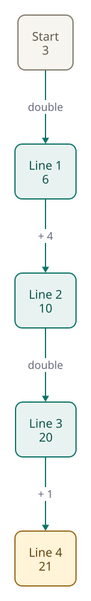
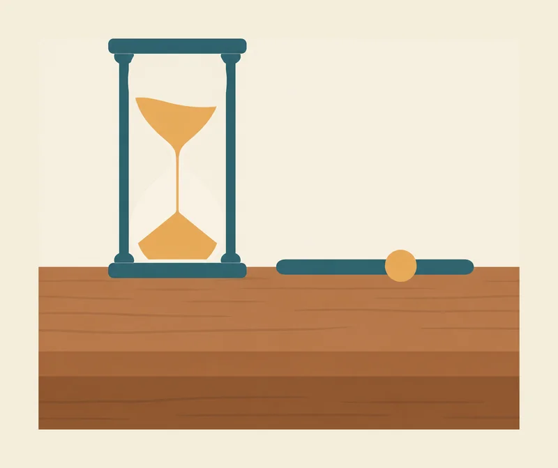
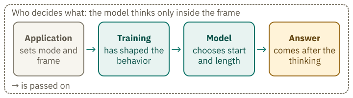

<!-- Generated from src/content/bausteine/en/how-a-model-thinks.mdx by scripts/export-lessons.mjs -- do not edit by hand. -->

# How a Model "Thinks": Intermediate Steps It Writes Itself

> Reading copy for GitHub. The full version with interactive demos, animations and recall moments is on the website: **[How a Model "Thinks": Intermediate Steps It Writes Itself](https://ki-einfach-verstehen.de/en/lessons/how-a-model-thinks/)**
>
> Licence: [CC BY 4.0](https://creativecommons.org/licenses/by/4.0/deed.en) · Credit it as: KI einfach verstehen, “How a Model "Thinks": Intermediate Steps It Writes Itself”, CC BY 4.0, https://ki-einfach-verstehen.de/en/lessons/how-a-model-thinks/

Why a model writes intermediate steps as text before its answer, why that makes some tasks solvable, and who decides whether and how long it thinks.

Some chat apps show a line like "thinking …" while you wait. The answer then comes only after a pause. What do you think happens in that time? Before you see the answer, you can only guess. This lesson shows what the model writes during the pause, why that can improve an answer, and who decides whether it thinks at all.

## The pause before the answer is text

During the pause, the model writes intermediate steps as text. It does the same thing it does for every answer: it writes tokens, one after another. Do you remember the [text loop](./input-and-output.md)? The model reads the text, picks a piece, and appends it. Thinking runs the same loop. First come the intermediate steps, and only then does the answer begin.

These intermediate steps are called [thinking tokens](https://ki-einfach-verstehen.de/en/glossary/thinking-tokens/). They are text like any other, except that the app usually does not show them. The [tokenization](./tokenization-inside-the-model.md) already shows that such outputs count as tokens. Those intermediate steps are text pieces too. They take up space in the [context window](https://ki-einfach-verstehen.de/en/glossary/context-window/), even if you never read them.

*The task is at the top, followed by lines for the intermediate steps. The space for the answer is at the bottom and is still empty.*

What do these extra lines accomplish? If they contain an intermediate result, the next step can build on it. Then they are more than filler text. The model reads its own intermediate steps again at the next step, like any other text in the conversation. You know this from your own calculations: if you write down a subtotal, you do not have to keep it in your head. The model keeps its intermediate results as text that it refers back to at the next step. That is why, in the picture, the lines sit between the input at the top and the answer at the bottom.

The computing work needed for an intermediate step is measured in passes through the [network](https://ki-einfach-verstehen.de/en/glossary/transformer/). Each pass is a trip through the model’s stored numerical structure.

## Why intermediate steps make hard tasks solvable

Take an invented task with five steps: Start with 3. Double the result. Add 4. Double again. Add 1. Each step needs the previous result.

You could write each intermediate result on a slip of paper, line by line: first 6, then 10, then 20, and finally 21. The slip replaces mental arithmetic. For the model, the text plays the role of the slip: it is text the model wrote itself and reads like any other text. There is no hidden second calculator; the intermediate results stand as text that the network reads again. Each new line builds on the earlier ones. That is why the slip helps.

A model writes one token after another. For every new token, it runs through the whole [network](https://ki-einfach-verstehen.de/en/glossary/transformer/). Kaplan and colleagues estimate the computing work per token at about twice the number of [parameters](https://ki-einfach-verstehen.de/en/glossary/parameters/), that is, the stored weights. A cost that grows with text length comes on top. To keep it simple, costs are counted in passes: an intermediate step consists of many thinking tokens, and each one costs another trip through the network. More thinking tokens therefore mean more work.

What is a pass?

A pass is a single trip through the network, and it yields exactly one new token at the end. For every token of the answer and for every thinking token, the model makes its own trip. The first trip processes the input; after that, only the new token. Earlier intermediate values are kept in the KV cache, a buffer, and reused. The KV cache saves computing work; the time still grows with the number of trips.

[▶ watch the animation on the website](https://ki-einfach-verstehen.de/en/lessons/how-a-model-thinks/)

*The thinking steps as a chain, with the intermediate results 3, 6, 10, 20, 21: each line hangs on the one before and stays in the context until the answer begins. Use “Next” to step through the steps.*

A 2024 paper shows this in theory for transformers, the networks behind chat models. A network with only a few layers, or computing stages, cannot directly solve tasks that require a sequence of steps without written intermediate steps. If it can write as many intermediate steps as the task requires, it can solve them. The finding shows only what is possible, and it says nothing about what a model does in everyday use.

The method is called [chain of thought](https://ki-einfach-verstehen.de/en/glossary/chain-of-thought/). In 2022, researchers at Google showed with handwritten examples that it raises the accuracy on elementary-school word problems. For PaLM, a language model from Google, it rose from 17.9 to 56.9 percent. The method did not work for every model; see the box.

One level deeper: How large does a model need to be for intermediate steps to help?

Wei and colleagues tested PaLM, which has 540 billion parameters, with eight handwritten examples in the prompt, each with the task, intermediate lines and answer. On GSM8K, a collection of elementary-school word problems, accuracy increased noticeably. The model was not retrained; it simply followed the examples in the prompt.

The researchers also tested smaller models. Only from about 100 billion parameters did the method help. The smaller models wrote fluent but illogical reasoning traces, which were worse than the standard prompt. The threshold is a finding about the models tested at the time, not a fixed size for every model.

A thinking mode therefore takes time: it lengthens the text before the answer, one pass per thinking token.

An invented example: 400 thinking tokens and 150 answer tokens make 550 passes, because every token needs its own pass.

If you only double the thinking tokens, the total does not double, because the answer stays the same length.

> **Interactive demo:** [try it on the website](https://ki-einfach-verstehen.de/en/lessons/how-a-model-thinks/)

## Where the reasoning comes from

You may have written "Let's think step by step" in a prompt. Where does the thinking come from in the first place? Three papers show three different ways to get models to think. They are separate methods, not stages of one model.

The first way is a sentence in the prompt. In 2022, a research group showed that adding "Let us think step by step" before each answer improves the results on arithmetic tasks. For InstructGPT, a model from OpenAI from 2022, the hit rate on elementary-school word problems rose to almost four times its previous value.

A second way is to include examples in the prompt that show a task being solved step by step. These examples affect only the current conversation; they do not change any stored weights. A third way is further training after pretraining, known as post-training. During training, DeepSeek-R1-Zero, a 2025 model from DeepSeek, had no second model trained to score its thinking steps. It received rewards for correct answers to tasks with checkable solutions and for following a fixed format that enclosed the thinking section in special markers called thinking tags.

The thinking sections became longer, even though training did not specify a target length. The DeepSeek report describes this at an intermediate stage of R1-Zero’s training. It attributes the increase to changes during training itself, rather than outside interventions, but does not establish exactly how those changes produced longer thinking. On AIME 2024, a math exam with hard tasks, the hit rate rose from 15.6 to 71.0 percent during this run.

One level deeper: How teacher models produce reasoning traces in German

The provider Aleph Alpha has published a technical report on its model Kolibri. There, teacher models produce reasoning traces, which are used to train other models. So it is about generating training data, not about the thinking of Kolibri itself. In the math case of figure 22, more than 5,000 reasoning traces were produced per variant. With an instruction in the system prompt alone, 67 percent of them stayed in German. A predefined German opening such as "Gegeben ist:" raised the share to 97 percent.

The language of a reasoning trace can therefore be steered during generation by instruction and opening. The report only concerns the generation of training data. It says nothing about the reasoning traces that an app shows you.

Provider note: The figures come from Aleph Alpha's technical report on Kolibri (https://www.aleph-alpha.com/downloads/tech-report.pdf). They are reported by the provider and have not been independently verified.

## Who decides whether and how long a model thinks

The short answer: first the application decides, then the model chooses within that frame.

*An hourglass on a table, next to a slider. The image is an analogy: the hourglass stands for an upper limit that the application sets; how much of it is used is up to the model.*

The application or the provider sets the default before the model writes anything. For the open language model Qwen3 with 1.7 billion parameters, thinking is switched on by default according to its model card. It belongs to the Qwen family from the provider Alibaba. A technical setting can switch it off. This setting controls whether thinking is on, rather than how long it lasts. The hourglass represents an upper limit on thinking; the model decides how much of that allowance to use.

The large providers work similarly. OpenAI offers an effort setting; its levels run from "none" to "max" and depend on the model. Anthropic describes its thinking as adaptive: the model checks each request and decides whether and how much it thinks. These settings are called effort levels here. No level guarantees a thinking section.

The application has to balance time, cost and accuracy. More thinking takes longer and costs more. Less thinking saves time and money, but can make answers to hard tasks less accurate. Some apps show the chosen setting; look for "Thinking" or "Effort". If no such information is given, you cannot see the setting. This setting sets the frame, but does not show what the model actually does within it.

What was the old thinking budget control?

With a thinking budget (`budget_tokens`), you stated how many thinking tokens the model should roughly plan for. It was a guideline and not a strict limit. The hard limit is the maximum number of tokens the app sets: it limits the entire output, thinking and answer together. How providers set the effort today differs by model. What is meant here is a target value set in advance, not a guarantee that the model uses all of it.

Within those limits, the model decides whether and how long to think, according to Anthropic. Since it writes one token at a time, choosing whether to begin with thinking tokens or go straight to the answer is itself a choice of the next token. The published sources do not explain how training shaped that choice.

*Who decides what: the application sets the mode and frame, training has shaped the behavior, and the model chooses the start and length within the frame.*

## When thinking pays off and what it costs

Thinking is not free; the [thinking effort](https://ki-einfach-verstehen.de/en/glossary/thinking-effort/) has a price. Anthropic bills thinking tokens as output, even when they are not shown. The full thinking effort is billed, not the visible reasoning trace. Thinking tokens also take up space in the context window. A long reasoning trace leaves less room for the conversation that follows. The app sets a single token limit for thinking and the answer together. If that limit is too low, the answer gets cut off, since thinking uses part of it.

So does thinking pay off at all? The technical report on Qwen3 measures two small models, each with and without thinking mode, on math tasks at two difficulty levels.

> **Interactive demo:** [try it on the website](https://ki-einfach-verstehen.de/en/lessons/how-a-model-thinks/)

Two things stand out. First, thinking clearly helps with hard math tasks: the 1.7 model reaches an accuracy of 48.3 percent on AIME 2024 with thinking and 13.4 percent without. Second, the advantage on MATH-500, a different math set, is smaller than on AIME 2024; for the smaller model Qwen3-0.6B, it is the other way around. Two model sizes and two task sets give no rule for other models. The report measures mathematics. The numbers say nothing about questions like "What is the capital of …?"; there is no measurement for that here.

These test results support using thinking mode for hard math tasks. The sources do not test whether it helps with short factual questions. If an app leaves the choice to you, compare both modes on a question whose answer you know. A test with a known result says more than the impression that the answer sounds good.

## A displayed reasoning trace is not a look inside

When an app shows a reasoning trace, it can feel like watching the model think. You might expect it to explain how the model arrived at its answer. That expectation is understandable, but only partly justified.

*A magnifying glass over a note: the displayed reasoning trace is a rendering that does not necessarily show everything that led to the answer.*

The large providers do not show the reasoning trace as an unchanged log. OpenAI does not disclose the raw thinking tokens; a summary can be requested. Google provides summaries of the thinking process, which are not output by default, and bills the full thinking tokens. The text displayed is therefore a rendering of what the model wrote, not necessarily the complete version.

Whether the reasoning trace names the actual reason for an answer can be tested. In 2025, Anthropic examined whether reasoning traces mention a hint that the model demonstrably used. The researchers deliberately built a hint toward the answer into the test tasks, sometimes a wrong one. If the model then changed its answer, it had demonstrably used the hint. When the hint demonstrably changed the answer, the reasoning trace mentioned it in about a quarter of the cases for Claude 3.7 Sonnet, a model by Anthropic. For DeepSeek R1, a model by DeepSeek, it was 39 percent. This does not show that the reasoning traces are wrong; it shows that they often do not name the reason. You cannot, however, rely on them naming the actual reason for the answer.

When you read a displayed reasoning trace, treat it as a draft written by the model. It can help you follow the answer and often shows which steps the model considered sensible. But it is not evidence that the answer is correct. Try it on a question whose answer you know: note two statements from the displayed reasoning trace and check them. If both are correct, that still says nothing about the rest of the reasoning trace.

More thinking also does not turn a model into a [store of facts](https://ki-einfach-verstehen.de/en/glossary/hallucination/).

## What remains in the end

A displayed reasoning trace is therefore neither a look inside nor proof that the answer is right.

To answer the opening question: during the pause, the model writes text. This is especially helpful for tasks where each step builds on earlier results. The application first sets the conditions for thinking; the model then decides within those limits whether to think at all.

**Exercise: Is thinking worth it?**

Sort the four tasks by whether thinking here tends to help a lot or little. The examples are invented, and your sorting is a prediction, not a measurement.

1. Repeat five city names from memory; each name stands on its own.
2. A puzzle with several conditions, where each statement narrows down the next.
3. The capital of a country.
4. A sentence that is supposed to sound friendlier.

**Solution:**

A lot: 2. In a puzzle, each statement limits the possibilities for the next step, so thinking can help. The Qwen3 report found a clear benefit for hard math tasks, but did not test this puzzle. Only theoretical support from the 2024 paper backs this prediction.

A little: 1, 3 and 4. To repeat five city names, you do not need each step to build on the previous one. For the capital question, thinking cannot supply a fact the model does not know. Making a sentence sound friendlier is also expected to benefit little from thinking. These are judgments rather than measured results; the sources provide no evidence for them.

---

Source: https://ki-einfach-verstehen.de/en/lessons/how-a-model-thinks/

← Previous: [From Text Predictor to Assistant: What Post-Training Makes of a Model](./from-text-predictor-to-assistant.md) · [All lessons](../../README.md#contents) · Next: [Why AI Is Convincingly Wrong: When Guessing Pays Off and a Confident Tone Proves Nothing](./why-ai-is-convincingly-wrong.md) →
