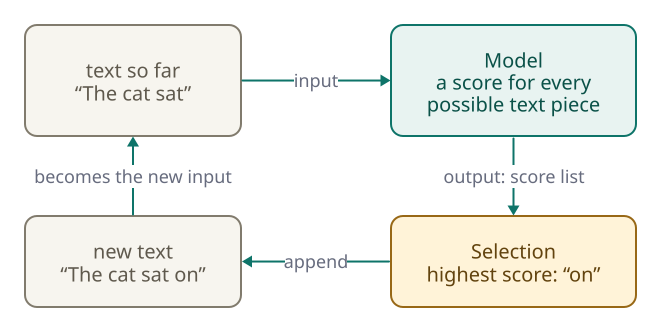
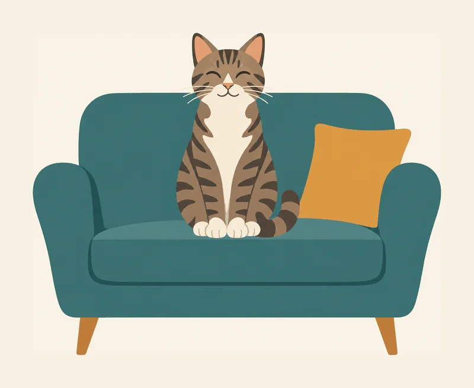
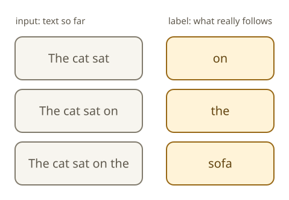

<!-- Generated from src/content/bausteine/en/input-and-output.mdx by scripts/export-lessons.mjs -- do not edit by hand. -->

# Input and Output: What a Model Does with an Input

> Reading copy for GitHub. The full version with interactive demos, animations and recall moments is on the website: **[Input and Output: What a Model Does with an Input](https://ki-einfach-verstehen.de/en/lessons/input-and-output/)**
>
> Licence: [CC BY 4.0](https://creativecommons.org/licenses/by/4.0/deed.en) · Credit it as: KI einfach verstehen, “Input and Output: What a Model Does with an Input”, CC BY 4.0, https://ki-einfach-verstehen.de/en/lessons/input-and-output/

What goes into an AI model, and what comes out? From spam filters to chatbots, the output is often a list of scores.

The spam filter from the [previous lesson](./program-algorithm-model.md) has a manageable job: an email goes in, and at the end a verdict comes out. A chatbot feels different. You type a question, and a moment later a complete, fitting answer appears. How does that happen if the **[model](https://ki-einfach-verstehen.de/en/glossary/model/)** behind it only calculates with fixed numbers?

## What goes in, what comes out

Take another close look at the spam filter. What goes in is called the **[input](https://ki-einfach-verstehen.de/en/glossary/input/)**: here an email, or more precisely the words in it. What comes out is called the **[output](https://ki-einfach-verstehen.de/en/glossary/output/)**. For the spam filter, the output is first a number, from which the verdict is then made: spam or not spam. The filter adds up the weights of the words. For “Free: your prize is waiting” that is 2 for “free” and 3 for “prize”, together 5. Only the comparison with the threshold turns that into a verdict. The threshold is a separate number, 2 as in the previous lesson: if the total is above it, the email counts as spam.

*For the spam filter, the input is an email. What comes out first is a number, and only after that the verdict.*

In the previous lesson, this comparison was part of the filter, and it still is. Adding up the trained weights produces the number first; comparing it with the fixed threshold then produces the verdict. The chatbot adds one more step: the model scores every possible next text piece, and then one of them is chosen. Because that choice does not always come out the same, the very same question can be answered in different ways.

**For the spam filter from the previous lesson, the same input always gives the same verdict.** If the same email arrives twice, the filter adds up the same weights twice. It does not remember the first email, and it does not get stricter the second time. The weights change only during training.

*Press the same keys and you get the same result. On paper, this also holds for a trained model.*

A familiar device works the same way: the calculator. You type “2 + 3” and it shows 5, today, tomorrow, and for anyone else who types it. In mathematics, this is called a **[function](https://ki-einfach-verstehen.de/en/glossary/function/)**: a fixed mapping that gives exactly one output for each input. A trained model is a function in this sense, too.

The steps in its calculation are fixed, and so are its [parameters](https://ki-einfach-verstehen.de/en/glossary/parameters/)—the stored numbers, such as the spam filter’s weights—once training is complete.

The spam filter always receives text, no matter how long, and always outputs exactly one number. It could not rate a photo at all.

The calculator comparison has its limits. People designed every step of a calculator's procedure. In a model, the numbers set during training determine what the calculation does. A calculator also outputs a single number, while many models output a whole row of numbers. That entire row is the output.

## A rating for every possibility

A spam filter has only two possible results. Image recognition, on the other hand, is supposed to assign a photo to one of many categories, such as cat, dog, fox or car. Technical language calls these classes. Its input is the photo. The model receives the brightness and color values of every pixel—that is, every dot in the image. Its output is not a single number but one number for each class.

For a photo of a cat, it might look like this, with made-up numbers: cat 6.2, dog 2.9, fox 1.4, car −3.0. Each of these numbers is a **[score](https://ki-einfach-verstehen.de/en/glossary/score/)**, a rating of how well the class fits the image. Higher is better. Where the zero point lies does not matter; what counts is how the scores compare with each other. Which class ends up on the screen is again decided by a separate step: it takes the class with the highest score. That is the same split as with the spam filter. **The model rates, and a simple step after it decides.**

Now on to a **[language model](https://ki-einfach-verstehen.de/en/glossary/language-model/)**, the model behind a chatbot. Think for a moment before you read on: the model receives the text “The cat sat”. What does it output: a finished answer or one word?

Neither. The output of a language model has the same shape as in image recognition, except that its classes are **text pieces**. A text piece is a whole word, part of a word, or a punctuation mark. For every text piece it knows, it outputs a score for how well that piece fits next. With made-up values, an excerpt looks like this:

*Excerpt from a score list after “The cat sat” (made-up values). The model outputs such a score for every text piece it knows.*

“on” and “still” fit well, “rain” hardly fits at all. In reality, the list is very long. The older language model GPT-2, a predecessor of the models behind ChatGPT, knows about 50,000 text pieces. Its score list for the next piece therefore always has the same number of entries, no matter how short or long the input is. Where the list of all text pieces comes from is covered in the next lesson.

## How single pieces become an answer

**One round rates only the next text piece, nothing more.** At its core, the model is trained to predict the next text piece. A chatbot is such a model, additionally trained to answer questions helpfully. A whole answer therefore comes from repeating the same small process:

1. The text so far goes into the model as input.
2. The model outputs the score list.
3. A selection step turns it into a single text piece.
4. This piece is appended to the text, and the longer text is the input for the next round.

[▶ watch the animation on the website](https://ki-einfach-verstehen.de/en/lessons/input-and-output/)

*The generation loop: input into the model, score list out, pick one text piece, append it, and the longer text goes back in.*

Follow the process through three rounds. Round one: the input is “The cat sat”. Here, the selection step simply takes the top-scoring piece, “on” with 8.1. Round two: the input is now “The cat sat on”. The model computes the whole list again, and this time different pieces come out on top:

*Score list after “The cat sat on” (made-up values): with the longer input, different text pieces come out on top.*

Now “the” leads, just ahead of “a”. So “the” is chosen. Round three receives “The cat sat on the”. Now “sofa” leads, well ahead of “table” (made-up values: 8.3 and 5.9). So “sofa” is chosen and appended.

*The picture shows a scene that matches the finished sentence “The cat sat on the sofa”. How it came about piece by piece is in the text above.*

The loop stops when the selection step picks a special **stop marker**, a sign that marks the end of a text. Besides that, there is a preset length limit; once it is reached, the loop stops, even mid-sentence. The stop marker is also an entry in the score list, but it is not a visible character: you just do not see it in the chat. In the chat, you therefore see only the result of this loop, never the score lists behind it. That the model gives the stop marker a high score comes from training: there, many texts end with such a marker, and the model learns to rate it highly after the last piece of a text.

## What the loop explains in the chat window

This loop explains three things you see in a chatbot. First, the answer often appears in small pieces, almost word by word, because it is produced piece by piece. Second, in the usual process the model does not revise a chosen piece. It stays, and all later rounds build on it, so an early unsuitable piece shapes the rest of the answer. Had round two picked “a” instead of “the”, the answer would have continued from “The cat sat on a”. In that process, there is no going back to “the”.

Third, the same question can get two different answers. The model itself remains a function: on paper, the same input gives the same score list; in the data center, tiny arithmetic differences add to this (more in the box below). The selection step explains much of the difference. For the spam filter, that step is a fixed threshold comparison. Many chatbots do not always take the top-scoring piece; they choose with some randomness, which makes answers more varied: the same question does not get the same wording every time. For “The cat sat”, “still” (5.4) would also be possible, not only “on” (8.1), just less often. The higher-scoring piece is more likely to be chosen, but it is not guaranteed; lower-scoring pieces still have a chance.

One level deeper: how tiny arithmetic differences arise in the data center

In the data center, tiny rounding differences can shift the scores in the last digit; this can only tip the result when two pieces are almost tied.

A computer stores decimal numbers as **floating-point numbers** with a fixed number of digits, rounding whatever does not fit. It stores them in binary, using only zeros and ones. Even 0.1 cannot be stored exactly that way, much like 1/3 never ends as 0.333… in decimal. So it matters which numbers are added first. With a = 0.1, b = 0.2 and c = 0.3, Python shows 0.6000000000000001 for (a + b) + c, adding a and b first. For a + (b + c), adding b and c first, it shows 0.6. The two results differ in the last stored digit. On paper, both are equal; in a computer, they are not.

For every score list, a language model performs many such additions. Many people's requests are processed together as a **batch**, and the order of the calculation steps can depend on the batch size. That size, in turn, depends on how many people are sending requests at the time. If it changes, the order of additions can change too, and the scores differ in their last digits.

Usually this has no effect. But if two pieces are almost tied, it can tip which one leads. The research company Thinking Machines Lab tested this: a model answered the same request 1,000 times, always taking the top-scoring piece, and produced 80 different answers. Each was 1,000 pieces long. All matched for the first 102 pieces; only then did they part ways.

Only the execution can differ: the computer may perform the same steps in a different order and round the last digit slightly differently.

For a chatbot, the input to the first round includes your text—the **[prompt](https://ki-einfach-verstehen.de/en/glossary/prompt/)**—and a system instruction that tells the model how to behave. After that, the input includes the whole conversation: your questions, the model's previous answers, and the system instruction. These messages are combined into a single sequence of text pieces, with control markers showing who wrote each one. The answer is then appended piece by piece.

> **Interactive demo:** [try it on the website](https://ki-einfach-verstehen.de/en/lessons/input-and-output/)

## Where the scores come from, and what is missing in the chat

How does the model know that “on” fits better after “The cat sat” than “rain”? The previous lesson introduced the answer: training examples with a known correct answer. For the spam filter, people had marked each email by hand. The right next text piece for a training example is called a **[label](https://ki-einfach-verstehen.de/en/glossary/label/)**. A training example consists of an input and this label. The **[training algorithm](https://ki-einfach-verstehen.de/en/glossary/training-algorithm/)** compares what the model outputs with the label and adjusts the parameters a little.

For the spam filter, people had to mark every email as spam or normal mail. **For a language model, the label is already in the text itself.** Take a perfectly ordinary sentence: “The cat sat on the sofa.” Several training examples can be built from it at once.

*One ordinary sentence yields several training examples: each beginning is an input, and the text piece that really follows is its label.*

Each time, the input is the beginning and the label is the piece that actually follows: “The cat sat” gets the label “on”, and “The cat sat on” gets the label “the”. The training algorithm checks the score the model gave the correct piece. That score should be as far above the others as possible. The algorithm adjusts the parameters so that the model rates the correct piece higher next time. If its score is already far ahead, the correction is smaller.

Because every text yields many examples this way, a language model can be trained on huge amounts of text. Nobody assigns labels by hand for this: the next piece in the text is the label. This training, in which the model only learns to predict the next piece, is called **pretraining**.

One level deeper: post-training, which turns the model into a chatbot

After pretraining, the model often gets a second round of training, called **post-training**. For this, people write or rate examples themselves: a question with a good answer, or several answers ranked by helpfulness. From these, the model learns to answer questions like a helpful chatbot, instead of only continuing the text.

Pretraining determines what the model knows about language. Post-training shifts the answers toward what people find helpful. Here, too, the parameters are adjusted, but the examples differ from those used in pretraining. The result is often called an instruction model, because it is meant to follow instructions.

A well-known example is InstructGPT from OpenAI, from 2022. There, a model from the GPT-3 family was further trained with answers written by people and with human ratings of answers.

When you use the model, there is no label. When you ask a chatbot a question, nobody knows the “correct” next piece, so there is nothing to compare against. The model calculates using only the parameters set during training. Your conversation does not change the model while you chat. That a chatbot responds to earlier messages does not mean it learns: the conversation so far is simply sent along as input every time. A new conversation usually starts without that history. Some chatbots save details and send them along again in later conversations.

Just as with the spam filter, new versions of a model only come from separate, later training runs.

A model calculates only with fixed numbers, yet a complete answer emerges: it rates the possible next text pieces, a selection step picks one, and the chosen piece goes into the next round. How “The cat sat” becomes numbers at all is shown in [the next lesson](./tokenizer-ids-vocabulary.md).

---

Source: https://ki-einfach-verstehen.de/en/lessons/input-and-output/

← Previous: [Program, Algorithm, Model Compared](./program-algorithm-model.md) · [All lessons](../../README.md#contents) · Next: [Tokenizers: How Text Breaks into Tokens](./tokenizer-ids-vocabulary.md) →
