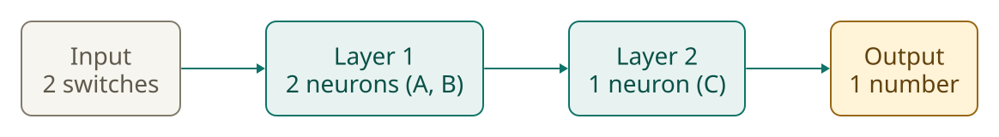
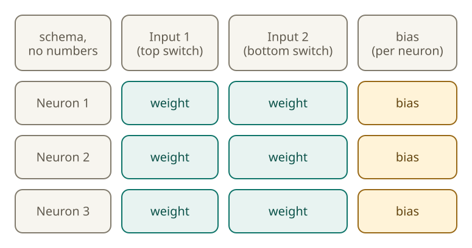
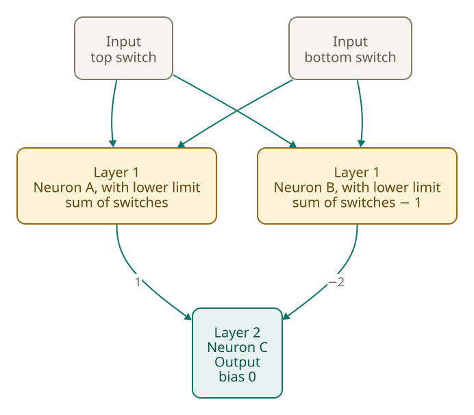
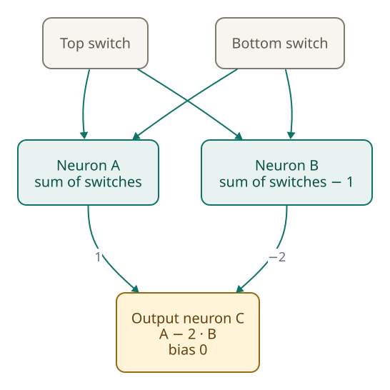

<!-- Generated from src/content/bausteine/en/layers.mdx by scripts/export-lessons.mjs -- do not edit by hand. -->

# Layers: How Many Neurons Become a Network

> Reading copy for GitHub. The full version with interactive demos, animations and recall moments is on the website: **[Layers: How Many Neurons Become a Network](https://ki-einfach-verstehen.de/en/lessons/layers/)**
>
> Licence: [CC BY 4.0](https://creativecommons.org/licenses/by/4.0/deed.en) · Credit it as: KI einfach verstehen, “Layers: How Many Neurons Become a Network”, CC BY 4.0, https://ki-einfach-verstehen.de/en/lessons/layers/

Many neurons calculate using the same numbers, and their outputs become the inputs of the next layer. Why the lower limit makes a peak possible that two layers without it cannot form, and what a figure like “96 layers” means.

The basic neuron calculates a sum, adds a bias and sets negative values to zero. That last step is the lower limit. A network is made up of many such neurons, and their arrangement determines how they work together.

## Many neurons on the same numbers

Picture a mixing-desk channel that receives numbers. Now place a second channel next to it, and a third. All three see the same inputs, but each has its own sliders. This group is called a [layer](https://ki-einfach-verstehen.de/en/glossary/layer/).

A layer is a group of neurons that receive the same inputs. Each neuron performs its own calculation, using its own weights and bias.

The counting box shows this for two inputs and three neurons. Each row is one neuron. Each row contains two empty boxes for the weights, one per input. The amber box at the end contains the bias. Read from left to right: the weight for the first input, the weight for the second, then the bias.

*A counting box for two inputs and three neurons: each neuron has two weight boxes and one bias, marked in amber.*

The picture shows the layout of this example: the two switches feed a layer with the neurons A and B, whose outputs run into the output neuron C. Read the picture from left to right to follow the path of the numbers. Each arrow stands for a value that travels from one place to the next. The inputs do not calculate; they only pass on what you enter. Only the neurons calculate, and the output neuron turns the outputs of A and B into a single number at the end. The two-switch example in the section “Intermediate values: the output keeps going” uses this layout.

*The layout of the two-switch example: two switches feed a layer with the neurons A and B, whose outputs run into the output neuron C. The example in the section “Intermediate values: the output keeps going” calculates with this layout.*

## How many numbers are in a layer?

First, guess how many numbers are in the layer shown in the counting box. Then count them step by step. Each neuron has one weight per input, so a layer with two inputs gives each neuron two weights. With three neurons, that makes 3 times 2, or 6 weights.

Add the biases. Each neuron has exactly one, so that is three more. Together that is 6 plus 3, which is 9 numbers.

The same rule applies to every other layer. With three inputs and two neurons, it is 3 times 2 weights, which is 6, plus 2 biases. That makes 8 numbers.

*The same layer as a table: each row is a neuron, each column an input. Each cell is a weight; the column at the edge holds the biases.*

## Intermediate values: the output keeps going

The output of a layer is not the end of the calculation. It becomes the input of the next layer. A number that travels from one layer to the next is called an [intermediate value](https://ki-einfach-verstehen.de/en/glossary/intermediate-value/).

Consider an example with two switches, one at the top and one at the bottom, like a stair light. The numbers in this example were chosen by hand, not learned through training. The stair light only shows how this calculation works; it says nothing about what a real model with billions of trained numbers does. A pressed switch counts as 1, a switch that is not pressed as 0. The light is on when C shows 1 at the end and stays off when C shows 0; C must not show any other value. The light should come on when exactly one of the two switches is pressed.

A and B both receive the two switches with a weight of 1. Only B has a bias that adds something: −1. For A, the bias is 0.

Output neuron C receives only the outputs of A and B. It gives A a weight of 1 and B a weight of −2; its bias is 0 as well.

What does C show when both switches are pressed? Guess first.

With both switches off, A gives 0 and B gives −1. The lower limit changes B to 0, so C calculates 1 times 0 plus (−2 times 0), which is 0. With one switch pressed, A gives 1 and B gives 0, so C calculates 1 times 1 plus (−2 times 0), which is 1. With both pressed, A gives 2 and B gives 1, so C calculates 1 times 2 plus (−2 times 1), which is 0.

[▶ watch the animation on the website](https://ki-einfach-verstehen.de/en/lessons/layers/)

*Two layers: the intermediate values A and B continue into output neuron C. The animation shows each step of the calculation.*

## Without a lower limit, the peak is missing

The calculation above has one fixed step: the lower limit at neurons A and B. Now leave it out. Guess first: when no switch is pressed, does C show 0 or 2?

> **Interactive demo:** [try it on the website](https://ki-einfach-verstehen.de/en/lessons/layers/)

Now work through all four cases. If neither switch is pressed, B stays at −1 without the lower limit. C then calculates −2 times −1 and shows 2. With one or two pressed switches, nothing changes, because B was never negative there: as above, C shows 1 and 0. The resulting series is 2, 1, 1, 0: none, one, one, both.

Group the cases by the number of switches pressed: 0, 1 or 2. C then shows 2, 1 and 0, falling by the same amount each time. There is no peak, because a peak must rise before it falls.

The reason holds for every network whose layers only calculate weighted sums plus a bias, with no lower limit or other step between them. If you feed the outputs of one layer into the next, the result is again a weighted sum of the original inputs plus a fixed number. This is true for two layers as for ten: the chain stays one single calculation of this kind. In this example, both switches have the same weights. So C depends only on how many switches are pressed, and each further pressed switch changes C by the same amount, here −1. A series that always falls by the same amount cannot rise and then fall.

With the lower limit, the series is 0, 1, 1, 0. Grouped by the number of pressed switches (0, 1, 2), it reads 0, 1, 0, while without the lower limit it reads 2, 1, 0. Only with the lower limit does the series rise and then fall. That is the peak. It occurs at exactly one pressed switch, which makes the pattern “exactly one” possible. Without the lower limit, that peak disappears. It takes a step that does more than add with weights, such as the lower limit.

[▶ watch the animation on the website](https://ki-einfach-verstehen.de/en/lessons/layers/)

*Without a lower limit, the diagram shows the values at A, B and C in every case. Ordered by the number of pressed switches, C falls evenly from 2 to 1 to 0, so it cannot form a peak.*

One level deeper: why does this example have no peak without a lower limit?

Without a lower limit, A is the number of pressed switches, and B is that same number minus 1. Each pressed switch raises A and B by 1. C calculates A minus twice B, so C falls by 1 for each pressed switch (1 minus 2). With no switch pressed, C stands at 2, because B is −1 and gets multiplied by −2. With zero, one or two pressed switches, this gives the values 2, 1, 0. The distance between two neighboring values is always the same, namely one. Because the calculation falls at a steady rate, it never turns around, and a peak requires such a turning point. Without a step between them, such layers stay a single calculation, however many there are, so in this example no peak appears.

## What a figure like “96 layers” means

Descriptions of language models often include their number of layers. GPT-3, a language model from 2020, has 96. Here, “layer” does not mean the kind shown in the counting box. It refers to the [transformer block](https://ki-einfach-verstehen.de/en/glossary/transformer-block/), one of a sequence of building blocks inside the model. The number 96 counts blocks, not neurons.

Each block contains a [feed-forward network](https://ki-einfach-verstehen.de/en/glossary/feed-forward-network/), a two-layer network in which information moves in only one direction, from input to output. Another step sits between the two layers, resembling the lower limit of the neuron; its exact form depends on the model.

*Several blocks on top of each other: each block passes its numbers on to the next.*

A block has two main parts. In one, each word looks back at the words that come before it. The other is the two-layer feed-forward network described above. The numbers a block puts out are the inputs of the next block, just as the intermediate values A and B were the inputs of C. The picture shows only the order of the blocks in the model, not their number.

## Where the numbers for the first layer come from

Layers work with numbers, but the question you type is text. Before the first layer can process it, the text has to be translated into numbers.

The next lesson shows how text breaks into small pieces, how each piece gets a number, and how the layers then work with these numbers.

The weights are already set at this point. How they come about is explained in later lessons.

---

Source: https://ki-einfach-verstehen.de/en/lessons/layers/

← Previous: [What an AI Model Actually Is](./what-an-ai-model-actually-is.md) · [All lessons](../../README.md#contents) · Next: [Tokenization Inside the Model: How Your Chat Becomes a Token Sequence](./tokenization-inside-the-model.md) →
