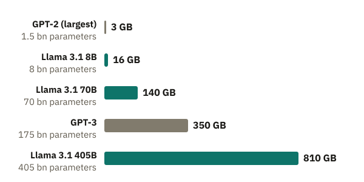
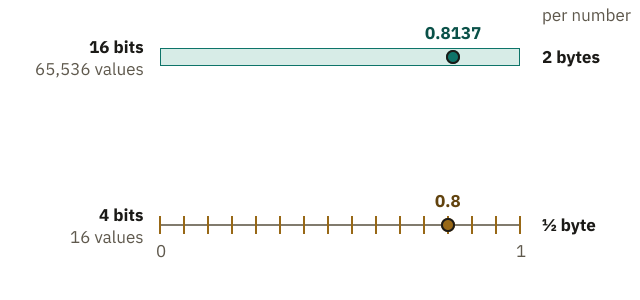
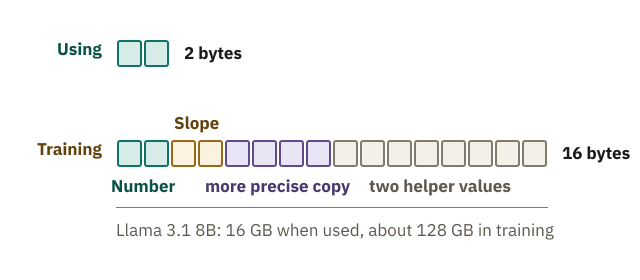

<!-- Generated from src/content/bausteine/en/model-size-and-hardware.mdx by scripts/export-lessons.mjs -- do not edit by hand. -->

# Model Size and Hardware: Where a Model Fits

> Reading copy for GitHub. The full version with interactive demos, animations and recall moments is on the website: **[Model Size and Hardware: Where a Model Fits](https://ki-einfach-verstehen.de/en/lessons/model-size-and-hardware/)**
>
> Licence: [CC BY 4.0](https://creativecommons.org/licenses/by/4.0/deed.en) · Credit it as: KI einfach verstehen, “Model Size and Hardware: Where a Model Fits”, CC BY 4.0, https://ki-einfach-verstehen.de/en/lessons/model-size-and-hardware/

How much memory an AI model needs, why space, not speed, is the first limit, how quantization shrinks models and why training needs far more memory still.

In the previous lesson, you learned about Llama 3.1 8B’s model file: a small blueprint and about eight billion numbers, 16 gigabytes in total. On some phones, a [language model](https://ki-einfach-verstehen.de/en/glossary/language-model/) runs right on the device. Apple’s model, for example, has about 3 billion [parameters](https://ki-einfach-verstehen.de/en/glossary/parameters/). Large chatbots run in data centers instead.

Do you think that is mainly because the phone’s chip calculates too slowly, or because of something else?

## How much space eight billion numbers take

Where do the 2 bytes come from? Llama 3.1 stores each of the eight billion numbers in 16 bits, or 2 bytes. A byte is eight bits; a bit is a cell that holds only yes or no.

Each combination of yes and no stands for a particular value. Each additional bit doubles the number of possible values.

This gives a rule of thumb: billions of parameters times bytes per number equals gigabytes, because a gigabyte is a billion bytes. For Llama 3.1 8B, that is 16 gigabytes. Meta also offers a mid-sized version of Llama 3.1 with 70 billion parameters.

How much space does the 70-billion-parameter version need? Think about it before you read on.

By the rule of thumb, that is 140 gigabytes. The largest version of the series comes to several hundred gigabytes; the calculation is in the deeper section below.

*By the rule of thumb with 2 bytes per number: the memory for the parameters grows in the same proportion as their count. At the far right is Llama 3.1 405B, the largest in the series; more about it in the section Space before speed.*

The rule of thumb counts only the parameters. While it computes, the model needs something more: intermediate results, values it calculates step by step for your text. They are not stored in the file. They take up extra space. The whole conversation so far is sent along with every message, so the memory needed for these intermediate results grows as the conversation gets longer. There is no fixed number for this. The rule of thumb is therefore a minimum, and Llama 3.1 8B needs at least this much space. On download pages, you can use the number in a model’s name to estimate roughly how large its file is at 16 bits; a version with fewer bits is correspondingly smaller. In practice it is a bit more.

One level deeper: the calculation in detail

The rule of thumb is a multiplication. With 16 bits per number, that is 2 bytes. For Llama 3.1 8B, you calculate 8 billion times 2 bytes, which is 16 billion bytes, or 16 gigabytes. For the 70-billion-parameter version, you calculate 70 times 2 and get 140 gigabytes. The largest version, Llama 3.1 405B, has 405 billion parameters. Times 2 bytes, that is about 810 gigabytes.

Bits set the number of possible values: 4 bits give 16 values, 8 bits give 256 values, and 16 bits give 65,536 values. Likewise, 8 bits fit into one byte, and 4 bits into half a byte. You can read a model’s name this way: the number before the B is its parameter count in billions. So “8B” means 8 billion parameters, and “70B” means 70 billion.

## For comparison: a gaming graphics card

How big is that in comparison? A gaming graphics card is one example: the GeForce RTX 4090 from Nvidia. According to the manufacturer, it has 24 gigabytes of memory directly on the card. Llama 3.1 8B, at 16 gigabytes, fits on it, with some room for intermediate results. If a model does not fully fit into memory, every text piece becomes much slower, because the missing part has to be loaded again and again.

The memory size of a card is listed in the manufacturer’s data sheet. Look there to see what fits on a card before you run a model on it.

## Space before speed

Where do all these gigabytes have to go while the model answers you? The mixing-desk picture helps only up to a point: a real desk has circuitry built in, while a model is a file of a blueprint and fader positions that must first be loaded onto a chip. “Running” the model means that, for every text piece, a chip follows the blueprint and calculates with the model’s numbers. You know the graphics processor (GPU) from the lesson on vectors and matrices: it runs thousands of similar calculations at once.

The chip works fastest when the numbers are in its own nearby memory. This is **[GPU memory](https://ki-einfach-verstehen.de/en/glossary/gpu-memory/)**.

*A graphics chip computes with the numbers in its own fast memory.*

The file itself sits in permanent storage, where photos and apps are stored long term. On a phone, that is far larger than the RAM. Reading from there is too slow when every text piece needs all numbers. So the numbers are copied into fast memory next to the chip (on a graphics card, this is GPU memory).

Llama 3.1 405B needs about 810 gigabytes by the rule of thumb, far more than a single data center processor holds. At 16 bits, the model is therefore spread across many chips that share its numbers.

**To answer quickly, all of a model’s numbers together must fit in the fast memory of the chips used.** Only then does speed matter. For every text piece, the chip needs all of Llama 3.1’s numbers, and each time they must travel from memory to the compute units. For a single request, that travel takes longer than the calculation itself, so fetching is usually the bottleneck. If part lies only in slow storage, the chip must reload it for every text piece. Even the fastest chip then waits.

### Why the phone hits its limit

*A small model fits on a phone. The largest ones need rows of chips in a data center, because otherwise their numbers would not fit.*

A phone has no GPU memory of its own. The fast memory next to its chip is RAM, which the model, the operating system and all apps share. Current Google Pixel phones have 8 to 16 gigabytes of RAM. That is far less than their permanent storage. At 16 bits, Llama 3.1 8B takes 16 gigabytes, which is the entire RAM of the largest of these phones. But the system and apps need space too. In this version, the model does not fit. For larger models, the gap is even wider. That is why your question travels to a data center, where chips calculate the answer for far larger chatbots.

One level deeper: how big and how fast an H100’s memory is

A data center processor, such as Nvidia’s H100, has 80 gigabytes in its widely used version. Even eight H100s with 80 gigabytes each hold only 640 gigabytes together. That is not enough for the roughly 810 gigabytes of Llama 3.1 405B.

For each new text piece, the chip runs the whole model once, so all parameters travel from GPU memory to the compute units.

The amount of data that memory can deliver per second is its **memory bandwidth**. According to the manufacturer, the H100’s widely used SXM version delivers 3.35 terabytes per second, or 3,350 gigabytes. For a rough estimate with Llama 3.1 8B, divide 3,350 by the model’s 16 gigabytes: about 209. With 16-bit numbers, this chip can handle at most about 209 text pieces per second for a single request, no matter how quickly it performs the calculations. In practice, it handles fewer. That is why data centers process many requests together, in a batch: the chip loads the parameters once and uses them for all requests in that step. So speed matters, but only once the model fits in memory.

## Rounded more coarsely: quantization

By the rule of thumb, Apple’s phone model would need 6 gigabytes with 2 bytes per number. On a phone with 8 gigabytes of RAM, hardly anything would be left for the system and apps. Yet it still runs on the device, because each number is stored with fewer bits and therefore rounded more coarsely.

Take a made-up number with many decimal places, such as 0.8137. For simplicity, the allowed values are spread evenly along a number line from zero to one. With 16 bits, the number stays almost exact.

With 4 bits, only a few allowed values remain. The number is rounded to the nearest one, which is 0.8. Storing numbers this coarsely is called **[quantization](https://ki-einfach-verstehen.de/en/glossary/quantization/)**. The faders all remain, but each is set a little less precisely.

*Simplified, with allowed values spread evenly between 0 and 1: the fewer bits, the fewer values, and the more coarsely the made-up number 0.8137 is rounded.*

Fewer bits mean less space: with 8 bits, each number needs only one byte instead of two, so half as much. Llama 3.1 8B would then be eight gigabytes.

One level deeper: how coarsely 4 bits round

With 4 bits, there are 16 possible values. Between 0 and 1 they are spread evenly, with 15 equal gaps between them. Each gap is 1/15 wide, or about 0.067. The made-up number 0.8137 lies between 0.8 and 0.867. The nearest is 0.8, because 0.867 is farther away. With 16 bits there are 65,536 values; the gaps are so small that 0.8137 stays almost exact.

Space works the same way. With 8 bits, each number needs one byte; with 4 bits, half a byte. For Llama 3.1 8B at 4 bits, 8 billion times half a byte gives about 4 gigabytes, roughly half of the 16 gigabytes at 16 bits. At 8 bits it would be 8 gigabytes, the entire RAM of the 8-gigabyte phone in the example.

Rounding the faders more coarsely slightly changes the [scores](https://ki-einfach-verstehen.de/en/glossary/score/) that the model calculates for the next text piece, as described in the lesson on [input and output](./input-and-output.md). Usually the same text piece still comes out on top. With fewer bits, the choice changes more often, and the model makes more mistakes. How much accuracy the model loses depends on the method and the number of bits. That is why many downloadable models come in several versions with different numbers of bits.

How many bits do you think Llama 3.1 8B needs to fit on a phone with 8 gigabytes? Think about it before you read on.

> **Interactive demo:** [try it on the website](https://ki-einfach-verstehen.de/en/lessons/model-size-and-hardware/)

With 8 bits, all of the phone’s RAM would be taken, leaving nothing for the system and apps. With 4 bits, the model needs only about half of that; in practice it takes a bit more.

At most about half remains for the system, apps and intermediate results, which is tight, because all apps share the same memory. A sensible choice is still 4 bits: Llama 3.1 8B then fits on the phone if the system and apps use little memory. With even fewer bits the space would be there; but a study of Llama 3 shows that models quantized after training to very low bit widths lose noticeable performance.

## Memory during training

Do you think training Llama 3.1 8B needs as much memory as using it? Both use the same eight billion parameters. Think briefly before you read on.

It needs much more. During training, backpropagation works backward through the model to calculate the slope for every fader. That slope sets its step. In the apple model from the previous lesson, the one fader set the price per kilo, and the same rule applied there: step equals slope times [learning rate](https://ki-einfach-verstehen.de/en/glossary/learning-rate/). The learning rate sets how far a fader turns. Each slope stays in memory while training collects it from many text pieces. Only then are the faders adjusted, so no single text piece moves them alone.

Steps are often so small that a 16-bit number rounds them away. That is why training keeps a more precise 32-bit copy of each number, in which the tiny steps add up. Training still computes in 16 bits, which is faster.

Adam goes beyond “slope times learning rate” by remembering two helper values for each fader: one for the direction of the recent slopes, one for their typical size.

A research paper on training large models gives 16 bytes per parameter instead of 2, eight times as much. Besides the number itself, its slope, a more precise copy and two helper values are stored. The deeper section below breaks down the 16 bytes.

For Llama 3.1 8B, these 16 bytes come to about 128 gigabytes: 8 billion times 16 bytes. This is a rough estimate.

The 128 gigabytes exceed the 80 gigabytes of a single H100 graphics processor. So training a model this size spreads across several chips.

*Per parameter: using the model takes 2 bytes; training adds the slope, a more precise copy and two helper values.*

One level deeper: what training also keeps in memory

The 16 bytes come from the research paper on ZeRO, a method for training very large models. The 16 bytes break down as 2 bytes for the number, 2 bytes for its slope, 4 bytes for the 32-bit copy and 8 bytes for the two helper values. The calculation applies to mixed-precision training, which uses 16-bit numbers alongside the more precise 32-bit copy.

A numerical example shows why the 32-bit copy is needed. In the 16-bit format Llama 3.1 uses, neighboring values near 0.8 are about 0.004 apart. A step of 0.001 would be rounded back to the old value when saved, and it would be lost. The 16-bit number is therefore rounded again from the copy at every step.

Experts call the slopes of all faders together the **gradient**. The training method with the two helper values is called **Adam**. From these, Adam calculates a separate, more balanced step for each fader.

Other calculations give somewhat higher totals. A Hugging Face guide gives 18 bytes per parameter, because it stores the slopes with 32 bits (4 instead of 2 bytes); there, too, the numbers are stored as a 16-bit number with a 32-bit copy. ZeRO spreads these entries across all participating chips instead of storing them in full on every chip. When the model is used with 16-bit numbers, the slopes, the copy and the helper values are no longer needed; the numbers alone are enough.

The answer to the question at the start is memory. The numbers of a large model do not fit into a phone’s memory, which is why large chatbots calculate in data centers. The billions of numbers contain no entry you could simply look up. Every answer is calculated anew from these numbers. How those numbers produce an answer like “Paris is the capital of France” remains an open question. First, [The Artificial Neuron](./artificial-neuron.md) shows how one neuron calculates with its numbers.

---

Source: https://ki-einfach-verstehen.de/en/lessons/model-size-and-hardware/

← Previous: [Parameters, Training and Use: How a Model Learns](./parameters-training-inference-hardware.md) · [All lessons](../../README.md#contents) · Next: [The Artificial Neuron: How a Sum Becomes an Output](./artificial-neuron.md) →
