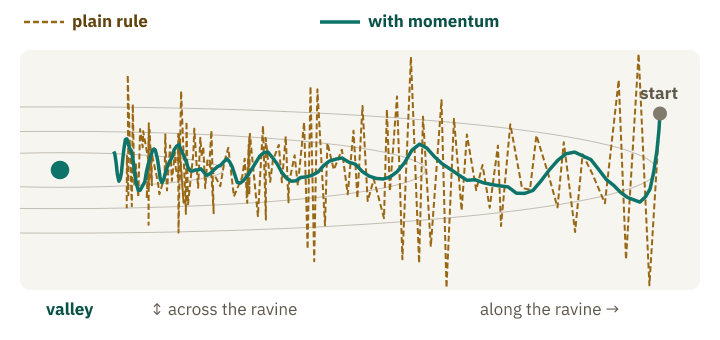
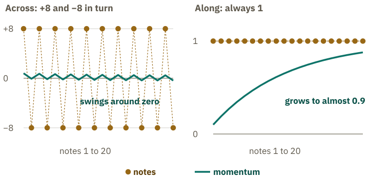
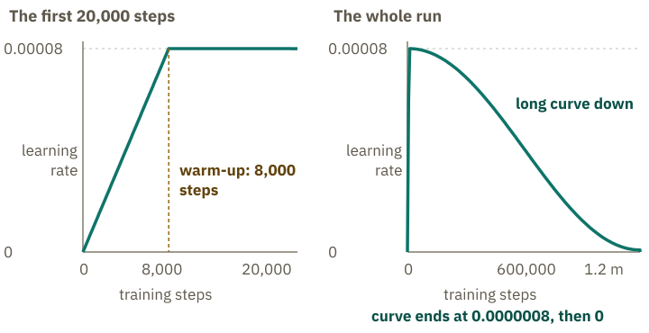

<!-- Generated from src/content/bausteine/en/optimization-of-the-weights.mdx by scripts/export-lessons.mjs -- do not edit by hand. -->

# Optimization: What Actually Changes the Weights

> Reading copy for GitHub. The full version with interactive demos, animations and recall moments is on the website: **[Optimization: What Actually Changes the Weights](https://ki-einfach-verstehen.de/en/lessons/optimization-of-the-weights/)**
>
> Licence: [CC BY 4.0](https://creativecommons.org/licenses/by/4.0/deed.en) · Credit it as: KI einfach verstehen, “Optimization: What Actually Changes the Weights”, CC BY 4.0, https://ki-einfach-verstehen.de/en/lessons/optimization-of-the-weights/

How the optimizer turns the notes from backpropagation into real steps: with momentum, with a step size of its own for every fader, with a gentle pull toward zero and on a schedule for the learning rate.

At the end of the last lesson, each of the roughly eight billion faders on Llama 3.1 8B’s mixing desk had a note on it. Backpropagation had worked it out for one [batch](https://ki-einfach-verstehen.de/en/glossary/batch/), a stack of text that the [loss](https://ki-einfach-verstehen.de/en/glossary/loss/) turns into a single error number. Each fader stands for a [parameter](https://ki-einfach-verstehen.de/en/glossary/parameters/), its setting for that parameter’s number. Its note says, for this batch only: up or down, and how strongly. All the notes together are called the gradient. Not a single fader has moved yet.

With the next batch, many notes point a little differently, some the opposite way. What do you think: where does it lead to follow the notes exactly every time?

## Who turns: the optimizer, with momentum

From the lesson on training you know the simplest answer: step equals slope times [learning rate](https://ki-einfach-verstehen.de/en/glossary/learning-rate/). A note is exactly this slope, for each fader separately: which way is downhill, and how steeply. With the made-up apple model and a learning rate of one twenty-fourth, every step halved the rest of the way to the valley. With one sixth, the fader jumped back and forth between 0 and 6. A fixed calculation like this, which turns notes into steps, is called an **[optimizer](https://ki-einfach-verstehen.de/en/glossary/optimizer/)**. In training, the optimizer is what turns the faders, step by step.

Following the simple rule to the letter causes a problem, as a made-up model with two faders shows. Its error forms a foggy hillside as in the lesson on training, now with two directions: one fader moves you across, the other along. Where you stand is both faders’ settings. The hillside is a narrow ravine: across, the ground falls steeply toward its middle; along, it only slopes gently downhill. With large steps you land on the opposite side each time, like the apple model at 6. Your path becomes a zigzag. Smaller steps stop the jumping, but then you barely progress along the ravine. And the hillside wobbles: every batch delivers slightly different notes.

*A made-up ravine seen from above, with the valley on the left. The plain rule follows every note and zigzags from edge to edge; with momentum the path becomes calmer.*

Smooth made-up numbers show what helps. Across, you jump from side to side, so the notes there point +8 and −8 in turn. Along, they say 1 every time. The notes only apply to their batch and are gone afterwards. What remains of them from batch to batch is the **momentum**. It is not physics, but a stored number per fader that takes in a bit of each new note. The optimizer now follows the momentum, not every note. Each new momentum is 90 percent old momentum and 10 percent new note. The step is then learning rate times momentum, not times note. What points back and forth across almost cancels out; what always points the same way along adds up. After twenty notes, the momentum across still swings between about −0.4 and +0.5. Along, it has grown to almost 0.9, nearly the full note.

*The made-up example from the text: across, the notes almost cancel out in the momentum; along, it builds up to almost the full size of a note.*

The technical term for it is **[Momentum](https://ki-einfach-verstehen.de/en/glossary/momentum/)**. A textbook describes it as a moving average of earlier slopes that the optimizer keeps moving along. The calculation exists in slightly different forms. The form shown here averages the slopes: the new note enters with only 10 percent. It is part of the most common method for large language models, coming shortly. GPT-3, a forerunner of the models behind ChatGPT, kept exactly these 90 percent in training, according to its research paper. The share is chosen, so it is a [hyperparameter](https://ki-einfach-verstehen.de/en/glossary/hyperparameter/).

With this averaging, the path along the ravine does not get faster; it stays just below the full note. It makes it calmer, so it can take larger steps without building up across. The real hillside does not have two directions, but as many as there are faders. More momentum isn’t always better. If the optimizer keeps 99 percent, it reacts sluggishly: new notes barely change its direction, and the model struggles to come to rest.

Momentum smooths out the back and forth. But it does nothing about some faders always getting large notes and others tiny ones.

## Every fader its own step size

The lesson on training gave this a single sentence: large language models adjust each fader’s step to how large its slopes have been so far. The lesson on model size added that the most widely used training method keeps two helper values per fader for this. What are they for?

Two made-up faders, each with four notes from four batches. As a shortcut, the table skips the 90-to-10 mixing and takes the simple average of the four notes: once with signs, standing in for the momentum, and once without, as if all notes were positive. That is their usual size. The mixing would give different numbers; the shortcut only shows which notes cancel out and which add up. For P, 10, −8, 9 and −11 cancel out to zero. Without signs, 10, 8, 9 and 11 add up to 38, divided by 4 that is 9.5.

| Fader | Notes | Average with signs | Usual size |
|---|---|---|---|
| P | 10, −8, 9, −11 | 0 | about 9.5 |
| Q | 0.1, 0.1, 0.1, 0.1 | 0.1 | 0.1 |

With the plain rule, P takes a step of 11 times the learning rate at the last note, Q one of 0.1 times the learning rate, a hundred and ten times less. Yet P does not know where to go: its notes contradict each other. Q always gets the same message, just quietly. What do you think: which of the two should take the larger step?

*A step length of its own for every direction: careful where it is steep and restless, bold where it slopes gently and steadily downhill.*

A good hiker in the ravine would have a step length for every direction, not for every spot. Across, where it is steep and the slope keeps changing, they take short steps. Along, where it is flat but steadily downhill, they stride out. They cannot know in advance where it is steep; their last steps tell them: where the slope kept flipping, they grow more careful. A hiker has two directions and feels the ground; the optimizer has one per fader and knows only the notes. It works out a step length for each of billions of faders.

That is what the method **Adam** does, introduced by two researchers in 2014. For every fader it stores two helper values: the momentum and a moving average of the squared notes. Squaring makes every note positive. Adam’s step is learning rate times momentum, divided by the square root of this average, that is, by the usual size of the notes. For P that is 0 divided by 9.5, so almost no step. For Q, 0.1 divided by 0.1, so one full learning rate. If a third fader got the note 10 four times, it would be 10 divided by 10, again one full learning rate. Adam divides out the notes’ size: the usual size measures only their strength; the momentum decides whether they point steadily one way.

Still, Adam is no model and learns nothing: it is a fixed calculation with chosen settings. Momentum and usual size are running values of training, not parameters of the model, and the finished model does not need them. GPT-3 was trained with Adam.

Which fader moves further, P or Q?

Q. Its steps point the same way at every batch and add up: after a hundred such batches, about a hundred learning rates far. P’s steps are tiny and point this way one time and that way the next. They largely cancel out, and P stays roughly where it was.

> **Interactive demo:** [try it on the website](https://ki-einfach-verstehen.de/en/lessons/optimization-of-the-weights/)

Adam is almost complete. But Meta’s report on Llama 3 names something with one more letter: AdamW.

## The W: a gentle pull toward zero

According to its research paper, Meta trained its largest model, Llama 3.1 with 405 billion faders, with AdamW. What does the W mean?

*Weight decay is like a small spring on every fader: at every step it pulls the fader a little toward zero, whatever the note says. The crossbar stands for zero.*

Picture a small spring on every fader of the mixing desk that pulls it toward zero. At every step, the optimizer first moves the fader a tiny bit toward zero, in proportion to its value, then takes the step from momentum and usual size. The spring has no resting point other than zero, and it always pulls, no matter what the note says. This pull is called **[weight decay](https://ki-einfach-verstehen.de/en/glossary/weight-decay/)**. No fader is removed in the process, and none jumps to zero.

But what happens to a fader whose note says zero at every batch?

It shrinks, step by step, by the same small share of its value. After many steps it is close to zero. Faders the model needs get notes that keep pushing back against the pull.

Why a letter of its own? You could simply add the pull to the note. But then Adam would divide it, together with the note, by the note’s usual size. For a fader with large notes the pull would become tiny, and that very fader would barely feel the spring. So in 2017 two researchers proposed applying the pull separately from the note, “decoupled”. The W in AdamW stands for this separate weight decay. The spring’s strength is a chosen number. According to the research paper, GPT-3 used the value 0.1. Common implementations also multiply the pull by the learning rate: per step, every fader gets smaller by learning rate times 0.1 times its value. With a made-up, deliberately large learning rate of 0.1: a fader at 2 is pulled toward zero in one step by 0.1 times 0.1 times 2, that is 0.02, and then stands at 1.98. If it is at 1, it is only 0.01. With the tiny learning rates of large models, the pull per step stays a tiny fraction of the value.

Not every large model is trained with AdamW alone: according to its developers’ report, the German-English language model Kolibri optimizes large parts of its faders with a newer optimizer called Muon.

That leaves the learning rate itself, fixed so far.

## Up first, then down for a long time: the learning-rate schedule

If so much depends on the learning rate, why not pick a good one and keep it?

> **Interactive demo:** [try it on the website](https://ki-einfach-verstehen.de/en/lessons/optimization-of-the-weights/)

Because training needs different steps at its start and its end. Toward the end, the model is close to the valley. But the notes keep wobbling, because every batch contains different text. A textbook gives this noise as the reason to lower the learning rate over time with the plain rule: it does not vanish even at the lowest point. With large steps the model would be pushed out of the valley repeatedly, like the apple model that jumped between 0 and 6. Small steps let it come to rest.

At the start, the faders are set at random, and the notes are large and wild. From so few notes, Adam estimates the usual size only roughly, so its step sizes vary widely, some much larger than needed. With a high learning rate such steps easily go wrong. A research team proposed, with experiments and theory, that a slow start cushions this uncertainty. So the learning rate starts near zero and ramps up quickly. This is called **warm-up**. After that, it slowly falls.

This course, fixed in advance, is called a **[learning-rate schedule](https://ki-einfach-verstehen.de/en/glossary/learning-rate-schedule/)**. Like the learning rate, it is a hyperparameter. For the largest model in this series, Llama 3.1 with 405 billion faders, according to Meta it rose for 8,000 steps and then fell slowly over more than a million. The chart shows the exact values. At the very end, it fell to zero.

*The learning-rate schedule of Llama 3.1 with 405 billion faders according to Meta: on the left the first steps, in which the learning rate ramps up; on the right the whole run, in which the warm-up only shows as a vertical line at the start.*

What would happen if, toward the end, you suddenly jumped back to the peak learning rate?

The steps would become large again. The model is close to the valley by then, but the notes keep wobbling, and every large step pushes it out a little, just as the apple model jumped between 0 and 6 at one sixth. The loss would probably rise again. That is why a schedule ends with small steps and does not jump back.

One level deeper: What the optimizer stores per fader

The lesson on model size gave you the 16 bytes per [parameter](https://ki-einfach-verstehen.de/en/glossary/parameters/) that training needs in a common setup. They come from the research paper on ZeRO, a method for training very large models: 2 bytes for the 16-bit number, 2 bytes for its note and 12 bytes for the optimizer. The 12 bytes are the more precise 32-bit copy of the number plus Adam’s momentum and usual size, 4 bytes each.

So three quarters of what is stored per parameter belongs to the optimizer. Worked out for Llama 3.1 8B, that is about 96 of the 128 gigabytes. That is where ZeRO comes in. When many chips train together, they need not each hold all the optimizer values. Each chip holds only its share and turns only those faders. The paper works through an example with 7.5 billion parameters on 64 chips: 120 gigabytes per chip without splitting, 31.4 gigabytes when only the optimizer state is spread out.

At the start, Llama 3.1 8B’s eight billion faders had notes, and none had moved. Now you know who does the turning. How many such steps does a model need, how much text does it see along the way, and how can you tell it is making progress? [Batch, Epoch, Step, Token Budget: How Training Progress Is Measured](./batch-epoch-step-token-budget.md).

---

Source: https://ki-einfach-verstehen.de/en/lessons/optimization-of-the-weights/

← Previous: [Backpropagation and Gradients: How the Model Knows What to Change](./backpropagation-and-gradients.md) · [All lessons](../../README.md#contents) · Next: [Batch, Epoch, Step, Token Budget: How Training Progress Is Measured](./batch-epoch-step-token-budget.md) →
