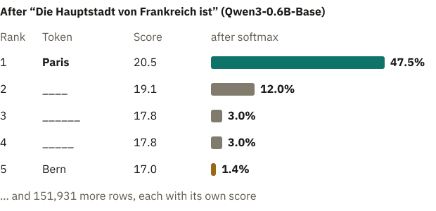
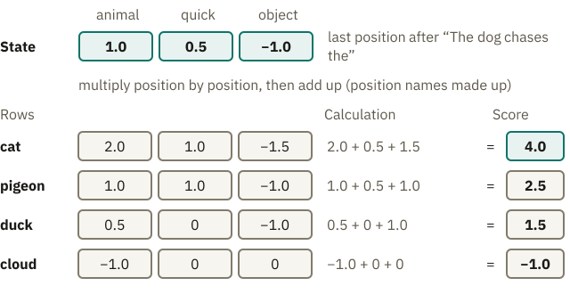
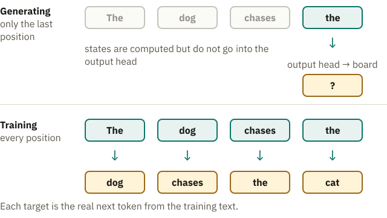
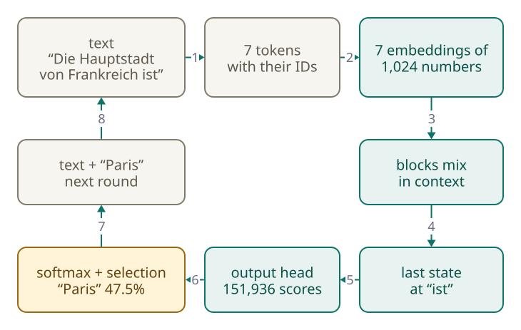

<!-- Generated from src/content/bausteine/en/output-head.mdx by scripts/export-lessons.mjs -- do not edit by hand. -->

# Output Head: From the Last State to a Prediction

> Reading copy for GitHub. The full version with interactive demos, animations and recall moments is on the website: **[Output Head: From the Last State to a Prediction](https://ki-einfach-verstehen.de/en/lessons/output-head/)**
>
> Licence: [CC BY 4.0](https://creativecommons.org/licenses/by/4.0/deed.en) · Credit it as: KI einfach verstehen, “Output Head: From the Last State to a Prediction”, CC BY 4.0, https://ki-einfach-verstehen.de/en/lessons/output-head/

How a language model computes a score for every token from its last state and why only the last position counts.

The previous lesson ended with a state at every position: a list of numbers that the blocks had filled with context. In the small language model Qwen3-0.6B, each state contains 1,024 numbers. A chat window, though, shows words, not the numbers behind them.

In the first lesson of this topic area, this same model gave “Paris” a probability of 47.5 percent after “Die Hauptstadt von Frankreich ist” (German for “The capital of France is”). On another run with the same opening, it wrote “Zürich”. What calculation produced the 47.5 percent?

## What comes out is a scoreboard, not a word

At the end, the model produces the score list mentioned earlier. It resembles the quiz-night scoreboard with three teams from the lesson on [probability and softmax](./probability-and-softmax.md). This board has far more rows: for Qwen3-0.6B, there are 151,936. Almost every row belongs to a [token](https://ki-einfach-verstehen.de/en/glossary/token/), one of the 151,669 pieces known to the [tokenizer](https://ki-einfach-verstehen.de/en/glossary/tokenizer/), the program splitting text into pieces. Their fixed list is the [vocabulary](https://ki-einfach-verstehen.de/en/glossary/vocabulary/). The remaining 267 rows belong to no piece and stand for no word. Every row gets a [score](https://ki-einfach-verstehen.de/en/glossary/score/), even the one for a comma or a Chinese character.

*The scoreboard at the end of the model: many rows, each with its own score. One row is ahead.*

For this topic area, the free base version of Qwen3-0.6B, without chat training, was run on an ordinary computer. After “Die Hauptstadt von Frankreich ist”, “Paris” has the highest score at 20.5. A blank line, “____”, comes second at 19.1, as in worksheets and quizzes. Blank lines of other lengths take third and fourth place because each length is a separate token. The model apparently saw such texts often in training. “Bern” comes fifth. Softmax turns the scores into percentages.

By the rule of thumb from the softmax lesson, one point ahead means about 2.7 times as much, two points a good seven times as much (2.7 · 2.7). “Paris” is almost one and a half points ahead of the blank line and gets about four times as much: 47.5 against 12.0 percent. “Bern” is three and a half points behind and only reaches 1.4 percent. All rows together make 100 percent. The top five have about two thirds, and the remaining rows share the last third in tiny pieces. Only as a share of this whole does “Paris” come to exactly 47.5 percent, the number from the first lesson.

*The top of the real board: softmax turns a lead of almost one and a half points into four times the share.*

You know from the lesson on [input and output](./input-and-output.md) that the model rates every vocabulary entry and a separate step picks one: after “The cat sat”, “on” was ahead. **Often, the chosen piece is not even a whole word.** After “Der Hund jagt die” (“The dog chases the”), Qwen3 put word beginnings in the lead, such as “T” (as in “Taube”, pigeon), “F” (as in “Fliege”, fly) and “Kat” (as in “Katze”, cat). Which word these pieces become is decided only in the following rounds. What gets chosen is a token.

Scores can even all be negative. In the older GPT-2, also part of the experiment, “dog” led after “The dog chased the” with −86.4 and still got almost 20 percent. Only the gaps between the scores count: the highest gets the largest share, even if it is negative.

## Where the points come from: one row per token

The part of the model that fills the board is called the **[output head](https://ki-einfach-verstehen.de/en/glossary/output-head/)**. It is no further block but a much simpler step: no attention, no mixing, just a comparison. For every vocabulary entry, it has a row as long as the state. **A token's score measures how well the state fits its row.**

Suppose states had only three numbers and the vocabulary four tokens: “cat”, “pigeon”, “duck” and “cloud”. For illustration, the three positions are called “animal”, “quick” and “object”. After “The dog chases the”, the last position holds the state (1.0 | 0.5 | −1.0): an animal fits, preferably a quick one, an object rather not. The row for “cat” reads (2.0 | 1.0 | −1.5): clearly an animal, quick, not an object. The numbers say how well a word fits after “chases the”, not what it is.

To score “cat”, the output head multiplies the numbers in matching positions, then adds the results. 1.0 times 2.0 gives 2.0, and 0.5 times 1.0 gives 0.5. The final pair, −1.0 and −1.5, gives plus 1.5 because minus times minus is plus. The total is 4.0. You saw the same calculation in the previous lesson, when the query (the search slip) for “bank” was compared with every key (the tag).

“pigeon” has the row (1.0 | 1.0 | −1.0), giving 1.0 + 0.5 + 1.0 = 2.5. “duck” has (0.5 | 0 | −1.0) and comes to 1.5. “cloud” has the row (−1.0 | 0 | 0). What score does it get? Work it out before reading on.

The score is −1.0. The sentence calls for an animal, and a cloud is not one. At the “animal” position, the state is positive but the row is negative, so the score goes down. The same rule applies throughout: matching signs add points, opposite signs subtract them. The farther a number is from zero, the more it matters.

So a high score does not mean that state and row are equal. If the state were exactly the row of “pigeon”, “cat” would still lead, 4.5 to 3.0. Its numbers share the signs of “pigeon”, and two are farther from zero (2.0 instead of 1.0 and −1.5 instead of −1.0).

*The output head in miniature: for each row, it multiplies the numbers position by position with the state, then adds the results (using made-up numbers and position names).*

Real models do the same, just bigger. In Qwen3-0.6B, the output head compares the state with 151,936 rows of 1,024 numbers each, about 156 million [parameters](https://ki-einfach-verstehen.de/en/glossary/parameters/) set during training. This happens for every token a chatbot writes. There, the positions have no names; “animal”, “quick” and “object” were made up.

> **Interactive demo:** [try it on the website](https://ki-einfach-verstehen.de/en/lessons/output-head/)

This is where the scoreboard analogy ends. On a real scoreboard, a referee awards points by known rules. No one wrote the output head's rows; training set their numbers.

One level deeper: the output head as a single matrix calculation

Stacked, the rows form a [matrix](https://ki-einfach-verstehen.de/en/glossary/matrix/), in GPT-2 of shape 50,257 × 768: one row per token, 768 numbers per row, as many as the state h. All comparisons together are one multiplication:

`Scores = h · Wᵀ`

W is the matrix of all rows; the superscript T means it is flipped so its rows meet the state's positions. Out comes a vector with 50,257 scores. Recalculated for GPT-2, the result differs from the model's own scores by less than 0.0002. Right before the head, a balancing step runs, a normalization; “last state” means the state after it. Experts call the scores logits.

The output head's rows recall something from the start of the path.

## The same table at the input and the output

At the input, every token ID fetches its embedding from a large table; in the lesson on embeddings, the embeddings of “apple” and “peach” lay close together. This table has one row per vocabulary entry, each as long as a state. The output head's table looks like that. Could it be the same one?

The lesson on embeddings said a second table usually sits at the output. Some models share it, though. Experts call this **weight tying**. “Weights” here means parameters, the numbers in the table. **The table is then used twice:** at the front to fetch an ID's numbers, at the back to compare the last state with every row. A high score for “Paris” then means: the state at the last position points in a similar direction to the embedding of “Paris”.

*Weight tying: the same table translates tokens into numbers at the input and compares numbers with tokens at the output.*

A model's blueprint says whether the table is shared. This is the small file shipped with the parameters (see the lesson on parameters, training and use). For Qwen3-0.6B, it says yes; for the larger Qwen3-8B, no: it has a second table of its own at the output.
Sharing can even make language models slightly better, as researchers showed in 2016, and above all it saves space.

The Qwen3-0.6B table contains the roughly 156 million numbers mentioned earlier. The whole model has about 0.6 billion parameters, hence the “0.6B” in its name. Without sharing, the output would need another 156 million numbers, adding about a quarter to the model. Each number takes two bytes here, as in Llama 3.1 8B from the basics, whose eight billion numbers fill 16 gigabytes. Sharing saves 156 million times two bytes, about 0.3 gigabytes. Small models in particular often run on laptops or phones, where every gigabyte counts.

So far, it was about a single state. But the model has one at every position.

## Which position counts

For Qwen3-0.6B, “Die Hauptstadt von Frankreich ist” consists of seven tokens: “Die”, “Haupt”, “stadt”, “von”, “Frank”, “reich” and “ist”. Each has its state after the last block. Which goes into the output head?

**During generation, only the state of the last position**, here “ist” (“is”). The other six would predict tokens that are already in the text.

Does the model then only look at the *last* word? No: as the previous lesson described, the blocks mixed information from all earlier positions into this state. The word “ist” alone points to no capital. Only the mixed-in context makes its state fit the row of “Paris” well.

In training, every position of a text delivers its own board. How many predictions are in a single pass with “The dog chases the cat”, if every word is one token? Think it over.

Five positions deliver a board each, four can be checked directly: “The” should predict “dog”, “dog” the word “chases”, “chases” the word “the”, and “the” the word “cat”. For “cat”, the next token is not in the text. No position can copy, although the whole sentence is in the model: the causal mask from the previous lesson lets every position see only what comes before it. Each gets the real text before it, not the model's own guess (technical term: teacher forcing). So no prediction waits for another; all run at once.

*During generation, only the last position delivers a board. In training, every position predicts its next token, all at the same time.*

That is why chatbot answers appear piece by piece, although training processes whole texts at once: during generation, the real next text does not exist yet. Each token must be chosen before the next can be computed.

## One full round, from text to the next token

Now the whole path in one go. The text is split into tokens, each with its ID. Every ID fetches its embedding from the table. The blocks mix context into the states, one after another. The state of the last position goes into the output head, and out comes the board with 151,936 scores. Softmax turns them into percentages. A selection step picks a token, and it is appended. Then the next round starts with one more token.

[▶ watch the animation on the website](https://ki-einfach-verstehen.de/en/lessons/output-head/)

*One complete round through the model: from the text via tokens, embeddings, blocks and the last state to the board, the selection and the appended token.*

**The selection step decides what the board turns into.** If the model always takes the most likely token (greedy decoding), “Paris” follows every time. If instead the prize wheel from the softmax lesson is spun ([sampling](https://ki-einfach-verstehen.de/en/glossary/sampling/)), the result is open: every token's segment is as large as its percentage. In the experiment, “Zürich” came out first; then a colon followed by the sentence again; the third time, “Paris”.

How does “Zürich” get onto the wheel when it is not even in the top five? For the model, “Zürich” is not one token but three: “Z”, “ür” and “ich”. The word beginning “Z” is 17th on the board, at about 0.6 percent. The wheel lands on this narrow segment roughly once every 170 spins, so hitting it on the first try was luck. Once “Z” is appended, “ür” and “ich” follow in the experiment. The output head ranked “Paris” first; the selection step made the draw.

In one answer, greedy decoding and sampling never take a token back; each round builds on it. Tapping “Regenerate” in a chatbot keeps the first board: only the draw is new, and from the first different token on, the later ones change too.

> **Interactive demo:** [try it on the website](https://ki-einfach-verstehen.de/en/lessons/output-head/)

Always taking the most likely token has a weakness. In the experiment, GPT-2 thus continued “Der Hund jagt die” with “Welt des Welt des Welt des Welt des” (“world of the world of the …”). That is the loop of repeated phrases from the softmax lesson: once a phrase is in the text twice, repeating it often becomes the most likely continuation.

One level deeper: does everything have to be recomputed every round?

As described, the whole text runs through the model every round, although only one token was added. The solution is called the **KV cache**. You know keys and values from the previous lesson. Those of earlier tokens are kept, because later tokens do not change them. Each round, only the new token goes through the blocks.

Measured with GPT-2 on an ordinary computer (only as an order of magnitude), 200 tokens took about 3.6 seconds with the cache and about 14 without, roughly four times as long. The cache is not free: it grows with every token and can fill much of the memory for very long texts.

## When the loop ends and what you can adjust

When does the loop stop? Remember the end token from the lesson on tokenization in the model, such as `<|eot_id|>` in Llama, that closes a turn. In the basics, it was called the stop marker. It has its own row in the output head and gets a score every round; **choosing it signals the end; the chat app then stops.** The length limit is a setting outside the model. If a long answer stops mid-sentence and the app offers to continue, the limit was hit.

*From outside, at most the selection step can be changed, not the output head.*

Whether you can influence the selection step depends on the program you use the model through. The calculation before it cannot be changed from outside. You know temperature from the softmax lesson: a low value enlarges the prize wheel's large segments further, a high value evens out the shares.

One level deeper: what providers report and allow

Programs reach a model through the provider's interface, an API. It reports why an answer ended: at Anthropic “end_turn” if the model finished by itself, otherwise for example the maximum number of tokens or a stop sequence set by the program.

Besides temperature, there are often top-k and top-p: before the spin, only the k most likely tokens remain, or only as many as together reach the share p. Some providers restrict them (as of October 2026). For OpenAI's GPT-6 models, temperature and top-p are dropped depending on the model: for some always, for others once the model thinks before answering. For models after Claude Opus 4.6, Anthropic accepts only temperature 1.0, no top-k, and top-p only from 0.99. That keeps 99 percent of the wheel and removes only hairline segments.

That completes the calculation behind the 47.5 percent: the last state times the row of “Paris”, then softmax over all rows. But where do its numbers come from? The last state is computed anew for every text, from the tokens and the model's parameters. The embeddings, the parameters in the blocks and the rows of the output head, by contrast, were set by training. Training uses this lesson's prediction: at every position, the next token is predicted and compared with the real one. How this makes a better model is shown in the next topic area, “How Learning Works”.

---

Source: https://ki-einfach-verstehen.de/en/lessons/output-head/

← Previous: [Transformer Blocks and Attention: How Context Gets Mixed In](./transformer-blocks-and-attention.md) · [All lessons](../../README.md#contents)
