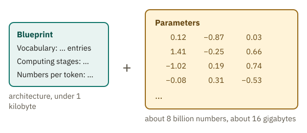
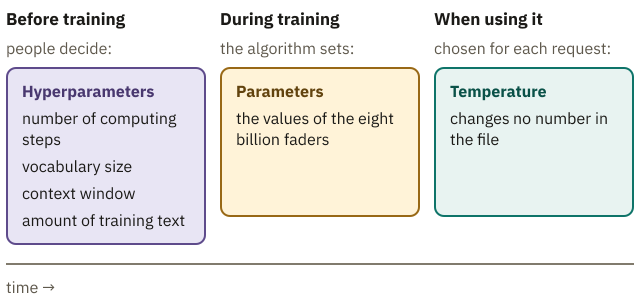
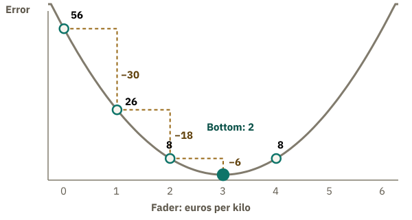
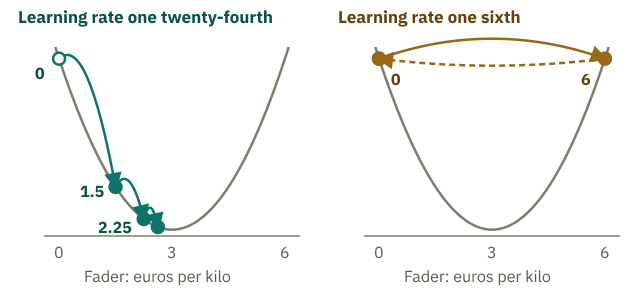
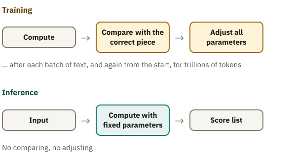

<!-- Generated from src/content/bausteine/en/parameters-training-inference-hardware.mdx by scripts/export-lessons.mjs -- do not edit by hand. -->

# Parameters, Training and Use: How a Model Learns

> Reading copy for GitHub. The full version with interactive demos, animations and recall moments is on the website: **[Parameters, Training and Use: How a Model Learns](https://ki-einfach-verstehen.de/en/lessons/parameters-training-inference-hardware/)**
>
> Licence: [CC BY 4.0](https://creativecommons.org/licenses/by/4.0/deed.en) · Credit it as: KI einfach verstehen, “Parameters, Training and Use: How a Model Learns”, CC BY 4.0, https://ki-einfach-verstehen.de/en/lessons/parameters-training-inference-hardware/

What is inside a model file, what people decide before training, how training uses the error to find each fader’s direction and why learning costs more than using.

Some language models are available to download. One is Llama 3.1, released in summer 2024 by Meta, the company behind Facebook. Llama 3.1 is a language model like the one behind ChatGPT. Its smallest version, Llama 3.1 8B, consists mainly of about eight billion numbers.

The numbers in the model file were set by training. Still open: who decided how many there are. How did training know for each number whether it had to go up or down?

## What is inside a model file

Download Llama 3.1 8B and you get mainly two kinds of files. One is tiny and holds a kind of blueprint.

The other kind consists of large files totaling about 16 gigabytes (the box below shows where that figure comes from). They contain only numbers called [parameters](https://ki-einfach-verstehen.de/en/glossary/parameters/): values set by training, like the weights of the spam filter in the first lesson. You will find no readable sentence in them.

*A downloaded model consists of two parts: a small blueprint and billions of numbers.*

The “8B” in the name stands for 8 billion parameters. The B stands for “billion”, here a thousand million.

One level deeper: where the 16 gigabytes come from

Each of these numbers takes up 2 bytes of memory. Memory is measured in bytes, and a gigabyte is a billion bytes. So the 16 gigabytes come about like this: eight billion times 2 bytes is 16 billion bytes, which is 16 gigabytes. Why it is 2 bytes, and whether fewer would do, is the subject of the next lesson.

A byte consists of eight yes-or-no bits. Each bit is either off (0) or on (1). Eight such bits can form 256 different patterns, and each pattern can stand for a number or a letter. That is how a computer stores everything it calculates or shows.

*The blueprint determines how the desk is built. The parameters record where its faders sit.*

On the mixing desk from the first lesson, each fader is a parameter and its position a number. The small file describes the type of model and its size: how many [layers](https://ki-einfach-verstehen.de/en/glossary/layer/) (computing stages) it has. This blueprint is called the model’s **[architecture](https://ki-einfach-verstehen.de/en/glossary/architecture/)**. The large files record where each fader sits. You know some of these faders from the lesson on vectors and matrices: each text piece the tokenizer splits the text into has a list of learned numbers, a vector. The blueprint sets how many such lists there are and how long they are. Each of these numbers is the position of one fader. Unlike a real desk, none has a label.

What do you think: if two models have exactly the same architecture, do they also behave the same? Make a guess before you read on.

Not necessarily. Meta also offers a second version, Llama 3.1 8B Instruct. Both share the same blueprint and number of parameters. The base version has only been through pretraining, where it learned to predict the next text piece. From “The cat sat”, it learns that “on” comes next. The Instruct version was then trained further to answer questions and instructions like a chatbot. The two differ in the values of their numbers. On download pages, the suffix “Instruct” marks the chat version.

But who decided that Llama 3.1 8B has eight and not nine billion faders?

## What people decide before training

Training does not make that decision. It sets the faders but does not build a new desk. Before training starts, people decide how many layers the model has, how wide each layer is and how large the vocabulary becomes. The number of parameters follows from that.

In the tokenizer lesson, [Byte Pair Encoding](https://ki-einfach-verstehen.de/en/glossary/byte-pair-encoding/) (BPE) ran until the [vocabulary](https://ki-einfach-verstehen.de/en/glossary/vocabulary/) (the fixed list of pieces a tokenizer knows) reached its preset size. The context window—the number of text pieces the model can process at once—is fixed too. It is set in the blueprint before anyone asks the chatbot a question.

Such settings are called **[hyperparameters](https://ki-einfach-verstehen.de/en/glossary/hyperparameter/)**. Training does not change them; it sets the parameters. They include choices about the size of the blueprint and about the training run itself, such as how much text the model sees.

The [temperature](https://ki-einfach-verstehen.de/en/glossary/temperature/) from the previous lesson is not trained either. It sets how much chance plays a part in the selection step. So is it a hyperparameter?

No. Hyperparameters are fixed before training and help determine which numbers end up in the file. Temperature is chosen only when the finished model is used, and it can be set for every request. It only determines how the [scores](https://ki-einfach-verstehen.de/en/glossary/score/) (the ratings for each possible next text piece; for “The cat sat”, a made-up score of 8.1 for “on”) become percentages, and it changes no number in the file. A chat app can therefore run the same model with a low or a high temperature.

*Hyperparameters are fixed before training, training sets the parameters, and the temperature is chosen only during use.*

One level deeper: how GPT-3 was set up

GPT-3 from the first lesson, a predecessor of ChatGPT’s models, has about 175 billion parameters. Its 2020 paper lists, among others, these hyperparameters for the largest model:

- **96 layers.** A layer is a stage that processes the previous result.
- **12,288 numbers per text piece.** The vector that represents each text piece on its way through the layers; they are computed anew for every input.
- **A context window of 2048 text pieces.**
- **A learning rate of at most 0.00006.** The learning rate sets how far each fader turns per step. Its course was fixed in advance: ramped up at the start, then lowered.
- **A batch of 3.2 million text pieces.** The corrections from this much text are collected and applied once.

None of these values was learned. Layer count, vector length and vocabulary size set how large the desk is: together with the structure of each layer, they give about 175 billion parameters. Learning rate and batch set how training runs.

Once everything is fixed, training begins.

## How does training know the direction?

With the spam filter from the first lesson, the training algorithm nudged the weights a small step after every error, toward a smaller error. There, you could still guess the direction. When a real email with “prize” in the subject wrongly landed in spam, the weight of “prize” was too high. With eight billion unlabeled faders, nobody can work out every direction. So how does training know where each one should go?

First, the error becomes a number. The training algorithm compares the model’s prediction with the right answer and works out how far off it is. This error number is called **loss**. For a language model, the loss is larger the lower the percentage the model gives to the text piece that actually follows, such as “on” after “The cat sat”.

A made-up mini model with one fader predicts apple prices: prediction equals fader setting times kilos. The fader therefore represents the price per kilo. This toy model only shows how the error reveals the right direction. Its three purchases are made up too: 1 kilo for 2 euros, 1 kilo for 4 euros and 2 kilos for 6 euros. There are no percentages here, so the apple model needs its own rule for its error: multiply each deviation by itself and add everything up. That way, too much counts as much as too little, and large deviations weigh more.

The fader starts at 0, like the spam filter’s weights, and moves step by step, as in training, but with a single fader. At 0, the model predicts 0 euros for every purchase. The deviations are 2, 4 and 6 euros. Squared, these give 4, 16 and 36, or 56 in total. So the error is 56. Does it get smaller when the fader is at 1?

Yes, it drops to 26.

At 1 the model predicts 1, 1 and 2 euros.

The deviations are then 1, 3 and 4 euros; squared and added, they come to 26. So higher is the right direction.

At 3 the error is at its smallest, and at 4 it rises again. It never reaches zero, because the two one-kilo purchases contradict each other.

The toy does not show whether a real model with billions of faders has just one lowest point.

*The error of the made-up apple model at every fader setting: far from the bottom it falls steeply with each euro, close to it hardly at all.*

The error drops less and less from one setting to the next: first by 30, then by 18, finally only by 6. How steep the error is at one spot, like a hillside, is called the **slope**. You measure it with a tiny turn of the fader and scale the change in error up to one euro. The slope tells the direction. If the error falls when you turn the fader up, it must go higher; if it rises, lower. Its size tells the distance: steep means the bottom is still far away.

You are standing on a hillside in thick fog and want to reach the valley. You see nothing, but you feel underfoot which way the ground falls and how steeply. The valley is the fader setting with the smallest error. In the picture, the hillside is the error curve. Training has to calculate the slope at every spot.

In the fog you would stride down steep slopes and go carefully near the valley. Training must do the same: make each step depend on the slope.

## How far a step goes

In the apple model, each step equals the slope times the learning rate. The **[learning rate](https://ki-einfach-verstehen.de/en/glossary/learning-rate/)** is a number that people choose before training, a hyperparameter. It determines how far the fader turns in each step: the larger it is, the longer the step. In the example it is one twenty-fourth, so that the steps come out evenly.

A tiny turn shows how steep the curve is at 0: turn the fader by only 0.01, and the error falls by just under 0.36. One whole euro is a hundred times as much as 0.01, so the slope at 0 is about 36. The error shows the direction: if it falls when you turn the fader up, the step goes up.

Between 0 and 1 the error falls by 30 in total. Directly at 0 it falls faster, because the hillside flattens out along that way.

The first step is therefore 36 divided by 24, which is 1.5.

The fader moves from 0 to 1.5. At 1.5, the bottom at 3 is only half as far away, so the slope is also half as large.

The next step is therefore half as long, 0.75, and leads to 2.25.

Each further step halves the rest of the way to the bottom at 3.

What happens with a learning rate four times as large, that is one sixth? Before you read on, consider where the fader jumps to.

The first step is 36 divided by 6: 6 euros. The fader jumps from 0 to 6, to the other side of the valley. There the error is 56 again, because this toy curve is symmetric around the bottom at 3. But the hillside now falls the other way, so the next step leads back to 0. The fader jumps back and forth and never reaches the bottom. If the learning rate is tiny, training hardly makes progress. Finding a suitable learning rate often takes trial runs over several training runs.

*The same error curve, two learning rates: with one twenty-fourth, each step halves what is left to the valley; with one sixth, the fader jumps back and forth between 0 and 6.*

> **Interactive demo:** [try it on the website](https://ki-einfach-verstehen.de/en/lessons/parameters-training-inference-hardware/)

A real model has billions of faders. Turning each one and re-measuring the error would mean computing the whole model billions of times per step. Instead, a method called **backpropagation** gives the slope for all faders at once, in a single pass backward through the model. Each fader then moves a bit downhill, toward where the error falls, as in the apple model. “How Learning Works” explains how backpropagation finds these slopes.

GPT-3 was trained with the method Adam, which works out the step length of each fader from the current and earlier slopes; the learning rate remains the control knob.

The spam filter worked the same way. For a genuine message with “prize” in its subject, a higher weight would have increased the error and a lower one would have decreased it, so the weight moved down a bit.

## Learning costs more than using

An answer appears in the chat window after a few seconds. According to Meta, training Llama 3.1 8B took 1.46 million hours of computing time, added up across all AI chips working at the same time. It ran on graphics processors, which carry out many similar calculations in parallel.

At the sound check before a concert, the band plays a few bars. The sound engineer listens and pushes the faders until it sounds right. During the concert, the desk processes whatever comes in. The sound check stands for training. Using the finished model is called **[inference](https://ki-einfach-verstehen.de/en/glossary/inference/)** and corresponds to the concert. Every question you ask a chatbot triggers inference.

*The sound check before the concert: first the faders are set, then they stay put.*

The picture falls short in two places, though. In training, nobody pushes faders by ear. Backpropagation calculates for all faders where they should go. And at a real desk, the engineer still steps in during the concert. **During inference, no fader moves at all, whatever you type.** What a chatbot “remembers” from your conversation is included in the input with every message; the lesson on input and output explains how. New versions of a model only come from later training runs.

Before you read on: what does the model compute for each text piece when it answers, and what does training add?

During inference, the model uses its fixed numbers to compute once per text piece: the input goes in, a list of scores comes out. Training starts with the same computation. Then the training algorithm compares the prediction with the actual next text piece and measures the loss. Next, backpropagation gives each of the eight billion faders its slope. Finally, it adjusts the faders once the batch’s slopes are collected.

*Training is a loop of computing, comparing and adjusting. Inference is only the first step, with fixed numbers.*

Per text piece, training takes about three times as much computing as inference, because the slopes add. The amount makes the difference: an answer works through roughly a few hundred text pieces, while Meta gives about 15 trillion for training Llama 3.1.

For the 8-billion version, one chip would need about 167 years (1.46 million hours divided by 8,760 hours per year). That is why many chips share the work at once.

One level deeper: how much computing time the largest Llama 3.1 needed

Meta’s model card gives about 30.8 million hours on H100 chips for the largest Llama 3.1, the version with 405 billion parameters. An H100 is a graphics chip for AI calculations. A single chip would need about 3,500 years for that. Meta therefore spread the work across more than 16,000 H100 chips, cutting the time to just under three months. This is only a rough estimate, because the chips do not compute all the time and some time is lost to coordination between them. The basic idea stays: many chips share one calculation, so that it finishes in months instead of millennia. This effort is made once per version.

But because millions of people ask questions, using the models also requires large data centers.

Back to the start: people fix the blueprint and its size beforehand. Training adjusts each of the eight billion numbers according to its slope. How much memory that takes, and whether it fits on a phone, is the subject of the next lesson, [Model Size and Hardware: Where a Model Fits](./model-size-and-hardware.md).

---

Source: https://ki-einfach-verstehen.de/en/lessons/parameters-training-inference-hardware/

← Previous: [Probability and Softmax: How a Model Decides](./probability-and-softmax.md) · [All lessons](../../README.md#contents) · Next: [Model Size and Hardware: Where a Model Fits](./model-size-and-hardware.md) →
