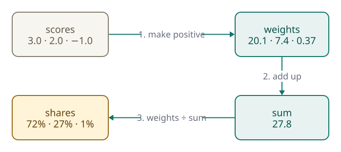
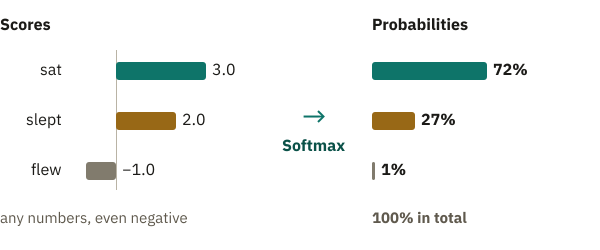
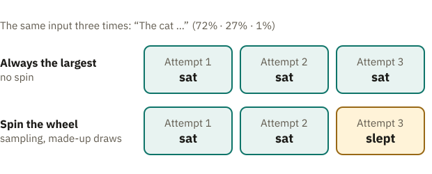
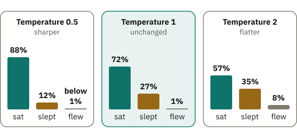

<!-- Generated from src/content/bausteine/en/probability-and-softmax.mdx by scripts/export-lessons.mjs -- do not edit by hand. -->

# Probability and Softmax: How a Model Decides

> Reading copy for GitHub. The full version with interactive demos, animations and recall moments is on the website: **[Probability and Softmax: How a Model Decides](https://ki-einfach-verstehen.de/en/lessons/probability-and-softmax/)**
>
> Licence: [CC BY 4.0](https://creativecommons.org/licenses/by/4.0/deed.en) · Credit it as: KI einfach verstehen, “Probability and Softmax: How a Model Decides”, CC BY 4.0, https://ki-einfach-verstehen.de/en/lessons/probability-and-softmax/

How a language model turns its scores into shares, why it sometimes picks the obvious choice and sometimes something else, and how temperature changes that.

When you have a chatbot regenerate an answer, you often get a different one, even though your question stayed the same. As the lesson on input and output showed, the same input gives, in principle, the same [score](https://ki-einfach-verstehen.de/en/glossary/score/) list. That list rates each [token](https://ki-einfach-verstehen.de/en/glossary/token/) (a piece of text) by how well it fits next. A separate step makes the choice, and that is where chance comes in. Scores like 7.1 or −2.3 are not yet probabilities. How does the model choose exactly one token from them?

You type “The cat”. For this example, we assume only three possible continuations: “sat” with the score 3.0, “slept” with 2.0 and “flew” with −1.0. These scores are made up. A person set them; nothing was trained. A real model gives a score to every token in its [vocabulary](https://ki-einfach-verstehen.de/en/glossary/vocabulary/) (the fixed list of all pieces into which the model splits a text). For example, GPT-2, an older forerunner of the models behind ChatGPT, has about 50,000 tokens. It computes each score from its [parameters](https://ki-einfach-verstehen.de/en/glossary/parameters/), the numbers set during training. With these made-up scores, you can only work through how a token is chosen. They do not tell you which continuation a real model prefers after “The cat”.

## How often should “sat” come up?

Suppose the model must choose the next token after “The cat” a hundred times. How often should “sat” come up, and how often “flew”? Try to read it off the scores before you read on.

If the selection step always takes the highest score, as in the lesson on input and output, “sat” comes up a hundred times, and regenerating would in principle give you nothing else. If “slept” should come up now and then too, the scores do not say how often. “flew” is where it breaks down: its score is negative, and a share of minus one percent does not exist. A score only shows which token is ahead, and by how much, not how often it should come up.

*Three possible continuations of “The cat …”: sat, slept, flew. The cat for “sat” is largest because that continuation is most likely; the tiny cat on the balloon is the least likely.*

As on a prize wheel, each token gets a segment whose size tells you how often it comes up over many tries. The larger a segment, the more often the pointer stops there. On average, the pointer lands on a segment covering a quarter of the wheel once every four spins. A segment’s share of the wheel is called its **[probability](https://ki-einfach-verstehen.de/en/glossary/probability/)**. Here the word means only this size, not the model’s certainty. It always lies between 0 and 100 percent, never more or less.

All shares together make 100 percent. This list is called a **distribution**. A chatbot needs such a wheel for every token it adds to an answer. So how do you build a wheel from 3.0, 2.0 and −1.0?

## From points to shares: softmax

After a quiz night, the scoreboard hangs on the wall. Team A has thirty points, team B twenty, team C ten. So team A has half of all points.

That approach fails for these scores: if you divide each score by the sum of all scores, “flew” gets a negative share, namely minus a quarter. A segment smaller than nothing does not fit on any wheel.

So softmax first turns each score into a positive number, its **strength**. The strength plays the role of the points: each token is a team. Negative points do not exist here.

A fixed rule, which training does not change, applies to every score: a score of zero gets strength 1. Each point above zero multiplies the strength by 2.718, each point below zero divides it by 2.718. Softmax then divides each strength by the sum of all strengths, as you work out each team’s share of the points.

The number 2.718 is called e, a constant of mathematics that nobody chose.

For “sat”, three points above zero means e · e · e. “slept” has two points, and “flew” sits one point below zero.

The three strengths together make a sum of 27.8; the numbers for it are in the box “The formula behind softmax”. Dividing each strength by this sum gives “sat” roughly 72 percent, “slept” roughly 27 and “flew” roughly 1 percent. This calculation is called **[softmax](https://ki-einfach-verstehen.de/en/glossary/softmax/)**: it turns any score list into a wheel.

[▶ watch the animation on the website](https://ki-einfach-verstehen.de/en/lessons/probability-and-softmax/)

*Softmax in three steps: turn scores into positive strengths, add up the strengths, divide each strength by the sum. The scores are made up.*

Suppose you add ten to all three scores: thirteen, twelve and nine. Do the percentages get larger, smaller, or stay the same?

They stay the same: adding ten points multiplies every strength and their sum by the same factor. When you divide, that factor cancels out. A different sentence beginning can shift the whole list of scores up or down. The scoreboard breaks down here: ten extra points per team would shift the shares, but scores would not. **With scores, all that matters is how far apart they are.**

On the wheel, the highest score always gets the largest segment. Each point of lead multiplies the strength by about 2.7; two points mean about seven times as much. A token far ahead therefore gets almost the whole wheel. Softmax gives every token a share above zero: even “flew” keeps about 1 percent.

*Softmax turns made-up scores into shares: the order stays the same, and the sum is 100%.*

## The same calculation for image recognition

The image recognition from the lesson on input and output usually does the same calculation: softmax. For a photo, it outputs scores: cat 6.2, dog 2.9, fox 1.4 and car −3.0.

The cat is a good three points ahead of the dog and therefore gets almost the whole wheel. The dog, fox and car share the rest. The car keeps a tiny remainder above zero. A language model like GPT-2, a predecessor of the models behind ChatGPT, runs the same calculation before every new token. It covers all scores of its vocabulary. The principle stays the same, whether the list holds animals or words.

One level deeper: the formula behind softmax

A score’s strength is e raised to the power of the score. For whole-number exponents, the small number counts how often e multiplies itself: e³ = e · e · e ≈ 20.1 and e² = e · e ≈ 7.4. A negative whole-number exponent means dividing: e⁻¹ = 1 ÷ e ≈ 0.37. For decimal exponents, use a calculator’s eˣ key. And e⁰ is 1. The sum of the three strengths is 20.086 + 7.389 + 0.368 ≈ 27.84; dividing each strength by this sum gives the shares above. For candidate number i, the formula is:

`Softmax(xᵢ) = eˣⁱ / Σⱼ eˣʲ`

Above the line is the candidate’s strength; below it, the summation sign Σ stands for the sum of all candidates’ strengths.

Here, the strengths are e^6.2 ≈ 493 (cat), e^2.9 ≈ 18 (dog), e^1.4 ≈ 4 (fox) and e^−3.0 ≈ 0.05 (car). Together about 515, of which 493 for the cat: about 96 percent.

The name comes from the hard rule “take the largest” (max). Softmax is its soft version: the largest gets the most, the others keep something, and the larger the lead, the closer it comes to the hard rule. In technical language, the scores before softmax are called **logits**.

## Take the favorite or spin the wheel

Softmax has built the wheel: “sat” has 72 percent, “slept” 27 percent, “flew” a thin strip. Nothing has been chosen yet. In the lesson on input and output, the selection step took the highest-scoring token. The wheel is not spun at all; the pointer points to the largest segment. This kind of selection is called **greedy decoding** (“greedy” means: it always grabs the biggest bite). Since softmax keeps the order, the largest segment always belongs to the highest score, so greedy decoding would not need softmax.

*The prize wheel after softmax: each segment is as large as its probability. The sizes are schematic.*

You only need the wheel to choose at random: it is really spun, and the token under the pointer is chosen. This is called **[sampling](https://ki-einfach-verstehen.de/en/glossary/sampling/)**. To “sample” means to draw one choice from all the segments. Chance sounds like a fair die, so should “flew” come up as often as “sat”? No: large segments come up often, thin ones rarely. Over 100 spins, the pointer lands on average about 72 times on “sat”, 27 times on “slept” and once on “flew”. With sampling, answers therefore differ from one time to the next. Nothing is arbitrary, though: large segments still come up more often.

*The same input three times: always taking the most likely gives “sat” three times. Spinning the wheel gives “sat” most of the time and sometimes something else (made-up draw).*

So why doesn’t a chatbot always take the largest segment? For short answers like a number, that works well. Longer texts that always pick the most likely continuation turn bland and often repeat the same phrases. Sampling brings in variety, because the second- or third-best token sometimes comes up.

A wheel applies only to one token. Before every new token, the model computes a new score list, softmax builds a new wheel from it, and that wheel is spun exactly once. The model adds the chosen token to the text, then starts the process again.

Regenerating an answer spins all the wheels again. But if the first pointer stops somewhere else, say on “slept” instead of “sat”, the chosen token is appended to the text, and all following rounds continue from it. That is how the same question gets a different answer.

Try it: regenerate a short answer three or four times and watch where the versions part ways.

The three segments simplify things: a real wheel has one segment per token, most of them hair-thin. How strongly chance acts when spinning can also be adjusted.

## More or less randomness: temperature

Tasks tolerate different amounts of chance. If a program must pull the same date from an email, any deviation is a problem; for ten title suggestions, variety is welcome. If your own program uses a language model, many models accept a value called **[temperature](https://ki-einfach-verstehen.de/en/glossary/temperature/)** with every request. Temperature acts in the selection step: the scores are divided by the temperature, and only then does softmax compute the shares. At temperature 1, the shares stay as above; dividing by 1 changes nothing.

At temperature 0.5, you divide by 0.5, which means multiplying by two. The scores are therefore doubled, and every gap becomes twice as large.

From “sat” at three you get six, and from “slept” at two you get four.

Now “sat” lies two points above “slept”. Because each point multiplies the strength, “sat” is about seven times as strong.

If “slept” counts as one part, “sat” is seven; together eight. Seven of eight parts give “sat” about 88 percent, “slept” about 12, and “flew” stays practically empty.

At temperature 2, the scores are halved. Think about what happens to the thin segment for “flew”.

> **Interactive demo:** [try it on the website](https://ki-einfach-verstehen.de/en/lessons/probability-and-softmax/)

Halving the gaps makes the segments even out. For “flew”, this means about 8 percent instead of about 1, and over a hundred spins about eight times as often as before.

One level deeper: how does softmax calculate at temperature 2?

At temperature 2, each score is divided by 2, so every gap between two scores becomes half as large. From 3, 2 and −1 they become 1.5, 1 and −0.5. The strength for “sat” at 1.5 points is e to the power 1.5. That is e · e to the power 0.5, and e to the power 0.5 is the square root of e, about 1.65. So the strength of “sat” is e · 1.65, about 4.5. For “slept” at 1 point it is e, about 2.7. For “flew” at −0.5 points it is 1 divided by 1.65, about 0.6. Together about 7.8. Of that, “sat” gets about 57 percent, “slept” about 35 and “flew” about 8.

*The same made-up scores at three temperatures: low makes the largest share dominate, high brings the shares closer together.*

The closer the temperature gets to 0, the larger the gaps become, until practically only the largest segment is left. You cannot divide by zero itself. At temperature zero, many programs take the largest segment without spinning. That is greedy decoding.

*The temperature sets how strongly the gaps between the scores count. The thermometer stands for the temperature setting.*

Temperature changes neither the model nor its scores. It is a per-request setting, not trained. Changing the temperature does not make the model smarter. A high setting makes answers more varied: rare tokens get more chances, fitting and unfitting ones alike. A low setting makes them more predictable. Whether a temperature slider appears depends on the provider.
## What 72 percent does not mean

If a model gives “sat” 72 percent, it is tempting to think it is 72 percent sure that “sat” is correct. **But all it means is the size of the segment on the wheel for the next token.** Where this size comes from is shown by training: the model learned from many texts which piece of text followed the beginning in the real text. That piece is called the label.

Suppose that in the training texts, “The cat” is followed seven times by “sat” and three times by “slept”. Each example nudges the parameters so that its label’s score rises relative to the others. The further ahead the right token already sits, the smaller its correction. “sat” is the label more often, so its score rises more often.

Ideally, the model approximates how often a continuation followed the same start: after “The cat”, seven times in ten “sat”, about 70 percent. That is not the 72 percent above: there the model calculated, here texts are counted. Whether that is true, nobody checks. Post-training, which makes the chatbot helpful, shifts the scores again. Even then, the segments are no reliable measure of whether an answer is correct.

Suppose many training texts continue “The capital of Australia is” with “Sydney”. Then “Sydney” gets a large segment, even though Canberra is the capital. A chatbot then phrases a wrong answer as fluently as a right one.

> **Interactive demo:** [try it on the website](https://ki-einfach-verstehen.de/en/lessons/probability-and-softmax/)

The model computes the scores from its parameters. Unlike the temperature, training sets these parameters.

Back to the start: if the app uses sampling, the different answer when regenerating comes from a new spin of the same first wheel. The parameters of the model have not changed.

---

Source: https://ki-einfach-verstehen.de/en/lessons/probability-and-softmax/

← Previous: [Scalar, Vector, Matrix, Tensor: the Building Blocks of Numbers](./scalar-vector-matrix-tensor.md) · [All lessons](../../README.md#contents) · Next: [Parameters, Training and Use: How a Model Learns](./parameters-training-inference-hardware.md) →
