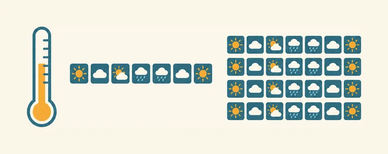
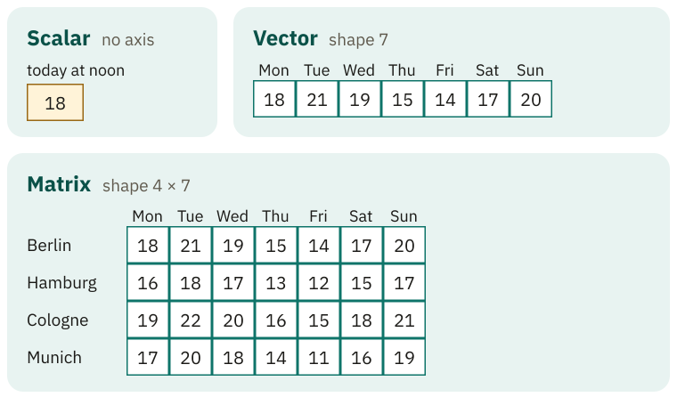
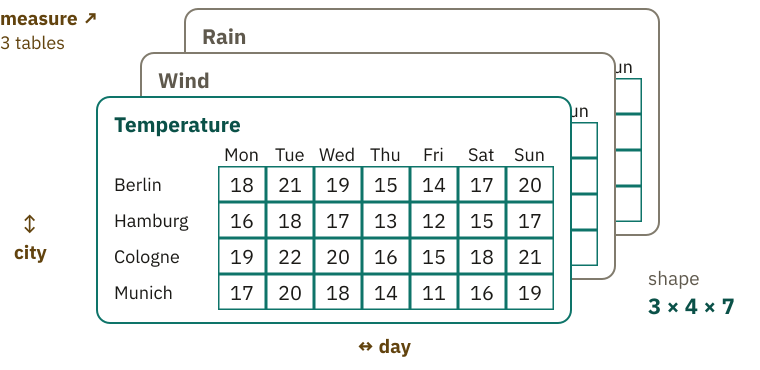
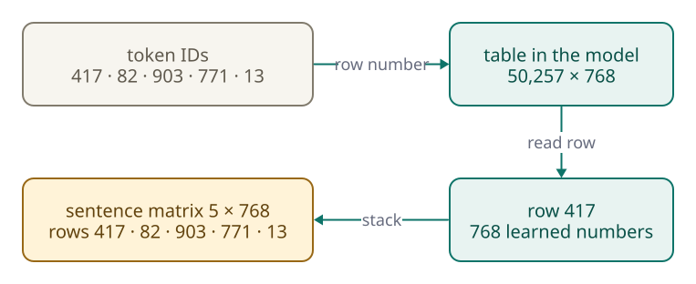
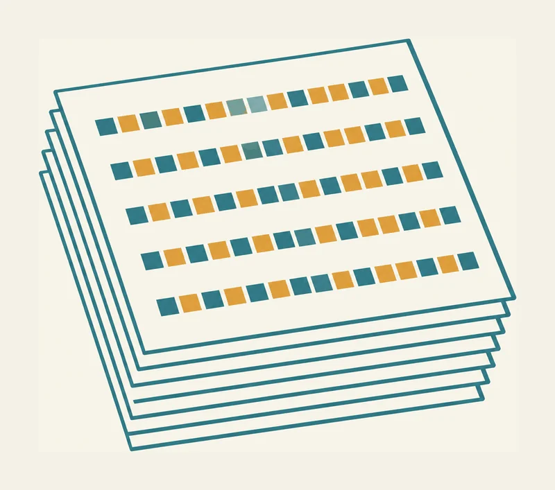

<!-- Generated from src/content/bausteine/en/scalar-vector-matrix-tensor.mdx by scripts/export-lessons.mjs -- do not edit by hand. -->

# Scalar, Vector, Matrix, Tensor: the Building Blocks of Numbers

> Reading copy for GitHub. The full version with interactive demos, animations and recall moments is on the website: **[Scalar, Vector, Matrix, Tensor: the Building Blocks of Numbers](https://ki-einfach-verstehen.de/en/lessons/scalar-vector-matrix-tensor/)**
>
> Licence: [CC BY 4.0](https://creativecommons.org/licenses/by/4.0/deed.en) · Credit it as: KI einfach verstehen, “Scalar, Vector, Matrix, Tensor: the Building Blocks of Numbers”, CC BY 4.0, https://ki-einfach-verstehen.de/en/lessons/scalar-vector-matrix-tensor/

From the weather app to the chatbot: how number, list, table and stack of tables relate, and why your chat is exactly such a block of numbers for a model.

You type into a chatbot: “The cats sit.” You already know the first step from the previous lesson: the [tokenizer](https://ki-einfach-verstehen.de/en/glossary/tokenizer/) splits the sentence into [tokens](https://ki-einfach-verstehen.de/en/glossary/token/), and every token gets a number. In the made-up example, “The” gets the number 417. On its own, that number is of little use to the model. It uses it as an address and fetches a long list of learned numbers from there. In the smallest version of GPT-2, an older model that is freely available, the list contains 768 numbers for each token. The five tokens of the made-up example (“The”, “cat”, “s”, “sit” and the period) therefore produce five rows.

The model arranges the numbers in a few simple forms that you already know from a weather app.

## A number and a list

The weather app reports 18 degrees for noon today. That is a single number, and nothing more is needed to answer the question “How warm is it?” A single number is called a **[scalar](https://ki-einfach-verstehen.de/en/glossary/scalar/)**.

*The same weather data, just arranged differently: one number for today, a row for the week, a table for several cities.*

The weekly forecast shows one number for each day, from Monday to Sunday (made up, between 14 and 21 degrees); for example, 15 degrees on Thursday. Here the order counts too: each number belongs to the day on which it stands. Swap two numbers and the forecast is wrong for two days, even though the same numbers are still there. An ordered list of numbers is called a **[vector](https://ki-einfach-verstehen.de/en/glossary/vector/)**. Every number has its fixed place in it, and **the place is part of the information**. The same applies to your chat: the numbers the model fetches for the token “The” form an ordered list, or vector. In the smallest version of GPT-2, that list contains 768 numbers.

At the end of processing, every possible next text piece gets a single rating: the [score](https://ki-einfach-verstehen.de/en/glossary/score/) from the lesson on input and output. Each of these scores is a scalar.

## Many lists in rows: the matrix

Now you want to compare the week for four cities: Berlin, Hamburg, Cologne, and Munich. The clearest layout is a table with one row per city and one column per day. To find a particular number, you need two pieces of information: city and day. Such a table is called a **[matrix](https://ki-einfach-verstehen.de/en/glossary/matrix/)**. Each of its rows is again a vector, namely one city's week.

*Scalar, vector, matrix: the same temperatures arranged as a single number, a row for the week, or a table for four cities.*

The numbers still represent temperatures. **Only their arrangement changed:** alone, in a row, or in a table.

Your chat has such a table, too. In the example, your sentence “The cats sit.” consists of five tokens, and the model fetches a list of 768 numbers for each one. The five tokens of the example are made up here. Write the five lists as rows one below the other, and you get a table with five rows, one per token: a matrix. A later section shows how the model finds these rows.

Before you read on: the weather service measures temperature, wind and rain, for the same four cities and seven days. How would you store these numbers so nothing gets mixed up?

## Stacking tables: the tensor

The simplest solution is to use three tables with the same layout: one for temperature, one for wind, and one for rain. Stack them on top of one another, and you get a stack. To find a number in it, you now need three pieces of information: which measure, which city, which day. “Wind, Cologne, Friday” leads to exactly one number.

*A tensor as a stack: three tables of the same layout for temperature, wind, and rain. Every number has an address made of measure, city, and day.*

Such a stack is called a **[tensor](https://ki-einfach-verstehen.de/en/glossary/tensor/)**. In AI, the word “tensor” covers any block of numbers, regardless of how many directions it extends in. Scalars, vectors, and matrices therefore count as tensors too. All entries have the same number type, for example all decimal numbers. Even so, they can measure different things: in the weather stack, temperature, wind, and rain sit on top of each other. This lets the chip process every number in the same way.

For AI models, it is enough: if you can read a weather table, you can also understand a tensor.

*For the model, a photo becomes three layers of equal size: one for red, one for green, and one for blue. Each layer is a table of color values.*

When you show a chatbot a photo, it usually processes such a stack first. Often the photo is scaled down beforehand, but the structure of three color tables stays the same. Every pixel delivers three values: how much red, how much green, and how much blue, each as a number from 0 to 255. All red values form one table, all green values a second, and all blue values a third. Each of them is as high and as wide as the photo. Stacked on top of each other, they have the same structure as the weather stack, only with colors instead of measures.

One level deeper: why often 0 to 1?

Many programs convert the values into decimal numbers from 0.0 to 1.0 before the model sees them, so that all color values have the same order of magnitude. 255 then becomes 1.0 and 0 becomes 0.0.

The reason: a model computes with all numbers at once. If values near 0 and others near 255 sit side by side, the large numbers can shape a calculation more strongly, even though both only stand for brightness. With values between 0.0 and 1.0, all have a similar weight. This is a preparation that happens before the actual learning, and it does not change the picture itself: a pixel stays the same pixel, only with different numbers. The conversion simply divides the value by 255. For a red value of 128, this gives roughly 0.5. How exactly a program proceeds depends on its design; the basic idea stays the same.

A photo 400 pixels high and 600 pixels wide already makes a fairly large stack. How large this block is and how it is built can be described briefly by its shape.

## Axes and shape: how a block of numbers is built

Each direction in a block of numbers is called an **axis**. The weekly list has one axis: days. The city table has two: cities and days. The weather stack has three: measure, city, and day. A single scalar has no axes, because it does not extend in any direction. It still counts as a tensor, just one without axes.

The **shape** of a block states how long each axis is. So the number of entries in the shape equals the number of axes. Multiply the lengths, and you get the total number of entries.

*The shape is the ruler of a block of numbers: it states how long each axis is.*

The photo looks like this: it has the shape 3 × 400 × 600: three colors, plus the height and width of the photo. The three values stand for three axes. How many numbers does that make? Think for a moment before you read on.

That makes 720,000, and that for a rather small photo. In this way, every block of numbers can be described briefly.

> **Interactive demo:** [try it on the website](https://ki-einfach-verstehen.de/en/lessons/scalar-vector-matrix-tensor/)

One level deeper: isn't a vector an arrow?

Many people know vectors from school as arrows, and there that is true: two or three numbers can be drawn as an arrow in a plane or in space. With AI models, a vector is first of all an ordered list of numbers, and it can be 768 numbers long. Mathematically, it is a list of 768 coordinates. If you tried to draw it, the arrow would need a space with 768 directions rather than two or three, which nobody can really picture. As a list of numbers, however, it works just like a vector with two entries.

The word “dimension” is similarly confusing. Some use it for the number of axes (“a three-dimensional block”), others for the length of an axis (“a vector with 768 dimensions” is a list of 768 numbers). The direction is called axis, and the number of entries is called length.

Where do the numbers for “The” come from?

## From token to block of numbers

Picture a thick reference book. It has one page for every text piece the [language model](https://ki-einfach-verstehen.de/en/glossary/language-model/) knows, so for every entry in its [vocabulary](https://ki-einfach-verstehen.de/en/glossary/vocabulary/). Each page holds a list of 768 numbers. In the smallest version of GPT-2, this book has 50,257 pages.

The [token ID](https://ki-einfach-verstehen.de/en/glossary/token-id/) is simply the page number. When the model receives a number, such as 417 for “The” in this example, it opens the matching page and retrieves the list stored there. The number is made up; in the real GPT-2, a different text piece sits at that spot. **The token ID is therefore not converted but looked up: the chosen row contains the learned list of numbers for this token.**

In the computer, the book is a table with one row per page. So the book is a matrix of shape 50,257 × 768.

[▶ watch the animation on the website](https://ki-einfach-verstehen.de/en/lessons/scalar-vector-matrix-tensor/)

*Each token ID selects one row of the large table; the rows land in order, one below the other, in the matrix for the sentence.*

For your sentence “The cats sit.”, this happens five times, once per token. The model opens the matching page for each token and writes the five lists one below the other, in the same order. How the model learns where a token stands in the sentence is explained in the lesson on [embeddings](./embeddings.md). That gives the table with five rows you already know from the matrix section.

No person wrote the numbers into the book. They belong to the model's [parameters](https://ki-einfach-verstehen.de/en/glossary/parameters/) and were set step by step during training. So an independently trained model with the same vocabulary has entirely different numbers on page 417.

This is where the weather comparison stops working. In the weather table, every number has a clear label, such as Monday, Hamburg, or wind. The individual numbers on page 417 usually have no such fixed meaning. Nobody decided that a single number on a page means “animal.” What the list expresses only emerges during training. That comes later.

## Many sentences, one stack

*Several sentences at once: each sentence is one table, and all the tables together form a stack. The top sheet shows the five rows of one sentence, one per token; the colors have no meaning here.*

During training, the model usually processes many sentences at once, in a single step. Each sentence forms a table like the one just described, with one row per token. These tables are stacked to form a tensor, just like the weather tables. The chain is now complete: the token ID is a page number, each page provides a vector, the whole sentence becomes a matrix, and several sentences form a tensor with three axes. Before tables of different heights can be stacked, the sentences must be brought to the same length.

One level deeper: when sentences differ in length

A made-up example: “The cats sit.” has five tokens, a second sentence has eight. Their tables have the shapes 5 × 768 and 8 × 768, and two tables of different heights do not make a clean stack.

The shorter sentence is therefore extended, a process called padding. Three extra positions are added at the end, each containing a special **padding token** that simply takes up space. Now both sentences are eight tokens long, and the stack has the shape 2 × 8 × 768: two sentences, eight positions, 768 numbers per position.

To keep the padding from counting as text, the model also gets a second, much smaller table, the **mask** (attention mask). It has the shape 2 × 8 and contains only ones and zeros. A 1 means “a real token is here”, a 0 means “only padding here”:

| | 1 | 2 | 3 | 4 | 5 | 6 | 7 | 8 |
| :--- | :-: | :-: | :-: | :-: | :-: | :-: | :-: | :-: |
| Sentence 1 | 1 | 1 | 1 | 1 | 1 | 0 | 0 | 0 |
| Sentence 2 | 1 | 1 | 1 | 1 | 1 | 1 | 1 | 1 |

The model ignores the positions marked 0.

There is also an upper limit on length: the [context window](https://ki-einfach-verstehen.de/en/glossary/context-window/), meaning the number of positions a model can process at once. For GPT-2, it is 1,024. A longer text does not fit completely into the block. Depending on the software, the request is then rejected or the text is cut off (truncation). Depending on the setting, either the end or the beginning is dropped. Together, padding and truncation give every block a fixed, rectangular shape. If the beginning disappears, the model lacks the first question of a long chat.

## Why models compute in blocks of numbers

Whether the input is a sentence, a photo, or weather data, the model handles it as a block of numbers with axes and a shape. **This allows the same calculation to be applied to many numbers at once.**

Suppose all 28 temperatures in the city table are to be converted from Celsius to Fahrenheit. The same calculation applies to every number, so all the calculations can run at the same time. Graphics processors, the chips large models usually run on, are made for exactly such tasks. They carry out thousands of similar calculations in parallel. Because the numbers sit in blocks of the same layout, the work can be split into portions of equal size and distributed across many processing units. The table contains only 28 temperatures, while the photo contains 720,000 numbers, but the same pattern works for both.

Large chatbots mostly do not run on your phone, but in huge data centers full of such chips. There, the blocks of numbers from your message run through the model. Their uniform structure makes it possible to process large portions in parallel instead of number by number.

The model’s output is a block of numbers too: the score list from the lesson on input and output. For the next text piece, it contains 50,257 [scores](https://ki-einfach-verstehen.de/en/glossary/score/), one for every vocabulary entry. This list is a vector.

What remains open is what happens to the score vector at the end. Scores like 7.1 or −2.3 are not yet probabilities. How the decision for the next token emerges is shown in the next lesson.

---

Source: https://ki-einfach-verstehen.de/en/lessons/scalar-vector-matrix-tensor/

← Previous: [Token IDs: What a Number Means](./token-ids-and-vocabulary.md) · [All lessons](../../README.md#contents) · Next: [Probability and Softmax: How a Model Decides](./probability-and-softmax.md) →
