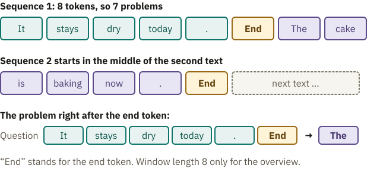
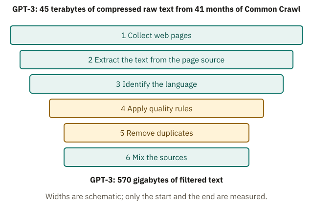
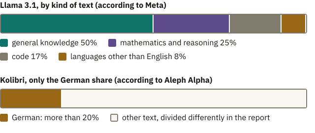

<!-- Generated from src/content/bausteine/en/text-becomes-many-practice-problems.mdx by scripts/export-lessons.mjs -- do not edit by hand. -->

# Text Becomes Many Practice Problems

> Reading copy for GitHub. The full version with interactive demos, animations and recall moments is on the website: **[Text Becomes Many Practice Problems](https://ki-einfach-verstehen.de/en/lessons/text-becomes-many-practice-problems/)**
>
> Licence: [CC BY 4.0](https://creativecommons.org/licenses/by/4.0/deed.en) · Credit it as: KI einfach verstehen, “Text Becomes Many Practice Problems”, CC BY 4.0, https://ki-einfach-verstehen.de/en/lessons/text-becomes-many-practice-problems/

Why nobody writes down answers to train a language model, how many texts become sequences of a fixed length, and which text gets in at all.

The path through the model ended with one sentence about training: at every position, the model predicts the next [token](https://ki-einfach-verstehen.de/en/glossary/token/), and the prediction is compared with the real one. Meta trained Llama 3.1, its freely available language model, on about 15 trillion tokens. Almost every one is a small practice problem: here is the text so far, what comes next?

Without an answer there is nothing to compare. So who wrote down answers to trillions of problems? A reading exercise with a card shows it.

## The answer is already in the text

Put a card on a line in a book so that only the first three words show. Guess the next word, slide the card one word along and check, then go on. Nobody had to write the answer down. It was already there, only covered.

*The cover card: the beginning of the line is uncovered. The word right under the edge of the card is the answer to this one problem, and nobody had to write it specially.*

Here the analogy stops: you guess word by word and only then look, but the model slides no card. It computes all the problems of a whole text in a single pass. When a text is being written, only the last position yields a list with one score for each possible token, as in the lesson on the output head. In training, by contrast, every position yields its own list: “The dog chases the cat” lets four predictions be checked at once. Each position saw only what comes before it. A built-in filter hides everything later, the rule “No looking ahead” from the lesson on transformer blocks and attention. So no position can copy its answer, even though that answer is in the same sequence.

This is how a language model’s practice problems come about. Recall “The cat sat on the sofa.” from the lesson on input and output: the beginning is the input. The piece that follows is its label, the correct answer. For the spam filter from the first lesson, people had to label every email by hand. With text, the card does that: every point in the text yields a problem with an answer.

Try an invented sentence: “The bus leaves again on time at eight in the morning.” A model computes with tokens, pieces of text from its tokenizer. To keep it simple, every word and the full stop count as one token here; a real tokenizer often splits more finely, but the principle stays.

> **Interactive demo:** [try it on the website](https://ki-einfach-verstehen.de/en/lessons/text-becomes-many-practice-problems/)

Count along:

| Question: everything so far | Answer |
|---|---|
| The | bus |
| The bus | leaves |
| The bus leaves | again |
| The bus leaves again | on |
| The bus leaves again on | time |
| The bus leaves again on time | at |
| The bus leaves again on time at | eight |
| The bus leaves again on time at eight | in |
| The bus leaves again on time at eight in | the |
| The bus leaves again on time at eight in the | morning |
| The bus leaves again on time at eight in the morning | . |

That is 11 problems, one for every token followed by another. The final full stop has no answer left in this text. This holds for every text: **it yields one problem fewer than it has tokens.**

How many problems are in a whole paragraph?

Take “It stays dry today. Tomorrow it should rain.” With every word and full stop as one token, that is 10 tokens and 9 problems. A paragraph of 100 words yields about 100 problems, and more with a real tokenizer that splits more finely. This is how trillions of tokens become trillions of problems.

The model keeps no list of answers. Training only changes numbers, as with the spam filter: the problems nudge the parameters, the faders on the model’s mixing desk, bit by bit, so that the correct answer becomes more likely next time.

In pretraining, nobody wrote the answers specially. A chatbot seems like someone giving learned answers, and for a later step people really do write answers. Not for the trillions of problems before that: because the answer is in the text itself, every text becomes practice problems. This is called **[self-supervised learning](https://ki-einfach-verstehen.de/en/glossary/self-supervised-learning/)**. The text supplies problem and answer at once; it supervises itself, so to speak.

Almost all language models behind chatbots started out this way. This first phase is called pretraining. Its result is the base model you know from the lesson on training, for example Llama 3.1. Only then come examples that people have written or rated, turning the base model into a helpful chatbot.

> **Interactive demo:** [try it on the website](https://ki-einfach-verstehen.de/en/lessons/text-becomes-many-practice-problems/)

A sentence is short. Real texts, though, run from three words to a hundred pages, and the model practices on pieces of a fixed length. How does that fit?

## Many texts, one fixed length

Remember the freight train from the lesson on tokenization inside the model? Every token was a wagon. [Special tokens](https://ki-einfach-verstehen.de/en/glossary/special-token/), markers that stand for no piece of text, were differently colored marker wagons. The buffer stop at the end of the track stood for the [context window](https://ki-einfach-verstehen.de/en/glossary/context-window/), the most tokens the model can process at once.

Training uses this length in full. The paper on GPT-3, a predecessor of the models behind ChatGPT, is precise: every sequence it practiced on had 2048 tokens, as many as fit its context window. Most texts are shorter, so they are joined like wagons into a long train. Between two texts there is always an end token, the marker that a text has ended; the lesson on input and output called it the stop marker. What is new is the cut, and here the analogy stops: nobody cuts up a real train. This one is cut into pieces of exactly 2048 tokens, each a **training sequence**. They are the same length because the model computes several at once on the graphics chips. For that, the pieces must fit into the same rectangular table of numbers. Shorter pieces would otherwise have to be filled up with padding tokens, placeholders that only take up space.

*Two invented texts, joined with end tokens and cut into sequences of 8 tokens each. Every box is a token. The first sequence ends with “The cake”; the second begins mid-sentence and has only begun, and in training the next text fills it up. The small context window is only for the overview; GPT-3 cut sequences of 2048 tokens.*

> **Interactive demo:** [try it on the website](https://ki-einfach-verstehen.de/en/lessons/text-becomes-many-practice-problems/)

Take two invented texts: “It stays dry today.” and “The cake is baking now.” With an end token after each, that is 13 tokens. Suppose the context window were only 8 tokens long. The first sequence then holds the weather sentence, its end token and “The cake”. The second begins mid-sentence with “is baking now”, and the next text fills the rest. So a text can be split across two sequences.

A sequence of 8 tokens yields 7 problems, as with the bus sentence. For GPT-3 that is 2047 problems per sequence, about 2000. The model does not learn the context window itself. It is a [hyperparameter](https://ki-einfach-verstehen.de/en/glossary/hyperparameter/), set before training, like the number of layers, the transformer blocks one after another.

Two special problems sit around the end token. In the first, the question is “It stays dry today.” and the answer is the end token itself, so the model learns when a text is finished. What does it learn from the next one, where “The” follows the end token?

“The cake” has nothing to do with the weather. Any text can begin after the end token. From many such problems, the model learns that after this marker comes a new text, unrelated to the one before. The weather sentence is still in the sequence; the marker only shows that it does not belong. That is why the GPT-3 paper puts it between texts. Without it, the model would practice continuing two unrelated texts as one.

The same kind of marker ends an answer when the model is used. In GPT-2, whose tokenizer you know from the lesson on tokenizers, it is the very same marker that shows the end of a text when writing. Chat models like Llama 3.1 end a turn with a special token of their own. That they should place it at the end of an answer, they learn only afterwards, in a further training on conversations, as in the lesson on tokenization inside the model.

So every text becomes problems, about 2000 per sequence. Then why not simply take the whole web?

## From the web to training text

The raw material often comes from Common Crawl, an organization that regularly collects web pages and offers the archive for free. It is a wild mix, like these five invented pages. One is a guide on looking after a bike, another a list of search terms such as “buy cheap bike”, one per line with bullet points. Then come a menu with “Home, About us, Contact”, the same guide under another address and a page in German. Which would you keep?

*Several sieves stacked: each layer stands for a rule, each sheet for a page, and whatever stays on top is dropped. The real sieves are programs whose rules people have set.*

The pages pass several stages, like a sieve with several layers. Unlike a real sieve, they sort not by size but by rules people have chosen. First the text is taken from the page’s source code, the instructions the browser builds the page from. Then the language is identified; the German page goes to the German part. Then quality rules apply. For Gopher, a language model from the AI company DeepMind, every page with fewer than 50 words was dropped. That hits the menu. Pages where more than 90 percent of lines start with a bullet point failed too, like the search-term list.

Next comes **deduplication**. The same page often appears on the web several times, copied or under a new address; programs keep one of the identical or near-identical pages. Otherwise the model would practice the same page again and again, and what appears very often in its text, a model can partly reproduce word for word. Developers also hold back text to test the model on text it never practiced on. If the same page sat in both the practice text and the held-back test text, the test would no longer measure cleanly. The GPT-3 paper gives both reasons.

Of the five pages, one is left for the English part: the guide, once.

> **Interactive demo:** [try it on the website](https://ki-einfach-verstehen.de/en/lessons/text-becomes-many-practice-problems/)

Why remove duplicate pages if they would mean more practice?

A copy teaches nothing new. Each repetition pushes the numbers further the same way, until exactly this continuation comes out on top every time. The text is still not stored as a sentence, but the numbers are set so that the model can reproduce it almost word for word. In a 2021 experiment, models trained on deduplicated text emitted memorized passages ten times less often.

*The stages from the web archive to training text. The amounts at the start and at the end come from the GPT-3 paper, with the raw text measured in compressed form.*

According to the GPT-3 paper, filtering left only 570 gigabytes of the roughly 45 terabytes of raw text, measured in compressed form. More text sounds like more practice, but a search-term list only practices stringing search terms together.

> **Interactive demo:** [try it on the website](https://ki-einfach-verstehen.de/en/lessons/text-becomes-many-practice-problems/)

Finally the sources are mixed, because only now is it clear how much usable text each one supplies. How much of each goes in is again a decision, the **data mix**. Meta reports about half general knowledge for Llama 3.1, a quarter mathematics and reasoning, plus code. That is one reason chatbots can write programs: they practiced on code like any other text. You can browse such a collection yourself in FineWeb, a freely available, filtered dataset from Common Crawl.

Whether all these texts may be collected, personal data included, is the subject of its own lesson: [Training Data: Copyright and Privacy](./training-data-copyright-and-privacy.md). What gets through the sieve shapes the model, most visibly when text is missing.

## The model learns what is in the text

Meta’s figures put only 8 percent of the Llama 3.1 text in languages other than English, all of them together, and German is just part of that. English text, by contrast, is plentiful. So why not translate English text into German and practice on that?

*Data mix according to the developers’ reports: for the Llama 3.1 models by kind of text, for Kolibri only the share of German. For Llama 3.1, that is about 50 percent general knowledge, 25 percent mathematics and reasoning, 17 percent code and 8 percent languages other than English. The two bars divide the text differently and can only be compared on the language share.*

Aleph Alpha’s report on its model Kolibri gives an example. “Drive safe!” is what you say in English when someone sets off. Translated, it easily becomes “Fahre sicher!” (roughly “drive safely!”), although, according to the report, “Komm gut an!” (roughly “arrive well!”) would be more natural. How would a model say goodbye in German if it knew German farewells mainly from translated text?

The answer to these problems is then “Fahre sicher!”, because that is what the text says, and each one pushes the numbers a little that way. **The model takes on the patterns of its text, and the more often they appear, the more strongly.** You know this from the lesson on probability and softmax: if many texts follow “The capital of Australia is” with “Sydney”, then “Sydney” gets a large segment, even though Canberra is the capital.

A single phrase is still the smaller problem. According to the report, translated text also keeps the source language’s view of the world. Such a body of text is in many respects an English view of the world, only in German.

So translated text does not replace missing German text; the model learns the traces of translation along with it. For Kolibri, Aleph Alpha therefore added German texts from the web or rephrased by a language model; according to the report, more than a fifth of the mix is German. Translated text went in only in a carefully selected amount, as a supplement.

Try it yourself. Ask a chatbot, in German, for a short farewell to someone with a long drive ahead. Does it sound like a word-for-word translation from English, such as “Fahre sicher!”, or like a German formula, such as “Gute Fahrt!” (roughly “have a good trip!”)? One answer proves nothing, because chance often plays a part in picking the next token. But over several tries, watch whether its German sometimes sounds translated.

So nobody specially wrote the answers down: they stand in the text, and from it come the trillions of problems, roughly one per token, in sequences of a fixed length. What is still open is how a prediction and the real token become a number that tells the training how far off it was. The next lesson shows that.

---

Source: https://ki-einfach-verstehen.de/en/lessons/text-becomes-many-practice-problems/

← Previous: [Output Head: From the Last State to a Prediction](./output-head.md) · [All lessons](../../README.md#contents) · Next: [Forward Pass and Loss: How the Model Measures Its Own Error](./forward-pass-and-loss.md) →
