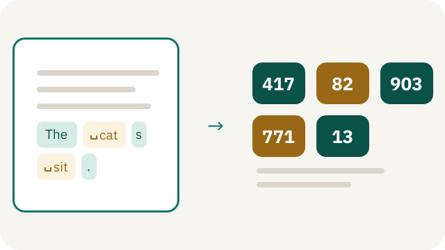
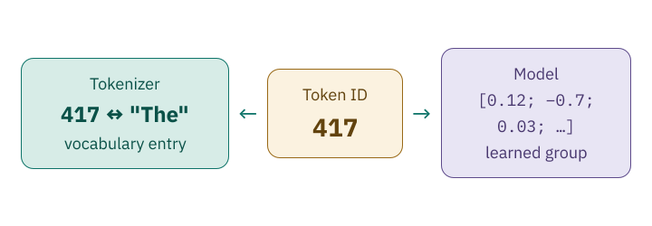
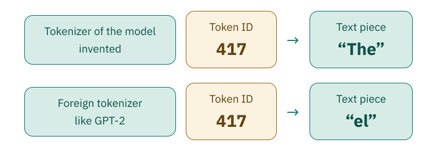

<!-- Generated from src/content/bausteine/en/token-ids-and-vocabulary.mdx by scripts/export-lessons.mjs -- do not edit by hand. -->

# Token IDs: What a Number Means

> Reading copy for GitHub. The full version with interactive demos, animations and recall moments is on the website: **[Token IDs: What a Number Means](https://ki-einfach-verstehen.de/en/lessons/token-ids-and-vocabulary/)**
>
> Licence: [CC BY 4.0](https://creativecommons.org/licenses/by/4.0/deed.en) · Credit it as: KI einfach verstehen, “Token IDs: What a Number Means”, CC BY 4.0, https://ki-einfach-verstehen.de/en/lessons/token-ids-and-vocabulary/

Shows what a token ID is: a number that only has meaning within its tokenizer’s vocabulary. It also explains why each model must use the tokenizer it was trained with, and why the number itself reveals nothing about the piece.

A language model calculates only with numbers, not text. That means every piece gets a number, such as the piece “Frank” in “Frankreich” (France).

## Every piece gets a number

Every piece in the [vocabulary](https://ki-einfach-verstehen.de/en/glossary/vocabulary/) has a fixed number, its **[token ID](https://ki-einfach-verstehen.de/en/glossary/token-id/)**. The tokenizer sets these numbers once, when it learns its vocabulary. After that, they never change. The number only shows where a piece sits in the vocabulary.

*The vocabulary as a box: for every piece of your sentence, exactly that piece is looked up, and its number is copied down.*

The vocabulary is the box from the previous lesson. Every piece in it has a number. For every piece in your text, exactly that piece is looked up, and its number is copied down. The tokenizer does not choose anything; it follows its rules. In the end, there is a row of numbers in the same order as the pieces. A fresh row is created for every text, whatever its length. Each piece contains only a sequence of characters, with no explanation of what it means. Looking through the box alone tells you nothing about a piece’s meaning.

Take the sentence “The cats sit.” The symbol ␣ represents a space stored as part of the piece. The tokenizer has split the sentence into “The”, “␣cat”, “s”, “␣sit”, and “.”. Because the vocabulary has no piece “␣cats”, “cats” becomes two pieces.

How many numbers does the sentence get? Guess before you read on.

Five, one for each piece. The table shows which number is on which card:

| Token ID | Text piece |
| ---: | :--- |
| 417 | “The” |
| 82 | “␣cat” |
| 903 | “s” |
| 771 | “␣sit” |
| 13 | “.” |

The pieces and ID assignments in this example are made up rather than taken from a real tokenizer. The five cards represent just five entries from a much larger box, so their numbers do not run from 1 to 5. The real vocabulary of GPT-2, an older language model from OpenAI, has 50,257 entries, and ID 417 stands for a different piece there.

The sentence therefore becomes the number sequence 417, 82, 903, 771, 13. Converting text into numbers in this way is called **[encoding](https://ki-einfach-verstehen.de/en/glossary/tokenizer/)**. The model then receives these five numbers as its input. Your messages to a chatbot are converted into numbers in this way, too, before the model sees them.

*A sentence is first split into text pieces, then each piece is translated into its number using the invented mini vocabulary. The symbol ␣ marks a space that belongs to the piece.*

## The way back: numbers become text

A chatbot’s answer also starts as a sequence of numbers. The model outputs a [score](https://ki-einfach-verstehen.de/en/glossary/score/) for every piece in the vocabulary. Each score says how well that piece would fit next. The text loop from the Input and Output lesson uses these scores to choose a piece. The list follows the vocabulary’s ID order: entry 417 belongs to piece 417. If the loop chooses entry 82, it selects the piece with number 82.

The tokenizer turns the numbers back into readable text by looking up each one and joining the stored pieces in order. This reverse step is called **[decoding](https://ki-einfach-verstehen.de/en/glossary/tokenizer/)**.

So 417, 82, 903, 771, 13 becomes “The cats sit.” again. The spaces are not lost, because they are already stored in “␣cat” and “␣sit”. Order matters, too: 82, 903, 417 gives “catsThe”, with a space at the start.

Before you read on: what comes out when 417 and 82 swap places?

> **Interactive demo:** [try it on the website](https://ki-einfach-verstehen.de/en/lessons/token-ids-and-vocabulary/)

If you swap 417 and 82, you get “catThes sit.”, with a space at the start. Each number only brings back its own piece, space included.

## An ID is a label

Does the number 417 tell the model that “The” is an article? No. In the invented mini vocabulary, 417 stands for “The”. In the real GPT-2 vocabulary, it stands for “el”, a word part. **A number is only valid within its vocabulary.** The number itself carries no meaning for the model. It makes no difference whether the number is large or small; the model uses it only to look something up.

*An ID is only a label: a number that says nothing about the content.*

Where does the model keep its numbers for “The”? The spam filter from the first lesson stored a single number, called a weight, for each word. A language model keeps a whole group of learned numbers for each token ID. In the made-up example, that group contains some numbers that training has set. These numbers are also [parameters](https://ki-einfach-verstehen.de/en/glossary/parameters/), set during training. The ID tells the model which group to fetch, and that group becomes the starting point for the calculation.

*The ID 417 leads to two separate places: in the tokenizer to the text piece “The” from the mini vocabulary, and in the model to a group of learned numbers. The model itself sees only the number.*

## Why the tokenizer and the model form a fixed pair

Can a finished model use a different tokenizer? Imagine two tokenizers with the same number of cards but different ID assignments: in the first, 417 stands for “The”; in the second, for “el”, as in GPT-2. The model was trained with the first but now receives numbers from the second. If “el” occurs in the text, the other tokenizer returns 417. What does the model do with that number? Take a moment to think before you read on.

It fetches the group it learned for ID 417, which belongs to “The” in its own vocabulary. No error appears because 417 is a valid ID for this model. The model simply keeps calculating with the group for “The”, even though the other tokenizer meant “el”.

*A different tokenizer has its own vocabulary, where ID 417 refers to a different piece. “The” is invented for this example; “el” comes from GPT-2.*

**That is why every model needs exactly the tokenizer it was trained with**, including its rules and vocabulary. The model learned its parameters for exactly one assignment of numbers to pieces. With a different assignment, the numbers no longer match the learned groups. If you switch to a model with a different tokenizer in a chat app, your message is split and numbered differently there. It then often consists of a different number of tokens, too. Several models can share one tokenizer; they then share the numbers, but not the learned numbers.

> **Interactive demo:** [try it on the website](https://ki-einfach-verstehen.de/en/lessons/token-ids-and-vocabulary/)

## The numbers are only the beginning

The next lesson shows how these groups of numbers are arranged in a table: [Scalar, Vector, Matrix, Tensor](./scalar-vector-matrix-tensor.md).

---

Source: https://ki-einfach-verstehen.de/en/lessons/token-ids-and-vocabulary/

← Previous: [Tokenizers: How Text Breaks into Tokens](./tokenizer-ids-vocabulary.md) · [All lessons](../../README.md#contents) · Next: [Scalar, Vector, Matrix, Tensor: the Building Blocks of Numbers](./scalar-vector-matrix-tensor.md) →
