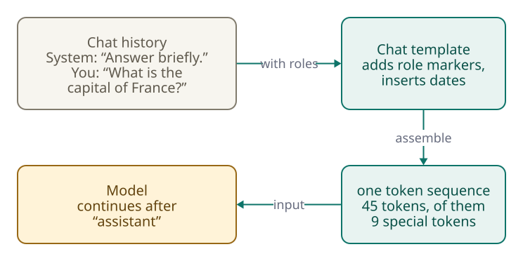
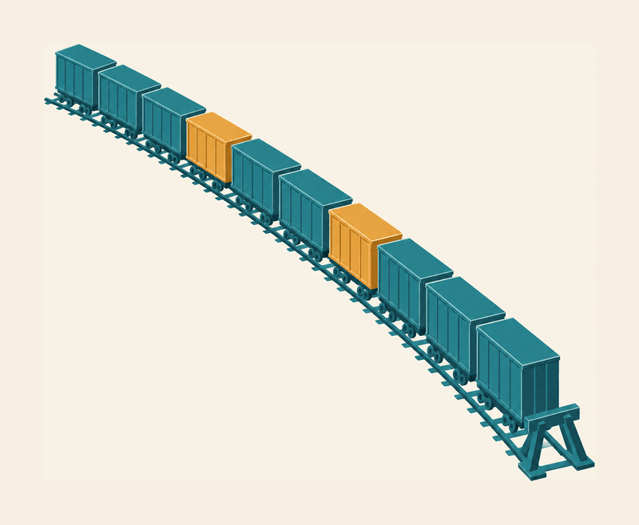
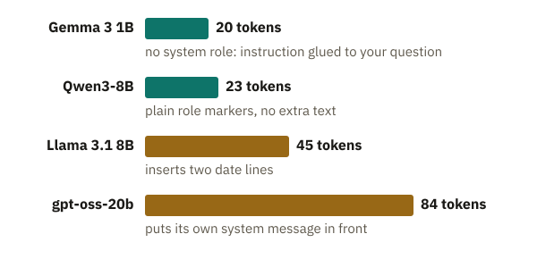
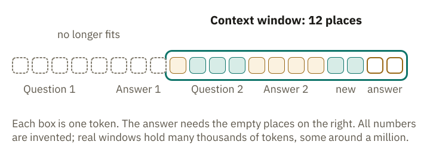
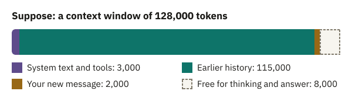

<!-- Generated from src/content/bausteine/en/tokenization-inside-the-model.mdx by scripts/export-lessons.mjs -- do not edit by hand. -->

# Tokenization Inside the Model: How Your Chat Becomes a Token Sequence

> Reading copy for GitHub. The full version with interactive demos, animations and recall moments is on the website: **[Tokenization Inside the Model: How Your Chat Becomes a Token Sequence](https://ki-einfach-verstehen.de/en/lessons/tokenization-inside-the-model/)**
>
> Licence: [CC BY 4.0](https://creativecommons.org/licenses/by/4.0/deed.en) · Credit it as: KI einfach verstehen, “Tokenization Inside the Model: How Your Chat Becomes a Token Sequence”, CC BY 4.0, https://ki-einfach-verstehen.de/en/lessons/tokenization-inside-the-model/

How a chat with roles becomes a single token sequence, what special tokens are for, and everything that has to fit into the context window.

“What is the capital of France?” That is six words and a question mark. The chat app also sends the model the instruction “Answer briefly.” Before you read on, guess how many [tokens](https://ki-einfach-verstehen.de/en/glossary/token/) reach the [model](https://ki-einfach-verstehen.de/en/glossary/model/) when you send the question.

You already know the first station on the way through the model: your chat message becomes one long sequence of tokens that also records who said what. You already know from the lessons on [tokenizers](./tokenizer-ids-vocabulary.md) and [token IDs](./token-ids-and-vocabulary.md) how a [tokenizer](https://ki-einfach-verstehen.de/en/glossary/tokenizer/) splits text into pieces and gives each piece a number.

## Your chat is one long text

In the chat window, a conversation looks like separate speech bubbles, and you might think the model gets only the newest one and learns the roles some other way. In fact, roles and messages sit in one sequence, and older messages are resent with each new message. A later section covers the token limit. As you know from the lesson on [input and output](./input-and-output.md), a [language model](https://ki-einfach-verstehen.de/en/glossary/language-model/) appends a piece to a text, round after round. **Continuing a sequence of tokens is all it can do.** So the chat app, the program around the model, must turn the whole conversation into one sequence.

To do this, every chat model has a **[chat template](https://ki-einfach-verstehen.de/en/glossary/chat-template/)**: a fixed pattern that lines up the messages with their roles. Open models ship this template as a small file alongside their [parameters](https://ki-einfach-verstehen.de/en/glossary/parameters/). Common roles are “user” for you, “assistant” for the model, and “system” for instructions from the chat app’s provider. The **system message** in this example is “Answer briefly.” You usually do not get to see it.

Meta’s Llama 3.1 8B Instruct is an openly available chat model. Its template turns the opening chat into this text:

```text
<|begin_of_text|><|start_header_id|>system<|end_header_id|>

Cutting Knowledge Date: December 2023
Today Date: 26 Jul 2024

Answer briefly.<|eot_id|><|start_header_id|>user<|end_header_id|>

What is the capital of France?<|eot_id|><|start_header_id|>assistant<|end_header_id|>

```

With the real tokenizer, that makes 45 tokens. Only 10 come from the chat: your question and the system message. The template adds the other 35: role names, line breaks (which count as tokens too), two date lines, and several entries in angle brackets.

These entries in angle brackets are called **[special tokens](https://ki-einfach-verstehen.de/en/glossary/special-token/)**, or markers for short. The template writes out their names, and the tokenizer turns each into one token with its own vocabulary entry. These tokens stand for no piece of text; they mark the conversation’s structure. The stop sign from the lesson on input and output also has its own vocabulary entry: it ends a text and is not shown. In the Llama chat, an answer without a tool call ends with `<|eot_id|>`. A conversation needs more such markers than a single text, since it has roles and turns.



[▶ watch the animation on the website](https://ki-einfach-verstehen.de/en/lessons/tokenization-inside-the-model/)

*With Llama 3.1, two messages with roles become a single sequence of 45 tokens that ends with an open header for the answer.*



*The token sequence is shown as a freight train. Ordinary wagons stand for pieces of text, while differently colored marker wagons stand for special tokens. The buffer stop at the end of the track represents the context window, explained further down. Schematic, not to scale: only a section is shown, and the number of wagons is not the token count.*

The finished sequence is a long freight train: each wagon stands for one token. Differently colored marker wagons show where a role name appears and where a message ends. The template builds the train anew for each request, following the model’s pattern. The train comparison has two limits. A wagon carries no meaningful cargo, only a number on its side: its [token ID](https://ki-einfach-verstehen.de/en/glossary/token-id/) in the vocabulary. And the markers work only because the model saw many trains with exactly these markers in training.

## Text you never wrote

Two lines of the Llama sequence come neither from you nor from the app: “Cutting Knowledge Date: December 2023” and “Today Date: 26 Jul 2024”. The template inserts this **extra text** on its own. The first line gives the knowledge cutoff: the first training texts only reach December 2023. The second date is preset unless the app supplies a current one. You never see these lines, but the model reads them with every request.

How much extra text is added depends on the model. For Llama 3.1 it is 35 tokens; other templates add less or considerably more.

<details>
<summary>One level deeper: why the chat size differs by model</summary>

The chat part is 10 tokens with each of the four models. In German, the same chat gives 12 to 15 tokens, because each model has its own tokenizer. Without tools and at default thinking effort, the four templates add between 10 and 74 tokens. Tools are extra functions such as a web search; thinking effort sets how many intermediate steps the model writes first. A chat is therefore only part of what goes into the model. Which number applies to you depends on the model the chat app uses. The same German chat counts 15 tokens with Llama 3.1 and 12 with gpt-oss: each tokenizer splits the same text differently. The figure below shows the numbers for all four models.
</details>



*The same chat, four chat templates: Gemma 3 1B (Google), Qwen3-8B (Alibaba), Llama 3.1 8B (Meta), gpt-oss-20b (OpenAI). The part from the chat stays at 10 tokens; the template’s addition ranges from 10 to 74 tokens.*

The longest template belongs to gpt-oss, the open model family of OpenAI, the company behind ChatGPT. It puts its extra text, with date and knowledge cutoff, at the very start, before the app provider’s system message. Its markers also look different from Llama’s: messages begin with `<|start|>`. The model’s finished answer ends with `<|return|>`, the sign for “answer finished, stop here”; when it is stored in the history, `<|end|>` takes its place.

After the answer “Paris.”, you ask “And Italy?” Does the sequence grow only by your new question, or does it add more? Make a quick guess before you read on.

> **Interactive demo:** [try it on the website](https://ki-einfach-verstehen.de/en/lessons/tokenization-inside-the-model/)

With Llama 3.1, 60 tokens now go into the model, 15 more than the first time. The Llama template rebuilds the whole train: system message, first question, old answer and new question, each with its markers. The history is sent along as input every time, because the model knows only what is in this sequence. **So what a request costs does not depend only on what you type.** If a provider bills per token, you pay for extra text, markers, and history again with every message.

## Marker wagons: how the model recognizes roles and endings


*Special tokens mark where a turn begins and where it ends.*

How does the model know to treat the system message differently from your question? By fixed markers. In the Llama sequence, `<|begin_of_text|>` is at the front and marks the start of the text. `<|start_header_id|>` and `<|end_header_id|>` enclose the role name “system”, “user”, or “assistant”; together, the three form the header of a message. `<|eot_id|>` ends a turn; the name stands for “end of turn”.

The model knows what these markers mean from training. After **pretraining** on ordinary text, a chatbot is trained further with examples so that it answers like a helpful assistant. These example conversations use exactly this format, with exactly these markers. So the model has learned what follows a header with “system”, “user”, or “assistant”. A model that has only had pretraining is called a **base model**.

The sequence ends with an open header for the role “assistant”, with nothing after it yet. What happens if this header is missing? Pause before reading on. Without it, nothing tells the model that the assistant should speak next, so it might continue your message instead of answering. The guide to chat templates from Hugging Face, a platform for openly available models, warns about this.

A special token also shows when an answer is finished: an **end token**. It ends a text without being shown. Recall the text loop: in each round, the model scores every vocabulary entry, and a selection step picks the next piece. `<|eot_id|>` is one of those entries and has its own score. In further training, it ended every answer. Those conversations taught it to score high when an answer is complete. The chat app watches for this token’s number and stops when the selection step picks it, or at the length limit. **So the model signals the end with this token. Stopping is the chat app’s job.**

Llama 3.1 comes as both a base model and a chat model. Two different end tokens matter here: the base model ends a text with `<|end_of_text|>`, while the chat model ends an answer with `<|eot_id|>`. A program that waits for only one of them keeps writing if the model picks another. The model then writes on past its answer, for example with an invented next turn, until the length limit kicks in.

How long may the train get? The context window limits it.

## Why does my chat forget things?

In a long chat, an early instruction seems to stop working at some point, often because of a token limit.

Each token takes one place in the sequence, and a model can process only a limited number of places at once. This maximum is called the **[context window](https://ki-einfach-verstehen.de/en/glossary/context-window/)**.

Each new message sends the whole conversation so far back into the model as input. With every answer, this history grows until it no longer fits into the window. That has little to do with human forgetting: the early instruction is missing from the input because the window no longer holds it. Even if the early instruction is still part of the input, its effect can grow weaker. Accuracy drops with very long texts, even within the window.



*An invented chat as a sequence of tokens. Only a fixed number of tokens fit into the context window; anything before them is no longer part of the input for this message.*

## The context window is a budget

The train can only get so long: the context window is the buffer stop at the track’s end. For Llama 3.1 the limit is 128K tokens, that is 131,072 (K stands for 1,024). For the large Claude models from Anthropic, the company behind the Claude chatbot, it is around one million. The gpt-oss figure is explained in the box below.

<details>
<summary>One level deeper: why gpt-oss does not look back the same distance everywhere</summary>

The configuration of gpt-oss-20b also states 131,072 tokens, the same length the main text gives for Llama. According to the model’s research paper, that length applies only to the dense attention layers, which take in the whole text. The dense layers look back across the whole sequence, up to 131,072 tokens; the others only over the last 128. For the calculation in the main text, 131,072 is the upper limit to which the sequence may grow. A layer with a 128-token window sees only the last 128 pieces, which keeps long texts cheaper. Whether the model uses the full length well is another question: accuracy often drops with long inputs.
</details>

You might assume only your typing must fit, since the answer comes afterward. But in the text loop, every selected piece is appended at the back and is part of the input in the next round. That is why **everything counts**, as OpenAI and Anthropic explain: the system message, the template’s extra text, attached documents, the history, your new message, and the answer itself. Tool descriptions also count, along with the results those tools return. A web search offered by the chat app is one such tool.

Tokens are counted here, not words, so German text often fills the window faster than English of the same length. With Llama 3.1, the German chat of system message and question gives 15 tokens without the template; in English (“Answer briefly. What is the capital of France?”) it gives 10. Only each model’s tokenizer knows the exact count. The lesson on [tokenizers](./tokenizer-ids-vocabulary.md) shows why.

Models that “think” before answering add **thinking tokens**: intermediate steps written as tokens before the answer begins. You often do not see them, but they take up space.



*A made-up example: if system message, template, tools, history, and new message take up 92,000 of 100,000 tokens, only 8,000 remain for thinking and answer together.*

Suppose your model’s window holds 100,000 tokens and you have chatted for a long time. The system message, extra text, tools, history, and your new question together take up 92,000.

That leaves only 8,000 tokens (100,000 minus 92,000), and the thinking tokens come out of those too. Think briefly: what would happen if the answer needed more room? If the model reaches the limit while writing, the answer breaks off unfinished. This is where the train comparison breaks down: a real freight train departs fully assembled, while the token train keeps growing at the back while the model answers, until it reaches the end token or the buffer stop.

If the input alone is too long, Anthropic, for example, rejects the request with “prompt is too long”. Chat apps therefore make room first. According to Anthropic, claude.ai can gradually remove the oldest parts of a conversation from the window. Programs that use a model directly, however, often receive only an error message. If a chatbot ignores the start of a long conversation, that part may no longer be on the train.

## In the end there is a sequence of numbers

With Llama 3.1, six words, a question mark, and a short instruction have become 45 tokens.

The sequence reaches the model as a train whose wagons carry only a number. Those numbers alone do not help the model. None of them says that “Paris” and “France” belong together. The next lesson shows how the model turns them into something it can compute with.

---

Source: https://ki-einfach-verstehen.de/en/lessons/tokenization-inside-the-model/

← Previous: [Layers: How Many Neurons Become a Network](./layers.md) · [All lessons](../../README.md#contents) · Next: [Embeddings: How a Number Becomes a Learned Vector](./embeddings.md) →
