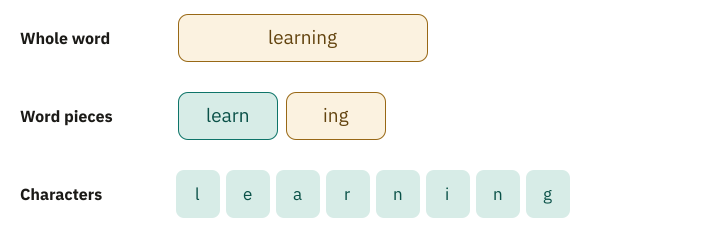
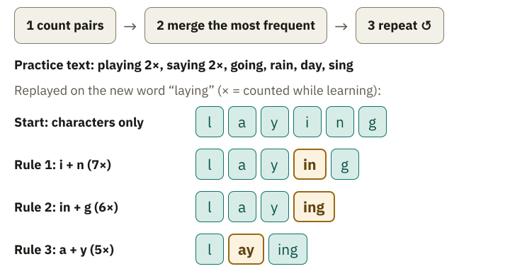
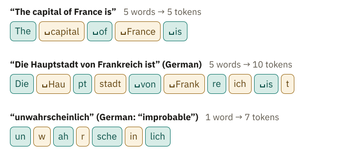

<!-- Generated from src/content/bausteine/en/tokenizer-ids-vocabulary.mdx by scripts/export-lessons.mjs -- do not edit by hand. -->

# Tokenizers: How Text Breaks into Tokens

> Reading copy for GitHub. The full version with interactive demos, animations and recall moments is on the website: **[Tokenizers: How Text Breaks into Tokens](https://ki-einfach-verstehen.de/en/lessons/tokenizer-ids-vocabulary/)**
>
> Licence: [CC BY 4.0](https://creativecommons.org/licenses/by/4.0/deed.en) · Credit it as: KI einfach verstehen, “Tokenizers: How Text Breaks into Tokens”, CC BY 4.0, https://ki-einfach-verstehen.de/en/lessons/tokenizer-ids-vocabulary/

Shows how a tokenizer splits text into pieces that it learned earlier by counting, and why the number of tokens is not the number of words.

Before you read on, try splitting this German word into pieces: “unwahrscheinlich”, which means “improbable”. Would you keep it as one piece, divide it into parts that make sense to a German speaker, such as “un”, “wahr” (true) and “scheinlich”, or split it into individual letters? Keep your choice in mind.

In the previous lesson, a [language model](https://ki-einfach-verstehen.de/en/glossary/language-model/) received the start of a text such as “The cat sat” as [input](https://ki-einfach-verstehen.de/en/glossary/input/) and gave a score to every text piece it knows. That left open how text becomes something a model can calculate with. What exactly is a text piece, and who decided which pieces exist?

## Why the model needs a fixed list of pieces

Why doesn’t a language model simply take your text as it comes? The older language model GPT-2 knows 50,257 text pieces, and its score list always has exactly 50,257 entries, one for each piece. It faces the same constraint as the image recognition model from the previous lesson. That model always produces four scores—one each for cat, dog, fox and car—and cannot add a new category. The language model’s output also has a fixed form before it calculates. So the score list can only be built if the list of pieces is fixed in advance.

The same goes for the input. Every model calculates only with the kind of input it was built for: the language model can only process pieces from its fixed list, the **[vocabulary](https://ki-einfach-verstehen.de/en/glossary/vocabulary/)**. The score list is different: it is recalculated for every input and has one entry for every piece in the vocabulary. So your question must first be split into pieces from the vocabulary. Each of these pieces is called a **[token](https://ki-einfach-verstehen.de/en/glossary/token/)**.

*Before the model calculates, your text is cut into pieces.*

Before your text goes into the model, a separate program splits it: the **[tokenizer](https://ki-einfach-verstehen.de/en/glossary/tokenizer/)**. Every message you send passes through it first, and every answer is built from the same kinds of pieces. So where it cuts is fixed before the model calculates even a single number. Which pieces should its list contain?

## Whole words or single letters?

Making every word a token can work for a limited collection of texts, but not for every text someone might write. The list would have to include “friend”, “friendly”, “unfriendly” and every similar word, along with forms such as “learn”, “learns” and “learned”, names, typos and words coined tomorrow. It can grow large, but it stays finite. Anything missing could only be represented by the placeholder “unknown”. With the rule filter from the first lesson, the prize rule stopped firing as soon as the subject line read “PR1ZE” instead of “prize”. A chatbot with a fixed word list would also see only “unknown” for every new band name.

Another option is to make every letter, space and punctuation mark a token of its own. Then any word can be assembled, even a completely new one, and the list stays small. But the input gets long. The model receives the input as a sequence of tokens, and each token takes up one place. Each model has a fixed maximum number of such places. More on this is in the lesson [Tokenization Inside the Model](./tokenization-inside-the-model.md). With its spaces and the period, “The cat sat.” takes up 12 places, and even a frequent “ing” takes up three every time. The answer would also arrive letter by letter, with one round of the loop for every character.

**Whole words are too rigid, single characters too fine-grained.**

*The same word, split three times at different levels of detail. The middle split is only an illustration.*

## The middle ground: reusable word pieces

Many tokenizers therefore work with **[subword tokens](https://ki-einfach-verstehen.de/en/glossary/subword-token/)**, or word pieces. A token can be a frequent whole word, a recurring word part or a single character. The tokenizers behind chatbots such as ChatGPT work this way, too. “Learning” might split into “learn” and “ing”, for example. That is only an illustration; every tokenizer splits differently.

*Word pieces work like building blocks: large, ready-made pieces are available for frequent sequences, while smaller pieces handle the rest.*

It works like a building set. Frequent sequences come ready-made as one large block; rare ones are assembled from small blocks, down to single characters if need be. So no word is left out, and frequent words still take up only a few places. The tokenizer does not need to have seen a word before; it can build the word from parts already in the box. The row you build is the token sequence of your text. A new sequence is created for every text. The box itself, by contrast, always stays the same: it is the vocabulary, the fixed list of all the pieces a tokenizer knows. For GPT-2, that is 50,257 pieces.

The comparison only goes so far. With building blocks, you choose which piece to use. A tokenizer makes no such choice: it follows fixed rules. The pieces are not shaped by meaning, either; a counting procedure determines which ones end up in the box.

## Where the pieces come from: counting and merging

GPT-2’s tokenizer learned its pieces with a procedure called **[byte pair encoding](https://ki-einfach-verstehen.de/en/glossary/byte-pair-encoding/)**, BPE for short. A “byte” is a small unit of computer memory, and a “pair” is two pieces standing side by side. “Learned” means something different here than for the spam filter, whose weights were adjusted after mistakes. BPE knows neither mistakes nor weights.

At the start, the vocabulary contains only base pieces. In the simple example these are single characters; for GPT-2, they are the 256 possible bytes from which a computer assembles characters. First, the procedure counts how often two pieces stand side by side in a text collection, the practice text. Then it merges the most frequent pair into a new piece and adds it to the vocabulary; the merge is recorded as a numbered **rule**.

The rules of the rule filter were written by people. No person writes these rules by hand; the counts produce them. The tokenizer is therefore not a model with weights, but a program that applies the rules one after another. Afterwards the procedure counts again, now with the new piece; each round, the most frequent pair wins. This continues until the vocabulary reaches a preset size. Real tokenizers learn tens of thousands of rules.

A made-up practice text has eight words: “playing” and “saying” twice each, and “going”, “rain”, “day” and “sing” once each. The words are made up, but the counting is real. You can check every count on paper. The procedure counts pairs only within each word. Which pair do you think occurs most often? Think about it briefly before you read on.

The most frequent pair is “i” + “n”, which appears 7 times: twice each in “playing” and “saying”, and once each in “going”, “rain” and “sing”. In each of these words it occurs exactly once. So “in” becomes the first rule.

## The second and third rule

Then the pairs are counted again. “playing” (twice) is p | l | a | y | in | g, “saying” (twice) s | a | y | in | g, and “going” (once) g | o | in | g. “rain” (once) is r | a | in, and “day” (once) is d | a | y. “sing” (once) is s | in | g. Which pair is now the most frequent? Count before you read on.

The most frequent is now “in” + “g”, 6 times; the figure further down shows these counts. That becomes the second rule, “ing”. After rule 2, the changed words look like this. “playing” (twice) is p | l | a | y | ing, “saying” (twice) s | a | y | ing, “going” (once) g | o | ing, and “sing” (once) s | ing. Only “rain” and “day” (once each) stay unchanged. They do not contain “in” followed by “g”.

In the third count, “a” + “y” wins, 5 times: “playing” and “saying” each appear twice in the text, “day” once; the figure shows the count. Third rule: “ay”.

One level deeper: what happens next?

The procedure counts again after every rule and keeps merging until the vocabulary reaches its set size. After the third rule, the most frequent pair is “ay” + “ing”, 4 times: “playing” and “saying” contribute two each, and both words have “ay” right before “ing”. The practice text shows only three rules. With real training texts, the same counting runs over huge amounts of text, and a long list of rules results. Each rule builds on the pieces that earlier rules created, so the procedure merges one pair after another and counts again after each step. Each merge adds one rule to the list.

Counting alone has produced pieces that look like English word parts. The procedure has no concept of an ending: “ing” and “ay” became rules simply because they were frequent.

Real tokenizers count the same way, over huge amounts of text, and end up with other rules.

One level deeper: how BPE does without “unknown”

Byte pair encoding was originally a data compression method that replaces frequent pairs of **bytes** with a single new symbol. Every visible character is represented by one or more bytes; an accented letter or an emoji uses several. For machine translation, BPE was adapted to merge characters instead of bytes.

A tokenizer that starts with characters has one weakness: if a character is missing from the practice text, it is also missing from the base vocabulary and remains “unknown”. A base vocabulary with all the world’s written characters would have over 130,000 entries. Byte-level BPE, as in GPT-2, therefore starts with bytes. There are only 256, and all fit into the base vocabulary. So even an unseen character can be assembled from bytes. The finished vocabulary has the base entries plus one for every learned rule. Sometimes special entries are added, such as markers for roles in the chat; [Tokenization Inside the Model](./tokenization-inside-the-model.md) shows what they do.

BPE is not the only method for word pieces. **[SentencePiece](https://ki-einfach-verstehen.de/en/glossary/sentencepiece/)** learns word pieces directly from raw sentences, using BPE among other methods. It does not split the sentences at presumed word boundaries first. That helps with languages that do not mark word boundaries with spaces the way German does.

## How the finished tokenizer splits a new word

What does the finished tokenizer do with a word that never occurred in the practice text, such as “laying”? Before you read on, try to work out how the three rules will split it.

It does not count again. It splits the word into single characters and replays its three rules in order. First, rule 1 turns “i” + “n” into the piece “in”: l | a | y | in | g. Then rule 2 forms the piece “ing” from “in” + “g”: l | a | y | ing. Finally, rule 3 joins “a” and “y”: l | ay | ing. There is no rule for the “l”; it stays a single character.

*At the top you see how BPE learns; below, the three rules from the made-up practice text are applied to the new word “laying”. The numbers in parentheses come from the counts made during learning; splitting does not count.*

Every character of the practice text was in the vocabulary from the start, so no word made of these characters is left out. Unknown words simply split into smaller pieces. If needed, GPT-2’s tokenizer assembles any character from even smaller building blocks, the bytes a computer uses to store characters (more on this in the box above). So nothing stays unknown. And because the rules and their order are fixed, the same text with the same tokenizer always gives the same tokens. If you send the same question in two new chats, it becomes the same tokens both times. When the same question produces different answers, the difference almost always arises later, during the selection step that uses some randomness to choose a piece from the model’s score list.

And “unwahrscheinlich” from the start? GPT-2’s real tokenizer turns it into seven pieces: “un”, “w”, “ah”, “r”, “sche”, “in” and “lich”. The boundaries run right through “wahr”, because none of its rules formed “wahr” as a whole. A tokenizer with different rules splits the same word differently.

> **Interactive demo:** [try it on the website](https://ki-einfach-verstehen.de/en/lessons/tokenizer-ids-vocabulary/)

## Why tokens are not words

Language models measure the length of a text in tokens, not in words. Does that mean the token count and the word count are the same?

Through your own programs, you usually pay per token. Counted with GPT-2’s tokenizer, “The capital of France is” gives 5 tokens, and its German version, “Die Hauptstadt von Frankreich ist”, gives 10. Both sentences have five words. For GPT-2, “France” is a single piece, while “Frankreich” becomes “Frank”, “re” and “ich”.

*Three texts, split by GPT-2’s real tokenizer. The color changes with every token. The symbol ␣ marks a space; in GPT-2, it belongs to the following word.*

> **Interactive demo:** [try it on the website](https://ki-einfach-verstehen.de/en/lessons/tokenizer-ids-vocabulary/)

Whatever was frequent during counting became large pieces. In the measured example, “France” is one token, while “Frankreich” splits into three. Even a typo can raise the count: “Frankkreich”, misspelled with a double k, needs one more piece than “Frankreich”.

One level deeper: which texts does GPT-2 count on?

GPT-2’s tokenizer was built for a model whose training texts OpenAI did not publish, and the texts used to count its pairs are not publicly listed. A replication project reports that non-English pages were removed; whether this shaped the pairs is not proven. What follows for you: which pieces a tokenizer has mostly reflects what was frequent in the counting texts. Whether these texts contained many German words can only be inferred indirectly. The texts chosen shape the result. The main text shows how that looks for English and German words. Once the tokenizer is built, the list is fixed. Every text, even a new one, is split with exactly this list.

More tokens mean the text takes up more places in the input. You often hear that a model understands a word less well if it splits into many tokens. That sounds plausible, since a whole piece looks more complete than fragments. The number alone says nothing about understanding. The model always receives the whole input at once, like “The cat sat on” in the previous lesson, not just the last piece. Whether it gains meaning from several pieces depends on what it learned in training, such as that “Frank”, “re” and “ich” together make up “Frankreich”.

**You cannot infer understanding from the number of tokens alone.**

The tokenizer only splits text into pieces and does not judge whether they fit the meaning.

## Pieces are not numbers yet

The tokens are still text, and a model only calculates with numbers. The next lesson shows which number each piece gets and what that number tells the model: [Token IDs: What a Number Means](./token-ids-and-vocabulary.md).

---

Source: https://ki-einfach-verstehen.de/en/lessons/tokenizer-ids-vocabulary/

← Previous: [Input and Output: What a Function Does](./input-and-output.md) · [All lessons](../../README.md#contents) · Next: [Token IDs: What a Number Means](./token-ids-and-vocabulary.md) →
