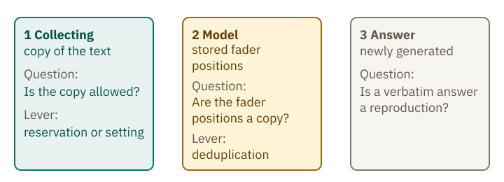
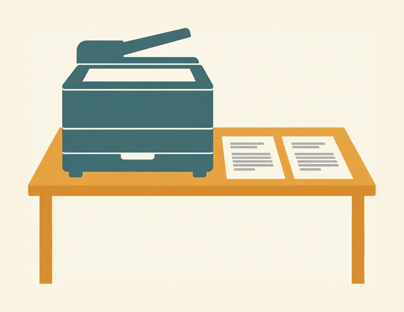
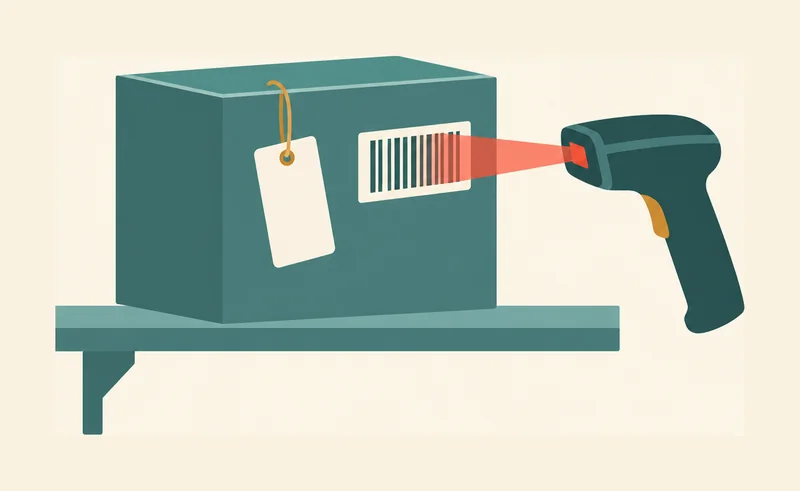
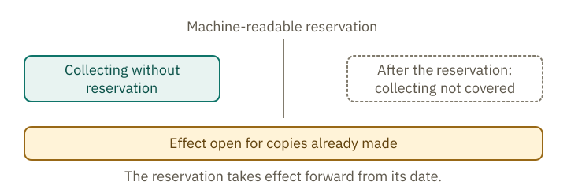
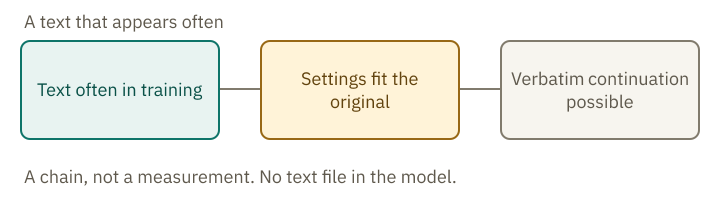
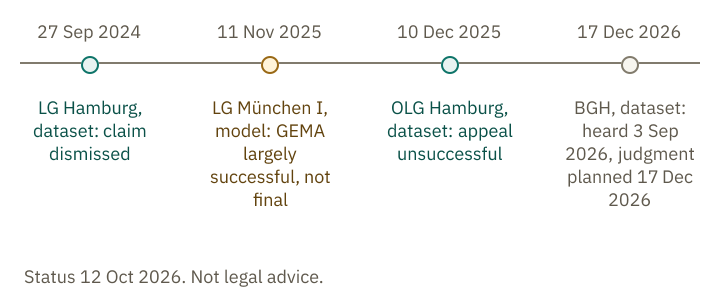

<!-- Generated from src/content/bausteine/en/training-data-copyright-and-privacy.mdx by scripts/export-lessons.mjs -- do not edit by hand. -->

# Training Data: Copyright and Privacy

> Reading copy for GitHub. The full version with interactive demos, animations and recall moments is on the website: **[Training Data: Copyright and Privacy](https://ki-einfach-verstehen.de/en/lessons/training-data-copyright-and-privacy/)**
>
> Licence: [CC BY 4.0](https://creativecommons.org/licenses/by/4.0/deed.en) · Credit it as: KI einfach verstehen, “Training Data: Copyright and Privacy”, CC BY 4.0, https://ki-einfach-verstehen.de/en/lessons/training-data-copyright-and-privacy/

Which texts may be used for training, how a rights reservation works, why copying raises the first legal question, and what may remain in the model. As of 12 Oct 2026; not legal advice.

Imagine you have been writing a gardening blog for ten years. One day someone asks a chatbot about tomato plants, and its answer contains a sentence almost identical to one you wrote. Is that allowed? Your text could have been used for training without your knowledge.

There are three points to consider legally: collecting, which makes a copy of the text; the model, which stores fader positions; and the answer, which is generated for each question. Each raises a different legal question. A “lever” is something you can use to influence what happens at one of these points, such as a rights reservation or a setting.

*Three points where a text raises legal questions. Each has its own question, with a separate lever for collecting and for the model.*

## First the copy, then the training

The lesson on [practice problems](./text-becomes-many-practice-problems.md) showed you where the raw material comes from. A program first downloads web pages, making copies before any filtering begins. Rules then select what is useful for training. Only after that does training start. As the lesson on [self-supervised learning](https://ki-einfach-verstehen.de/en/glossary/self-supervised-learning/) explains, the text itself supplies the answers to the practice problems: the next piece of text. But before any of this can happen, a copy has already been made.

Copyright protects a work: a text that a person wrote and that is a personal intellectual creation (§ 2(2) UrhG). Not every text reaches that threshold. As a rule, its author has the right to decide about copies. A transcript is a copy, even if it was written by hand and made only once. A program copies in seconds, and the copy is still a copy. The collected copies form the dataset that training later draws on.

*A copy already exists when a program reads the page and stores it, before anything is learned.*

There are exceptions to this rule. For text and data mining, § 44b of the German Copyright Act (UrhG) permits making copies, known in legal language as reproductions. Text and data mining is the automated analysis of digital works to find patterns, trends and connections. The exception applies only to works that are lawfully accessible. It is therefore a narrow permission for one kind of analysis, not a general license for any use of a text. The picture shows only the first step, the collecting. Whether the model then contains something similar is covered in the sections below.

A text is lawfully accessible if you can access it in a way the law permits—for example, because its author published it. Being publicly available does not by itself establish this. A poem shared only with family members by letter is not publicly accessible: a collecting program cannot reach it, so the exception does not apply. For a public blog, whether the exception applies depends on whether its operator has made a rights reservation. The next section explains what that means.

An example from a web archive: it collects five pages on the same topic. When filtering, four of them drop out because they are too short or duplicated; only the instructions remain. But the copies of all five pages were already made before filtering began. That is why the law asks about the copy first.

Before you go on: which of the three places stays open if there is no reservation, the text is public, and it was often repeated? Choose these settings in the demo and check your guess.

> **Interactive demo:** [try it on the website](https://ki-einfach-verstehen.de/en/lessons/training-data-copyright-and-privacy/)

## A reservation only a computer can read

What if the operator does not want their blog collected? That is what a rights reservation is for. It is the rights holder’s declaration that a particular use is not permitted. The law requires a specific form for it. Section 44b(3) UrhG reads, in translation: “A rights reservation for works made available online is effective only if it is made in a machine-readable form.”

Machine-readable means using a standardized format that a program can find and interpret. A sentence such as “No use for AI training” in a website’s imprint is clear to people, but it is not in that format. According to the wording of the law, it is therefore not enough.

An example of a machine-readable notice is the [robots.txt](https://ki-einfach-verstehen.de/en/glossary/robots-txt/), a text file on a website with instructions for crawlers. Common Crawl, an organization that collects web pages and makes its archive freely available, describes the line “User-agent: CCBot” with “Disallow: /” for this purpose. Whether a robots.txt counts legally as a reservation within the meaning of the law is not settled.

*A notice meant only for people is not enough. The barcode carries information a scanner can read. The picture illustrates the idea, not the legal position.*

The reservation applies to future uses. That is why the moment it is set matters for which uses it covers. The wording does not explicitly address material already collected, leaving open how existing copies should be treated. For retaining copies, § 44b(2) sentence 2 UrhG sets a rule: reproductions must be deleted once they are no longer needed for text and data mining. Whether training itself counts as text and data mining remains open. The law does not give a definitive answer.

*The reservation works forward from the day it is made. Anything collected before it is marked as open in this drawing. The timeline shows only the order.*

What happens if the reservation comes only after collecting?

Then the copy already exists, made before the reservation. The reservation applies to future uses. Whether a reservation covers an existing copy is the open question from the section above; the deletion duty under § 44b(2) sentence 2 UrhG applies regardless; it covers only copies that are no longer needed. This text does not decide the open question, because the courts have not yet ruled conclusively on it.

## When the text contains people

Texts on the web often contain more than sentences. Names, phone numbers and email addresses appear in forums, imprints and comments. These are [personal data](https://ki-einfach-verstehen.de/en/glossary/personal-data/), that is, details that make a specific person recognizable. The General Data Protection Regulation (GDPR) applies to them as soon as they are processed, so already when collecting. Copyright asks about the copy; data protection asks about personal details. Both questions can apply at once.

Processing personal data needs a legal basis. Under Art. 6(1)(f) GDPR, a legitimate interest can justify processing, provided the interests or fundamental rights of the person concerned do not outweigh it. Whoever processes the data must weigh these interests in each individual case. There is no blanket answer.

Under Art. 21(1) GDPR, you can object to this processing for reasons relating to your particular situation. The right to object therefore depends on your circumstances; simply wanting the processing to stop is not enough.

One study shows that such details can be extracted from a model. Using targeted queries, Carlini and others obtained texts containing names, phone numbers and email addresses from a language model. The finding concerns what an older model produced in response to those queries; it does not establish what the model stores.

The lever of an objection shows at large platforms. According to the Verbraucherzentrale (German consumer advice center), Meta, the company behind Facebook and Instagram, has used public content from adults in the EU for AI training since 27 May 2025. An objection is possible and, according to that information, takes effect for the future.

Whether a trained model itself still contains personal data is an open question.

## What stays in the model

The model does not store a text file. Remember the mixing desk from the lesson on the model? It stores the fader positions, not sentences. The comparison has a limit: a mixing desk does not learn from repetition, whereas training adjusts a fader each time a text appears. Whenever the model continues a sentence, it generates the continuation afresh. This brings you to the second point: the model itself.

The fader positions can, however, turn out so that a continuation fits the original word for word. A song lyric that is often quoted on the web can be such a case: an answer then gives its next line verbatim. (Invented example.) Research calls this [memorization](https://ki-einfach-verstehen.de/en/glossary/memorization/). Carlini and others showed that it grows with the model size, with the number of times a text appears in training, and with the length of the context. The measurements come from older models; there is no figure for today’s chatbots.

*Repetition can shift the fader positions so that a continuation matches the original. The drawing shows a chain, not a measurement.*

Removing duplicate texts, a process called deduplication, reduces the problem. In 2021, Lee and others examined text the model generated without a template. Without deduplication, over 1 percent of its tokens—the small pieces into which a model splits text—were copied word for word from the training text. Models trained on deduplicated data reproduced memorized text about ten times less often. These measurements suggest that removing duplicates helps.

Nasr and others showed that attacks can extract training text from chat models, and that methods which tune the model to conversations do not fully remove memorization. In normal use, this was not measured.

The third place is the answer. It is produced anew for every question. If it comes out word for word, that is a reproduction in the conversation, even if no text is stored as a file in the model. Whether such a reproduction is legally a copy is currently being decided by the courts.

The German Federal Court of Justice (Bundesgerichtshof), the highest German civil court, has not yet decided whether fader positions count as a copy. The Munich I Regional Court treated them as a copy in the case of song lyrics that a model can reproduce word for word; the judgment can still be challenged.

## Courts still deciding

Status: 12 October 2026. Not legal advice. The proceedings are ongoing or can still be challenged, and they concern different questions.

In the case concerning a non-profit association’s dataset, the Hamburg Regional Court dismissed the claim on 27 September 2024. The dataset contains only links and image descriptions, no images. The dispute concerned copying a thumbnail of a photograph while the dataset was being built, not the model. The Hanseatic Higher Regional Court (Oberlandesgericht) rejected the appeal on 10 December 2025.

The model was at issue in GEMA’s case against OpenAI, the company behind ChatGPT. On 11 November 2025, the Munich I Regional Court largely ruled in favor of GEMA, the collecting society that represents music rights. The case concerned song lyrics that, in the court’s view, the models can reproduce word for word. The court treated this as memorization and as reproduction. In the court’s view, the text and data mining exception does not apply to training that reproduces the lyrics. An analogous application of the exception, that is, its extension to similar cases, was also rejected. The judgment is not final: an appeal can still be lodged, so it is not yet conclusive.

The dataset case is now before the Federal Court of Justice under case number I ZR 281/25. The hearing took place on 3 September 2026, and the court is due to announce its judgment on 17 December 2026. This case, too, concerns the dataset, not the model.

*Who decided when, separated into dataset and model. The distances are not to scale; the order matters. The dates come from the courts’ press releases; the proceedings at the Federal Court of Justice are still open.*

The EU rules for AI models also apply. The AI Act requires providers of general-purpose AI models to have a copyright policy and to publish a summary of the content used for training. These obligations apply since 2 August 2025; fines since 2 August 2026. The summary says what was used, not whether that was lawful.

## Your chats

What you write to a chatbot does not change the finished model while you use it. You saw that in the input and output lesson. Whether a conversation later flows into training is separate. Some providers offer a setting, others do not; the app’s settings and terms say which applies.

An example: Anthropic, the maker of Claude, states in its consumer terms (valid since 8 October 2025) that content can be used for training unless you object in the account settings. Even after an objection, Anthropic may use content for training if you give feedback (such as a thumbs up or down) or if content is flagged for a safety review. So check the app settings before you use sensitive texts.

The provider may keep conversations for operation and safety; its privacy notice says so.

**Exercise: Five texts, three places**

For each case, name the place (collecting, model or answer) and the lever that works there (reservation, setting or deduplication). A case can have several places.

a) A blog post, public, with no reservation in the robots.txt.
b) Your own chat conversation, with training switched off.
c) A lyric that is often quoted online.
d) Your own poem, shared only within the family.
e) A photo whose page source contains a machine-readable reservation.

**Solution:**

a) At the collecting place, the exception for lawfully accessible works applies as long as there is no machine-readable reservation. The working lever is the reservation. What courts make of the position for the model is open.

b) At the collecting place, if the provider uses the conversation for later training. The working lever is the setting. Keeping it for operation and safety remains possible.

c) The unresolved question concerns the model. The lyric appears frequently on the web, which can increase memorization. Deduplication of the training data is the lever you can use here to reduce the problem. The Munich I Regional Court treated this as a reproduction; the judgment can still be challenged. The Federal Court of Justice case concerns the dataset, not the model.

d) The poem was shared only within the family, and a collecting program does not reach it. The exception does not apply at the collecting place, so no lever works there. If you copy it into a chat, the training setting of your account decides whether the input can be used for training.

e) At the collecting place, the machine-readable reservation works for future uses of the photo under § 44b(3) UrhG. Whether a copy already collected is affected is open.

The solution is an assessment, not advice on a specific case.

For a blog like yours, the wording of § 44b says that collecting for text and data mining was allowed as long as no machine-readable reservation was in place. Whether that permission also covers using the copies to train a model is not settled by the highest court. The Munich I Regional Court has denied it for training that lets a model reproduce song lyrics; the judgment is not final. How it applies to your blog depends on the circumstances. A model may contain a passage word for word; whether that counts as a reproduction remains open. Your sentence appearing in an answer raises the third legal question, which also depends on the circumstances.

Each of the three points raises its own question, and the timing determines whether a lever works. The lesson [Prediction and parroting](./why-prediction-is-more-than-parroting.md) explains how a model can reproduce text word for word without ever storing it as a file. In the next lesson, you will learn how to check answers for errors, even when their source is unclear.

---

Source: https://ki-einfach-verstehen.de/en/lessons/training-data-copyright-and-privacy/

← Previous: [Does AI Understand What It Says?](./does-ai-understand-what-it-says.md) · [All lessons](../../README.md#contents) · Next: [Checking Answers: Using AI Safely in Everyday Life](./checking-answers.md) →
