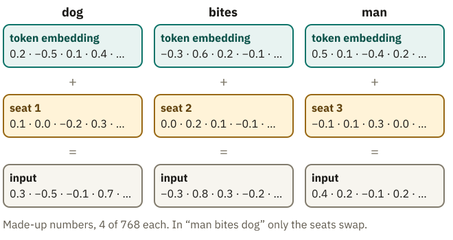
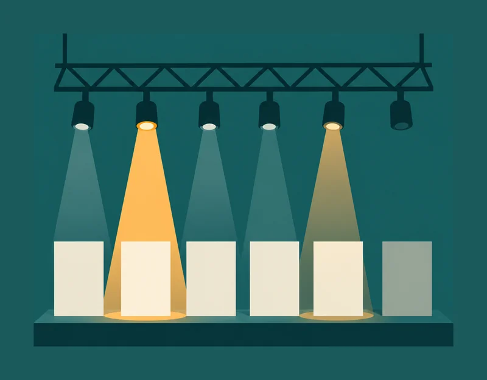
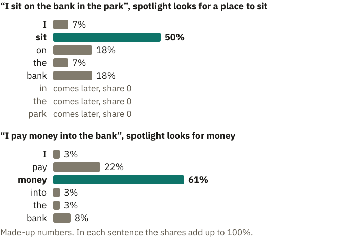
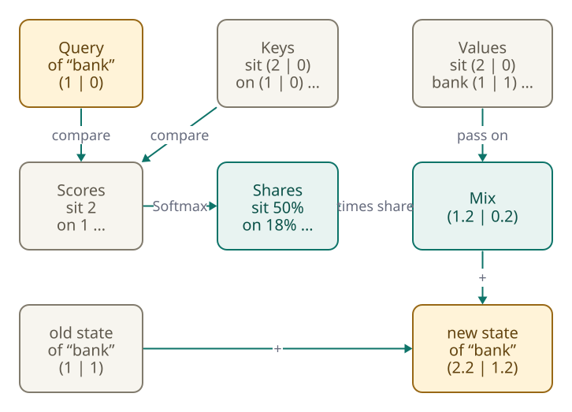
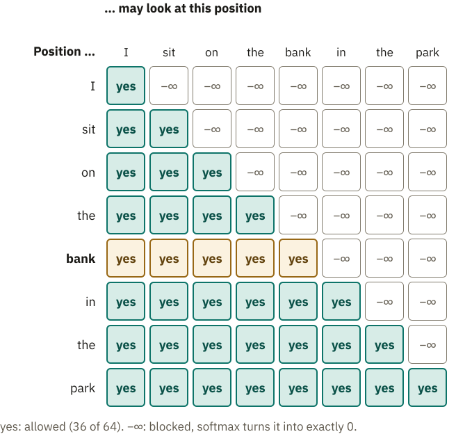
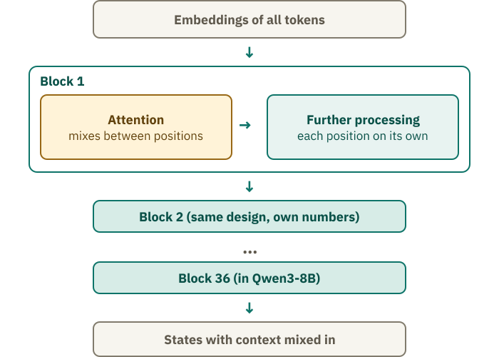

<!-- Generated from src/content/bausteine/en/transformer-blocks-and-attention.mdx by scripts/export-lessons.mjs -- do not edit by hand. -->

# Transformer Blocks and Attention: How Context Gets Mixed In

> Reading copy for GitHub. The full version with interactive demos, animations and recall moments is on the website: **[Transformer Blocks and Attention: How Context Gets Mixed In](https://ki-einfach-verstehen.de/en/lessons/transformer-blocks-and-attention/)**
>
> Licence: [CC BY 4.0](https://creativecommons.org/licenses/by/4.0/deed.en) · Credit it as: KI einfach verstehen, “Transformer Blocks and Attention: How Context Gets Mixed In”, CC BY 4.0, https://ki-einfach-verstehen.de/en/lessons/transformer-blocks-and-attention/

How a language model mixes the information of earlier words into each token, why it may not look ahead while doing so, and how many such blocks work in a row.

*“bank” can mean a bank for money or a bench to sit on: the word alone does not show which.*

Take “I pay money into the bank today” and “I sit on the bank in the park.” Each token has its **[embedding](https://ki-einfach-verstehen.de/en/glossary/embedding/)** from the previous lesson, a long list of numbers from the lookup table, the same for “bank” in both. Translating both into French, a chatbot must write “banque” (money) once and “banc” (bench) once. How can it tell?

The answer lies in many identically built blocks, each with its own numbers: the **[transformer](https://ki-einfach-verstehen.de/en/glossary/transformer/)** architecture, introduced in 2017. In them, each token gets information from other tokens.

## One embedding, two meanings

Reading “I sit on the bank,” you do not think of money, because you read the sentence around it. An embedding cannot.

A language model computes new numbers from each embedding; the table itself stays unchanged. As on the mixing desk, the numbers run through many stages, called blocks (often layers in model descriptions). The freely available Qwen3-8B has 36 of them; most of its parameters sit in those blocks.

A token's intermediate values are its **state**. It starts as the embedding (in GPT-2 plus the seat, see below), and each block updates it. Measurements on older models such as GPT-2 show that the same word's states usually differ more between sentences in later blocks. In GPT-2, the last block's states are shaped almost entirely by the sentence.

## The seat in the sentence

The embedding still lacks something simpler: where the token stands. “Dog bites man” and “Man bites dog” have the same three words and fetch the same three embeddings. Only the order differs, and it decides who gets bitten.

The blocks mix in words by adding up their contributions at different strengths. But a sum ignores order: 2 + 3 equals 3 + 2. Without position information, a token learns mainly which words it sees; it can at most approximate their order. That is why the 2017 researchers added position information separately.

GPT-2 uses a second table, one row for each of the 1,024 positions in the [context window](https://ki-einfach-verstehen.de/en/glossary/context-window/) (the most tokens handled at once). Each row is an embedding for one **seat**: seat 1, seat 2 and so on. These start random and are learned.

Both have the same length and are added number by number. In a made-up example with one number, “dog” has 0.2, the seat 0.1, together 0.3, and that goes into the blocks. In a later seat, as in “Man bites dog,” the seat value is negative, and less goes in. **The same dog gives a different sum in another seat.** Its technical name is **[position embedding](https://ki-einfach-verstehen.de/en/glossary/position-embedding/)**.

*Token embedding plus seat embedding goes into the blocks. In “Man bites dog,” the dog sits in seat 3.*

Is the token lost in the sum? With a single number per vector, yes, because different pairs give the same sum. With hundreds of numbers, hardly. A recalculation on the smallest GPT-2 shows that in 99.8 percent of random token-and-seat pairs, the sum points most closely toward the correct token.

In GPT-2, the sum is the first state: the token knows where it stands, not which bank is meant. Other models solve the seat differently. How do the other words get in?

## The spotlight: mixing in context, share by share

*Schematic, not the example sentence: what is brightly lit flows strongly in.*

For the token whose turn it is, several spotlights switch on. Their light falls on the tokens before it and on the token itself. **What is brightly lit flows strongly into the new state**, while tokens in dimmer light contribute only a little. The model computes all positions at the same time; here, one is picked out. This method is called **[attention](https://ki-einfach-verstehen.de/en/glossary/attention/)**. The spotlights are not aimed by hand: the model itself works out how much light each token receives.

Suppose vectors had only two places, one for “seating” and one for “money” (made-up numbers). Real vectors have thousands of unnamed places. “bank” starts undecided at (1 | 1). The spotlight brightens hints of seating. Which word of the park sentence will it light up most?

The brightest is “sit” with 50 percent, because it gets the highest score (2; the section on query, key and value shows how that comes about). “on” and “bank” come next, “I” and “the” furthest behind.

You know the rule from the lesson on [probability and softmax](./probability-and-softmax.md): [softmax](https://ki-einfach-verstehen.de/en/glossary/softmax/) turns points into shares. Here, the percentages are shares of light, not probabilities.

Each word contributes two numbers:

| Word | Share | contributes: seating | contributes: money |
| :--- | ---: | ---: | ---: |
| I | 7 % | 0 | 0 |
| sit | 50 % | 2 | 0 |
| on | 18 % | 0 | 0 |
| the | 7 % | 0 | 0 |
| bank | 18 % | 1 | 1 |

Each contribution is multiplied by its share and added up: this is a **weighted sum**. It is added to the old state rather than replacing it.

At the seating place: half of “sit,” multiplied by its value 2, gives 1, plus a small remainder from “bank.” At the money place, “bank” contributes only a fraction, and “sit” has value 0 there. So the state keeps what “bank” was: the seating place grows clearly, the money place hardly at all.

In the money sentence, the calculation shows the money spotlight. “money” has the highest score, “pay” the second. “money” gets about 61 percent of the light and pulls the state toward money; “pay” and “bank” get smaller shares. “I,” “into” and “the” share the other 9 percent and pass on nothing. “today” comes after “bank” and gets nothing; the section on the causal mask shows why.

*The same word in two sentences (made-up numbers). Words after “bank” get no share.*

One level deeper: the money sentence worked out

The scores are made up: “money” 3, “pay” 2, “bank” 1, the other words 0. From these come the strengths: e³ ≈ 20 for “money,” about 7.4 for “pay,” about 2.7 for “bank,” and 1 for each of the three words with score 0. Together that is about 33. So the shares are about 61, 22 and 8 percent.

Now the mixing. At the money place, “money” with value (0 | 2) contributes 0.61 · 2 ≈ 1.2, “pay” with (0 | 1) contributes 0.22 · 1 ≈ 0.2, and “bank” with (1 | 1) contributes 0.08 · 1 ≈ 0.1. Together that is about 1.5. At the seating place only “bank” contributes: 0.08 · 1 = 0.08. The mix is (0.08 | 1.5); added to (1 | 1), it gives (1.1 | 2.5).

## Query, key and value: where the shares come from

How does the spotlight know that “sit” fits better than “the”? As in an archive search, “bank” brings a search slip: “Any hints of seating here?” Each earlier word is a folder: tag outside, contents inside. **The slip is compared with the tags; the better a tag fits, the more of its folder's contents is taken along.**

The model calls the three parts **query** (search slip), **key** (the tag) and **value** (contents). All three are vectors computed from a state: the query belongs to the current token, a key and a value to each visible token.

The model multiplies query and key number by number and adds the results. This gives a [score](https://ki-einfach-verstehen.de/en/glossary/score/) for every visible token: a measure of how well query and key fit together. For “sit,” only the seating place counts, because there query and key both carry something; the money place stays empty for both.

The query of “bank” seeks seating. The best fit is “sit” with score 2; “on” and “bank” come next with 1, and “I” and “the” get 0.

Softmax turns the scores into the shares from before: in the example, each score becomes a strength. Zero points give strength 1, and each point more makes it about 2.7 times as large. The strengths become shares that add up to 100 percent. So “sit,” with the most points, gets 50 percent. Keys and values serve different purposes: a word can be found through one cue yet contribute something else. “on” matches a little through its key, but its value contributes nothing.

[▶ watch the animation on the website](https://ki-einfach-verstehen.de/en/lessons/transformer-blocks-and-attention/)

*One pass for “bank” with made-up numbers.*

> **Interactive demo:** [try it on the website](https://ki-einfach-verstehen.de/en/lessons/transformer-blocks-and-attention/)

Where do query, key and value come from? Again from weighted sums: each state number is multiplied by a factor and summed. For “bank,” this gives on the seating place a value of 1, on the money place 0; the calculation is in the box.

The factors sit in a table, a [matrix](https://ki-einfach-verstehen.de/en/glossary/matrix/), one each for query, key and value. On the mixing desk, their numbers are knobs, [parameters](https://ki-einfach-verstehen.de/en/glossary/parameters/): set by training and the same for every text. Query, key and value are displays, new for every text.

And “park,” the best hint of a bench, got no share at all. Why?

One level deeper: where the numbers for “bank” come from

The query of “bank” is (1 | 0), the key of “sit” is (2 | 0). Query and key are multiplied and added, position by position: 1 · 2 + 0 · 0 = 2.

Real models divide the scores by a fixed number before softmax, so they do not grow too large; the example leaves that out. Then softmax turns these into strengths: each score becomes a power of e, roughly 2.72. A score of 0 gives the strength 1. A score of 1 gives about 2.72. A score of 2 gives about 2.72 · 2.72 ≈ 7.4. Together that is about 14.8, of which 7.4 belongs to “sit.”

The query of “bank” is computed the same way: from (1 | 1), the seating place with factors 0.5 and 0.5 gives 0.5 · 1 + 0.5 · 1 = 1, the money place with factors 0 gives 0.

For the seating place, mixing the values gives 0.5 · 2 + 0.18 · 1 ≈ 1.2: 0.5 is the share of “sit” times its value 2; 0.18 is the share of “bank” times its value 1.

## No looking ahead: the causal mask

“Park” comes after “bank.” Language models that write from left to right, like chatbots, follow a fixed rule: **each position sees only itself and the positions before it**, never those after. For “bank,” “park” is invisible, even though it stands there.

*What comes after the current token stays invisible.*

The reason lies in training: the whole sentence goes in at once, and at each position the model should predict the next token. The position of “bank” should predict “in.” If it could already see “in,” it could just copy.

A **[causal mask](https://ki-einfach-verstehen.de/en/glossary/causal-mask/)** enforces this rule: before softmax, it sets every later position's score to minus infinity. Each point less makes the strength smaller; at minus infinity nothing is left, and the share is *exactly* 0. For a whole sentence this gives a triangle: the first word sees only itself, the last sees all.

*The causal mask: each row shows what a position may look at. The row of “bank” is highlighted.*

“Park” may look at everything, including “bank.” The next word is predicted from the last position's state, which sees the whole sentence.

## Many spotlights, many blocks

A single spotlight would have to split its light between seating and money. So a block has several spotlights, called **heads**, each with its own query matrix. Their mixes are laid end to end; a learned matrix brings them to the usual length, and the result is added to the state. Qwen3-8B has 32 heads per block, the smaller Qwen3-0.6B-Base 16. Some heads can be interpreted: an induction head looks for what followed the last occurrence of the current token. If “Frau Kowalczyk” stood earlier in the chat and “Frau” comes again, it highlights “Kowalczyk.” Many heads show no such pattern.

> **Interactive demo:** [try it on the website](https://ki-einfach-verstehen.de/en/lessons/transformer-blocks-and-attention/)

Attention is only the first part of a block. Next comes the further processing (a feed-forward network, as in the lesson on [layers](./layers.md)). In the 2017 transformer paper, this stage is a ReLU, which sets negative values to zero. It is also added to the state. Attention plus further processing form a **[transformer block](https://ki-einfach-verstehen.de/en/glossary/transformer-block/)**.

One level deeper: which step does Qwen3-8B, an open language model, use?

Qwen3-8B's public configuration file lists `silu` under `hidden_act`. The further processing, however, uses a design called SwiGLU: one computation passes through `silu`, another remains linear, and their product continues. The silu step is a rounded curve: for large negative inputs it approaches zero, for large positive inputs it stays close to the input, and in between there is no sharp corner.

In the model code, the output of `gate_proj` goes through this step, is multiplied by the output of `up_proj` and then sent through `down_proj`.

The same file gives `num_hidden_layers` as 36, the large blocks of this lesson. In the 2017 transformer, each head also had its own key and value matrices. To save memory, the 32 heads form groups of four that share keys and values; only the queries differ.

*Each block mixes between the positions, then processes each one on its own. Qwen3-8B has 36 of them.*

**Context comes in only through attention.** Yet in large models, most parameters sit in the further processing; in Qwen3-8B about two thirds, calculated from the published values. Knowledge probably sits there too. Block counts vary: the smallest GPT-2 has 12, Qwen3-8B 36, the large GPT-3 96.

Do the spotlights show why the chatbot answers as it does?

## What the spotlight does not reveal

Some tools display a head's light as a colored table: here the model “looked.”

You can test a word's importance by leaving it out. A widely cited 2019 study ran this test on older models without transformer blocks: how much the prediction changed often matched the shares poorly. Other researchers push back: such tests do not refute that the shares can help in explaining; it depends on what one means by an explanation.

Across blocks, information mixes ever more: light on “sit” in block 20 hits a mixture of many words. Besides the share, the value counts: a token with a tiny value adds little.

Light often lands on the very first token, even when it contributes little. Researchers call this **attention sinks**. A suspected reason: the shares must add up to 100 percent; if a head finds nothing fitting, the light must go somewhere, and every later position sees the first token. In this lesson's experiment, the first token is a special marker at the text boundary, separating texts. Llama-2 with 70 billion parameters shows it too.

Here the spotlight picture ends: it shows how information is mixed, but **it does not reliably explain why an answer comes out**.

“Bank” starts with the same token embedding; in GPT-2 a different seat is added. In each block, attention mixes in the values of the token itself and earlier tokens by share, never later ones. The next lesson shows how the state becomes a score list.

---

Source: https://ki-einfach-verstehen.de/en/lessons/transformer-blocks-and-attention/

← Previous: [Embeddings: How a Number Becomes a Learned Vector](./embeddings.md) · [All lessons](../../README.md#contents) · Next: [Output Head: From the Last State to a Prediction](./output-head.md) →
