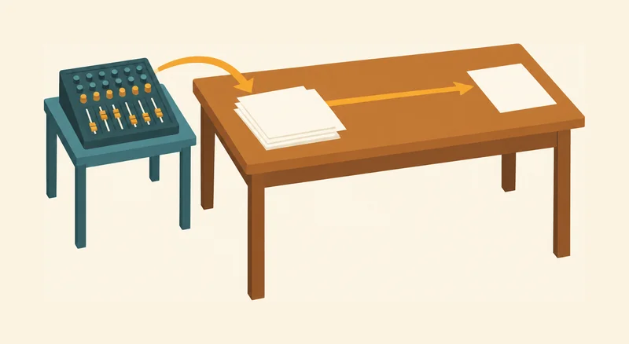
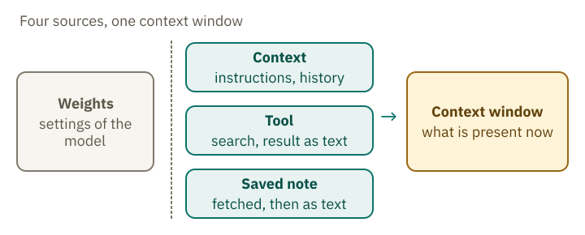
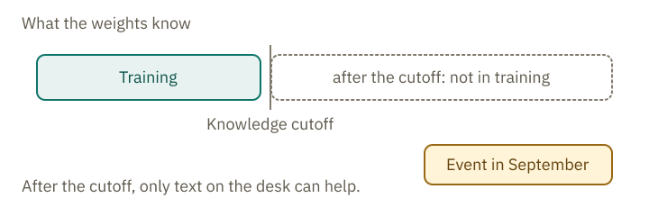
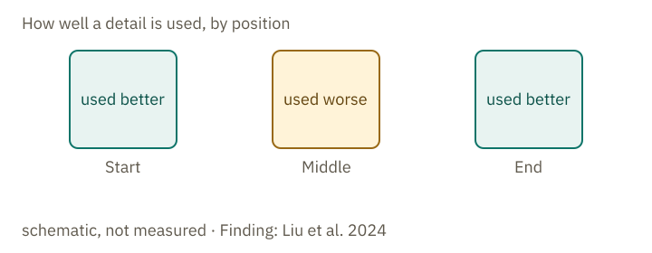

<!-- Generated from src/content/bausteine/en/what-a-chatbot-knows-in-a-conversation.mdx by scripts/export-lessons.mjs -- do not edit by hand. -->

# What a Chatbot Knows in a Conversation: Four Sources, One Context Window

> Reading copy for GitHub. The full version with interactive demos, animations and recall moments is on the website: **[What a Chatbot Knows in a Conversation: Four Sources, One Context Window](https://ki-einfach-verstehen.de/en/lessons/what-a-chatbot-knows-in-a-conversation/)**
>
> Licence: [CC BY 4.0](https://creativecommons.org/licenses/by/4.0/deed.en) · Credit it as: KI einfach verstehen, “What a Chatbot Knows in a Conversation: Four Sources, One Context Window”, CC BY 4.0, https://ki-einfach-verstehen.de/en/lessons/what-a-chatbot-knows-in-a-conversation/

Where an answer in a chat can come from: from the weights set by training, from the text in the context window, from tools and from saved memories, and what that means for how far you can rely on it.

Imagine asking a chatbot, “What did I write last week about my garden?” It might answer as though it had looked up your earlier conversation. But where does that answer come from? The model did not learn about your garden during training: your garden was not part of its training data. So the answer must come from information available in the conversation, or it is a guess. To tell the difference, you need to know which sources a chatbot can draw on.

## Four sources, one context window

During a conversation, a chatbot can draw on four sources. Its **weights** are the numbers set during training. In the mixing-desk picture from the lesson “Program, Algorithm, Model Compared”, these are the faders. The context contains everything available in the conversation, including the app’s instructions, the chat history and any attached document. **Tools** can search for information on the web or in earlier chats. And saved memories hold information outside the model until it is retrieved.

The last three sources have one thing in common: once fetched, their content lands as text in the [context window](https://ki-einfach-verstehen.de/en/glossary/context-window/). The context window has a fixed limit on how much information a model can process at once. In the lesson on [tokens](https://ki-einfach-verstehen.de/en/glossary/token/) you met the same limit as the buffer stop at the end of a track. Here it appears as a tabletop.

On the tabletop there are slips: the instructions, the history, a document, a search result, a note. The faders are not on the table. They are set on the mixing desk and stay as they are.

*The desk represents the context window, with a stack of slips on its surface. The mixing desk and its faders sit on a separate side table. One arrow points from the mixing desk to the slips; another points to the output slip—the answer. The picture shows what is available in the conversation, not what the model knows.*

The difference matters. The weights sit inside the model and affect every answer. What lies in the window affects the current answer. Whether older messages stay is up to the app: when the window is full, it can remove the oldest ones. The model processes everything on the table as input: text as text, images as images, including a sentence from the system prompt or from a web search. If the app has a system prompt, it goes into the model again with every message. The weights stay the same for every question. The faders are used when the text is processed, and their settings do not change in the process. In the end, the slips produce an output slip: the answer.

*Four sources around the context window: the weights sit inside the model and affect every answer. Tools and saved memories deliver text that enters the context window.*

## Training ends at a cutoff date

Training sets the weights—the faders in the mixing-desk picture. Their settings stay the same afterward, including during a conversation. The lesson on [input and output](./input-and-output.md) explains how this works. The model therefore cannot get information from its faders if that information was absent from training.

The date that marks the end of the training data is called the [knowledge cutoff](https://ki-einfach-verstehen.de/en/glossary/knowledge-cutoff/). For the current Claude models, Anthropic lists June 2026 both as the period for which their knowledge is most reliable and as the state of their broader training data. The information is in Anthropic’s model overview, retrieved on 12 October 2026.

*The cutoff separates what occurred in training from everything after it. An event from September lies on the table as text only when it is fetched.*

Stable knowledge survives the cutoff. A model answers the text continuation “The capital of France is …” from its weights, because this knowledge appears in many texts and was therefore well represented in training. An event from September 2026, by contrast, took place after a June knowledge cutoff. The chatbot can therefore learn of it only through text in the conversation, or else guess.

A fluent answer does not reveal where it comes from. The tone is the same whether the statement comes from the faders, from a search or from guessing.

## What lies on the table: instructions, history, documents

The simplest source is the context that you can see or that the app adds. This includes the [system prompt](https://ki-einfach-verstehen.de/en/glossary/system-prompt/), the instructions that stand at the front of the sequence; you saw that in the lesson [From Text Predictor to Assistant](./from-text-predictor-to-assistant.md). It also includes the history of your chat and every document you upload.

The chat history acts like a memory, but it is text sent to the model again with each new message, as the lesson on tokens explains. Anthropic describes each exchange this way: the input contains the entire conversation history plus the new message. If you use the programming interface, you can see this in every request.

Anthropic lists exactly what counts toward the window: the system prompt, every message with tool results, images and documents, the tool descriptions and the answer itself. The model overview names a context window of 1 million [tokens](https://ki-einfach-verstehen.de/en/glossary/token/) for Claude Opus 5.5. That sounds like a lot, but everything shares the same space.

If the input alone is too long, the Claude API rejects the request with an error. An app can therefore leave things out or shorten them beforehand.

So the tabletop is the context window, and the slips on it are everything that stands in the conversation. The faders are not part of it.

## Tools bring slips from the archive

Suppose you ask about today’s weather in Leipzig. That information is not yet on the table, but [tools](https://ki-einfach-verstehen.de/en/glossary/tool/) can retrieve it. A tool is a function that a program runs and that returns its result as text. Familiar examples include web search and searches of earlier chats.

In simple web search, every search result lands in the context window, even when much of it is unimportant. With so-called dynamic filtering, only relevant content reaches the table. Relevant does not mean correct, though.

A fetched slip also stays on the table. Anthropic writes that search results retrieved during a conversation also count as input in later turns. They therefore keep taking up space.

According to Claude’s help pages, searches of earlier chats use [retrieval-augmented generation](https://ki-einfach-verstehen.de/en/glossary/rag/), or RAG for short. The search finds relevant passages and places them on the table. It appears in the current chat as a tool call—a request to run the search. Incognito chats are excluded.

Think of the search as a helper who fetches slips from an archive to answer your question. Anything the helper misses never reaches the model, which can only use the slips it receives. Whether the information on a slip is correct depends on the web page it came from.

> **Interactive demo:** [try it on the website](https://ki-einfach-verstehen.de/en/lessons/what-a-chatbot-knows-in-a-conversation/)

## Memories sit outside the faders

Some chatbots store details so that they come up again in later conversations. When chatting, Claude keeps memories as individual topics, rather than summarizing conversations only after they have ended.
The memory lies outside the faders. When it is fetched, it lies as text on the table, and the faders do not change because of it.

*A closed notebook lies on a shelf beside the table. Only a single sheet lies on the tabletop. The picture shows that a memory lies outside the model until it is fetched; the faders stay unchanged.*

Saved memories in chat apps follow this pattern. Part of the memory lies outside the model, and only the excerpt currently needed comes onto the table. Whether and how an app keeps memories is decided by the app’s provider, not by the model. For you, this means: a fact that a chatbot names from its memory is not automatically correct. It is only as reliable as the note, and the note can be outdated or wrong. The note stays in the notebook until the application fetches it; then it lies on the tabletop as a slip.

The programming interface is more precise about this.

One level deeper: how the API connects a memory

The memory tool of the programming interface runs in the application, not in the model. Claude requests file operations, such as reading or writing a file. The application carries them out and returns the result. When starting a task, Claude checks its memory directory itself, so an entry stored earlier appears there again, as long as the application keeps it available. If the application deletes a file, its contents will no longer reach the table in the next conversation. This does not train the model: the weights stay the same, and only the stored memory changes. The application therefore determines what the memory contains.

With OpenAI, each request to generate text is independent: it carries no memory of earlier requests. To link responses, an app includes the identifier of the previous response. The conversation history can then be kept by the provider. Separately, OpenAI stores response objects for 30 days by default, though this storage can be turned off.

With Anthropic, the app sends the history along with every request. Text stored at the provider is then again a slip: it comes onto the table when it is needed.

## The middle of long texts is often used less well

Does the model use everything on the table equally well? Consider a long document with an important number halfway through it.

Even in a large context window, not every passage is used equally well. Anthropic explains that more context is not automatically better: as the token count grows, answers become less accurate and the model misses more information. Anthropic calls this effect context rot. The finding that the middle of long inputs is used especially poorly has a name of its own: [Lost in the Middle](https://ki-einfach-verstehen.de/en/glossary/lost-in-the-middle/).

A 2024 study by Liu and colleagues illustrates this clearly. They asked language models questions about documents, placing the information needed to answer at different points. The models often performed best when that information was at the beginning or end. Performance dropped noticeably when it was in the middle of long inputs, even for models built for long contexts.

*The model often uses details at the beginning and end of the context window better than those in the middle. The three zones illustrate this pattern without showing measured values. The finding comes from Liu et al. (2024).*

Other studies from 2024 and 2025 also found that models often perform unreliably with long inputs. You can find the exact numbers in the expandable section below. These studies used research tasks rather than everyday chats.

One level deeper: numbers from the studies

RULER tested 17 long-context models in 2024. At 32,000 tokens, only about half still performed satisfactorily, although all were advertised as supporting context windows at least that large. NoLiMa tested 13 models in 2025. At 32,000 tokens, 11 of them fell below half of their performance on short contexts. In this study, the questions and the information needed to answer them deliberately use hardly any of the same words, so the model has to make the connection through meaning. Chroma Research tested 18 models in July 2025; performance becomes unreliable as the input length grows, even on simple tasks.

The numbers apply to the models tested in the studies. They show how a model performs under these conditions and say nothing certain about your chat. If you want to look up the numbers, you find the sources here: RULER at arxiv.org/abs/2404.06654, NoLiMa at arxiv.org/abs/2502.05167 and the study by Chroma Research at trychroma.com/research/context-rot. All three studies measure how performance declines as inputs get longer, but they use different tasks. If you need the findings to answer a specific question, check the original study to see what it tested.

In your chat, even when the whole uploaded document is on the table, the model may use a detail in the middle less reliably than one at the beginning. Check important numbers and conditions in the original document.

## What remains at the end

The question from the start can now be answered. The fact about your garden can only come from text that is in the conversation, for example from the history, a memory or a search in earlier chats. Otherwise the answer is a guess. It does not come from the faders.

Everything on the table is input, text as well as images, but the model does not use every passage equally well. Check important details against their source: the web page, saved memory or document they came from. The reply alone does not show whether those details are correct.

**Exercise: Where does the statement come from?**

This is an imaginary conversation. For each statement, choose its possible source: weights, context (instructions, chat history or a document), a tool or a saved memory.

1. “The capital of France is Paris.”
2. “Just now you wrote: my balcony faces south.”
3. “Today the temperature in Leipzig is 12 degrees, according to the weather service.”
4. “Answer briefly and in German.”
5. “On page 3, the deadline is 30 June.”

**Solution:**

1 comes from the weights: this is stable knowledge that appeared in training. 2 comes from the history: your own message lies on the table as text. 3 comes from a tool: the search found the figure and put it on the table as text. The answer does not check whether the weather service is right. 4 comes from the context: an instruction that enters the conversation as text, such as a system prompt or your request. 5 comes from the context, from an attached document.

The source tells you where a sentence comes from, not whether it is true. The sentence about the deadline is only as reliable as the document on the table.

---

Source: https://ki-einfach-verstehen.de/en/lessons/what-a-chatbot-knows-in-a-conversation/

← Previous: [Why AI Is Convincingly Wrong: When Guessing Pays Off and a Confident Tone Proves Nothing](./why-ai-is-convincingly-wrong.md) · [All lessons](../../README.md#contents) · Next: [From Chatbot to Agent: How AI Works through a Task](./from-chatbot-to-agent.md) →
