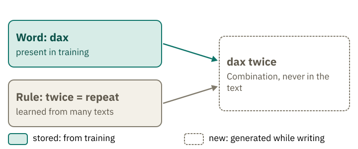
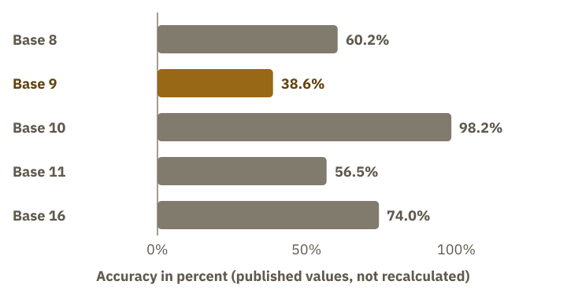

<!-- Generated from src/content/bausteine/en/why-prediction-is-more-than-parroting.mdx by scripts/export-lessons.mjs -- do not edit by hand. -->

# Why prediction is more than parroting

> Reading copy for GitHub. The full version with interactive demos, animations and recall moments is on the website: **[Why prediction is more than parroting](https://ki-einfach-verstehen.de/en/lessons/why-prediction-is-more-than-parroting/)**
>
> Licence: [CC BY 4.0](https://creativecommons.org/licenses/by/4.0/deed.en) · Credit it as: KI einfach verstehen, “Why prediction is more than parroting”, CC BY 4.0, https://ki-einfach-verstehen.de/en/lessons/why-prediction-is-more-than-parroting/

How a model that only predicts the next token can write an email that never existed before: why good prediction requires rules rather than copies, where verbatim memorization still happens and where new tasks fail.

## A sentence that never existed

In the lesson [Text Becomes Many Practice Problems](./text-becomes-many-practice-problems.md) you saw how text turns into practice problems: the model guesses the next [token](https://ki-einfach-verstehen.de/en/glossary/token/), and after each correction the weights are adjusted.

Ask a model for an email to your landlord about a dripping tap, written in the style of an epic poem. A made-up example, but a typical one. The email comes back finished, with a greeting, a poetic meter and an ending that states the problem factually. This exact wording appears nowhere, and it did not exist before.

Where does the model get the sentence from? For a sentence that has never existed, there is nothing to look up. This is how it arises: the request goes into the model as input. With its fixed weights, the model computes a [score](https://ki-einfach-verstehen.de/en/glossary/score/) for every possible next token, meaning a number that shows how well that token fits. It picks one token, appends it to the input and starts again. It repeats this until the email is finished.

Whether anything in the model resembles a human feel for language remains an open question. In people, that feeling involves intention, experience and meaning. This lesson does not settle the comparison; it only shows that producing a new sentence does not require a stored copy.

Think of a native speaker’s feel for language. As she speaks, she forms a sentence she has never heard before. She knows the words and rules, and what a correct sentence sounds like. She does not have the finished sentence ready in her head; she builds it word by word. There was no need to have heard every sentence beforehand. Knowing words and rules lets her form many sentences that have never existed before. In the model, this knowledge corresponds to the stored weights. The finished sentence is the output, produced only as the model writes.

*A native speaker formulates a sentence she has never heard in this form. She knows the words and the rules, not the sentence.*

If the model does not look the sentence up, it has to arise from what was learned. How much text fits into what was learned at all? If little fits, mostly the pattern remains; often repeated passages can, however, also stick word for word. This can be calculated. The words and rules were there before, the sentence was not. That is exactly what separates composing from copying. In everyday use, the text you ask for is almost always new, even when the topic has long been familiar. New does not mean correct, though. The model chooses word by word according to probability, and that says nothing about whether a fact is true. That is why it is worth checking facts yourself in every answer.

## The training data are much larger than the weights

The training data of the Qwen3 model family comprise roughly 36 trillion tokens. The technical report gives this quantity for the whole family. The tokens are the text the models learned from. The smallest model has 0.6 billion learned numbers, called [weights](https://ki-einfach-verstehen.de/en/glossary/parameters/) and kept in a file.

A [token](https://ki-einfach-verstehen.de/en/glossary/token/) is a piece of text, usually a part of a word or a whole word. A byte is the smallest unit computers store text in. Qwen3 builds its tokens from bytes, and every token that contains text is at least one byte long. So a minimum can be calculated without knowing the average bytes per token.

Each weight number is stored in the BF16 format, two bytes per number. The published file of the smallest model holds about 750 million such numbers, more than its 0.6 billion learned numbers. The source does not say why.

Two bytes times 750 million give about 1.5 gigabytes, since a billion bytes is a gigabyte.

The 36 trillion text tokens are each at least one byte, so together at least 36 trillion bytes.

One trillion bytes is a thousand gigabytes, so that is at least 36,000 gigabytes.

Divided by the 1.5 gigabytes of the smallest model's file, that is at least roughly 24,000 times as much. For larger models in the family, with more weights, the ratio is smaller. The report does not say how much distinct text the training data contain.

> **Interactive demo:** [try it on the website](https://ki-einfach-verstehen.de/en/lessons/why-prediction-is-more-than-parroting/)

The model usually does not store a copy of the text in its weights. A lossless copy keeps every sentence and returns it exactly. The model is no such copy; it stores weights, which it uses to calculate how text continues. Verbatim reproduction still happens, as the next section shows.

Where does the minimum of 36,000 gigabytes come from?

Computers store text as bytes. A byte has 256 possible values. Byte-level means that the tokenizer starts with exactly these 256 base values. This way any text can be represented without unknown characters. Byte-pair encoding then merges frequent sequences into new entries in the vocabulary, for example a whole word.

A common word is one single token, but it covers several letters and therefore several bytes. A token usually contains more than one byte. How many depends on the language and the vocabulary and is not measured here. Each text token is made up of at least one byte. For the calculation the minimum is enough: even then the text is many times larger than the weights.

## Verbatim copies still happen

The calculation describes the normal case. It does not rule out verbatim copies, and they do happen.

Carlini and others recovered texts from GPT-2 XL, an older language model, that matched passages in its training data word for word. They had the model generate about 600,000 texts, selected 1,800 candidates from them and checked them against the training data: 604 were verbatim copies. The 604 relate only to this selection, not to all texts generated.

Why? When a passage occurs often in training, for example a text copied many times on the web, it sticks more strongly. Lee and others removed duplicates from the training texts and then compared the models. Afterwards they reproduced memorized passages about ten times less often. Before, more than 1 percent of the tokens the model wrote without a prompt were copied verbatim from the training data; after deduplication it was 0.1 percent.

More new text helps against memorization, as the lesson [Batch, Epoch, Step and Token Budget](./batch-epoch-step-token-budget.md) shows. Many copies of the same passage, by contrast, act like repeated passes through the same texts (epochs). That is an analogy, not a measurement. Removing duplicates works against memorization.

McCoy and others examined language models more closely. They occasionally reproduced passages of more than 1,000 words from the training data. This is a sample, and it shows that memorizing large chunks of text is possible, but not the rule.

## New sentence structures from known words

If the model does more than copy, how can you tell whether its sentences are new? McCoy and others checked more than whether the exact sentences appeared in the training data. They also examined sentence structure: the order of nouns, verbs and other word types, and how main and subordinate clauses branch and fit together. Here, structure means the arrangement of words and sentence parts, not their meaning.

With four tested language models, between just under two thirds and just over three quarters of the sentences produced had a structure that no training sentence had. For human texts, the share was similarly high. So the structure of a sentence is often new, and this holds for models and for human texts alike.

The study also found a difference in short word sequences: the models produced fewer new combinations than humans did. Compared with each model, the human text had about one and a half to three times as many new word pairs (bigrams). For all models, most sequences were new only once they reached five words or more. The study examined models from 2021; it does not tell you exactly how today’s large models perform.

From the scores, [softmax](https://ki-einfach-verstehen.de/en/glossary/softmax/) makes probabilities. The model picks one of the likely tokens and appends it. The model mainly draws on patterns that recur across sentences. But it can also store word sequences verbatim if they appear often, as described in the section on verbatim copies. A made-up German example: the model has learned from many texts that after a comma a subordinate clause often follows, whose verb often stands at the end. When it writes a sentence with a comma, it applies this rule, even to words that never appeared in this combination. In German: "Ich kam zu spät, obwohl ich früh losging." (I was late, although I left early.) This sentence would be new, but the rule behind it would not.

Chance plays a role because the model does not always take the most probable token. Chance, however, only chooses among the suitable pieces; it does not invent rules. Many answers in a chat come about this way.

## New from the known

People do this every day: anyone who has seen the made-up verb "dax" in several sentences and already knows the rule "twice" understands "dax twice": the verb is carried out twice. The example comes from the introduction of Lake and Baroni (2018), who describe this ability as systematicity: recombining known parts.

*Known parts, newly combined: the word is present in training together with other words, the rule has been learned many times. The combination is produced while writing.*

The combination succeeds when the model has seen the verb with other words and learned the rule. Lake and Baroni used an artificial command language. The tasks were split at random into training and test data. Every word appeared in training in many contexts, and the best network answered 99.8 percent of the tasks correctly. In another test, the verb appeared in training only on its own, never combined with other words. The best network in that experiment answered 1.2 percent of the tasks correctly.

This warning comes from a study of simpler networks, not a test of today’s models. When you use a chat model, the question is whether it can draw on what it knows to produce something new, such as a poem about a topic no poem has covered before. This experiment does not measure how well today’s chat models handle such requests.

## Examples in the prompt

You give a model in the [prompt](https://ki-einfach-verstehen.de/en/glossary/prompt/) three examples of a made-up word rule and ask it for one more word. Often it works. Has the model learned in the process?

The paper on GPT-3 (Brown and others, 2020) tested this. The model performed the tasks without changes to its weights, so it was not retrained specifically for them. It received the tasks and examples only as input text. This is called [in-context learning](https://ki-einfach-verstehen.de/en/glossary/in-context-learning/): the model follows patterns shown in the examples you give it. Nothing is learned permanently in this process; the weights stay the same.

*Three example sheets lie before the task. The desk, that is the model with its fixed weights, stays the same.*

Remember the mixing desk from the lesson about models? The faders, that is, the weights, are fixed, and the displays show the intermediate values anew for every text. A prompt with examples belongs to the input. It changes the displays, not the weights. As in the lesson on input and output, the whole conversation goes in as input. The examples act through their content: what they say determines the pattern the model takes over. So whoever works with examples should choose them the way the task is meant.

The measurement shows that the answer changes with the examples, while the weights stay unchanged with this method. Whether this also holds for today's post-trained models, this measurement does not show. It comes from GPT-3 and from a limited number of tasks.

Many believe the model learns permanently from the conversation. The method does not change the weights; the examples only act within this input. What a chat service additionally stores is a different question and is not part of the model's rules.

## When the task is slightly different

What happens when a task that the model can already do is changed only slightly?

Wu and others gave GPT-4 two-digit additions in different number systems. The procedure is the same in every base; only the digits change. In base 9 there are the digits 0 to 8. The tasks were posed with a step-by-step answer (chain-of-thought) and without examples. How strongly accuracy depends on the base is shown in the chart below.

> **Interactive demo:** [try it on the website](https://ki-einfach-verstehen.de/en/lessons/why-prediction-is-more-than-parroting/)

*Published values: accuracy of addition in five number systems, GPT-4 with a step-by-step answer. Base 9 falls clearly behind.*

The values come from a single model in a 2023 test and do not show that AI cannot do arithmetic.

Wu and others classify bases 8 and 16 as common, and 9 and 11 as rare. They suspect overfitting: the model may have adapted too closely to common patterns in its training data. This is the authors’ interpretation, not an established result. The rule is the same in all bases, and whether training patterns explain the difference remains an open question.

This finding also has a limit: it comes from a single test. It shows that a model can succeed at a task in one form and fail when the form changes. Even if it calculates correctly in the usual number system, it may struggle with a rare one. The test does not show how widely this finding applies.

## Judging is prediction too

A model can assess answers as well as give them, for example when you compare two drafts. Zheng and others examined how well a strong model performs as a judge. You can picture a judge reading case files and reaching a verdict. The comparison has its limits: a human judge knows the rules, while a model produces its verdict as it would any other text.

The verdict can be read as the continuation of a text that would contain such a verdict. That is an interpretation, not a measured finding. What was measured is this: GPT-4 agreed with human judgments roughly as often as humans agreed with each other: 85 against 81 percent, when one of the two answers counts as better. "Tie" means that both answers are equally good. If you count this tie as a separate result, GPT-4's agreement with humans drops to 66 percent.

The verdicts can also depend on how answers are presented. The effect was clearer when the models were similarly strong; with very different performance it could almost disappear. If you swap the order of the two answers, GPT-4's verdict mostly stays the same. With another model this was less often the case, and it often preferred the first answer (standard prompt, models from 2023).

Length can also play a role in a small test with padded lists: two older models chose the padded answer clearly more often than GPT-4. The sample is small.

When you use a model to assess two drafts, ask it again with the drafts in the opposite order. If its verdict changes, the assessment is uncertain: the order helped determine the result. This check does not tell you whether length also influenced the verdict. For texts that really matter, you still need a human review.

**Exercise: New combination or truly foreign?**

Sort the four tasks before you open the solution. All cases are made up. Is the model more likely to succeed because it recombines what is known, or less likely because the task is foreign?

a) A poem in the form of a cooking recipe about the weather on the North Sea.
b) A calculation like 47 + 38, but in a rare number base.
c) A made-up word rule that you explain in the prompt, with three examples.
d) A question about an event that happened after training, with no source in the prompt.

**Solution:**

a) Probably yes. Form (recipe) and topic (weather) are each familiar to the model. The combination is new.

b) Probably no. The rule is the same, but the form is rare. Wu and others show that accuracy can drop clearly in another base.

c) Probably yes. The rule is in the prompt, and the model uses it without any change to the weights (section Examples in the prompt).

d) Probably no, for a different reason. The event lies after training, so the model has not learned it. Without a source in the prompt the basis is missing. Here knowledge is missing, not the combination.

Combining what the model already knows in new ways is different from asking it for knowledge it does not have.

## The sentence is new, the rule comes from the text

Return to the email to your landlord. The sentence is new, yet it arises from patterns: the model predicts it token by token. It did not store the sentence itself. It stores weights adjusted during training to capture those patterns. Verbatim copies happen as an exception.

Whether the patterns suffice depends on the task. Recombining what is known often works once its parts and rules are learned. Foreign tasks and rare forms fail more often. And judging is also a prediction, with all the distortions that come with it.

The model has learned to continue text, and in a conversation it still seems like someone answering. How a continuation becomes an answer is the subject of the next lesson.

---

Source: https://ki-einfach-verstehen.de/en/lessons/why-prediction-is-more-than-parroting/

← Previous: [Batch, Epoch, Step, Token Budget: How Training Progress Is Measured](./batch-epoch-step-token-budget.md) · [All lessons](../../README.md#contents) · Next: [From Text Predictor to Assistant: What Post-Training Makes of a Model](./from-text-predictor-to-assistant.md) →
